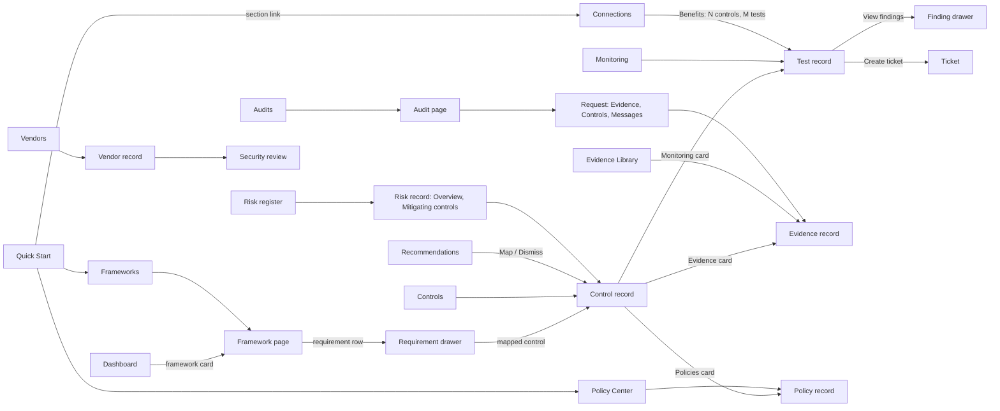

# Drata: pages and flow, read for Program Assurance

This was researched on 2026-11-22 from Drata's public help center (https://help.drata.com/en/), which was crawled whole: every collection, every article and every image. It is the counterpart of `../vanta/`, and is laid out the same way so the two can be read side by side.

**What's in this folder:**
- **`help-center/`**: the whole help center as it stood on 2026-11-22.
  - `index.md`: 896 articles in 87 collections, grouped as Drata groups them. One article, the Webflow guide, is listed but unpublished.
  - `articles/`: each article's text (814k words), with its images inline where they appear.
  - `crawl.json`: the collection tree and each article's title, description, update date, collections, image count and word count.
  - `notes/`: every article in a line, and each product surface in depth, in five notes. Each note covers its share's data model and ends with what it means for Program Assurance.
    - `platform-grc-core.md`: Quick Start, Dashboard, Recommendations, Connections, Controls, Monitoring, Evidence, Events, Policies. 110 articles, 27 surfaces.
    - `platform-risk-vendors-people.md`: Risk, Vendors (TPRM), Personnel, devices, Assets, Vulnerabilities, Access reviews. 146 articles, 29 surfaces.
    - `getting-started-settings-workflow-audit.md`: onboarding, the Rollout Toolkit, workspaces, settings and roles, tasks, tickets, custom workflows, Audit Hub and the auditor's portal. 122 articles, 30 surfaces.
    - `integrations-and-tests.md`: every connection guide and every monitoring test, the tests in 13 groups. 393 articles, 14 surfaces.
    - `frameworks-and-policies.md`: every framework, closely on FedRAMP, NIST SP 800-53, NIST SP 800-171 and CMMC, plus the 41 policy templates. 125 articles, 13 surfaces.
- **`images/`**: every help-center image, 978 unique (248 MB), each looked at and sorted. They fall into four groups (see `images/README.md`, with `index.json` giving each image's screen line and patterns):
  - Drata's product screens by area: `ux/<area>/`, 23 areas;
  - integration setup by integration: `integrations/<integration>/`, 68 folders;
  - `documentation/`;
  - `not-product/`.
- **`journey.md`**: the end-to-end path from sign-up to a completed audit.
- **`style.md`**: Drata's visual language, set beside Vanta's, and what it adds for Ledger.

The `images/` folder is gitignored, because the repository is public: Drata's screenshots stay on this machine and are never committed. The notes are in our own words, quoting only on-screen labels. To look at a screenshot, open the note or article that names it.

## What defines Drata's product

1. **Readiness is computed and explained.** A control is Ready when everything that counts is ready:
   - its evidence is current;
   - its mapped tests pass;
   - its mapped policies are published;
   - its approval is given, where one is required.

   The control record shows this as a bar ("6 of 11") over four cards: Evidence, Monitoring, Policies and Approvals. A **Not factored** bucket counts what is left out: disabled or erroring tests, and out-of-scope items. A framework rolls up as "ready controls %" or "requirements ready n/m", and each user picks which of the two to count. The weakness is that readiness is binary at every level: Ready or Not ready, never why.
2. **One catalog under every framework.** The Drata Control Framework (DCF) is Drata's own control set, and every framework's requirements map onto it: one control serves many frameworks, and one requirement takes several controls. Drata ships default mappings and default control text. A customer can diverge from either and compare back ("Compare to defaults", "Compare with Drata's template"). When a framework becomes "pre-mapped", new controls and policies land overnight and readiness drops.
3. **Automation is the spine.** The chain runs: connection → synced records (people, accounts, devices, resources) → test (one instance of a Test Library template, 1,227 of them) → findings and exclusions → control → requirement → framework.
   - Before connecting, a connection shows what it will feed: "AWS: 4 impact areas, 46 controls, 83 tests".
   - Matching tables name the test that will fail: "19 devices not linked", Test 64.
4. **Next steps as numbers.** The test record opens on three numbers: Track ("Days failed 52"), Fix ("Failing resources 250 → View findings") and Manage ("Tickets in progress 0 → Create ticket"). Each opens the place where the work happens.
5. **Exceptions are records.** An exception carries who made it, when and why, and is listed on a tab of its own. That covers:
   - excluding a finding, an account or a person's check;
   - scoping out a control or a requirement;
   - disabling a test.

   One gap: a monitoring finding can be excluded with no reason, and the test then passes.
6. **Approval and versions on the governing records.**
   - Controls and policies carry required approvals, staged Prepare for approvers → Needs approval → Changes requested → Approved. An approved control slips back 14 days before its deadline.
   - A policy draft is finalized as a material change (re-approval and re-acknowledgement) or a non-material one (it publishes now), with an explanation kept in its version history.
7. **The audit is a handshake.** In Audit Hub the team moves a request New → Prepared, which releases its evidence to the auditor. Only the auditor moves it to Completed or Changes Requested. Each request has its own message thread. Evidence is cut to the audit period and frozen when samples are set, and the evidence package carries a manifest.
8. **AI proposes; a person decides.** Every AI suggestion carries a confidence and a rationale with Map / Dismiss. That covers Recommendations (mappings for a custom control), the Framework Mapping Agent, and request-to-control mapping. The TPRM Agent ends every proposed change in an approval card, and the autonomy settings say, step by step, what it may record on its own.
9. **Setup is a checklist that only points.** Quick Start's sections ("N of M completed", one %) each link to the page that does the work, and do nothing themselves. My Drata does the same for employees.

## Navigation and shell (from the screenshots)

- **Left nav.** A "Workspace" group holds Quick Start, Dashboard, Recommendations and Tasks. Then come:
  - Compliance, which expands to Controls, Frameworks, Monitoring, Evidence and Audits;
  - Risk, Vendors, Governance (Personnel) and Events.

  A foot group (Connections, Library, Settings) is pinned to the bottom. Settings and Connections open a second column of their own pages. Collapsed, the nav becomes an icon rail.
- **Top bar:** the wordmark, collapse and expand, a bordered workspace switcher, search, and the user avatar.
- **Page:** white chrome around an inset grey well.
  - The header shares the well's grey. It holds the trail, the title row (an identifier chip before the name; ⋯, a secondary and the primary at the right), a facts strip of label-over-value pairs, and line tabs.
  - A register's body is a filter panel card (about 300px, "Clear all filters") beside a table card, under a row of stat tiles. A floating selection bar appears while rows are ticked.
  - A record's body is a grid of white cards.
  - Smaller things (a finding, a requirement, an evidence item) open in a wide drawer from the right. Notes, tickets and tasks dock as panes from a thin rail at the record's right edge.
- **Two generations in the help center.** The older one has a navy nav, navy stat cards, a top-bar breadcrumb and chips on every row. The newer one ("New Experience") has a white nav, small ring facts and count columns. Many articles show both.

## The look (from `style.md`)

- **Colour:** one blue, drifting toward indigo, carries every primary, outlined secondary, link, chip and selected row. AI gets its own cyan-to-violet gradient.
- **Control codes:** set in monospace inside pills tinted by readiness, so the code is also the status.
- **For Ledger, what Vanta's study did not already give:**
  - an identifier that carries its status;
  - inline parameter chips in control text;
  - four readiness-by-stage cards on a control's Overview;
  - a facet panel beside long registers;
  - a sunken body with raised cards on Record and Overview pages only;
  - docked panes from a right-edge rail;
  - a vertical stepper for long flows;
  - an agent's proposal shown as a Sign.

  Leave behind: blue-outlined secondaries, the seven-tint pill set, gradients, and illustrated empty states.

## The journey (from `journey.md`)

The phases are: align (weeks 0–1), kick off (1–2), connect and assign (3–8), enable employees (9–12), then tune (13 onwards). The audit follows the pre-audit check.

| # | Stage | Where | Done when |
|---|---|---|---|
| 1 | Sign in | auth.drata.com, SSO | The admin is in |
| 2 | Basic info | Quick Start → Organization details | "1 of 1" |
| 3 | Connect | Quick Start → Connections (IdP, cloud, VCS, ticketing) | "4 of 4"; people synced; tests run nightly |
| 4 | Roles and workspaces | Settings › Role administration, Workspaces | Owners hold roles |
| 5 | Scope | Frameworks, Controls | Requirements scoped; out of scope justified; owners named |
| 6 | Personnel | HRIS, Personnel, Personnel compliance | "5 of 5"; employees invited to My Drata |
| 7 | Policies | Policy Center | Approved, published, acknowledged |
| 8 | Readiness | Monitoring, Controls, Evidence, Tasks | Tests near 100%; every control Ready |
| 9 | Pre-audit check | Monitoring, Personnel, Vendors | Failures fixed; period agreed |
| 10 | Create the audit | Audits › Create Audit (full-page wizard) | An Active audit card; auditors invited |
| 11 | Fieldwork | The audit page, its requests, packages | Every request Prepared, then Completed |
| 12 | Close and repeat | Complete audit; Annual Compliance Review | The yearly cycle starts |

## The page map

## Drata beside Vanta

| | Drata | Vanta |
|---|---|---|
| Completion | Readiness: Ready / Not ready, with the four-card breakdown and Not factored | "OK n of N" and a % first, then Needs attention by when |
| Control catalog | DCF under every framework, with defaults you can compare back to | Vanta's common controls; frameworks map to them |
| Automated checks | Monitoring: a Test Library of 1,227 templates; a test record opening on Track / Fix / Manage | Tests: a register with SLAs (Overdue, Due soon, No SLA) |
| Evidence | Evidence Library: Needs artifact / Needs renewal / Upcoming renewal / Ready | Documents: what is owed, with Renew by |
| Work | Tasks with "65 open including 8 past due"; an automated task for every control (noisy) | My work by urgency, as sentence rows |
| Audit | Audit Hub: requests released by status, a thread per request, a separate auditor portal | An audit band that turns the app into an audit mode |
| Filters | A left side panel beside the table | A filter row above the table |
| Records | Pages with tabs; smaller things in a wide right drawer | A side panel over the register first; pages only for records with their own work |
| AI | Visible everywhere, always with confidence and rationale; the TPRM Agent with approval cards | Vanta AI suggestions in panels |
| Federal | FedRAMP readiness (baselines, inline parameters); 800-53, 800-171 and CMMC pre-mapped; no SSP, POA&M or authorization | Similar framework coverage |

## Mapped to Program Assurance

| Drata | Program Assurance today | What would change |
|---|---|---|
| Control readiness cards with Not factored | The control's status ladder, from no requirement to determination | Keep the ladder, which says why. Borrow the four-card breakdown (requirements, evidence, assessment, inheritance) and a visible "not counted" bucket: erroring sources, objectives judged by inheritance |
| Test record: Track / Fix / Manage | Finding and operational issue records | Open findings on three numbers: days open, affected items, POA&M milestones in progress. Each opens where the work is |
| Exclusions with reason and date, on their own tab | Tailoring rationale, risk acceptance | Tailored-out controls stay visible with their rationale. Accepted findings get a tab, not a filter, with an end date. Never an exclusion without a reason or a signature |
| Material vs non-material policy change | SSP revisions, overlay versions | Ask at finalize, in RMF's words: significant change |
| FedRAMP drawer: inline parameter fields, upstream values underlined, Complete / Incomplete filter | `program_control_parameters` prints values in the control text | Take the in-place fields, the underline for a value set upstream, and the open-parameter filter. Count an open parameter as a gap, and keep values when the baseline changes (Drata erases them) |
| Audit Hub: New → Prepared → Completed, a thread per request, frozen samples, a manifest | Assessment campaigns, the Review queue, published results | The same handshake for assessment objectives, with the assessor's verbs held to the assessor. The authorization package export carries a manifest with absent evidence as a loud row |
| Connection "Benefits: N controls, M tests" | Ingestion, shared components (Where used) | Each evidence source and component says what it supports, counted in objectives |
| AI suggestions with confidence and rationale; the agent's approval card | Map a requirement, the customer requirements import | Review is the default. Nothing applies silently, and the author is the person who approved |
| Guided importer (map fields, Valid / Invalid counts, a confirm dialog counting creates and updates) | No importer screens yet | For an SCTM, a POA&M spreadsheet, or a requirements document |
| Change email domain wizard (counts first, Moving 147 / Not moving 12, all or nothing) | Take version, Edit overlays, publishing results | Show what moves before any command over many records |
| Quick Start checklist | Program setup, the program Overview | A first-month list on the program's Overview that only points: categorize, baseline, allocate, assign roles, first evidence, plan the assessment |
| Three risk vocabularies across modules | One RMF ladder | Keep one ladder. Drata shows why: one screenshot labels a 9 "Critical" against its own table |

## Where Program Assurance can lead

For federal work, Drata stops at readiness:
- FedRAMP has no SSP or POA&M templates and no external audits;
- the 800-171 guide sends the reader to score SPRS by hand and to upload the SSP and POA&M as files;
- 800-53A assessment objectives are a text column, not something counted.

Program Assurance's chain goes past this point, through objectives counted per control, determinations, findings, POA&M and risk, to the SSP assembled from the record. That is the ground to hold. Do not flatten 800-53 into a vendor control set the way the DCF does.

## Not to copy

- Drata's name, logo, colours, illustrations, the "Dratanaut" support persona, the agents' names, or any copy text word for word.
- **Binary readiness.** RMF needs the derived ladder.
- **Inline edit selects in register rows** (treatment, impact, likelihood). An RMF record needs an author and a revision.
- **An automated task per control** (3,308 in one month): noise, not a worklist.
- **Rescoping in silence.** Drata changes a baseline or a level after one paragraph of warning, with no list of what moves.
- **Zero tiles and donut walls** on the insight pages.
- **Two visual generations at once.**
