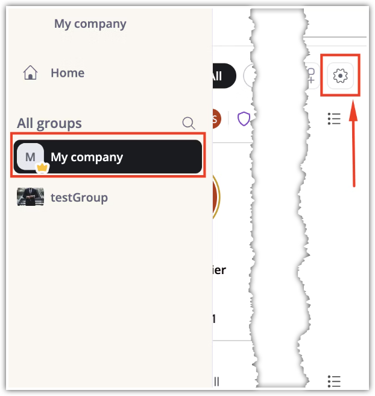

# 360Learning Integration Guide

Source: https://help.drata.com/en/articles/12591181-360learning-integration-guide
Collection: Connection Support › Other Guidance
Updated: 2025-10-29
Fetched: 2026-11-22

## Article text

### Prerequisites & Data Access

- **Account / Role Needed**: Admin privileges for your 360 Learning account.
- Company ID and API Key
- Group ID for target learning group
- User ID used for authentication

## Step-by-Step Setup

### Step 1: Create Integrations App

1. Log in to your **360Learning Admin** account.
2. Select the top level parent Group under **`All Groups`**.
3. Click on **`Settings`** in the top right corner.
   
4. From the left settings menu, select **`API`**.
5. The **`Company ID`** is also displayed under the Authentication section. Copy the Company ID.
6. Click **`Add API Key`** to create a new API key.
7. Save your API Key.

### Step 2: Find Group ID

1. Select the desired group to find the **`Group Id`** in the address bar.
2. If your url is **`https://app.360learning.com/group/67c948a88723b46e710295bd/content/all`**, the Group Id is **`67c948a88723b46e710295bd`**.

### Step 3: Find User ID

1. Open the User Profile to find the **`User Id`** in the address bar.
2. If your url is **`https://app.360learning.com/group/10295bd/stats/users/current/users/67d`**, the User Id is **`67d`**.

### Step 4: Link Your 360Learning Account to Drata

In Drata:

1. Go to **Connections**
2. Select **360Learning**
3. Enter:
   - Company ID
   - API Key
   - Group ID
   - User ID
   - External Platform: `360learning`
4. Click **Connect**

## Images

- [image 01] ../../images/integrations/360learning/360learning-integration-guide--01.png

## Related articles

- [Teamtailor Integration Guide](teamtailor-integration-guide.md)
- [Rapid7 InsightVM Integration Guide](rapid7-insightvm-integration-guide.md)
- [Gong Integration Guide](gong-integration-guide.md)
- [EasyLlama Integration Guide](easyllama-integration-guide.md)
- [SAP SuccessFactors Integration Guide](sap-successfactors-integration-guide.md)
