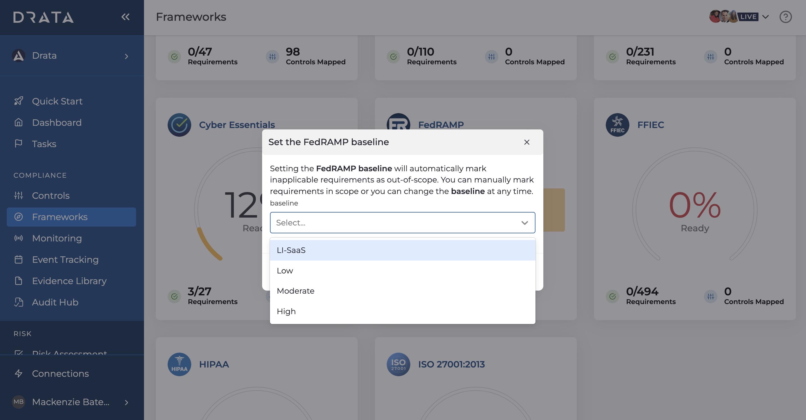
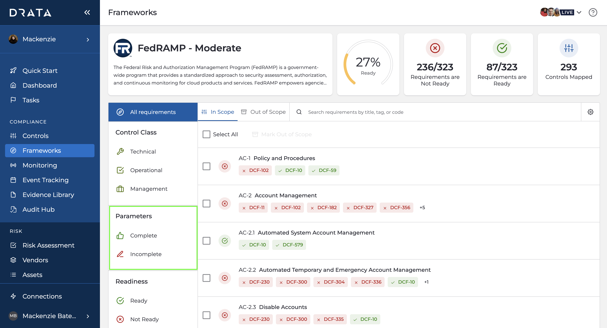
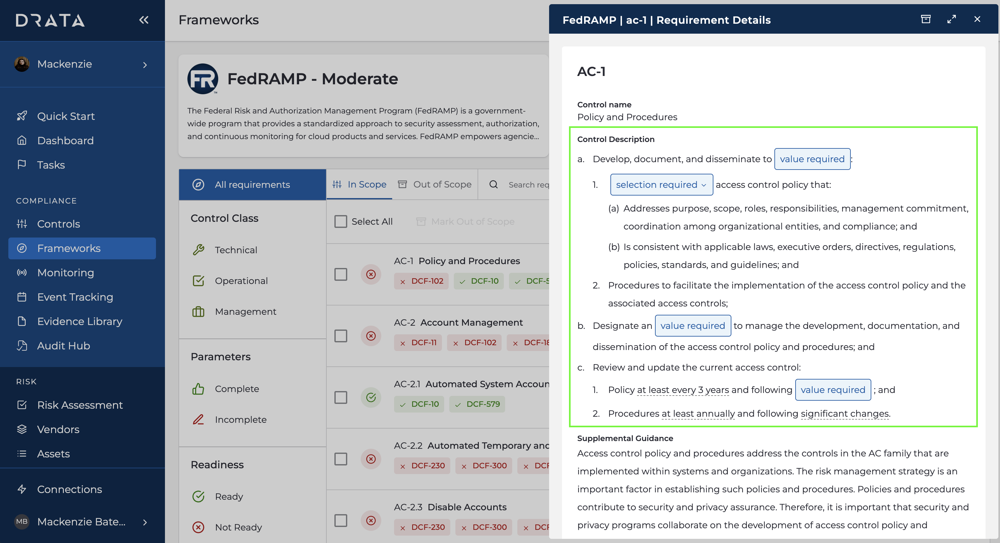
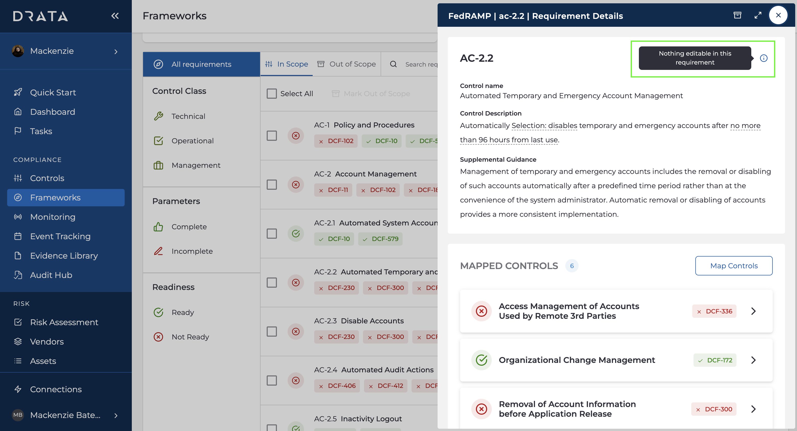
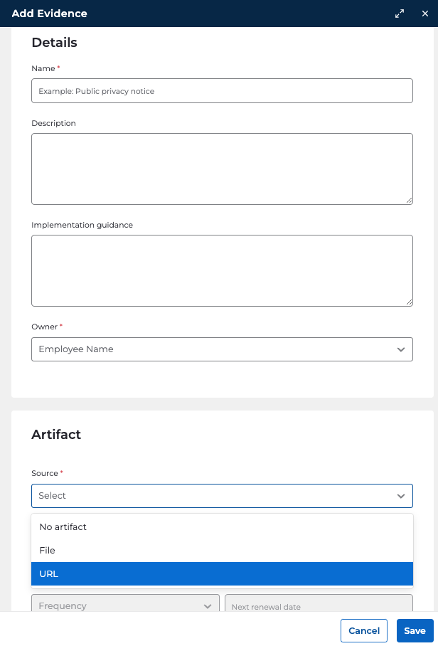

# A guide to Drata's FedRAMP Readiness Framework

Source: https://help.drata.com/en/articles/9095570-a-guide-to-drata-s-fedramp-readiness-framework
Collection: Framework Information › FedRAMP
Updated: 2026-08-05
Fetched: 2026-11-22

## Article text

## Should my company pursue FedRAMP?

If you’re asking this question, it’s likely you’ve stumbled onto this support article to check out what Drata has to offer with regards to FedRAMP.

Deciding whether to pursue FedRAMP is far more nuanced than deciding to get a SOC 2 attestation or to be GDPR-compliant. Achieving FedRAMP compliance and authorization to operate (ATO) requires a significant amount of time; typically 1-3 years from starting the process to obtaining an ATO. It also has a high cost, often a million dollars or more. A strong indication that the FedRAMP path may be right for your organization is if one of your current customers or prospects is a federal government agency, and mandates a FedRAMP ATO; even better if they are willing to officially sponsor your company through the FedRAMP authorization process.

If you’d like to learn more about the process of achieving FedRAMP compliance, check out our blog post that gives [a comprehensive guide to FedRAMP](https://learn.drata.com/hubfs/Downloadables/Drata_The%20Cloud%20Service%20Provider%E2%80%99s%20Guide%20to%20FedRAMP.pdf).

## Getting Started

If you’ve already started to pursue FedRAMP and are using Drata to help manage your efforts, the rest of this article is for you!

If you need to get familiar with frameworks in general, [this article](https://help.drata.com/en/articles/6188149-framework-readiness) is a great place to start.

We also have a [frameworks section of our help center](https://help.drata.com/en/collections/2997147-frameworks) for you to get context on all things related to managing your frameworks.

> 💡One thing that we want to be explicitly clear about as you use Drata to manage FedRAMP is that ***Drata does not have a FedRAMP ATO***. This means that you will likely need to use Drata outside of your FedRAMP boundary, and therefore cannot store any finalized products or reports, such as your SSP or POAM, in Drata. It also means that you must store any evidence that contains direct impact data outside of Drata. You can still track that evidence in Drata’s Evidence Library by providing a URL to where the evidence is stored externally. We go into more detail about managing evidence below.

## What is included in the FedRAMP Readiness Framework?

### Included features

- FedRAMP requirements with dynamic control mapping per baseline
- Editable parameters within each requirement
- New filter on the requirements list for complete/incomplete filters
- FedRAMP reports in Trust Center
- Support for FedRAMP using the Download-Only feature in Audit Hub

### Features not included

- Support for external audits via Audit Hub
- SSP and POAM report template support

## Managing the FedRAMP Baseline & Control Mapping

As part of our FedRAMP framework, we allow you to change between the LI-SaaS, Low, Moderate, and High baselines. One unique way that FedRAMP approaches the requirements included in their framework is that the very nature of the requirement may change as the baseline changes, through set parameters and additional requirements which modify the original NIST 800-53r5 controls. When using Drata, this means that the requirement may also have different controls mapped to it at different baseline settings. This is why we provide the control mappings only after the baseline is selected. If you were to change baselines at any point, the controls mapped to those requirements would change as well.

> 💡You should be aware that changing the baseline **will remove any of the data you have entered into the parameters within the requirements.**

## Managing your requirement parameters

#### What are parameters?

Parameters are pre-defined values set by FedRAMP to modify NIST 800-53r5 controls, on which FedRAMP is based, to make the requirements more strict. Through the use of OSCAL, which Drata’s framework is built on, these set values are dynamically selected according to your selected baseline. Additionally, parameters that have not been explicitly set by FedRAMP, allow you to select or write in the specific aspects that are true for your FedRAMP compliance program. Typically, these parameters are more strict the higher the baseline. In essence, defining your parameters helps to define the details of your FedRAMP compliance program.

#### Parameters filter

The FedRAMP framework page includes a Parameters filter to easily see which requirements have and have not been completed. NOTE: Requirement readiness is *not* impacted by parameter completeness, therefore a requirement with incomplete parameters might still be “ready”.

#### Completing parameters

When you’re getting started with the FedRAMP framework, one of the first things you’ll do is complete the parameters that have not been set automatically, for each of the requirements in your chosen baseline. We like to refer to this process as compliance “Mad Libs” because completing these is much like the nostalgic word game.

There will be an edit button on any requirement that has parameters that need to be completed.

Sometimes, there are no parameters on a specific requirement. Other times, there is nothing to edit because the requirement is at a baseline where the parameters are selected on your behalf because of what FedRAMP stipulates. In this case, you’ll see an indication that there is nothing to edit on that requirement.

## How to manage evidence containing direct impact data

#### Drata’s compliance plans

Drata does not currently have a FedRAMP ATO, nor are we planning to pursue a FedRAMP ATO in the foreseeable future. However, we are officially NIST 800-171 compliant.

Why is this important?

Our compliance with NIST 800-171 enables you to use Drata to store evidence that contains *indirect impact data and metadata* related to the federal government or government agencies. However, since we do not have a FedRAMP ATO, it means that **direct impact data or metadata related to the federal government or government agencies cannot be stored in Drata**; this type of evidence must be stored in FedRAMP-authorized systems. That said, evidence that contains direct impact data can be maintained alongside all other evidence in Drata’s evidence library by providing the URL to where the evidence resides externally.

#### Using Evidence Library to track evidence containing direct impact data

Drata’s Evidence library has two options; you can either upload a file, or provide a link to a URL to where evidence is externally stored. Use the URL option to track evidence containing direct impact data in Drata.

## Monitoring tests requiring evaluation

Drata automatically maps monitoring tests to DCF controls, however, some of these tests could inadvertently bring in direct impact data into Drata, depending on the connections you have enabled. We recommend reviewing the following monitoring tests to evaluate if any of them could bring in direct impact data. If you find that any of these tests bring in direct impact data, we strongly urge you to disable those tests.

|  | ID | Test Name | DCF Mapping |
|---|---|---|---|
| 1 | 4 | SSL/TLS on Admin Page of Infrastructure Console | DCF-3 |
| 2 | 8 | Formal Code Review Process | DCF-5 |
| 3 | 9 | Production Code Changes Restricted | DCF-6 |
| 4 | 21 | Records of Vulnerability Scans | DCF-18 |
| 5 | 26 | Security Issues are Prioritized | DCF-23 |
| 6 | 30 | Availability Zones Used | DCF-27 |
| 7 | 64 | Malware Detection Software Installed on Employee Computers | DCF-50 |
| 8 | 65 | Security Patches Auto-Applied on Employee Computers | DCF-51 |
| 9 | 66 | Hard-Disk Encryption Enabled on Employee Computers | DCF-52 |
| 10 | 68 | Customer Data is Encrypted at Rest | DCF-54 |
| 11 | 69 | Customer Data in Cloud Storage is Encrypted at Rest | DCF-54 |
| 12 | 70 | SSL/TLS Enforced on Company Website | DCF-55 |
| 13 | 71 | SSL/TLS Configuration has No Known Issues | DCF-55 |
| 14 | 72 | SSL/TLS Certificate has Not Expired | DCF-55 |
| 16 | 86 | MFA on Identity Provider | DCF-67 |
| 17 | 87 | MFA on Version Control System | DCF-67 |
| 18 | 88 | MFA on Infrastructure Console | DCF-67 |
| 19 | 105 | Threat Detection in Place | DCF-87 |
| 20 | 107 | Daily Database Backups | DCF-77 |
| 21 | 119 | Firewall Default Disallows Traffic | DCF-85 |
| 22 | 121 | Logging/Monitoring | DCF-87 |
| 23 | 122 | Web Application Firewall in Place | DCF-88 |
| 24 | 124 | Root Infrastructure Account Unused | DCF-90 |
| 25 | 196 | Malware Detection Software Installed on Contractor Computers | DCF-50 |
| 26 | 198 | Hard-Disk Encryption Enabled on Contractor Computers | DCF-52 |

## Images

- [image 01] ../../images/ux/frameworks/a-guide-to-drata-s-fedramp-readiness-framework--01.png
- [image 02] ../../images/ux/frameworks/a-guide-to-drata-s-fedramp-readiness-framework--02.png
- [image 03] ../../images/ux/frameworks/a-guide-to-drata-s-fedramp-readiness-framework--03.png
- [image 04] ../../images/ux/frameworks/a-guide-to-drata-s-fedramp-readiness-framework--04.png
- [image 05] ../../images/ux/evidence/a-guide-to-drata-s-fedramp-readiness-framework--05.png

## Related articles

- [Frameworks](frameworks.md)
- [NIST SP 800-53 (Rev. 5) Control & Policy Mapping Updates](nist-sp-800-53-rev-5-control-policy-mapping-updates.md)
- [Policies to Framework Summary](policies-to-framework-summary.md)
- [October 2024 Release: AWS Drata test](october-2024-release-aws-drata-test.md)
- [February 2025 Release: AWS and Azure Drata Tests](february-2025-release-aws-and-azure-drata-tests.md)
