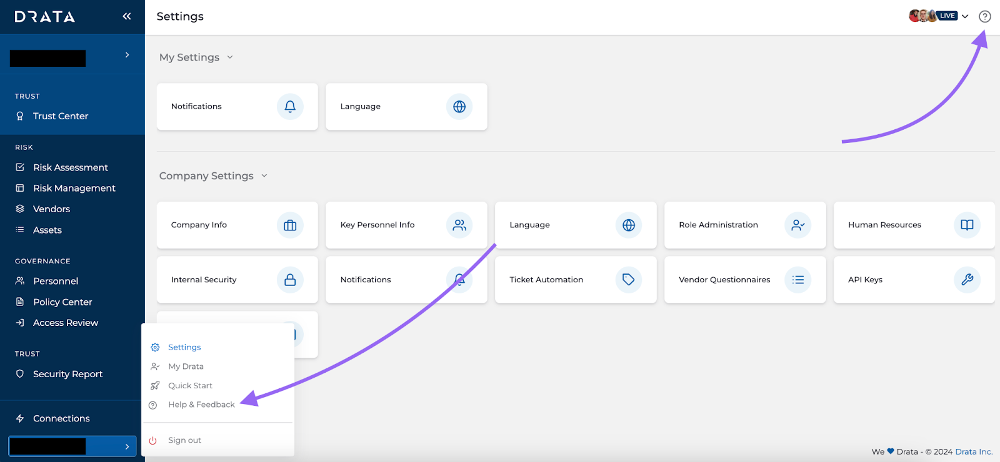

# Access reviewer overview

Source: https://help.drata.com/en/articles/8885250-access-reviewer-overview
Collection: Settings › Role Administration
Updated: 2026-06-30
Fetched: 2026-11-22
Description: Learn more about access reviewers role, permissions, and functionality in Drata.

## Article text

In this help article, learn and discover the functionalities available to access reviewers roles within Drata.

User access review is an add-on feature that must be enabled to have access reviewer roles.

### Access reviews access

The side navigation of the Drata app is divided into several sections, each containing pages you can access based on your role:

- Governance: Access Review
- Help Menu

### Governance

Access the following pages under the Governance section on the navigation bar:

- Access Review page: Identify and resolve permission and access issues with accounts, including addressing unauthorized accounts. Access Review is an add-on feature.  Learn more about [User Access Review](run-an-access-review.md).

### Help Menu

Select the help icon or Help & Feedback option to access the Help & Feedback drawer.

This drawer displays sections containing the help center, upcoming features, and community.

### Additional resources

- [Role Administration & RBAC](role-administration-rbac.md)

## Images

- [image 01] ../../images/ux/settings/information-security-leads-overview--01.png

## Related articles

- [Information security leads overview](information-security-leads-overview.md)
- [Risk managers overview](risk-managers-overview.md)
- [Control managers overview](control-managers-overview.md)
- [Personnel compliance managers overview](personnel-compliance-managers-overview.md)
- [Policy managers overview](policy-managers-overview.md)
