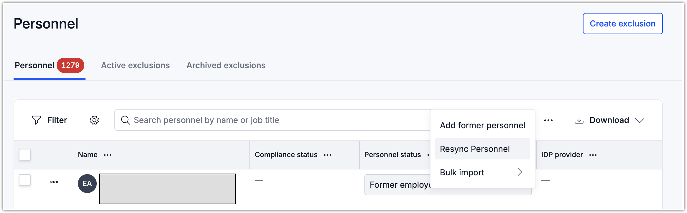
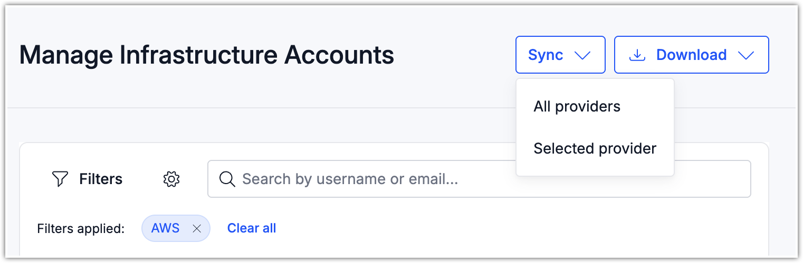

# Ad-hoc identity and account resync

Source: https://help.drata.com/en/articles/13337229-ad-hoc-identity-and-account-resync
Collection: Understand the Drata Platform › Connections
Updated: 2026-11-09
Fetched: 2026-11-22
Description: Learn how to manually resync identity and account data in Drata to immediately reflect access and personnel changes.

## Article text

Drata runs scheduled, automated syncs in the background to keep identity and account data up to date. In most cases, these automatic syncs are sufficient.

An **ad-hoc resync** lets you manually refresh identity or account-related data instead of waiting for the next scheduled sync. This is useful when you’ve recently made changes in a connected system, such as adding users, updating access, or completing offboarding, and want those updates reflected in Drata right away.

## Prerequisites

Before running any resync:

- You must have **Admin** access in Drata
- At least one relevant system must already be connected

## When to run an ad-hoc resync

You may want to run a resync if you:

- Added or removed users in your identity provider
- Updated group membership or access permissions
- Completed employee onboarding or offboarding
- Linked or updated connected accounts
- Need recent changes reflected immediately for review or audit readiness

## How to run an ad-hoc identity resync

You can initiate an ad-hoc identity resync from two places in Drata.

### Option 1: Resync from Personnel

Use this option when you want to refresh identity-related data broadly.

From the **Personnel** page:

1. Select the **ellipsis (⋯)** menu
2. Select **Resync Personnel**
   
3. Confirm the action to start the resync

This option triggers a resync across applicable connected systems, such as identity providers, infrastructure, version control, and security training.

You’ll see an in-product confirmation when the resync starts and when it completes. Admins also receive a confirmation email once the resync finishes.

### Option 2: Resync accounts from Manage accounts

Use this option when you want to refresh **account data for a specific connection type**.

From the **Connections** area:

1. Open the relevant **Manage accounts** page
   - Re-sync is only available for the following pages: Access Reviews, Infrastructure, or Observability.
2. Select **Sync**
3. Choose one of the following:
   - **All providers** to resync accounts for all connected providers of that type
   - **Selected provider** to resync accounts for specific providers using the filter menu
      - To do this, first use the **filter menu** to select the provider you want to resync.
      - Then select **Sync** and choose **Selected provider** from the dropdown.

This behavior is consistent across all **Sync** buttons under Manage accounts.

This option triggers an account resync only for the selected connection type. You’ll receive an in-product confirmation when the resync starts and completes, and the user who initiated the resync will receive a confirmation email.

## Images

- [image 01] ../../images/ux/personnel/ad-hoc-identity-and-account-resync--01.png
- [image 02] ../../images/ux/connections/ad-hoc-identity-and-account-resync--02.png

## Related articles

- [Identity sync updates in Drata](identity-sync-updates-in-drata.md)
- [PingOne Integration Guide](pingone-integration-guide.md)
- [Why active employees may appear as former employees in Drata? (Concept Guide)](why-active-employees-may-appear-as-former-employees-in-drata-concept-guide.md)
- [Integrate Multiple Identity and HRIS Connections](integrate-multiple-identity-and-hris-connections.md)
- [Troubleshooting Identity Sync Issues in Drata](troubleshooting-identity-sync-issues-in-drata.md)
