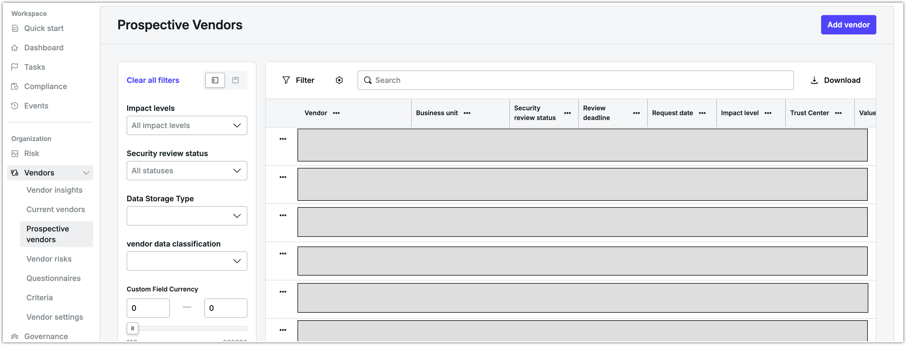

# Add a prospective vendor

Source: https://help.drata.com/en/articles/13557260-add-a-prospective-vendor
Collection: Understand the Drata Platform › Vendors
Updated: 2026-11-09
Fetched: 2026-11-22
Description: Use prospective vendors to evaluate third parties before onboarding.

## Article text

This workflow helps you conduct security reviews, document decisions, and activate vendors only after they meet your organization's requirements.

Prospective vendors separate evaluation from ongoing vendor management, which supports audit clarity and internal approval processes.

---

## How Prospective Vendors Work

Prospective vendors represent vendors that are still under consideration.

With prospective vendors, you can:

- Run a security review and collect evidence
- Send questionnaires or upload vendor responses
- Document review decisions and approval outcomes
- Activate vendors only after review completion

Once activated, the vendor moves to **Current vendors**, and review history is retained for audit purposes.

---

## Access Prospective Vendors

1. Go to **Vendors → Prospective vendors**
2. Select **Add vendor**

 (links to https://downloads.intercomcdn.com/i/o/am69aeco/2054379176/bef4395a57cc01e53f97b43dcc5b/image.png?expires=1780056000&signature=0a4b633c835fd9bfe2eb94f96fdd9140b3963bce5328c52322dc4f45afde33f1&req=diAiEsp5lIBYX%2FMW3nq%2BgYJIC3y9Tnah4uWyA3Q4Ve9mOaT31AuLn%2Biyt8IV%0AdO5g09d1jwwGbQFHl0435C3Rgz8%3D%0A)

---

### Step 1: Add Vendor Details

Complete the vendor intake form. Some fields are optional.

### Vendor Details

- **Vendor name**: Select or enter the vendor name.
- **Vendor website URL (optional)**: Enter the vendor's website.
   - **Important:** Do not include `www` in the URL.
   - ✅ `https://vendor.com`
   - ❌ `https://www.vendor.com`
- **Business unit**: Internal team that will use or benefit from the vendor.
- **Provided services (optional)**: Brief description of the services the vendor will provide.

---

### Contact Information (Optional)

- **Contact at vendor**: Primary external contact
- **Contact's email address**: Email address for the vendor contact

---

### Request Details

- **Request date**: Date the request was submitted
- **Review deadline**: Date a decision must be finalized
- **Requester**: Internal team member requesting the vendor
- **Internal security owner (optional)**: Person responsible for reviewing the vendor's security posture

Internal security owners must have one of the following roles: Admin, Information Security Lead, or Workspace Manager

---

### Step 2: Select the Inherent risk

Next, determine the vendor's Inherent risk based on the type of access and business criticality.

You'll select options such as:

- **Data accessed**: Type and sensitivity of data the vendor will access
- **Operational impact**: Potential effect on business operations
- **Access to environments**: Level of access to systems or infrastructure
- **Inherent risk:** Drata uses these selections to calculate the overall Inherent risk and recommends an Inherent risk. Some plans may require you to select an Inherent risk without having Drata's recommended Inherent risk.

---

### Step 3: Define Security Review Scope and Attach Evidence

After adding the vendor, define what you want to review and gather supporting documentation.

You can include:

- Uploaded files (for example, SOC 2 reports or certifications)
- Questionnaires sent through Drata
- Manually uploaded vendor responses

---

### Step 4: Complete the Security Review

After the prospective vendor is created, Drata opens the security review automatically. From the review page, you can:

- View and annotate questionnaires
- Review uploaded documentation
- View AI-generated summaries (VRM Agent), if enabled

When ready, finalize the review by selecting a decision:

- Pending
- Approved
- Approved with conditions
- Rejected

Add notes to document the decision rationale for auditors or internal stakeholders. After completion, you're redirected to a review summary page, which you can download and share.

You can also reopen the review if updates are needed.

---

## Activate the Vendor

If you decide to continue working with the vendor, activate them after the review is complete.

1. Select **Mark as active**
2. Complete the activation steps:
   - Confirm or assign the vendor risk level
   - (TPRM only) Convert observations into vendor risks
   - Set a recurring review schedule

After activation:

- The vendor moves to **Vendors → Current vendors**
- Review deadlines are tracked
- Vendors approaching deadlines are marked **Due soon** or **Overdue**

## Images

- [image 01] ../../images/ux/vendors/add-a-prospective-vendor--01.png

## Related articles

- [Terminology Updates: Inherent and Residual Risk in Vendor Risk Management](terminology-updates-inherent-and-residual-risk-in-vendor-risk-management.md)
- [Training Video: Vendor Management Overview (New Experience)](training-video-vendor-management-overview-new-experience.md)
- [Add a vendor or prospective vendor](add-a-vendor-or-prospective-vendor.md)
- [TPRM Agent: Create a Criteria](tprm-agent-create-a-criteria.md)
- [Training Videos: Add Prospective and Existing Vendors to Drata (New Experience)](training-videos-add-prospective-and-existing-vendors-to-drata-new-experience.md)
