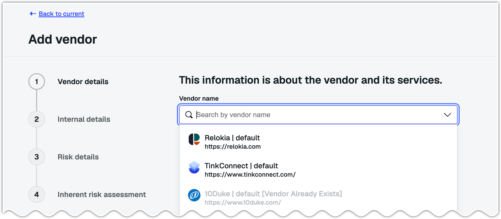
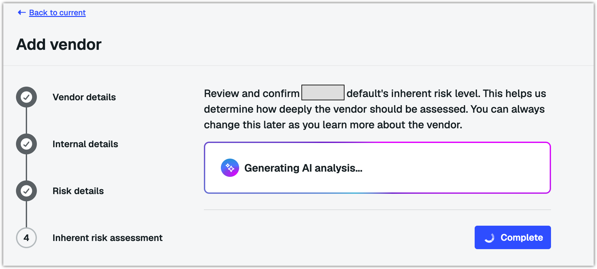
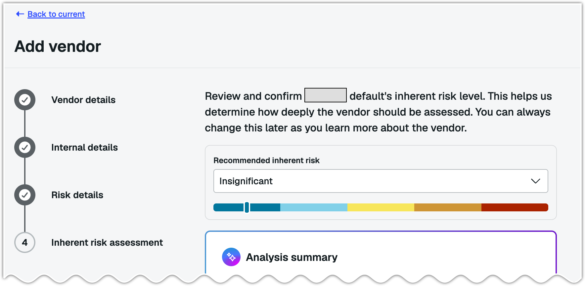
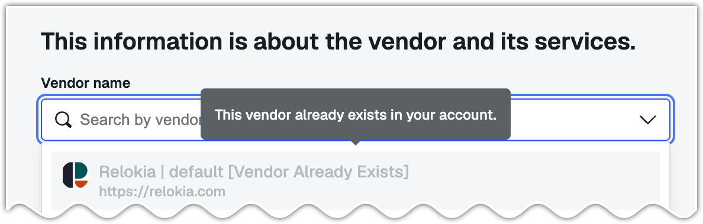

# Add a vendor or prospective vendor

Source: https://help.drata.com/en/articles/16880268-add-a-vendor-or-prospective-vendor
Collection: Understand the Drata Platform › Vendors › TPRM Agent
Updated: 2026-09-09
Fetched: 2026-11-22
Description: Learn how to add vendors to Drata manually — either as a current vendor you already work with, or as a prospective vendor you're still evaluating.

## Article text

This article explains how to add a vendor to Drata by hand, using the guided intake flow.

Drata gives you two places to add a vendor, and which one you choose determines what happens next. **Current vendors** are third parties you already work with — you add them to bring your existing vendor inventory into Drata. **Prospective vendors** are third parties still under consideration, where the point of adding them is to evaluate the vendor before you commit. Prospective vendors carry request details and a review deadline, and they stay separate from your active inventory until you decide to activate them.

Both flows end the same way: you describe how you'll use the vendor, and Drata recommends an inherent risk level. That rating sets which criteria the TPRM Agent applies in a security review—so a few minutes at intake shapes every assessment that follows.

Drata also maintains an internal vendor catalog. Selecting a listed vendor fills in its website and Trust Center URL for you, so the agent knows where to find security documentation.

After following this article, you'll be able to:

- Decide whether to add a vendor as current or prospective
- Complete the intake flow for a current vendor
- Complete the intake flow for a prospective vendor
- Understand how Drata recommends an inherent risk level from your inputs
- Know what happens once a vendor is added

**Note:** These instructions cover the New Drata Experience only.

**Tip:** You can also bring vendors in automatically through a connected procurement tool.

---

## Choosing between current and prospective

| **Add as** | **When to use it** | **What you provide** |
|---|---|---|
| **Current vendor** | You already work with this vendor and are recording them in Drata. | Vendor details, internal details, risk details |
| **Prospective vendor** | You're evaluating this vendor and haven't committed yet. | Vendor details, request details, risk details |

Prospective vendors add a request layer — who asked for the vendor, when, and by when a decision is needed — and a security review window. Once you finish evaluating a prospective vendor, you activate it and it moves to your current vendor list, keeping its review history for audit purposes.

If you're unsure, prospective is the safer starting point for anything not yet contracted.

**Expected outcome:** You know whether a vendor belongs under Vendors > Current (ones you already work with) or Vendors > Prospective (ones you're still evaluating).

---

## Autofill a vendor's website and Trust Center URL

Whether you add a current or a prospective vendor, Drata can fill in the vendor's website and Trust Center URL for you. In the **Vendor name** field, select the desired vendor from the dropdown—Drata fills in the website URL and Trust Center URL automatically. The Trust Center URL is what lets the TPRM Agent collect the vendor's published security documentation during a security review, with no manual access request.

**Important:** Since you selected this vendor from the dropdown, its name, website URL, and Trust Center URL lock once created. Every other field stays editable. If you type the vendor in manually instead of selecting a match, those three fields—name, website URL, and Trust Center URL—stay editable

**Already in your account?** Vendors marked *Vendor Already Exists* can't be selected again. Find that vendor under Vendors > Current or Vendors > Prospective instead of adding a duplicate.

**Not in the dropdown?** Add it manually: type the name and enter the website and Trust Center URL yourself. These stay fully editable. Drata accepts `https://vendor.com`, `www.vendor.com`, or the bare domain vendor.com (it adds `https://` for you); URLs without a valid top-level domain are rejected.

Both intake flows—current and prospective—are covered step by step in the sections below.

---

## Add a current vendor

Go to **Vendors > Current**, select **Add vendor**, then **Add single vendor**. The flow has four steps: **Vendor details**, **Internal details**, **Risk details**, and **Inherent risk assessment**.

### Step 1: Vendor details

Describe the vendor and its services.

- **Vendor name** — search the catalog and select the vendor
- **Website URL** *(optional)* — autofilled from the catalog
- **Provided services** *(optional)* — what the vendor does for you; supports Markdown formatting
- **Password policy** *(optional)*
- **Trust Center URL** *(optional)* — autofilled from the catalog
- **Privacy policy URL** *(optional)*
- **Terms of use URL** *(optional)*
- **Vendor contact name** *(optional)*
- **Vendor contact email addresses** *(optional)* — up to 5 recipients, separated by commas or semicolons

**Expected outcome:** Step 1 shows a checkmark in the left rail and the flow advances to Internal details.

### Step 2: Internal details

This step captures how your organization classifies and manages the vendor.

- **Vendor status** *(optional)*
- **Type** *(optional)* — your vendor type taxonomy
- **Business unit** *(optional)*
- **Residual risk** *(optional)*
- **Stored data** *(optional)* — supports Markdown formatting
- **This vendor stores personally identifiable information (PII)** — checkbox
- **This vendor is our sub-processor** — checkbox
- **Integrations** *(optional)* — search and link related integrations
- **Security owner** *(optional)* — the person responsible for reviewing this vendor's security posture
- **Vendor relationship contact** *(optional)* — the internal contact for questions about this vendor
- **Annual contract value** *(optional)*
- **Additional notes** *(optional)* — supports Markdown formatting

**Expected outcome:** Step 2 shows a checkmark and the flow advances to Risk details.

### Step 3: Risk details

These three inputs describe how your organization uses the vendor, and they drive the inherent risk recommendation.

- **Data accessed or processed** — select all that apply: General, Public, Controlled Unclassified (CUI), Financial, Proprietary, Employee/Personnel, Cardholder Data (CHD), Personally Identifiable (PII), Protected Health (PHI), or Other personal or sensitive
- **Operational impact** — None, Low, Normal, Important, or Critical
- **Access to environments** — No access, Read only, or Read/write

**Expected outcome:** Step 3 shows a checkmark and the flow advances to the inherent risk assessment.

### Step 4: Inherent risk assessment

Drata analyzes your Step 3 selections and recommends an inherent risk level (you'll see *Generating AI analysis…* while it works). This

The recommendation includes the reasoning—which rules applied across data sensitivity, operational impact, and environment access—and how many criteria a security review would assess for a vendor with these factors.

**Note:** The inherent risk recommendation in this step comes from your inherent risk classification rules, which live on your Vendor Settings page.

If you haven't set up your own rules, Drata uses its defaults—you can still adjust the level before completing, and re-assess later with Drata AI.

Review it and select **Complete**. You can change the level later from the vendor's profile as you learn more.

**Expected outcome:** The vendor is created and appears under Vendors > Current with the inherent risk level you confirmed.

---

## Add a prospective vendor

Go to **Vendors > Prospective**, then select **Add vendor**. The flow has three steps.

### Step 1: Vendor information

**Vendor Details**

- **Vendor name** — search the catalog and select the vendor
- **Vendor website URL** *(optional)* — autofilled from the catalog
- **Trust Center URL** *(optional)* — autofilled from the catalog
- **Business unit** — the internal team that will use or benefit from the vendor

**Contact Information**

- **Vendor contact name** *(optional)*
- **Vendor contact email addresses** *(optional)* — up to 5 recipients, separated by commas or semicolons

**Request Details**

- **Request date** — when the request was submitted *(required)*
- **Review deadline** — when a decision must be finalized *(required)*
- **Requester** — the internal team member requesting the vendor *(required)*
- **Internal security owner** *(optional)* — the person responsible for reviewing the vendor's security posture

**Note:** Request date, review deadline, and requester are required. If you select Next without them, the flow flags each missing field and the step stays open.

### Step 2: Risk details

Same three inputs as the current vendor flow, and they drive the inherent risk recommendation:

- **Data accessed or processed** — select all that apply: General, Public, Controlled Unclassified (CUI), Financial, Proprietary, Employee/Personnel, Cardholder Data (CHD), Personally Identifiable (PII), Protected Health (PHI), or Other personal or sensitive
- **Operational impact** — None, Low, Normal, Important, or Critical
- **Access to environments** — No access, Read only, or Read/write

Select **Next**, or **Back** to revise Step 1.

### Step 3: Inherent risk assessment

Drata analyzes your selections and recommends an inherent risk level (you'll see *Generating AI analysis…* while it works). Review the recommendation and the reasoning behind it, then select **Complete**.

**Note:** The inherent risk recommendation in this step comes from your inherent risk classification rules, which live on your Vendor Settings page. If you haven't set up your own rules, Drata uses its defaults—you can still adjust the level before completing, and re-assess later with Drata AI.

**Expected outcome:** The prospective vendor is created and its profile opens.

---

## What happens after you add a prospective vendor

The prospective vendor's profile shows its **Business unit**, **Inherent risk**, **Residual risk** (Unscored until a review is completed), **Risks associated**, and a **Security review window** derived from your request date and review deadline.

From here you can:

- **Start a security review.** If the vendor has a Trust Center URL, the TPRM Agent offers to conduct the review by analyzing documents from it. See [Conducting a Security Review](conducting-a-security-review-legacy.md).
- **Work through the profile tabs** — Overview, Security reviews, Reports and documents, and Trust Center.
- **Mark the vendor as active** once you've completed your review and decided to proceed. The vendor then moves to **Vendors > Current**, keeping its review history.

**Expected outcome:** The prospective vendor appears under **Vendors > Prospective** with an inherent risk level and a security review window, ready for a security review.

---

## Tips

- **Search the catalog before typing a name manually.** A catalog match fills in the Trust Center URL, which is what lets the agent collect documents automatically later.
- **Check the name and URLs before completing the flow.** For catalog vendors, the name, website, and Trust Center URL can't be edited afterward.
- **Be accurate on Risk details.** These three inputs drive the inherent risk recommendation, which in turn selects the criteria used in every security review of this vendor.
- **Use prospective for anything not yet contracted.** It keeps your current vendor list to third parties you actually use, and preserves the evaluation record.
- **Set the security owner during intake.** It saves assigning one later when a review starts.

---

## FAQ

**What's the difference between a current and a prospective vendor?** Current vendors are third parties you already work with. Prospective vendors are still under evaluation — they carry request details and a review deadline, and stay out of your active inventory until you activate them.

**Why can't I edit the vendor name, website, or Trust Center URL?** For vendors you select from the dropdown, three fields—the vendor name, website URL, and Trust Center URL—lock once the vendor is created and appear greyed out on the vendor's details, so they stay in sync with Drata's saved entry. Every other field stays editable, and vendors you type in manually aren't locked at all.

**Do I need to leave "www" out of the URL?** No. [www.vendor.com](http://www.vendor.com), [https://vendor.com](https://vendor.com), and the bare domain vendor.com are all accepted — Drata adds https:// to a bare domain for you.

**A vendor shows "Vendor Already Exists" in the dropdown. What does that mean?** That vendor is already in your Drata account. Look for it under **Vendors > Current** or **Vendors > Prospective** instead of adding it again.

**My vendor isn't in the catalog. Can I still add it?** Yes. Type the name and fill in the website and Trust Center URL manually if you have them.

**Can I change the inherent risk level later?** Yes. Drata's recommendation is a starting point, and you can change it from the vendor's profile as you learn more.

**Can I add many vendors at once?** Yes — **Add vendor > Add/update in bulk** on the Current vendors page supports bulk import. This article covers manual entry only.

**Do I have to run a security review right away?** No. The vendor is created either way. For a prospective vendor, the review window is tracked so you can see when a decision is due.

## Images

- [image 01] ../../images/ux/vendors/add-a-vendor-or-prospective-vendor--01.png
- [image 02] ../../images/ux/vendors/add-a-vendor-or-prospective-vendor--02.png
- [image 03] ../../images/ux/vendors/add-a-vendor-or-prospective-vendor--03.png
- [image 04] ../../images/ux/vendors/add-a-vendor-or-prospective-vendor--04.png

## Related articles

- [Add a prospective vendor](add-a-prospective-vendor.md)
- [Terminology Updates: Inherent and Residual Risk in Vendor Risk Management](terminology-updates-inherent-and-residual-risk-in-vendor-risk-management.md)
- [Training Video: Vendor Management Overview (New Experience)](training-video-vendor-management-overview-new-experience.md)
- [Training Videos: Add Prospective and Existing Vendors to Drata (New Experience)](training-videos-add-prospective-and-existing-vendors-to-drata-new-experience.md)
- [Customize vendor risk levels](customize-vendor-risk-levels.md)
