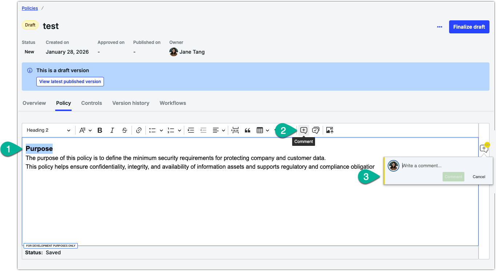

# Add comments in your policy

Source: https://help.drata.com/en/articles/13549713-add-comments-in-your-policy
Collection: Understand the Drata Platform › Policies
Updated: 2026-11-09
Fetched: 2026-11-22
Description: This article explains when you can comment or edit a policy, how comments work, and how Policy Owners manage edits during reviews.

## Article text

## When comments and edits are allowed

Whether you can comment or edit depends on the policy's current status.

| **Policy status** | **Comments** | **Edits** |
|---|---|---|
| **Draft** | Allowed | Allowed |
| **Needs approval** | Not allowed | Not allowed |
| **Approved** | Not allowed | Not allowed |
| **Published** | Not allowed | Not allowed |

## Add comments to a policy

1. Open **Governance → Policies**.
2. Open the policy you want to review.
3. Select the **Policy** tab.
4. Highlight the text you want to comment on.
5. Select the **Comment** icon.
6. Enter your comment and submit.

Comments are disabled in all other statuses.

---

## How comments are retained

- Comments remain attached to the policy when its status changes.
- Moving a policy back to **Draft** does not remove existing comments.
- Comments are visible only within the Policy Center and are **not visible to personnel in My Drata**.

This helps maintain feedback history during revisions.

## Images

- [image 01] ../../images/ux/policies/add-comments-in-your-policy--01.png

## Related articles

- [Policy Center Overview](policy-center-overview.md)
- [View and edit a policy](view-and-edit-a-policy.md)
- [Create a policy](create-a-policy.md)
- [External Policy: Use BambooHR to manage your policies](external-policy-use-bamboohr-to-manage-your-policies.md)
- [Section 5: Policy Owners](section-5-policy-owners.md)
