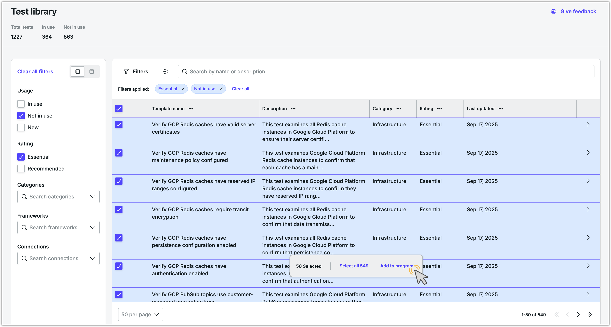
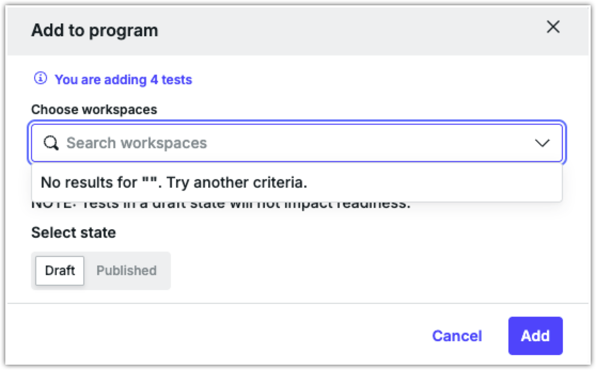
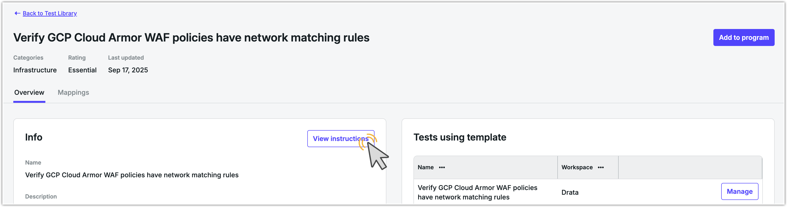
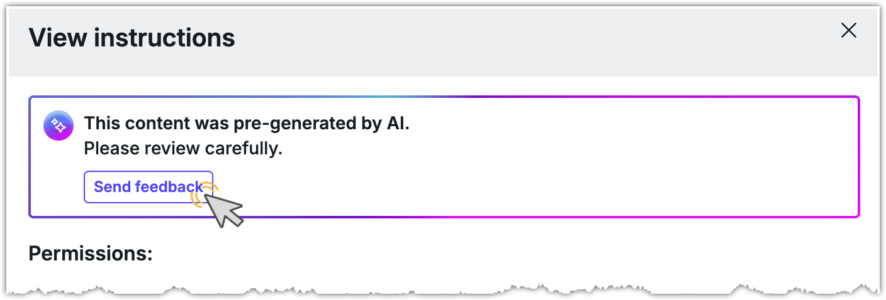
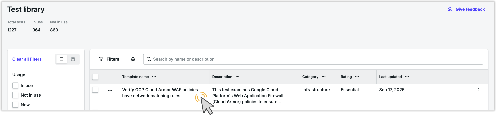
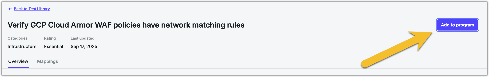
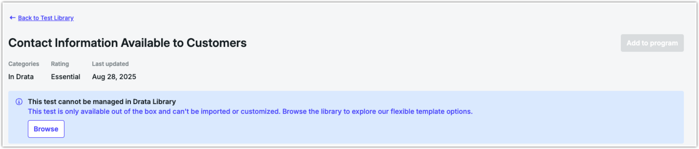

# Add tests from the Test Library to a workspace (New Experience)

Source: https://help.drata.com/en/articles/13948681-add-tests-from-the-test-library-to-a-workspace-new-experience
Collection: Understand the Drata Platform › Monitoring
Updated: 2026-07-28
Fetched: 2026-11-22

## Article text

You can easily add one or multiple tests from the Test Library to your workspaces, allowing you to tailor your compliance program to your specific environment.

Whether you are adding a single test with custom configurations or batch-adding multiple tests to streamline your setup, this guide will walk you through the process of selecting your workspace, setting the test status, and preparing your tests for monitoring.

## Add multiple tests to a workspace

1. In the **Test Library**, checkmark one or more tests.
2. Click **Add to Program**.
   
3. Choose a **workspace** from the **Workspaces** dropdown.
   - A workspace appears in the **Workspaces** dropdown only if it has the **required connection for the selected test**.
   - Workspaces without the necessary connection are not listed.
      
4. Select the test status:
   - **Draft** – The test is added but **does not impact readiness**.
   - **Published** – The test **runs automatically** and contributes to your **compliance posture**.
5. Click **Add** to assign the tests to the workspace.

**▸ ⚠️ Legacy AP1 tests notes**

> Legacy AP1 tests may still be displayed in the Test Library, but they cannot be added to your program from the Test Library.
>
> These tests may already exist in your tenant because they were **automatically provisioned when a framework was enabled**. However, they **cannot be imported again from the Test Library**.
>
> If you attempt to add multiple tests and one or more cannot be added (for example, due to **missing connections** or because the test is a **legacy AP1 test**), Drata displays a **modal after you click Add** explaining which tests were not added and why.

After the test is imported, go to the **Monitoring** page to modify its logic and align the test with your environment and monitoring needs.

> **Important:** AI-generated tests are experimental and may be subject to variation. In some cases, test logic may not fully align with third-party provider behavior or may produce inaccurate results. Customers should independently review AI-generated test results and confirm accuracy before relying on them as evidence of compliance.
>
> To know if a test is AI-generated:
>
> 1. From the Test page, select the test and click **View Instructions**.
>    
> 2. The modal indicates whether the test was **generated by AI** and allows you to **submit feedback**.
>    

## Add a single test to a workspace

You can also **customize the test name or description before adding the test to your program.**

1. In the **Test Library**, select the desired test.
   
2. Click **Add to Program**.
   
3. In the setup wizard:
   - Select the **workspace**.
   - Optionally **customize the test name or description**.
4. Choose the test status:
   - **Draft** – The test is added but **does not impact readiness**.
   - **Published** – The test **runs automatically** and contributes to your **compliance posture**.
5. Click **Add** to finish.

After the test is added, it appears on the **Monitoring** page, where you can manage it going forward.

> **Important:** AI-generated tests are experimental and may be subject to variation. In some cases, test logic may not fully align with third-party provider behavior or may produce inaccurate results. Customers should independently review AI-generated test results and confirm accuracy before relying on them as evidence of compliance.
>
> To know if a test is AI-generated:
>
> 1. From the Test page, select the test and click **View Instructions**.
>    
> 2. The modal indicates whether the test was **generated by AI** and allows you to **submit feedback**.
>    

## Legacy tests

Legacy tests may remain active and usable, but they cannot be imported through the **Test Library**. To identify one of these tests, select the test to view its details. Legacy tests display the message **“This test cannot be managed in Drata Library.”**

## What is a Program?

In Drata, **Program** refers to the complete set of governance, risk, and compliance (GRC) components configured in your tenant.

Your Program includes all managed compliance elements, such as:

- Controls
- Risks
- Policies
- Frameworks
- Connections
- Tests
- Other related GRC configurations

In short, Program represents your overall managed GRC program within Drata.

## Images

- [image 01] ../../images/ux/monitoring/add-tests-from-the-test-library-to-a-workspace-new-experience--01.png
- [image 02] ../../images/ux/monitoring/add-tests-from-the-test-library-to-a-workspace-new-experience--02.png
- [image 03] ../../images/ux/monitoring/test-library-new-experience--04.png
- [image 04] ../../images/ux/monitoring/test-library-new-experience--05.png
- [image 05] ../../images/ux/monitoring/add-tests-from-the-test-library-to-a-workspace-new-experience--05.png
- [image 06] ../../images/ux/monitoring/add-tests-from-the-test-library-to-a-workspace-new-experience--06.png
- [image 07] ../../images/ux/monitoring/test-library-new-experience--04.png
- [image 08] ../../images/ux/monitoring/test-library-new-experience--05.png
- [image 09] ../../images/ux/monitoring/add-tests-from-the-test-library-to-a-workspace-new-experience--09.png

## Related articles

- [Test Library (New experience)](test-library-new-experience.md)
- [Roles and permissions overview (New Experience)](roles-and-permissions-overview-new-experience.md)
- [Understanding Test Provisioning and the Test Library (New Experience)](understanding-test-provisioning-and-the-test-library-new-experience.md)
- [AI-Assisted Custom Control Mapping to GRC Objects](ai-assisted-custom-control-mapping-to-grc-objects.md)
- [Understand Accounts, Workspaces, and MIM](understand-accounts-workspaces-and-mim.md)
