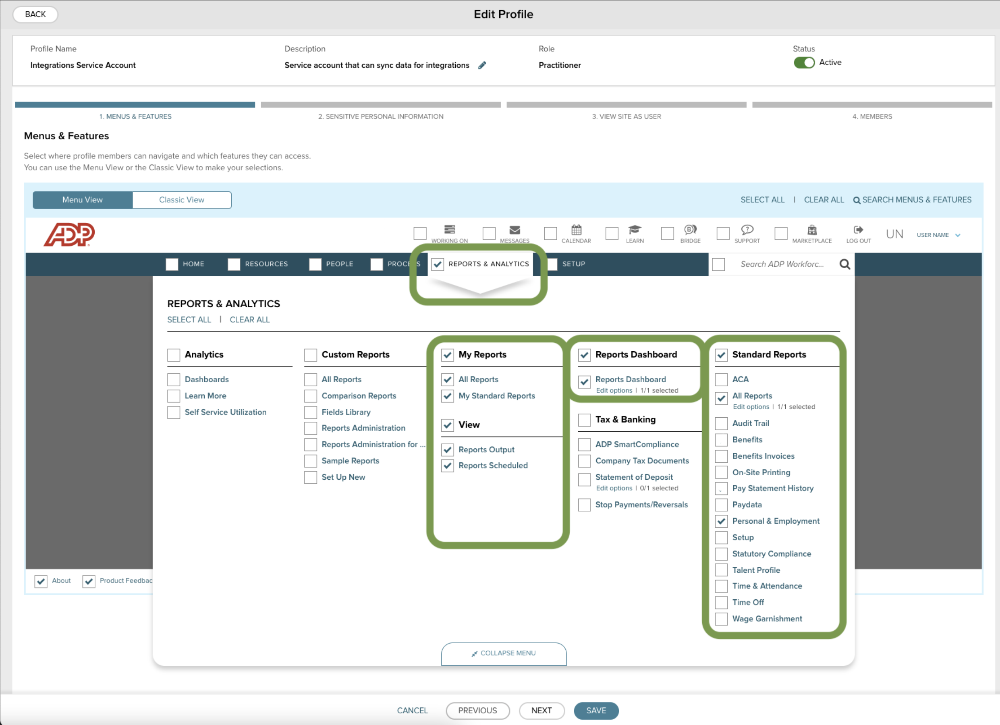
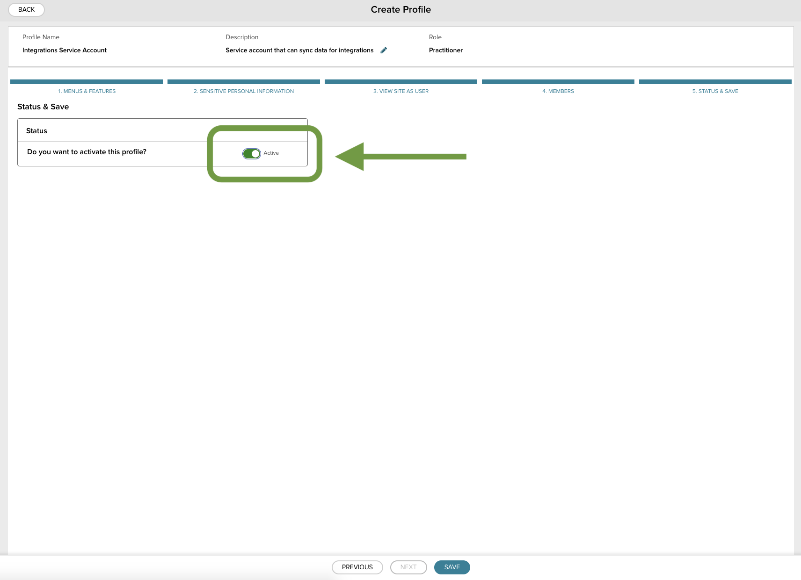
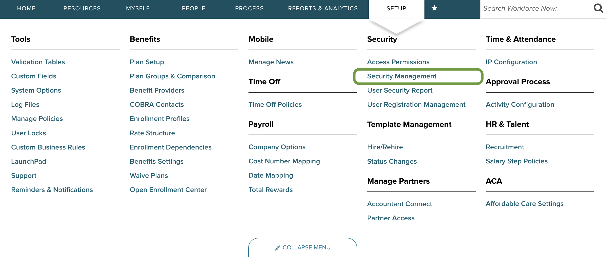
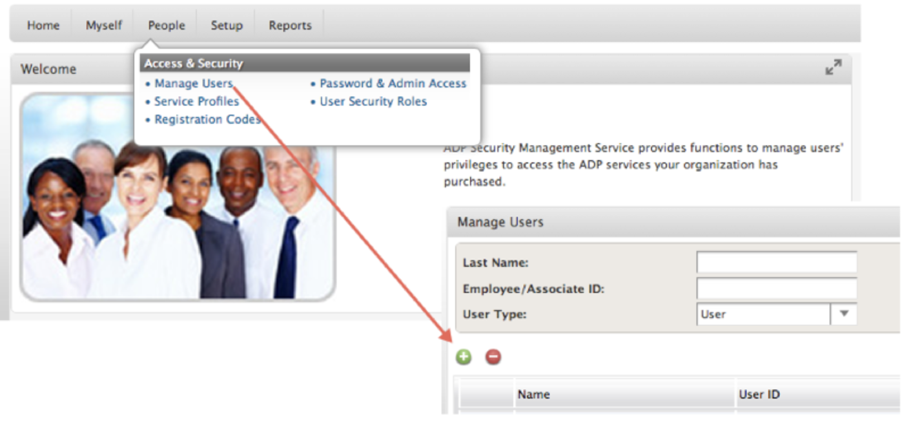
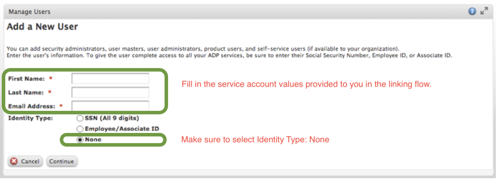
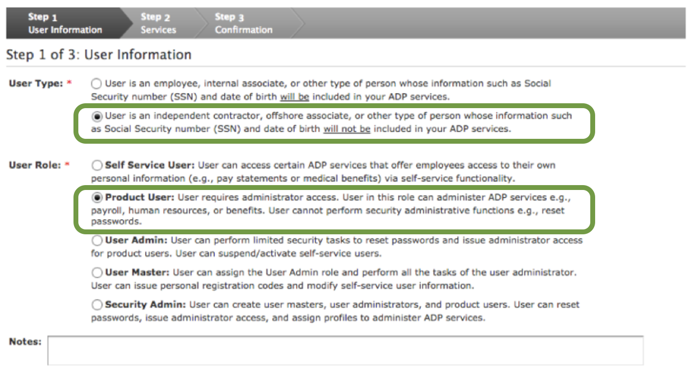
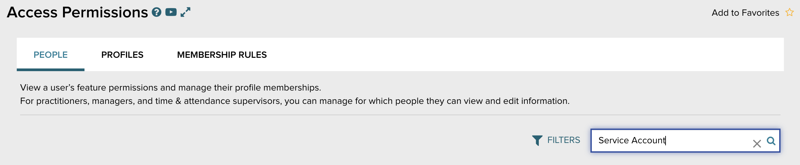
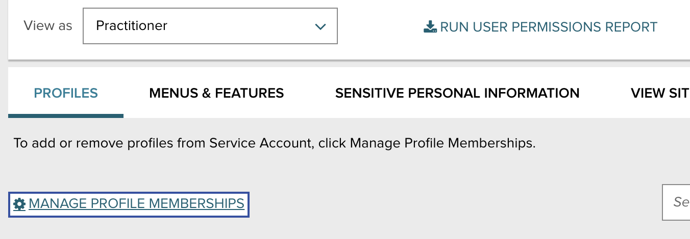
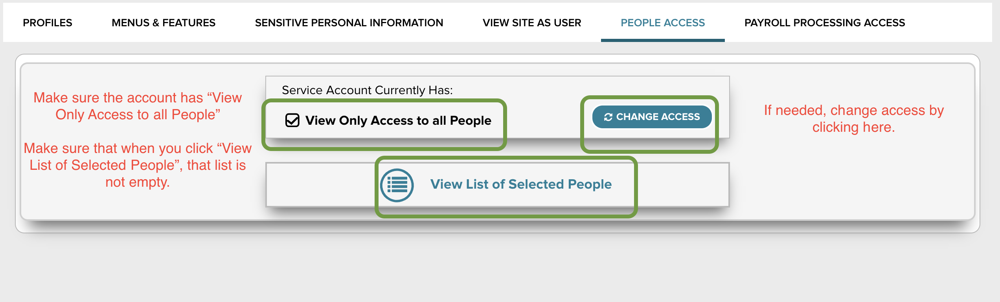

# ADP Workforce Now Integration Guide

Source: https://help.drata.com/en/articles/6134114-adp-workforce-now-integration-guide
Collection: Connection Support › Other Guidance
Updated: 2026-08-05
Fetched: 2026-11-22
Description: Integrate ADP Workforce Now with Drata to sync hire dates, terminations, and employment status for access reviews.

## Article text

The **ADP Workforce Now integration** enables **HR, IT, and Compliance teams** to automatically sync hire dates, termination dates, and employment statuses from ADP to Drata. This automation ensures that your organization maintains accurate personnel data for user access reviews, onboarding/offboarding verification, and audit evidence collection.

## Key Capabilities

- **Automated data synchronization:** Imports hire dates, termination dates, and employee status from ADP Workforce Now into Drata.
- **Access review automation:** Provides verified personnel information to support user access and offboarding compliance.
- **Evidence collection:** Streamlines compliance audits by automatically maintaining up-to-date employment records.

## Prerequisites & Data Access

- Must have **Administrator** privileges in **ADP Workforce Now**.
- Must create a **Service Account** in ADP with a **Practitioner role**.
- Within ADP, ensure the **Job Title field is populated** to ensure personnel are syncing correctly. If the field is empty, the users may sync into Drata with an Unknown status.
- The ADP instance must be **U.S.-based**. ADP Canada is **not supported** due to limited personnel report data.

### Permissions & Data Table

| **Permission/Scope** | **Why It’s Needed** | **Data Access (Read Only)** |
|---|---|---|
| Practitioner Role | Enables API and report access for syncing personnel data | Employee personal and employment details |
| Reports & Analytics (My Reports, All Reports, Standard Reports) | Grants access to HR reports required for syncing data | Hire/termination dates, employment status |
| Personal & Employment (Employment, Employee Profile, Personal Info) | Provides visibility into personnel employment attributes | Employee identifiers and HR metadata |

## Step-by-Step Setup

### Step 1: Create a Profile with Report Access

1. Go to **Setup → Access Permissions → Profile Permissions → Manage Profiles**.
2. Select **Create Profile** and enter the name, description and role.
   - **Important Note**: The role **must **be **Practitioner**.
3. Under **Menus & Features**, enable the following in **Reports & Analytics**. This will give the service account access to securely sync your data.
   - **My Reports **
      - All Reports
      - My Standard Reports
   - **View**
      - Reports Output
      - Reports Scheduled
   - **ReportsDashboard**
      - Reports Dashboard
   - **Standard Reports**
      - All Reports (only grants access to report types that are otherwise checked)
      - Personal & Employment
   
4. Under **People**, enable:
   - **Employment**
      - Employee Profile
   - **Personal Information**
      - Employment Profile Report
      - Personal Profile
5. Save and activate the Profile.
   

### Step 2: Create a Service Account User

1. From **Setup → Security Management**.
   
2. Go to **People → Manage Users → +**
   
3. Fill in the user fields.
   - **First Name, Last Name, and Email Address**: Provided to you during the connection process in Drata.
   - **Identity Type**: None
   
   - Step 1:
      - **User Type **→ independent contractor
      - **User Role** → Product User
      
   - Step 2:
      - Give the user access to Workforce Now (if available).
      - Set them as a Practitioner (if available).
4. Proceed through Step 3, and confirm the new user.

### Step 3: Assign the User Profile

1. In **Access Permissions → Manage People**, search for the new Service Account user.
   
2. Open **User Access Permissions → Manage Profile Memberships**.
   
3. Add the Service Account Profile created earlier.
4. Verify that **Menus & Features** and **Sensitive Personal Information** match the Profile you set up previously.
5. In **People Access**, ensure the user has** View Only Access to all People.**

## Complete the Connection: ADP Workforce Now

When connecting, ensure that you used the values displayed in Drata during the connection process to create your ADP service account. If the account setup is incorrect, you will be prompted to adjust the configuration and try again, with the same values shown to you.

For steps on accessing and using the Connections page in Drata, refer to [The Connections Page in Drata](https://help.drata.com/en/articles/12305645-the-connections-page-in-drata).

## Images

- [image 01] ../../images/integrations/adp-workforce-now/adp-workforce-now-integration-guide--01.png
- [image 02] ../../images/integrations/adp-workforce-now/adp-workforce-now-integration-guide--02.png
- [image 03] ../../images/integrations/adp-workforce-now/adp-workforce-now-integration-guide--03.png
- [image 04] ../../images/integrations/adp-workforce-now/adp-workforce-now-integration-guide--04.png
- [image 05] ../../images/integrations/adp-workforce-now/adp-workforce-now-integration-guide--05.png
- [image 06] ../../images/integrations/adp-workforce-now/adp-workforce-now-integration-guide--06.png
- [image 07] ../../images/integrations/adp-workforce-now/adp-workforce-now-integration-guide--07.png
- [image 08] ../../images/integrations/adp-workforce-now/adp-workforce-now-integration-guide--08.png
- [image 09] ../../images/integrations/adp-workforce-now/adp-workforce-now-integration-guide--09.png

## Related articles

- [PingOne Integration Guide](pingone-integration-guide.md)
- [How Drata Uses HRIS Data](how-drata-uses-hris-data.md)
- [Future Hire Personnel](future-hire-personnel.md)
- [UKG Ready Integration Guide](ukg-ready-integration-guide.md)
- [Troubleshooting Identity Sync Issues in Drata](troubleshooting-identity-sync-issues-in-drata.md)
