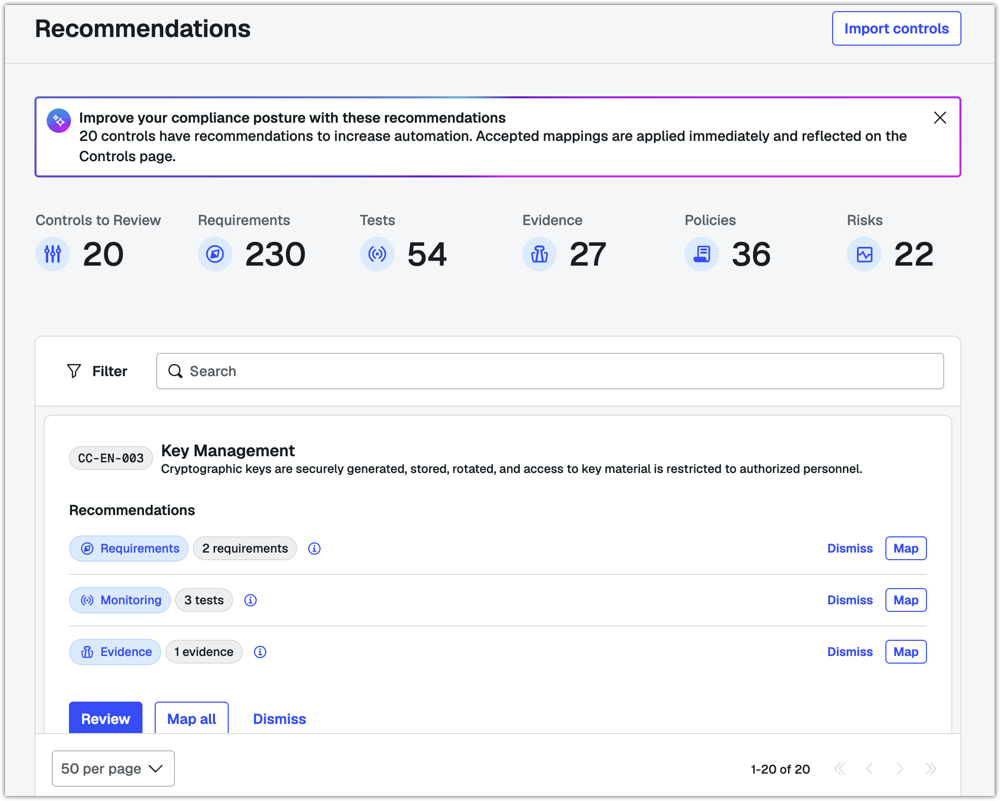
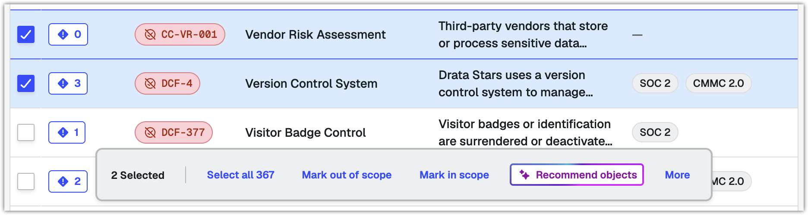
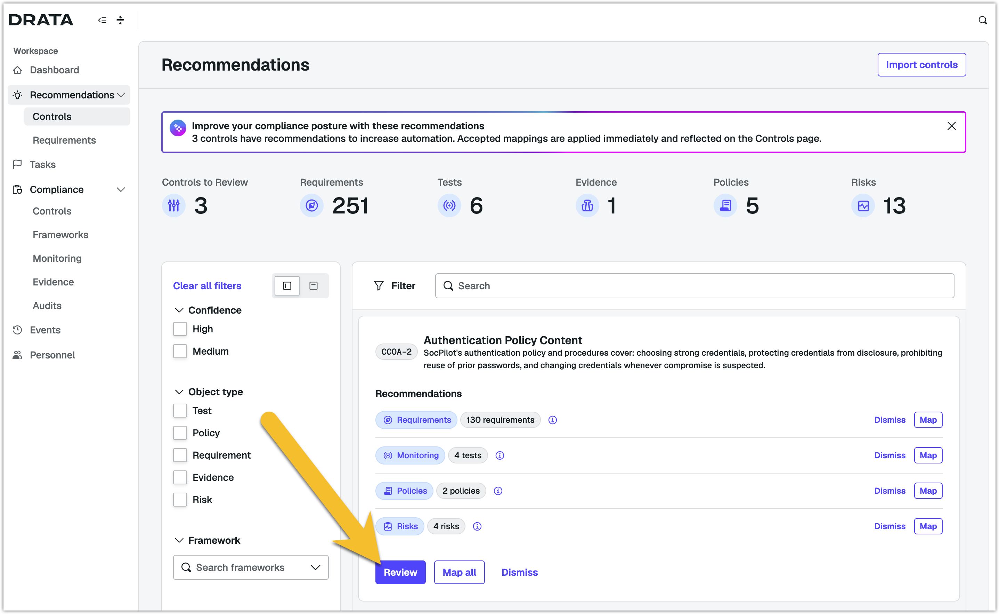
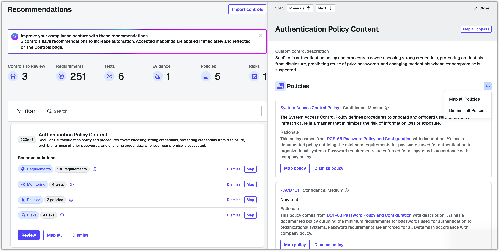
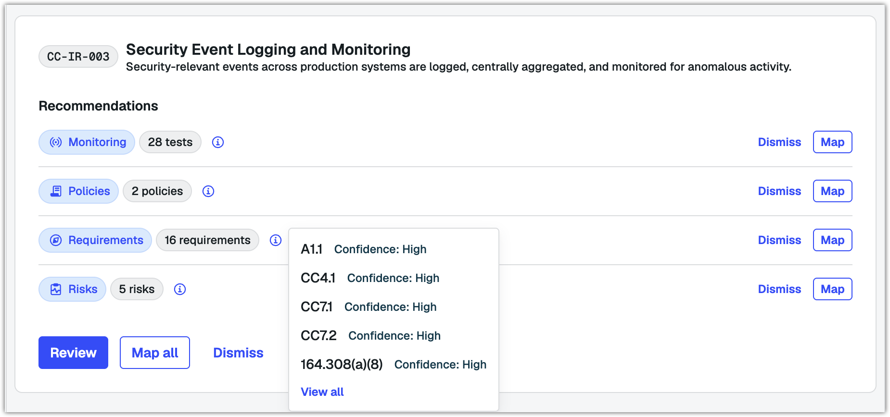

# AI-Assisted Custom Control Mapping to GRC Objects

Source: https://help.drata.com/en/articles/16791453-ai-assisted-custom-control-mapping-to-grc-objects
Collection: Understand the Drata Platform › Recommendation
Updated: 2026-09-02
Fetched: 2026-11-22

## Article text

## What is Custom Control Mapping Agent?

Custom Control Mapping Agent is an AI-native GRC object mapping capability that analyzes your custom controls and recommends mappings to the right GRC objects in Drata — framework requirements, risks, policies, tests, and evidence. Instead of manually reviewing every control and searching for related requirements, risks, policies, tests, and evidence, you import or select your custom controls and Drata suggests the objects most likely to be related. You review each recommendation in a dedicated Recommendations workspace and decide whether to accept or dismiss it.

Recommendations help you start your review faster — they don't replace your compliance judgment. Review each suggestion and confirm it supports the purpose and scope of the control before you accept it.

This is especially useful when:

- You have a large number of custom controls and don't want to research every possible related requirement, risk, policy, test, and piece of evidence manually
- You're standing up a new or complex compliance program and need to connect controls to the rest of your GRC program quickly
- You want a consistent, auditable way to show how your controls, risks, policies, evidence, and tests relate to each other

---

## Prerequisites

- **Access to the Controls page** (to trigger recommendations) and the **Recommendations page** (to review them).
- **AI features enabled** for your organization.
- **RBAC roles**: Admins, Workspace Managers, Information Security Leads, Control Managers
- **Custom control information ready** — either a CSV file to bulk upload or update controls, or existing custom controls already created in your workspace.
- **Workspace awareness**: This feature is workspace-aware.

**Note:** If Recommendations doesn't appear in the left navigation, the feature may not be enabled for your organization or available for your role.

---

## What can I do here?

### Ways to trigger recommendations

There are three ways to kick off the mapping agent:

1. **Import brand-new custom controls from Recommendations.** Go to Recommendations > Controls, then select Import controls to upload a CSV or manually enter new custom controls. Submitting the import automatically generates recommendations for those controls.
   
2. **Import or create custom controls from the Controls page.** Go to Compliance > Controls, then bulk-import controls via CSV or create a single new control. This also automatically generates recommendations for the new control(s).
3. **Select existing custom controls already in Drata.** Go to Compliance > Controls, select the checkbox next to one or more controls already in the index table, then choose **Recommend Objects** — no import needed.
   

## Import or create custom controls

Use this path when you're bringing brand-new custom controls into Drata, whether you start from Recommendations or from the Controls page. For step-by-step instructions on preparing your file, mapping columns, and validating the import, go to [Import Controls in Bulk (New Experience)](import-controls-in-bulk-new-experience.md).

**Important:** When updating a control, the Control Code must match the existing code exactly, including capitalization. Review your file carefully to avoid creating a duplicate control or updating the wrong control.

Once your import is submitted, Drata automatically generates recommendations for the new or updated controls.

## Get recommendations for existing custom controls

For custom controls you already have in Drata, you don't need to import or re-import anything.

1. From the **Controls** page, select the checkbox next to one or more existing controls in the index table.
2. Choose **Recommend Objects**.

What you select determines whether the option appears and what gets processed:

- Select only **Drata Controls (DCFs)** — Recommend Objects doesn't appear.
- Select a mix of **DCFs and Custom Controls** — Recommend Objects appears, but only the Custom Controls in your selection are analyzed.
- Select only **Custom Controls** — Recommend Objects appears, and all selected controls are analyzed.

Once you select Recommend Objects, Drata analyzes the selected custom controls and adds them to your review queue on the Recommendations page.

## Review the recommendations

However you trigger them — by importing brand-new custom controls or selecting existing ones — Drata presents possible mappings to relevant GRC objects on the Recommendations page. Use the recommendations to focus your review, not to make an automatic decision.

1. Open the Recommendations page > Controls page to review all the recommendations. You can filter by object type or confidence levels.
   - Object Types:
      - Test (This is the same as Monitoring tests)
      - Policy
      - Requirement (This is the same as Framework requirements)
      - Evidence
      - Risk
   - Confidence levels:
      - High
      - Medium
2. Compare the suggestion with the control's purpose, scope, and expected outcome.
3. Click on Review button on each control when you need to verify the details of the recommendations.
   - If all recommended objects accurately support the control, select **Map all** to map every recommendation for that control, across all object types.
   - If the recommendations do not support the control, select **Dismiss**.
   - To act on recommendations individually, select **Map** or **Dismiss** next to the relevant recommendation.
   
4. When reviewing the recommendations:
   - Select **Map all objects** to map every recommended object for that control, regardless of object type.
   - To map all recommendations within a specific section, such as **Policies**, select the **ellipsis (...)** next to that section, then choose the option to map all recommendations in that section.
   - There is no option to map every recommendation in your entire queue at once. You must still review and take action on recommendations for each control individually.

---

## Use cases / Best practices

### Onboarding controls faster

Instead of manually researching which requirements, risks, policies, tests, and evidence relate to each control, import your brand-new custom controls (or select existing ones on the Controls page) and let Drata suggest a starting set of mappings for you to review.

### Mapping controls you've already created

If you have existing custom controls that were never mapped to the rest of your GRC program, use **Recommend objects** from the Controls page instead of re-importing them.

### Let confidence guide your review effort

Treat confidence indicators and rationale as a prioritization tool: spend your review time on lower-confidence suggestions, and move quickly through high-confidence ones that clearly relate to the control.

### You're always the final decision-maker

Selecting Map is the only way a recommendation is applied to your live compliance program. If a suggestion doesn't reflect your control accurately, dismiss it and map it manually — nothing is auto-approved on your behalf.

## Images

- [image 01] ../../images/ux/home/ai-assisted-custom-control-mapping-to-grc-objects--01.png
- [image 02] ../../images/ux/controls/ai-assisted-custom-control-mapping-to-grc-objects--02.png
- [image 03] ../../images/ux/controls/ai-assisted-custom-control-mapping-to-grc-objects--02.png
- [image 04] ../../images/ux/home/ai-assisted-custom-control-mapping-to-grc-objects--04.png
- [image 05] ../../images/ux/home/ai-assisted-custom-control-mapping-to-grc-objects--05.png
- [image 06] ../../images/ux/home/ai-assisted-custom-control-mapping-to-grc-objects--06.png

## Related articles

- [AI-powered control suggestions for policies](ai-powered-control-suggestions-for-policies.md)
- [Map evidence and policies to controls (New Experience)](map-evidence-and-policies-to-controls-new-experience.md)
- [Section 2: GRC Roles & Responsibilities](section-2-grc-roles-responsibilities.md)
- [Section 6: Implementation Roadmap + Success Metrics](section-6-implementation-roadmap-success-metrics.md)
- [Map audit requests to DCF controls with AI](map-audit-requests-to-dcf-controls-with-ai.md)
