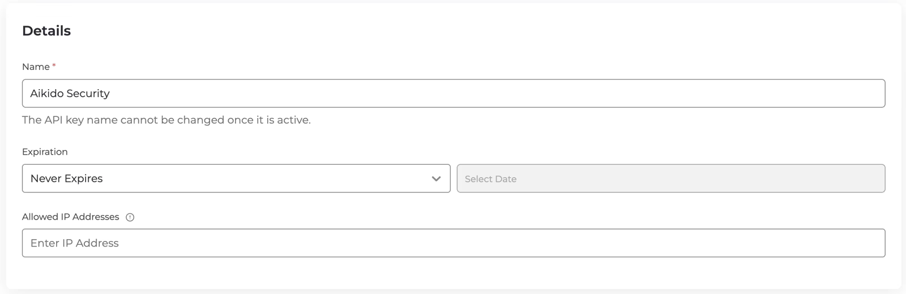

# Aikido Integration Guide

Source: https://help.drata.com/en/articles/9791674-aikido-integration-guide
Collection: Connection Support › Other Guidance
Updated: 2025-10-29
Fetched: 2026-11-22
Description: Category Type: CSPM & Vulnerability Scanning.

## Article text

The **Aikido** integration enables **security and compliance teams** to sync both **vulnerability** and **cloud posture** data from Aikido into Drata as mapped evidence for **SOC 2** and **ISO 27001** controls. It connects Drata to Aikido either through an **API Key (for CSPM)** or **Client Credentials (for Vulnerability Scanning)**, depending on your intended use case.

> **Note: **This integration is created by Drata's partner integration, Aikido. For any questions regarding this connection, please contact Aikido. Learn more about [partner connections](https://help.drata.com/en/articles/8463244-partner-connections)

## Prerequisites

1. Must have **Admin**, **Information Security Lead**, **DevOps Engineer**, or **Workspace Manager** roles in Drata.
2. Must have an **active Aikido account**.

**For CSPM**

1. Must have the ability to **create an API key in Drata** with specific permissions and scopes.

**For Vulnerability Scanning**

- Must have the ability to create **Client Credentials** in Aikido’s settings.
- Aikido provides a **public REST API integration** for credential generation.

### Permissions & Data Table for CSPM

| **Permission/Scope** | **Why It’s Needed** | **Data Accessed (Read/Write)** |  |
|---|---|---|---|
| **Controls** - **Controls list:** Read - **Add control:** Write - **Map external evidence:** Read, Write - **Delete mapped external evidence:** Write | Allows Aikido to read and manage Drata controls, map external evidence, and update linked compliance data. | Control and evidence data (Read/Write) |  |
| - **Workspaces**    - **List workspaces:** Read | Identifies available Drata workspaces for integration and mapping. | Workspace IDs (Read) |  |
| - **Frameworks**    - **List frameworks:** Read    - **List framework requirements:** Read | Enables linking of evidence to SOC 2 and ISO 27001 frameworks and requirements. | Framework and requirement metadata (Read) |  |

### Permissions & Data Table for Vulnerability Scanning

| **Permission/Scope** | **Why It’s Needed** | **Data Accessed (Read/Write)** |
|---|---|---|
| **Issues** • **issues:read** | Allows Drata to import vulnerability issue data. | Vulnerability records (Read) |
| **Clouds** • **clouds:read** | Grants access to Aikido’s cloud metadata to map vulnerabilities to cloud assets. | Cloud posture context (Read) |
| **Repositories** • **repositories:read** | Enables retrieval of repository and dependency data tied to vulnerabilities. | Repository and dependency metadata (Read) |
| **Containers** • **containers:read** | Allows scanning of container-based workloads for vulnerabilities. | Container metadata (Read) |
| **Basics** • **basics:read** | Required for Aikido to verify account and connection status. | Account and configuration metadata (Read) |

## Step-by-Step Setup for CSPM

### Step 1: Create a Drata API Key

1. Log in to **Drata** with an Admin account.
2. Navigate to[**Settings → API Keys**](https://app.drata.com/account-settings/api-keys).
3. Select **Create New Key** and configure it as follows:
   - **Name:** `Aikido Security`
   - **Expiration:** `Never Expires`
   - **Allowed IP Address:** Leave blank
   
4. Under **Scopes**, set **Access** to `Custom`.
5. Expand each section and enable:
   - **Controls**
      - **Controls list:** Read
      - **Add control:** Write
      - **Map external evidence:** Read, Write
      - **Delete mapped external evidence:** Write
   - **Workspaces**
      - **List workspaces:** Read
   - **Frameworks**
      - **List frameworks:** Read
      - **List framework requirements:** Read
6. Save and copy the **API Key**.

**Expected outcome:** You now have a valid Drata API Key configured with all necessary permissions for the Aikido integration.

### Step 2: Complete the Connection in Aikido

1. Log in to your **Aikido account** at [https://app.aikido.dev/login](https://app.aikido.dev/login).
2. Navigate to **[Settings → Integrations → Drata](https://app.aikido.dev/settings/integrations/compliance/drata)**.
3. Select **Add Drata Integration**.
4. Paste the **API Key** you generated in Drata.
5. Choose your **Drata Workspace** from the dropdown menu.
6. Click **Save**.

**Expected outcome:** Aikido is now connected to Drata, ready to sync daily evidence reports.

### Step 3: Verify

Once the connection is complete:

- Aikido automatically generates a **daily PDF report** of vulnerabilities.
- The report is synced to Drata as **Miscellaneous Evidence**.
- A control with the code **AIKIDO** is created and automatically linked to relevant **SOC 2** and **ISO 27001** requirements.

You can find these controls on the [Controls page](https://app.drata.com/compliance/controls/inscope?q=Aikido).

## Step-by-Step Setup for Vulnerability Scanning

### Step 1: Create Client Credentials in Aikido

1. Log in to your **Aikido account**.
2. Navigate to **Settings → Aikido Public REST API Integration**.
3. Review the list of existing API integrations:
   - If you already have a **private app** with the required permissions, you can reuse it.
   - Otherwise, click **Add Client** to create a new one.
4. Give the client a name, select **Private App Type**, and enable the following permissions:
   - `issues:read`
   - `clouds:read`
   - `repositories:read`
   - `containers:read`
   - `basics:read`
5. Generate the credentials and copy your **Client ID** and **Client Secret**.

**Expected outcome:** You now have a valid Client ID and Client Secret for connecting Aikido to Drata.

### Step 2: Configure Vulnerability Filters (Optional)

1. Before connecting, you can filter which vulnerabilities Drata imports:
   - **Severity of vulnerabilities:** Select from **Critical**, **High**, **Medium**, **Low**.
      - Drata recommends selecting at least **Critical** and **High** for compliance relevance.
   - **First Seen On:** Select a start date to import only vulnerabilities discovered on or after that date.
2. Drata imports up to **1,000 vulnerabilities per connection per day**, ordered from **Critical → Low** severity.

**Expected outcome:** Your import filters are configured for compliance-focused vulnerability data.

### Step 3: Complete the Connection in Drata

1. In Drata, go to **Connections → Available Connections**.
2. Search for **Aikido (Vulnerability Scanning)** and select **Connect**.
3. The **Aikido authentication widget** will appear. Follow the prompts to authenticate your account.
4. Enter your **Aikido Client ID**.
5. Enter your **Aikido Client Secret**.
6. Upon successful authentication, Drata will automatically finalize and confirm the connection.

**Expected outcome:** Aikido is now connected to Drata, and daily vulnerability data will begin syncing automatically.

## Important Notes

- **Partner Integration:** [Managed by Aikido, not Drata](https://integrations.aikido.dev/integrations/drata).
- **Security:** Drata API Key must be securely generated and stored; no credentials are shared from Drata to Aikido.

Learn more about [Drata Integration at Aikido](https://help.aikido.dev/iso-27001-and-soc-2-compliance/drata-compliance-integration).

## Partner Offers & Discounts

Drata has direct partnership with  Aikido for **first time and new customers**. Get 25% off your first year of Aikido by visiting [https://app.aikido.dev/partner/drata](https://app.aikido.dev/partner/drata).

Check out [more partner offers and discounts](https://drata.com/partner/find/tech-directory?collections=partner-discountoffers,partner-offers-discounts-pod).

## Images

- [image 01] ../../images/ux/settings/aikido-integration-guide--01.png

## Related articles

- [Qualys Integration Guide](qualys-integration-guide.md)
- [Arnica Integration Guide](arnica-integration-guide.md)
- [Wiz (Vulnerability Scanning) Integration Guide](wiz-vulnerability-scanning-integration-guide.md)
- [Orca Security Integration Guide](orca-security-integration-guide.md)
- [GitLab VMS Integration Guide](gitlab-vms-integration-guide.md)
