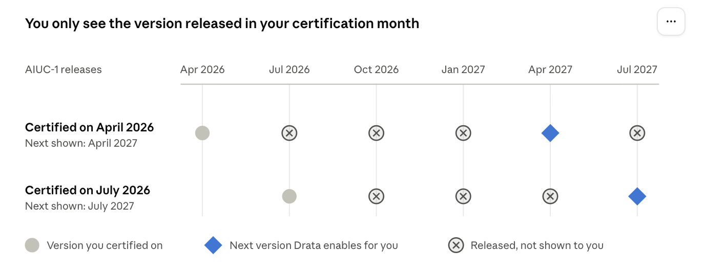

# AIUC-1 Version Updates: Which Version You'll See and When

Source: https://help.drata.com/en/articles/17312936-aiuc-1-version-updates-which-version-you-ll-see-and-when
Collection: Framework Information › AIUC-1
Updated: 2026-10-02
Fetched: 2026-11-22

## Article text

## What's changing with AIUC-1 updates?

The AIUC organization publishes a new version of the AIUC-1 standard every 3 months. Drata does not enable every one of those versions for every customer. You'll only see the version that matters for your next certification: the one released in the same month as your current certification, one year later.

For example, if you were certified against the April 2026 version, the next version you'll see in Drata is April 2027. The three versions released in between (July, October and January) won't appear in your account, because you're not expected to implement those versions.

We defined this approach together with the AIUC organization. Customers certify against one version per year, so you won't be asked to move to a newer version in the middle of your certification cycle.

---

## How AIUC-1 updates work

- **Quarterly releases**: AIUC publishes a new AIUC-1 version every 3 months — in January, April, July and October.
- **Annual certification**: You certify against one AIUC-1 version, and you recertify about a year later.
- **Your version is set by your certification month**: The version you certified against determines which future version Drata enables for you. Certified on the April version → you'll see the next April version. Certified on the July version → you'll see the next July version.
- **In-between versions are skipped for you**: You won't be seeking certification against a July version if you were certified on the April version, so Drata doesn't show you the July, October or January releases.

---

## How a new AIUC-1 version shows up in Drata

### If the new version applies to you

- When the version that matches your certification month is released (one year after your current version), Drata enables it in your account.
- It appears as a **separate framework tile** in your Frameworks page. Your current AIUC-1 version stays in place, so your existing program and audit work are not affected.
- You can review the new version and prepare for your recertification at your own pace.

### If the new version doesn't apply to you

- You won't see it. Versions released between your certification and your next annual cycle are not enabled in your account.
- There's nothing you need to do. Your current AIUC-1 framework, controls and evidence stay exactly as they are.
- A new AIUC-1 release announcement does not mean your requirements have changed. It only affects you when it lines up with your certification month.

---

## Example: which versions you'll see

**Certified on April 2026**

- Hidden: July 2026, October 2026, January 2027
- Next version shown: **April 2027**

**Certified on July 2026**

- Hidden: October 2026, January 2027, April 2027
- Next version shown: **July 2027**

Each customer sees one new AIUC-1 version per year, in the same month they certified. The quarterly releases in between stay hidden from their account.

---

## Frequently asked questions

### AIUC just announced a new version. Do I need to do anything?

Not unless it's the version released in your certification month, one year after your current certification. If it isn't, you won't see it in Drata and your program is unchanged.

### Why don't I see every AIUC-1 version in Drata?

You certify against one version per year. Showing you the versions in between would add frameworks you won't be audited against. Based on our conversations with AIUC, only the version aligned to your annual cycle is relevant to you.

### Will the new version replace my current AIUC-1 framework?

No. It shows up as a separate framework tile, so your current version and its audit work stay intact.

## Images

- [image 01] ../../images/documentation/aiuc-1-version-updates-which-version-you-ll-see-and-when--01.png

## Related articles

- [ISO 27001:2022](iso-27001-2022.md)
- [Transition Guidance for ISO 27001:2013 to ISO 27001:2022](transition-guidance-for-iso-27001-2013-to-iso-27001-2022.md)
- [NIST CSF 2.0](nist-csf-2-0.md)
- [Filter and search tests in Monitoring (New Experience)](filter-and-search-tests-in-monitoring-new-experience.md)
- [Compare Policy Versions with AI](compare-policy-versions-with-ai.md)
