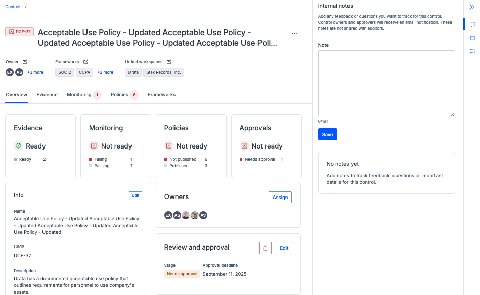

# Annotate a Control

Source: https://help.drata.com/en/articles/5918311-annotate-a-control
Collection: Understand the Drata Platform › Controls
Updated: 2026-11-09
Fetched: 2026-11-22
Description: Add internal notes, tickets, and tasks to controls to provide context for your team.

## Article text

Use the utilities panel on a control's detail page to add internal notes, create tickets, and create tasks for context, collaboration, and management.

You can edit and delete any note(s) you've written, and an Admin can delete any note. A history of all notes related to that control will display in the drawer. Control notes will not be included in any file downloads.

## Prerequisites

Only **Administrators** and **Information Security Leads** can annotate controls.

## Annotate a Control

1. Open a **control detail page** and open **the utilities panel** within it.
2. Add, edit, or delete notes in the **Internal Notes** section.
   
3. You can also create tickets from the panel.
4. Create tasks from the panel.

## Images

- [image 01] ../../images/ux/controls/annotate-a-control--01.png

## Related articles

- [Control managers overview](control-managers-overview.md)
- [Zoho Desk Integration Guide (Ticketing & UAR)](zoho-desk-integration-guide-ticketing-uar.md)
- [Introducing the New Drata Experience](introducing-the-new-drata-experience.md)
- [Create, Edit, and Manage Controls](create-edit-and-manage-controls.md)
- [Annotate an event](annotate-an-event.md)
