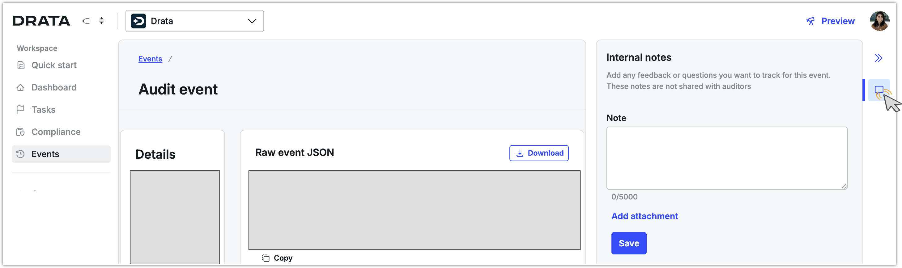

# Annotate an event

Source: https://help.drata.com/en/articles/13557378-annotate-an-event
Collection: Understand the Drata Platform › Events
Updated: 2026-11-09
Fetched: 2026-11-22
Description: You can add notes to an event to provide additional context for auditors or internal reviewers. Notes are attached directly to the event and become part of the event’s audit evidence.

## Article text

### Why add event notes

Event notes help you:

- Explain why an event occurred
- Document investigation or remediation details
- Add auditor-facing context to automated activity
- Attach supporting documentation to system events

---

### Who can annotate events

The following Drata roles can add, edit, or remove event notes:

- Admin
- Information Security Lead

---

## Add a note to an event

1. Go to **Events**.
2. Select an event in the table.
3. Select the **sidebar arrow**.
   
4. Enter your note.
5. (Optional) Upload a supporting file.
6. Save the note.

The note is saved immediately and is visible to other authorized users.

---

## Manage event notes

You can also:

- View the full history of notes for the event
- Edit or delete notes you created
- Upload files to provide additional evidence or context

Only the user who uploaded a file can delete that file.

---

## How notes appear in audit evidence

- Notes are included in the **event PDF** under the **Notes** section.
- If files are attached, the download is provided as a **ZIP file** that includes:
   - The event PDF
   - All attached files

This ensures annotations and attachments are preserved for audit review.

---

### Key behaviors to understand

- Events remain **read-only** and cannot be modified
- Notes are timestamped and attributed to the author
- Notes do not affect monitoring results or control status
- Notes persist with the event for audit history

## Images

- [image 01] ../../images/ux/events/annotate-an-event--01.png

## Related articles

- [Organization settings: Human Resources Settings (New Experience)](organization-settings-human-resources-settings-new-experience.md)
- [How audit date ranges and evidence sampling affect auditor access](how-audit-date-ranges-and-evidence-sampling-affect-auditor-access.md)
- [Using the Drata Audit Portal (New Experience)](using-the-drata-audit-portal-new-experience.md)
- [Audits page overview (New Experience)](audits-page-overview-new-experience.md)
- [Creating and Navigating an Audit in Drata Training Video](creating-and-navigating-an-audit-in-drata-training-video.md)
