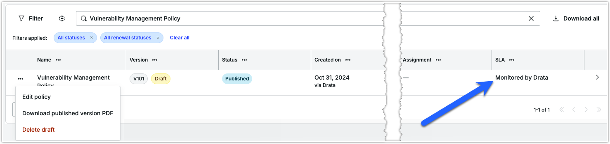
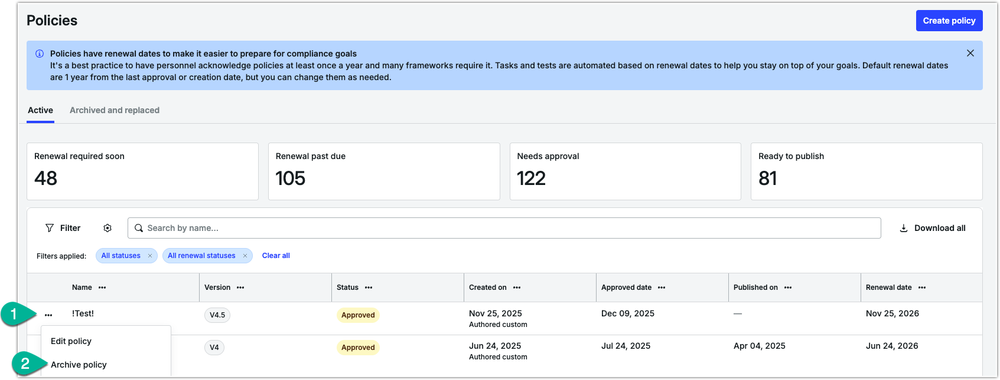

# Archive and restore policies

Source: https://help.drata.com/en/articles/13550854-archive-and-restore-policies
Collection: Understand the Drata Platform › Policies
Updated: 2026-11-14
Fetched: 2026-11-22
Description: This article explains when policies can be archived, why some policies can’t be archived, and how to restore archived or replaced policies.

## Article text

Archiving and restoring policies allows you to manage policy lifecycle changes without losing audit history. Drata preserves evidence, mappings, and version history so you can adapt policies while maintaining compliance continuity.

Use archiving to retire policies you no longer need while preserving audit history. You can restore archived or replaced policies at any time if requirements change.

## Prerequisites

Some policies can’t be archived if they are required for active compliance workflows or Service Level Agreements (SLAs). Additionally, Drata templated policies in versions cannot be deleted. Attempting to delete such policies will revert them to the previous version.

Additionally, archiving availability may differ based on whether the policy is a Drata template or a custom policy. Custom policies created by your organization may not have the archive option available.

### Policies that can’t be archived

Some Drata-provided policies don’t show an **Archive** option. This is expected.

Policies may be non-archivable when they:

- Are tied to active SLAs
- Are required for automated compliance tracking
- Serve as baseline templates for acknowledgments, onboarding, or monitoring

Additionally, some policies cannot be deleted due to system constraints or their role in compliance workflows.

If you need to archive a template policy, consider replacing it with a custom version. This action can automatically archive the template while preserving mappings.

Common examples include foundational policies such as:

- Information Security Policy
- System Access Control Policy
- Vulnerability Management Policy

## What happens when you archive a policy

When you archive a policy:

- The policy is removed from active use
- The policy no longer serves as evidence for mapped controls
- Any mapped monitoring tests are disabled
- The policy remains available in archived records for audit history

Archiving does not delete the policy.

## Archive a policy

1. Open **Governance → Policies**.
2. Make sure you are on the Active tab.
3. Select the **ellipsis (⋯)** next to the policy and choose **Archive**.
4. Review the confirmation modal.
5. Select **Archive** to confirm.

If you can't archive a policy, it's likely because the policy is required for active compliance or tied to an SLA. To resolve this, verify the policy type to ensure it is a Drata template. Check if the policy is tied to active SLAs or compliance workflows, such as acknowledgments or onboarding processes. If so, resolve or replace these associations. For example, replacing a template policy with a custom version can automatically archive the template while preserving mappings. Additionally, some policies may be protected baseline templates integral to compliance workflows and cannot be archived unless replaced or reconfigured. If the archive icon is missing temporarily, it may be due to a display glitch. Refresh the page or check back later to see if the issue resolves itself. [This is a run-on sentence that requires breaking into multiple sentences or adding appropriate punctuation after 'mappings.']

---

## Restore an archived or replaced policy

You can restore policies that were previously archived or replaced. When you restore a policy:

- The policy becomes active again
- Previously mapped tests are re-enabled
- The policy can be used again for acknowledgments and compliance evidence

### Restore a policy

1. Open **Governance → Policies**.
2. Open the **Archived or replaced** tab.
   
3. Locate the policy you want to restore.
4. Select the **ellipsis (⋯)** and choose **Restore**.
5. Review the restore confirmation modal. The modal lists tests that will be re-enabled.
6. Select **Restore** to confirm.

## Images

- [image 01] ../../images/ux/policies/archive-and-restore-policies--01.png
- [image 02] ../../images/ux/policies/archive-and-restore-policies--02.png
- [image 03] ../../images/ux/policies/archive-and-restore-policies--03.png

## Related articles

- [Managing Policies Synced from Confluence in Drata](managing-policies-synced-from-confluence-in-drata.md)
- [Configure Policies to Support Compliance Test Completion in Drata](configure-policies-to-support-compliance-test-completion-in-drata.md)
- [Policy Center Overview](policy-center-overview.md)
- [Create a policy](create-a-policy.md)
- [Creating an SLA for Employee Onboarding Completion](creating-an-sla-for-employee-onboarding-completion.md)
