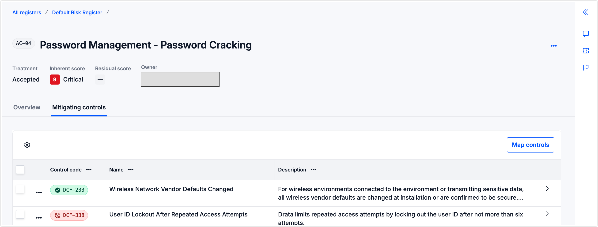
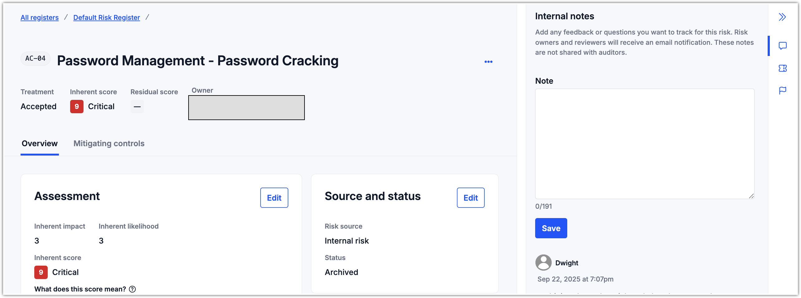

# Assess and Manage Individual Risks

Source: https://help.drata.com/en/articles/13370793-assess-and-manage-individual-risks
Collection: Understand the Drata Platform › Risk
Updated: 2026-11-09
Fetched: 2026-11-22

## Article text

### Overview

Each risk in Drata is assessed based on its **impact** and **likelihood**. These values are used to calculate a risk score, which contributes to the Residual risk posture within the Risk Register. The risk score is calculated by multiplying impact by likelihood.

By default, risks are marked as **Untreated** until a treatment option is selected.

You can assess risks directly from the Risk Register or from **an individual risk's details page**. This article explains how to view and manage risk information from an individual risk.

## Access an individual risk's details page

From **Risk Management**, select a risk to open its details page.

### Assessment section

The Assessment section is used to evaluate the severity of a risk and determine how it will be addressed.

- **Inherent Impact:** The potential severity of the risk before any controls or mitigation efforts are applied.
- **Inherent Likelihood:** The probability of the risk occurring before controls or mitigation efforts are applied.
- **Inherent Score:** The calculated risk score based on Impact × Likelihood. This field is not editable.

### Current Treatment section

The Treatment Plan indicates how the risk is addressed. Risks default to **Untreated** until a treatment option is selected.

Depending on the selected treatment, additional fields may appear.

#### Mitigate or Transfer

- **Treatment Details:** Describes how the risk is mitigated or transferred.
- **Anticipated Completion Date:** The expected date the treatment will be completed.
- **Completed Date:** The date the treatment was completed.
- **Reviewer:** The individual responsible for reviewing the treatment.
- **Residual Impact:** The potential severity of the risk after controls are applied.
- **Residual Likelihood:** The probability of the risk occurring after controls are applied.
- **Residual Score:** The calculated risk score after controls are applied.

#### Accept or Avoid

- **Treatment Details:** Describes why the risk is accepted or avoided.
- **Completed Date:** The date the treatment decision was finalized.
- **Reviewer:** The individual responsible for reviewing the treatment.- For treatment types like "Avoid" or "Accept," residual scores are not calculated. Instead, the system uses the inherent risk score for residual risk calculations.

### Source and status section

- **Risk Source:** Indicates whether the risk is internal or external to your organization.
- **Status:** Indicates whether the risk is active, closed, or archived.- Short-term risks can be closed once their residual risk is low and acceptable, indicating no further action is required.
- Long-term risks requiring continuous management or resourcing should remain "Active," reflecting ongoing efforts to manage the risk.
- Note that "Mitigated" refers to the treatment type, not the current status.

### Detail section

- **Title (required):** The name of the risk.
- **Description (required):** A detailed explanation of the risk and its potential impact.
- **Categories:** Used to group and organize risks. Categories are managed in Risk Settings. Creating or deleting categories is available with Risk Management Pro.
- **Supporting Documents:** Attach files to provide additional context or evidence for the risk. Upload up to 10 files per risk. File uploads are available with Risk Management Pro.

### Owner section

- **Owner:** One or more individuals responsible for managing and overseeing the risk.

### Mapped Controls

Go to **Mitigate controls tab** to view your mapped controls. Mapped Controls allow you to associate Drata Control Framework (DCF) or custom controls with a risk. Only controls from the primary workspace can be linked.

- **Green:** Available and ready
- **Red:** Not ready

 (links to https://downloads.intercomcdn.com/i/o/am69aeco/1935083334/92d48fbb6a95dfbf28558b54127a/image.png?expires=1780056000&signature=b47d2f05fab84e568b1922f19af8d474e767a446e4d07c7a3fa94445c3ab0612&req=dSkkE8l2noJcXfMW3nq%2BgT2NUBGH4hT5uwduO3jk7cdS1Za5l2HKV6LiHGt9%0AIIuu4tGCHoKCTjnIm06rs04G6EU%3D%0A)

### Internal Notes

You can add, edit, or delete notes related to the risk from the risk's internal notes panel. From the same panel, you can also create and view tickets and tasks related to the risk. Reassessing Mitigated Risks Reassessments are necessary when new data fields or information become available after risks have been mitigated. To handle reassessments effectively:

1. **Schedule a Formal Reassessment**: Organize a meeting with the same participants who conducted the original risk assessment.
2. **Review Mitigated Risks**: Evaluate the already mitigated risks and determine how to address the new data fields, such as post-mitigation risk scores.
3. **Document the Reassessment**: Record the meeting details to demonstrate that the reassessment was deliberate and official.
4. **Update the Risk Records**: Add the new information to the risk records and include a note stating the reassessment date.
5. **Generate Updated Reports**: Create a new risk assessment report to show before-and-after scores, which can be shared with auditors to highlight the effectiveness of your risk management program.

 (links to https://downloads.intercomcdn.com/i/o/am69aeco/1935088466/afc521b3074251132dabf1dd5ebf/image.png?expires=1780056000&signature=c15db6010843411a9808aa49c22234ca81f25da131e219b8e63708d61531811c&req=dSkkE8l2lYVZX%2FMW3nq%2BgWjRncE4RuSebe9j8%2ByGtZB%2Fa4ozxmJQ0kbnVvZ1%0AWxLfZtXStCTed%2FqCQXMM%2F4xPpx4%3D%0A)

### Key Notes

- Risks are marked as **Untreated** until a treatment option is selected.
- You can assess risks either from the Risk Register or from an individual risk's details page.
- Some features, such as category management and file uploads, require **Risk Management Pro**.

## Images

- [image 01] ../../images/ux/risk/assess-and-manage-individual-risks--01.png
- [image 02] ../../images/ux/risk/assess-and-manage-individual-risks--02.png

## Related articles

- [Getting started with a risk assessment (Concept Guide)](getting-started-with-a-risk-assessment-concept-guide.md)
- [Understanding the Drata Risk Register](understanding-the-drata-risk-register.md)
- [Risk management in Drata: An overview](risk-management-in-drata-an-overview.md)
- [Add and View Residual Risk in the Risk Register (New Experience)](add-and-view-residual-risk-in-the-risk-register-new-experience.md)
- [Risk Management Training Videos (New Experience)](risk-management-training-videos-new-experience.md)
