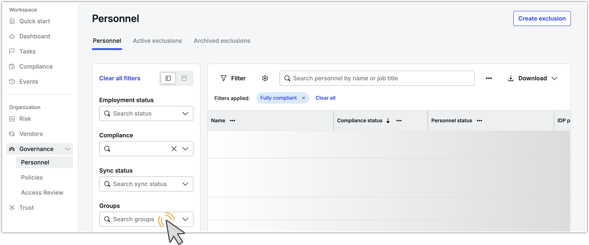
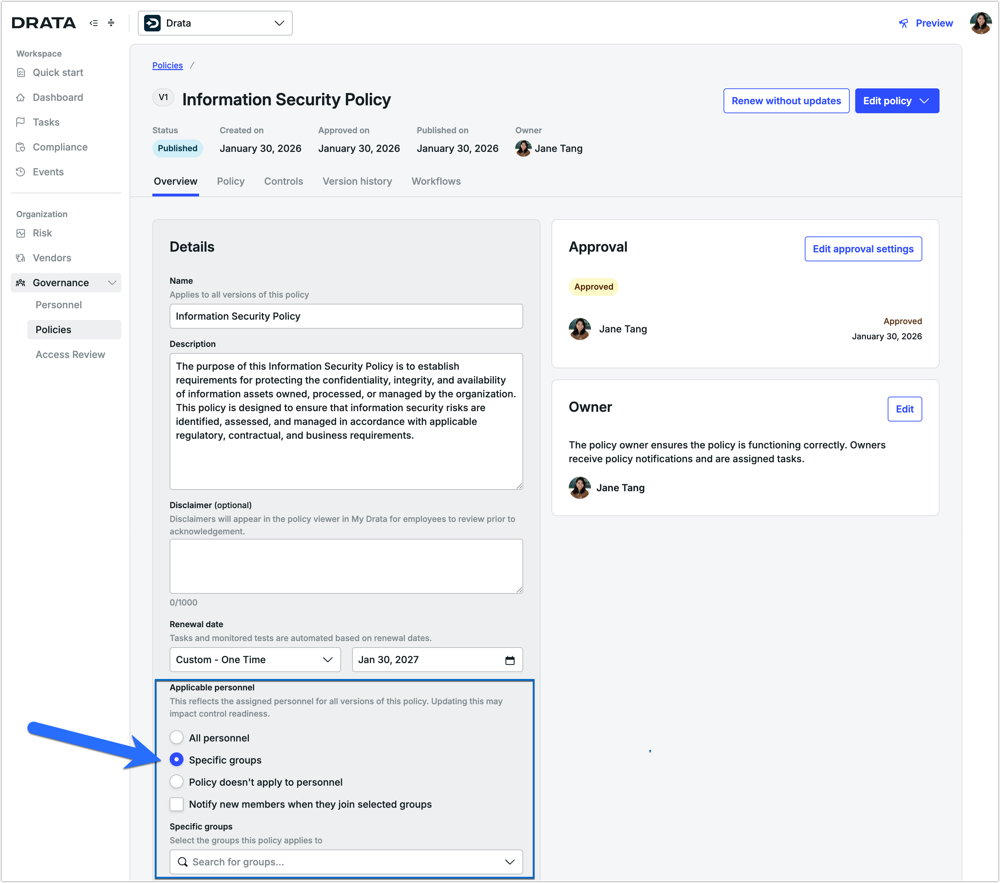
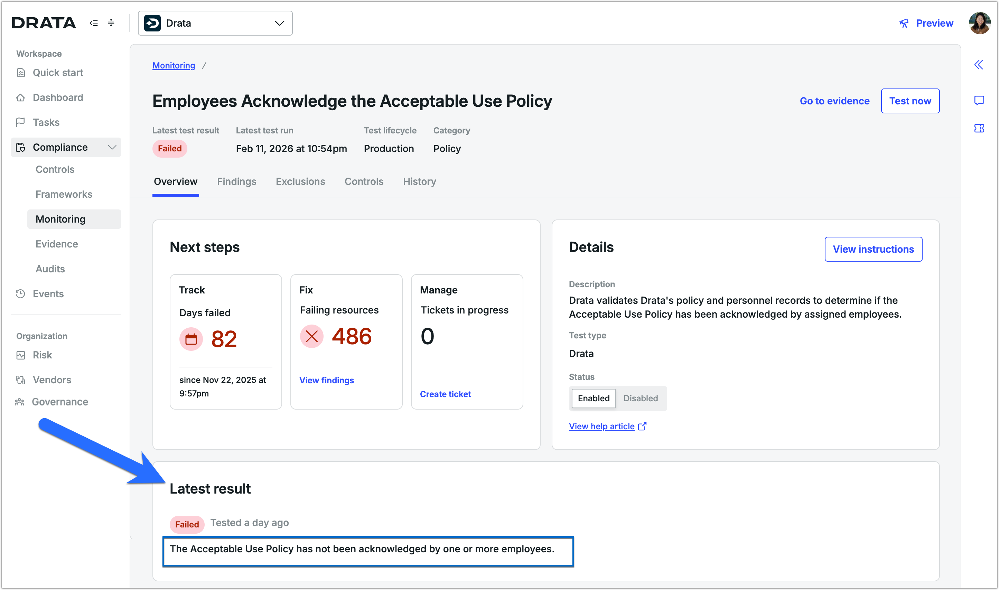
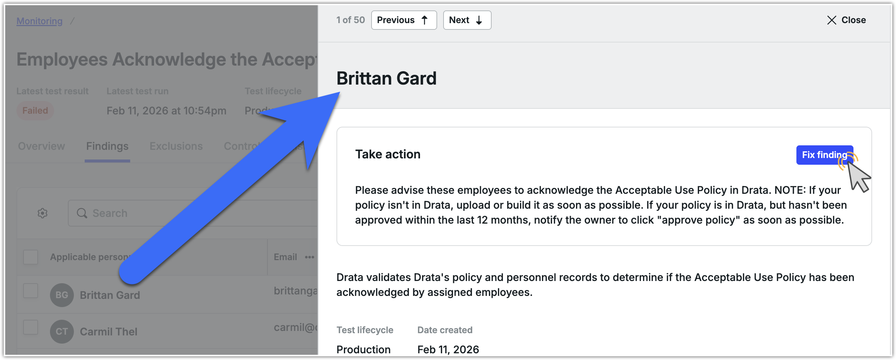

# Assigning Policies to Specific Groups

Source: https://help.drata.com/en/articles/13551822-assigning-policies-to-specific-groups
Collection: Understand the Drata Platform › Policies
Updated: 2026-11-09
Fetched: 2026-11-22
Description: Control which personnel must acknowledge each policy by assigning policies to specific identity provider groups, all personnel, or no personnel.

## Article text

Group-based policy assignments let you control which personnel must acknowledge each policy. Instead of requiring every employee to acknowledge every policy, you can assign policies to specific identity provider (IdP) groups, all personnel, or no personnel.

This helps reduce unnecessary acknowledgments while keeping compliance requirements accurate and audit-ready.

## Prerequisites

- You must have an active connection to a supported Identity Provider:
   - Google Workspace
      - If you already have an active Google connection with Drata, make sure you have the following 2 additional scopes enabled:
         - **[Google Groups](https://www.googleapis.com/auth/admin.directory.group.readonly)**
         - **[Google Organizational Units](https://www.googleapis.com/auth/admin.directory.orgunit.readonly)**
   - Microsoft 365
   - Okta
- Groups must be created and managed in your Identity Provider.
- Drata doesn't support HRIS-based groups or creating groups directly in Drata.

**Google Workspace note**: If you already have your Google connection ready but do not have any groups defined in Google Workspace, please check these instructions:

- How to [Create groups](https://support.google.com/a/answer/9400082?hl=en) in Google Workspace
- How to [Create Organizational Units](https://support.google.com/a/answer/182537?hl=en) in Google Workspace

## How group syncing works

Drata imports groups and group membership from your connected Identity Provider.

- Group and membership changes sync **once per day** after the nightly (Autopilot) runs.
- New groups appear automatically after the next sync.
- Deleted groups are removed from Drata and unassigned from policies.
- If the IdP connection is disconnected, existing groups and assignments remain unchanged until the connection is restored.

If multi-domain support isn't enabled, only groups from the primary domain sync.

## Verify groups are synced

1. Open **Personnel**.
2. Use the **Groups** filter to view imported groups.

If you don't see the Groups filter, groups may not be synced or don't exist in your Identity Provider.

## Assign policies to personnel groups

Each policy includes a **Personnel groups** setting that determines who must acknowledge it. When selecting specific groups, only members of selected IdP groups must acknowledge the policy.

- Only group members see the policy during onboarding
- Monitoring tests apply **only** to assigned group members
- Tests fail only if members of the assigned groups don't acknowledge
- **Group membership changes:**
   - New members are assigned after the next Autopilot sync
   - Removed members are no longer required to acknowledge the policy
   - If all members are removed from assigned groups, the Policy Owner is notified

You can choose to notify new group members automatically when they're added.

### Add personnel group to an existing policy

1. Open **Governance → Policies**.
2. Open the policy.
3. Select **Edit Details section** within the **Overview tab.**
4. Update the **Applicable personnel options.**
5. Save your changes.

## How group assignments affect monitoring

Group-based policy assignments directly affect which personnel appear in policy-related monitoring tests. Monitoring only evaluates acknowledgment for users who are **in scope for the policy** based on their group assignment.

### Find non-compliant personnel from Monitoring page

From **Compliance → Monitoring**, you can identify personnel who still need to acknowledge a policy:

1. Filter tests by **Category: Policy** and **Result: Failed**.
2. Open a failed test.
3. In the **Latest result** section, confirm the failure is due to missing personnel acknowledgment.
   
4. Open the **Findings** tab to view the personnel who haven't acknowledged the policy.
5. Select **Fix now** to open the **Personnel** page filtered to non-compliant users.
   

**Find non-compliant personnel from Personnel page:**

On the **Personnel** page, you can further narrow the list by:

- **Employment status** (for example, employee vs. contractor)
- **Compliance → Policies non-compliant**

This helps you focus follow-ups on the right users and send reminder emails only to personnel who are expected to acknowledge the policy.

## Integration limitations

- Groups can only be created in Identity Providers
- HRIS groups aren't supported
- Microsoft 365 syncs user membership only (no devices or contacts)
- Okta group sync doesn't include deactivated or suspended users

## Images

- [image 01] ../../images/ux/personnel/assigning-policies-to-specific-groups--01.png
- [image 02] ../../images/ux/policies/assigning-policies-to-specific-groups--02.png
- [image 03] ../../images/ux/monitoring/assigning-policies-to-specific-groups--03.png
- [image 04] ../../images/ux/monitoring/assigning-policies-to-specific-groups--04.png

## Related articles

- [Google Workspace Integration Guide](google-workspace-integration-guide.md)
- [Manual Import (CSV) Identity Provider Integration Guide](manual-import-csv-identity-provider-integration-guide.md)
- [Personnel Overview](personnel-overview.md)
- [Create a policy](create-a-policy.md)
- [External Policy: Use BambooHR to manage your policies](external-policy-use-bamboohr-to-manage-your-policies.md)
