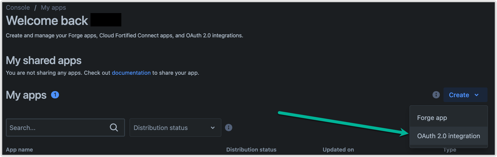
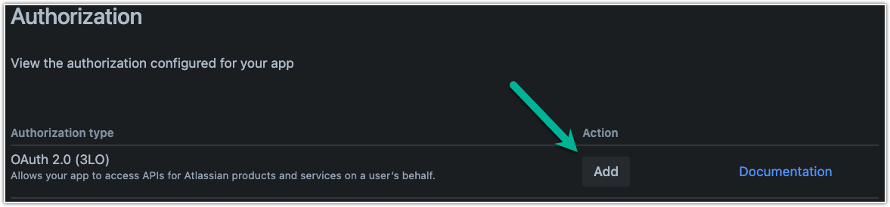
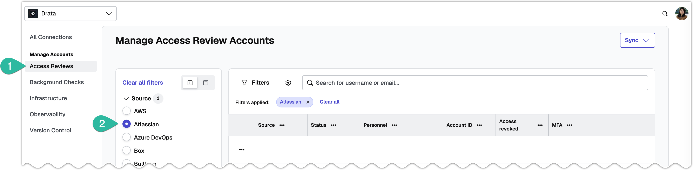

# Atlassian Integration Guide

Source: https://help.drata.com/en/articles/9242322-atlassian-integration-guide
Collection: Connection Support › Other Guidance
Updated: 2026-11-17
Fetched: 2026-11-22

## Article text

The **Atlassian** integration enables **security and compliance teams** to automate user access reviews by syncing user data directly from Atlassian.

It connects Drata to your Atlassian workspace using an **OAuth 2.0 integration**, allowing your team to maintain accurate, real-time access visibility and reduce manual review effort.

## Key Capabilities

- **User Data Sync:** Imports Atlassian user access information into Drata automatically.
- **Access Review Automation:** Keeps access data up to date for compliance testing.

## Prerequisites & Data Access

- Must have an **Admin role** in Drata.
- Must have **Admin access** in your **Atlassian Developer Console**.
- Must create an **OAuth 2.0 application** in Atlassian with the required scopes and callback URL.
- The Atlassian application must include permissions for **User Identity** and **Jira API** scopes

### Permissions & Data Table

| **Permission/Scope** | **Why It’s Needed** | **Data Accessed (Read Only)** |
|---|---|---|
| **read:me** | Allows Drata to view the active Atlassian user’s profile | User identity details |
| **read:account** | Enables Drata to view Atlassian user profiles | User account metadata |
| **read:jira-work** | Grants Drata access to Jira issue data | Jira issue and project data |
| **read:jira-user** | Allows Drata to read Jira user profile information and permissions. | Jira user data |

## Step-by-Step Setup

### Step 1: Create an OAuth 2.0 Application in Atlassian

1. Navigate to the [Atlassian developer console](https://developer.atlassian.com/console/myapps/).
2. Select **Create** and choose **OAuth 2.0 Integration** to create a new application.
   
3. Enter a **name** for your application and select **Create**.
4. You will be redirected to the application’s overview page.

### Step 2: Assign Required Scopes and Add the Callback URL.

1. In your new application’s page, select **Permissions** from the left navigation.
2. Add **User identity API** and then configure and edit the scopes to add these scopes:
   - View active user profile (code is  `read:me`)
   - View user profile (code is `read:account`)
3. Add **Jira API**:
   - View Jira issue data  (code is `read:jira-work`)
   - View user profiles (code is  `read:jira-user`)
4. Then, select **Authorization **on the left side navigation and then select **Add **to add the callback URL.
   - **Callback URL**: `https://app.drata.com/callback/atlassian`
      

### Step 3: Connect Inside Drata

1. In Drata, navigate to **Connections → Available Connections**.
2. Search for **Atlassian** and select **Connect**.
3. Follow the connection instructions displayed in the connection drawer.
4. You will be redirected to the Atlassian login page.
5. Log in and approve the mandatory permissions.
6. You will then be redirected back to Drata.

| **Drata Field** | **Atlassian Value** |
|---|---|
| OAuth 2.0 Application | The app you created in Atlassian Developer Console |
| Callback URL | `https://app.drata.com/callback/atlassian` |

## Jira Service Management portal-only accounts in access reviews

Jira Service Management portal-only accounts in an Atlassian access review connection. These are people who only use the help-center portal and have no product access or license.

On the next sync, Drata marks these accounts as Out of scope with the reason “Atlassian portal-only customer (no product access)”. The status reads **Out of scope**, and you can see the reason under **View rationale**.

**Find the rationale for out of scoped accounts**

1. Go to Manage accounts > Access Review and filter to Atlassian.
   
2. For rows where the Status column shows Out of scope, select the row's ⋯ menu, then View rationale, to see the reason.

**What doesn’t change**

- Nothing is revoked.
- Linked accounts keep their link.
- Regular Atlassian users are reviewed as before.

**What happens to reviews already in progress?**

Nothing is automatically approved, rejected, or completed.

Accounts already marked Out of scope or as a service account aren't affected. Completed reviews keep their recorded decisions.

**If a portal-only account later gets product access, does the Out of scope mark clear?**

No, not automatically. In Atlassian, giving a portal account product access means migrating it to a full Atlassian account, which creates a new account and deactivates the portal one.

In Drata, that new account appears as a separate account and goes through access review normally. The original portal account keeps its Out of scope status.

## Images

- [image 01] ../../images/integrations/atlassian/atlassian-integration-guide--01.png
- [image 02] ../../images/integrations/atlassian/atlassian-integration-guide--02.png
- [image 03] ../../images/ux/access-review/atlassian-integration-guide--03.png

## Related articles

- [Webex Integration Guide](webex-integration-guide.md)
- [Domo Integration Guide](domo-integration-guide.md)
- [RingCentral Integration Guide](ringcentral-integration-guide.md)
- [Databricks Integration Guide (UAR)](databricks-integration-guide-uar.md)
- [Box Integration Guide](box-integration-guide.md)
