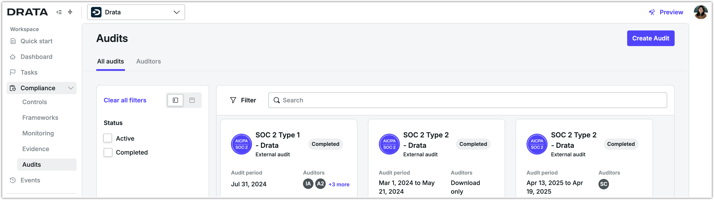
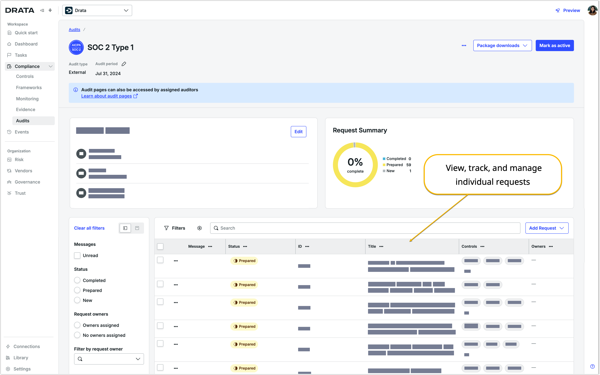
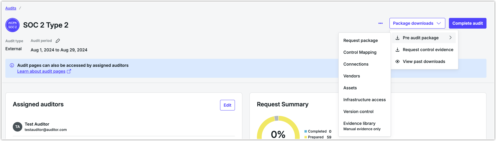
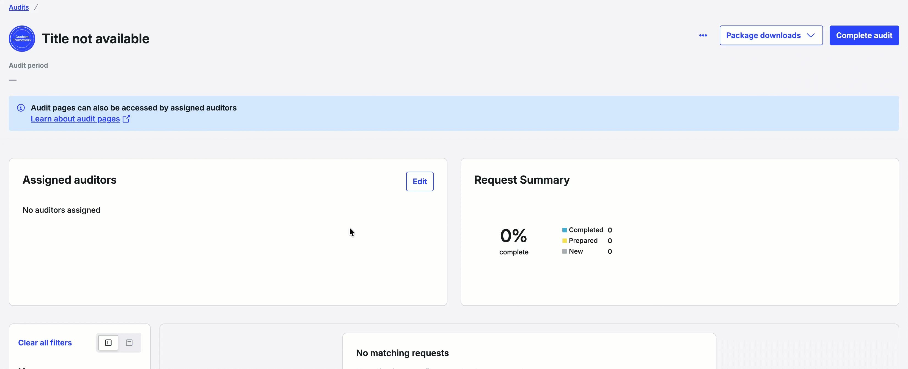

# Audits page overview (New Experience)

Source: https://help.drata.com/en/articles/13774474-audits-page-overview-new-experience
Collection: The Auditor Experience
Updated: 2026-07-23
Fetched: 2026-11-22
Description: Use the Audits page to see all of your active and completed audits in one place, track progress against auditor requests, and manage evidence and communication without leaving Drata.

## Article text

## What you can do from the Audits page

From the Audits page, you can:

- View all active and completed audits across your workspaces and frameworks in a single table.
- Open an individual audit to see its details, requests, and progress.
   - Assign and manage auditors for each audit.
   - Respond to auditor requests and track request statuses.
   - Read and send messages to your auditors about specific requests.
   - View and download audit evidence packages and request-level evidence.

## Who can access the Audits page

Access to the Audits page is controlled by roles and permissions:

- **Admins** and **workspace managers** can view audits, manage requests, and generally perform the same audit actions as Admin users when permissions are configured accordingly.
- External auditors access a separate **auditor portal** experience; what they see is optimized for their workflow but is powered by the same underlying audit data.

## How to get to the Audits page

1. In the left navigation under **Compliance**, select **Audits**.
2. The Audits page opens, showing a list of all audits you can access, along with key information and high-level progress.

---

## Understand the Audits list

When you first open the Audits page, you land on the **audits list**. This is the list of audits you’re running in Drata.

Typical information you’ll see for each audit includes:

- If the audit is **internal** or **external**
- **Audit name** and **framework** (for example, SOC 2, ISO 27001).
- **Audit period** (date range the auditor will review).
- **Overall audit status** (for example, active vs. completed).

---

## Open an audit and view its overview

Select any audit from the list to open the **audit details view**. This view is designed to mirror how your auditor sees the audit in the auditor portal, while still giving you customer-only tools where needed.

### Track and manage audit requests

The table displays each individual request that has been made, along with its current status and related details. From the requests table, you can typically:

- View each request’s **requirement**, **status**, and other context.
- Filter and sort by status (for example, New, Prepared, Completed) to focus on what still needs work.
- Open a specific request to view deeper details and respond.

Opening a request usually exposes:

- A summary of what the auditor is asking for.
- Any **related controls** mapped to that request.
- Evidence that has already been uploaded or linked to those controls.
- A dedicated **messages** section where you and your auditor can communicate about this specific request.

Requests and their statuses drive the completion percentage you see in the audit overview, so keeping statuses accurate is key to a reliable signal for your auditors and stakeholders.

### Collaborate with auditors via messages

Each request supports in-app messaging between your team and your auditors. This allows you to:

- Ask clarifying questions when a request isn’t clear.
- Provide updates or context about uploaded evidence.
- Keep a structured, time-stamped record of audit-related communication tied to the relevant request.

On the Audits page and within an audit, you can mark request messages as **read** or **unread**, which helps you and your team keep track of what’s been reviewed versus what still needs attention.

### View and download audit evidence

The Audits page is closely integrated with how Drata manages evidence for your controls and tests, so you can give auditors what they need without assembling everything manually.

You can typically:

- **Pre audit package**: These packages contain different types of evidence and metadata for the selected audit period.
   - **Request package: **Generate and download a pre-audit evidence package for this audit. Drata builds a zip file for this audit and notifies you when it’s ready to download.
   - **Control Mapping: **Include a report that maps your Drata controls (DCF) to framework requirements, so auditors can quickly see which evidence supports which requirement.
   - **Connections: **Include a summary of all systems connected to Drata (for example, cloud, HRIS, ticketing, vulnerability tools), showing which integrations are in place for this audit.
   - **Vendors: **Include your vendor inventory and key details, giving auditors a clear view of which third parties you rely on and how they’re tracked in Drata.
   - **Assets: **Include an export of your asset inventory (such as servers, devices, and other infrastructure components) that are in scope for the audit.
   - **Infrastructure access: **Include access information for your critical infrastructure (for example, cloud accounts and IAM users/groups) so auditors can review who has access to what.
   - **Version control: **Include details from your code repositories and version control systems (for example, GitHub, GitLab), helping auditors understand how source code is managed and controlled.
   - **Evidence library (Manual evidence only): **Include manually uploaded evidence files from the Evidence Library that are linked to in‑scope controls, so auditors get the supporting documents they expect in one place.
- **Request control evidence: **Ask Drata to build a **control evidence package** for this audit. Drata compiles a zip file with all control evidence, audit mappings, and an interactive manifest; once the package finishes generating, the requestor receives an email and can download it from this menu or the notification link.
- **View past downloads: **Open the **download history** for this audit. This modal lists previously generated pre-audit and control evidence packages (with their statuses and timestamps) so users can re-download existing packages without regenerating them.

Because evidence access and visibility are driven by the **audit date range and evidence sampling** your auditor configures, it’s important to choose the correct audit period and understand how sampling windows work.

---

### Manage auditors for an audit

From the Audits page and within an individual audit, you can manage who is assigned as an auditor for that engagement. Typical actions include:

- **Add auditors** to an audit, so they receive access to the auditor portal for your tenant.
- **Remove or replace auditors** if your audit firm changes personnel.
- Ensure auditors have the right access to see requests and evidence tied to that specific audit only.

---

## How the Audits page fits into the broader New Drata Experience

The Audits page is one part of a larger set of compliance pages updated in the New Drata Experience, which introduce a consistent layout and table patterns across areas like **Monitoring**, **Evidence**, **Personnel**, **Policies**, and **Risk Management**.

In practice, this means:

- You’ll see familiar controls, tests, evidence, and personnel records referenced directly from within audits.
- You can navigate from an audit to other areas (for example, Monitoring or Evidence) to investigate issues more deeply and then return to complete requests.
- The same design patterns (filters, tables, drawers, progress indicators) you see on other updated pages also apply to the Audits page.

> 🎓 **Want to learn more?** Dive deeper into this topic and see it in action! Check out our dedicated Audits course over at the **[Drata Academy](https://academy.drata.com/the-audit)**.

## Images

- [image 01] ../../images/ux/audits/audits-page-overview-new-experience--01.png
- [image 02] ../../images/ux/audits/audits-page-overview-new-experience--02.png
- [image 03] ../../images/ux/audits/audits-page-overview-new-experience--03.png
- [image 04] ../../images/ux/audits/audits-page-overview-new-experience--04.gif

## Related articles

- [Create and add auditors to an audit](create-and-add-auditors-to-an-audit.md)
- [How audit date ranges and evidence sampling affect auditor access](how-audit-date-ranges-and-evidence-sampling-affect-auditor-access.md)
- [Using the Drata Audit Portal (New Experience)](using-the-drata-audit-portal-new-experience.md)
- [What auditors can see in Audit Portal](what-auditors-can-see-in-audit-portal.md)
- [Creating and Navigating an Audit in Drata Training Video](creating-and-navigating-an-audit-in-drata-training-video.md)
