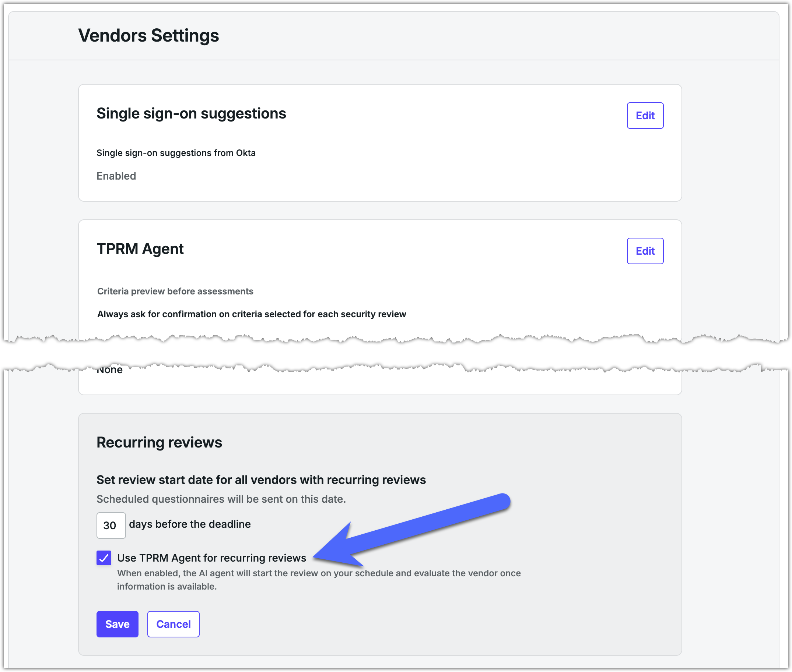
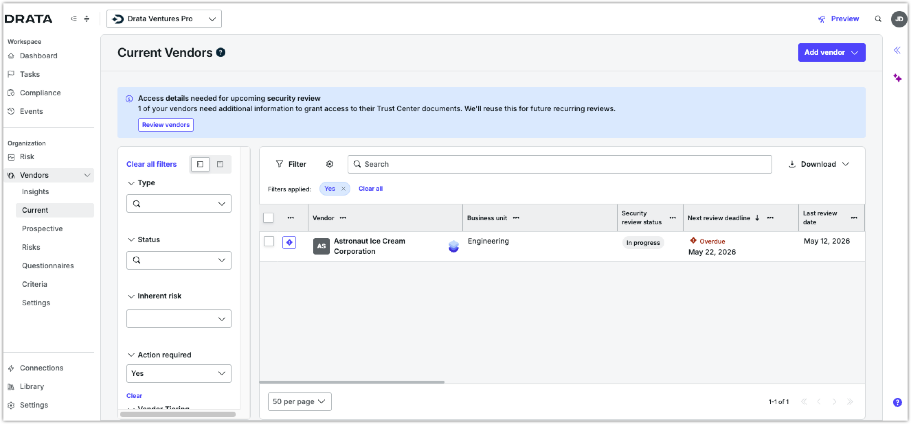
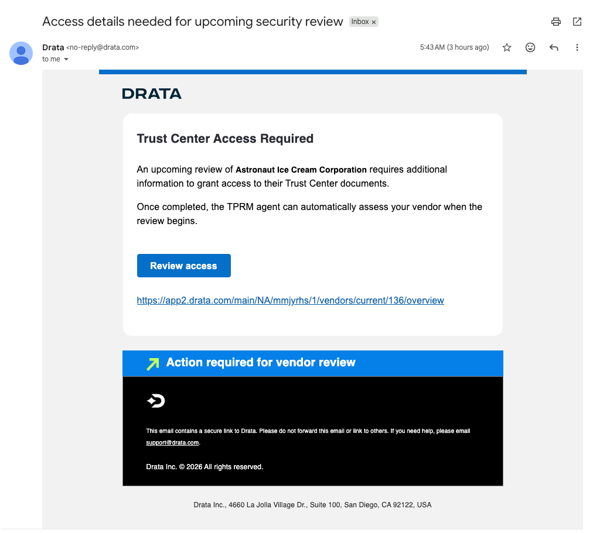

# Automate Recurring Vendor Reviews with the TPRM Agent

Source: https://help.drata.com/en/articles/15384160-automate-recurring-vendor-reviews-with-the-tprm-agent
Collection: Understand the Drata Platform › Vendors
Updated: 2026-06-04
Fetched: 2026-11-22

## Article text

Use the TPRM Agent to automatically kick off recurring vendor reviews on schedule — so your team spends less time starting reviews and more time acting on results.

**Note:** This article covers the recurring review automation setting. To learn how the TPRM Agent conducts a security review, including how it accesses SafeBase Trust Centers, see [SafeBase Integration for TPRM Reviews](safebase-integration-for-tprm-reviews.md) and [Conducting a Security Review](conducting-a-security-review-legacy.md).

---

## Before you start

The following must be true for a vendor to be eligible for recurring review automation:

- Your account has the **TPRM Agent** enabled.
- The vendor has a **SafeBase Trust Center URL** added to their vendor profile.
- The vendor has a **Security Owner** assigned.
- The vendor has **Recurring reviews** enabled.

**Note:** Recurring review automation requires a SafeBase Trust Center to be linked to the vendor. Vendors without a linked Trust Center are not eligible for this automation at this time.

---

## Enable recurring review automation

This setting is account-level and applies to all vendors that meet the prerequisites above.

1. Go to **Vendors → Settings**.
2. In the **Recurring reviews** section, set how many days before the review deadline the review should start.
3. Check **Use TPRM Agent to automate scheduled recurring reviews**.

*TPRM Agent will automatically start the review and assess the vendor against your criteria.*

Once enabled, the agent automatically creates and begins recurring security reviews for all eligible vendors on your configured schedule.

**Important:** This setting controls whether the agent runs automatically. When it is off, recurring reviews still create and send questionnaires on schedule — but the vendor assessment will not run. This is intentional, as agent assessments consume AI credits.

---

## Prepare each vendor

For the automation to run on a specific vendor, confirm the following on their vendor profile:

1. **Add the SafeBase Trust Center URL.** If the vendor has multiple products on SafeBase, use the product-specific Trust Center URL for the product you're reviewing.
2. **Assign a Security Owner.** This person receives action-required notifications if the agent needs help accessing the Trust Center.
3. **Enable recurring reviews** with a configured schedule and deadline.

**Tip:** If you need to assign Security Owners to multiple vendors at once, you can do this in bulk from the **Current vendors** page. See [Bulk actions for Current Vendors](bulk-actions-for-current-vendors-new-experience.md) for details.

---

## How it works

When a vendor's recurring review start date arrives, Drata automatically creates the security review and checks whether the TPRM Agent has valid access to the vendor's SafeBase Trust Center.

**If access is ready**, the agent proceeds without any action needed on your part:

1. Documents are automatically collected from the Trust Center.
2. The agent processes the documents and runs the assessment.

**If access details are missing or the access token has expired**, Drata starts an action-required flow so the assigned Security Owner can complete the missing step before the review continues.

### Criteria confirmation and recurring reviews

The TPRM Agent has a separate setting under **Vendors → Settings → TPRM Agent** called **Criteria preview before assessments**, with three options to: Only ask first time, Always ask, Automatically assess.

**When recurring review automation is enabled, it bypasses the criteria confirmation setting entirely.** Regardless of which option is selected, the agent **always auto-confirms criteria and proceeds without waiting for human input**. This means:

- If you have **Always ask** enabled because you want to review criteria before every assessment, automated recurring reviews **will not honor that preference** — they will proceed automatically.
- If you want recurring reviews to run fully hands-off, no changes to the criteria setting are required — the automation handles it regardless.
- If you want to retain manual control over criteria for recurring reviews, do not enable this automation setting.

---

## When action is required

SafeBase Trust Center access requests are customized per vendor, and access tokens expire over time. When the agent can't access a Trust Center automatically, it flags the vendor and notifies the assigned Security Owner approximately 7 days before the review start date.

### How you'll be notified

**Banner on the Current vendors page** — An *"Access details needed for upcoming security review"* banner appears at the top of the vendor table when one or more vendors require attention. An **Action Required** button also appears on the affected vendor's row.

**Email to the Security Owner** — An email with the subject *"Access details needed for upcoming security review"* is sent with a direct link to the vendor's access form in Drata.

The email body reads:

*An upcoming review of [vendor name] requires additional information to grant access to their Trust Center documents. Once completed, the TPRM Agent can automatically assess your vendor once your review begins.*

### How to resolve it

1. Open the vendor from the banner, the **Action Required** button on the vendor row, or the link in the email.
2. Navigate to the **Trust Center** tab on the vendor profile.
3. Review and complete any required SafeBase access fields. These vary by vendor — common examples include job title and company name.
4. Submit the access request.

Once the vendor's Trust Center admin approves the request, you'll receive a confirmation email from SafeBase with an access link. Click that link to complete the connection. After that, Drata can resume collecting Trust Center documents and the agent will continue the assessment automatically.

---

## Notes

- The automation setting applies at the account level to all vendors with recurring reviews enabled and a SafeBase Trust Center linked.
- Even when the review runs automatically, you can always supplement it by uploading additional documents or reviewing the agent's findings before finalizing.

## Images

- [image 01] ../../images/ux/vendors/automate-recurring-vendor-reviews-with-the-tprm-agent--01.png
- [image 02] ../../images/ux/vendors/automate-recurring-vendor-reviews-with-the-tprm-agent--02.png
- [image 03] ../../images/ux/notifications/automate-recurring-vendor-reviews-with-the-tprm-agent--03.png

## Related articles

- [SafeBase Integration for TPRM Reviews](safebase-integration-for-tprm-reviews.md)
- [SafeBase Trust Center integration in Drata TPRM](safebase-trust-center-integration-in-drata-tprm.md)
- [Training Video: Conducting an End-to-End Vendor Review with the Drata TPRM Agent (New Experience)](training-video-conducting-an-end-to-end-vendor-review-with-the-drata-tprm-agent-new-experience.md)
- [TPRM Agent Autonomy Settings](tprm-agent-autonomy-settings.md)
- [TPRM Agent: Trust Center Document Collection](tprm-agent-trust-center-document-collection.md)
