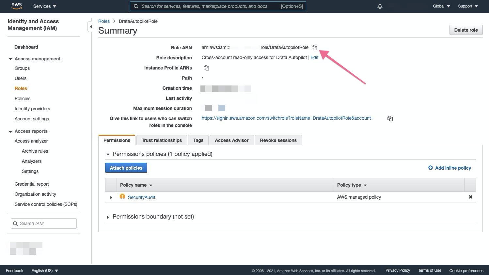

# AWS CodeCommit Integration Guide

Source: https://help.drata.com/en/articles/5867505-aws-codecommit-integration-guide
Collection: Connection Support › Version Control Guidance
Updated: 2026-11-14
Fetched: 2026-11-22
Description: This article walks through the details of configuring AWS CodeCommit to connect to Drata.

## Article text

The **AWS CodeCommit** integration enables **DevOps, Security, and Compliance teams** to automate continuous monitoring and evidence collection for infrastructure-related security controls required for compliance.

It connects Drata to your **AWS environment** to collect configuration and access data from CodeCommit, ensuring visibility into your development environment.

## Key Capabilities

- **Automated Evidence Collection:** Continuously monitors and collects CodeCommit-related compliance evidence.
- **IAM Role Integration:** Uses a secure AWS IAM role with least-privilege access for compliance monitoring.

## Prerequisites & Data Access

- Must have **Admin access** to your company’s **AWS account**.
- Must have permission to **create IAM roles and policies**.
- Must be able to **connect using a custom IAM policy** to limit access to only the required AWS services.
- Ensure your AWS environment is **not affected by exclusion tags** that could prevent data collection (see [Exclusion tags within AWS](https://docs.aws.amazon.com)).

### Permissions & Data Table

| **Permission/Scope** | **Why It’s Needed** | **Data Accessed (Read Only)** |
|---|---|---|
| **ec2:DescribeRegions** | Identifies AWS regions for environment mapping. | Region configuration data |
| **iam:GetAccountAuthorizationDetails**, **iam:GetRole**, **iam:GetUser**, **iam:ListAccountAliases**, **iam:ListMFADevices**, **iam:ListUsers**, **iam:SimulatePrincipalPolicy** | Enables Drata to retrieve IAM user, role, and account details for compliance validation. | IAM account and user data |
| **iam:GetUserPolicy**, **iam:ListUserPolicies**, **iam:SimulateCustomPolicy** | Supports policy simulation and user access verification. | IAM policy data |
| **codecommit:EvaluatePullRequestApprovalRules**, **codecommit:GetApprovalRuleTemplate**, **codecommit:GetRepository**, **codecommit:ListAssociatedApprovalRuleTemplatesForRepository**, **codecommit:ListRepositories** | Grants Drata read-only access to CodeCommit repositories for continuous monitoring. | CodeCommit repository and configuration data |

## Step-by-Step Setup

1. **Create a Policy in AWS**: Define a custom least-privilege policy (`DrataCodeCommitPolicy`) with the required permissions.
2. **Create a New IAM Role**: Create a cross-account IAM role (`DrataCodeCommitRole`) and attach the policy.
3. **Get the Role ARN**: Copy the Role ARN and enter it in Drata to complete the connection.

### Step 1: Create a Policy in AWS

1. Log in to the [AWS Console](https://console.aws.amazon.com/) with an account that has access to create a new role.
2. Go to the [IAM service](https://console.aws.amazon.com/iam) and select **Policies** from the sidebar.
3. Click **Create Policy**.
4. Select the **JSON** tab.
5. Replace the default policy text with the following Drata policy:
   ```
{ "Version": "2012-10-17", 
  "Statement": [ { 
      "Effect": "Allow", 
      "Action": "ec2:DescribeRegions", 
      "Resource": "*" 
  }, { 
      "Effect": "Allow", 
      "Action": [ 
        "iam:GetAccountAuthorizationDetails",
        "iam:GetRole", 
        "iam:GetUser", 
        "iam:ListAccountAliases", 
        "iam:ListMFADevices", 
        "iam:ListUsers", 
        "iam:SimulatePrincipalPolicy" 
     ], 
     "Resource": "*" 
 }, { 
      "Sid": "NeededUntilWeConsolidateThePolicyChecks", 
      "Effect": "Allow", 
      "Action": [ 
        "iam:GetUserPolicy", 
        "iam:ListUserPolicies", 
        "iam:SimulateCustomPolicy" 
     ],
     "Resource": "*" 
  }, {
	"Effect": "Allow",
	"Action": [
          "codecommit:EvaluatePullRequestApprovalRules",
          "codecommit:GetApprovalRuleTemplate",
          "codecommit:GetRepository",
          "codecommit:ListAssociatedApprovalRuleTemplatesForRepository",
          "codecommit:ListRepositories"
	],
	"Resource": "*"
}] 
}
   ```
6. Click **Next: Tags** (optional — add tags if used in your organization).
7. Click **Next: Review**.
8. Enter the following details:
   - **Name:** `DrataCodeCommitPolicy`
   - **Description:** `Provides read-only access for Drata CodeCommit Connection`
9. Click **Create Policy**.

**Expected outcome:** You have created the `DrataCodeCommitPolicy` with the minimum required permissions for Drata.

### Step 2: Create a New IAM Role

1. In the **IAM** service, click **Roles**, then **Create role**.
2. Select **Another AWS account**.
3. In the **Account ID** field, enter:
   ```
269135526815
   ```
4. Check **Require external ID**, and enter your **Drata Account ID**.
   - Example: `YOUR-ACCOUNT-ID` (you’ll find this in the Drata app during connection).
5. Leave **Require MFA** unchecked.
6. Click **Next: Permissions**.
7. Search for and select the policy you created:
   - `DrataCodeCommitPolicy`
8. Click **Next: Tags** (optional).
9. Click **Next: Review**.
10. Enter the following details:
   - **Role Name:** `DrataCodeCommitRole`
   - **Description:** `Cross-account read-only access for Drata CodeCommit Connection`
11. Click **Create role**.

**Expected outcome:** You now have a cross-account IAM role (`DrataCodeCommitRole`) for Drata with the correct read-only permissions.

### Step 3: Get the Role ARN

1. After creating the role, click on **DrataCodeCommitRole**.
2. Copy the **Role ARN** value.
   
3. You will use this ARN to connect the integration in Drata.

### Step 4: Connect Inside Drata

1. In Drata, navigate to **Connections → Available Connections**.
2. Search for **AWS CodeCommit** and select **Connect**.
3. During the connection process, enter the following:

| **Drata Field** | **AWS Value** |
|---|---|
| **Role ARN** | The ARN for your new IAM Role (`DrataCodeCommitRole`) |

Click **Save & Test Connection** to complete setup.

**Expected outcome:** You should now see a successful connection confirmation message in Drata.

### Step 5: Validate Connection / Test

- Confirm that the connection is active in Drata’s **Connections** page.
- If errors occur, verify that:
   - The IAM role includes the correct external ID and attached policy.
   - No AWS exclusion tags are blocking access.
   - The `DrataCodeCommitPolicy` is properly assigned.

**Expected outcome:** Drata is connected to AWS CodeCommit and performing read-only monitoring.

**🎉 You have just successfully set up proper read-only access for Drata 🎉**

## Images

- [image 01] ../../images/integrations/aws-codecommit/aws-codecommit-integration-guide--01.png

## Related articles

- [AWS Integration Guide (Infrastructure, User Access Review)](aws-integration-guide-infrastructure-user-access-review.md)
- [AWS Inspector (Amazon Inspector) Integration Guide](aws-inspector-amazon-inspector-integration-guide.md)
- [AWS GovCloud Integration Guide](aws-govcloud-integration-guide.md)
- [AWS Org Units Connection Instructions](aws-org-units-connection-instructions.md)
- [Understanding AWS Permissions and How Drata Integrates with AWS (Concept Guide)](understanding-aws-permissions-and-how-drata-integrates-with-aws-concept-guide.md)
