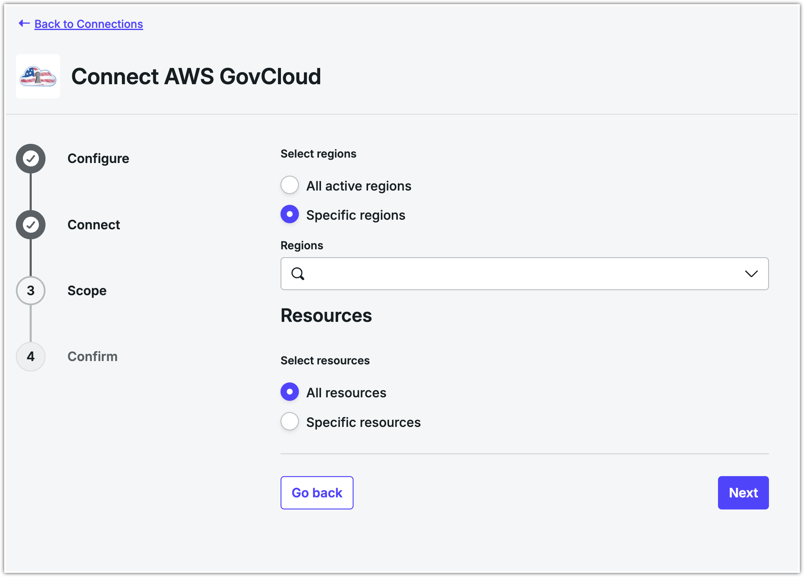

# AWS GovCloud Integration Guide

Source: https://help.drata.com/en/articles/8579862-aws-govcloud-integration-guide
Collection: Connection Support › Infrastructure Guidance
Updated: 2026-08-05
Fetched: 2026-11-22

## Article text

The **AWS GovCloud** integration enables **security and compliance teams** to automate continuous monitoring and evidence collection for infrastructure-level security controls within AWS GovCloud environments.

## Key Capabilities

- **Infrastructure Monitoring:** Continuously monitors AWS GovCloud configurations for compliance evidence.
- **Evidence Collection:** Automatically collects data across dozens of security controls.
- **Resource Scoping:** Define which AWS GovCloud resources are included in or excluded from monitoring.
- **Automatically saving**: When you start creating an AWS GovCloud connection, Drata automatically saves your progress as a draft so you can pause and resume at any time. If you exit the wizard before completing setup, the connection appears in your Active connections list with an **In progress** status, where you can resume to continue connecting or **Delete** to remove it.

## Prerequisites & Data Access

- Must have **Admin** access in your AWS GovCloud account.
- Must have permissions to **create IAM roles** and **assign the SecurityAudit policy**.
- Must have access to the **Drata Connections** page.
- Carefully review your organization’s **data residency and compliance requirements** before enabling this integration.

**IMPORTANT NOTICE:** It is important to note that Drata is currently hosted** *outside AWS GovCloud***. You can find a complete list of our Sub-processors [here](https://drata.com/sub-processors).

This feature involves providing Drata with read-only access to AWS’s [SecurityAudit policy](https://docs.aws.amazon.com/aws-managed-policy/latest/reference/SecurityAudit.html), which may not be appropriate in all [AWS GovCloud](https://aws.amazon.com/govcloud-us/faqs/) [use cases](https://aws.amazon.com/blogs/publicsector/aws-govcloud-us-standard-selecting-right-aws-partition/).

### Permissions & Data Table

| **Permission/Scope** | **Why It’s Needed** | **Data Accessed (Read Only)** |
|---|---|---|
| **SecurityAudit Policy** | Grants read-only visibility into AWS services and configurations for compliance monitoring. | Infrastructure configuration, encryption settings, IAM roles, and audit metadata |

## Step-by-Step Setup

### Open the AWS GovCloud Connection in Drata

1. In Drata, go to the **Connections** page.
2. Search for **AWS GovCloud** and select it.
3. A side panel opens with an overview of the integration, including its description, required permissions, and data accessed.
4. Review the details, then click **Connect** to launch the setup wizard.

**Expected outcome:** You'll open the guided connection wizard for AWS GovCloud.

### Wizard Step 1: Select Workspace

If your account uses workspaces, select the workspace you want to associate with this AWS GovCloud connection, then click **Next**.

### Wizard Step 2: Connect & Create and Enter Your Role ARN

Before entering anything in Drata, you first need to create a read-only IAM role in your AWS GovCloud account.

#### Create a Read-Only IAM Role in AWS GovCloud

1. Sign in to your **AWS GovCloud console** at [https://console.amazonaws-us-gov.com](https://console.amazonaws-us-gov.com) using an account with privileges to create IAM roles.
2. Go to the **IAM** service: [https://console.amazonaws-us-gov.com/iam](https://console.amazonaws-us-gov.com/iam).
3. In the sidebar, select **Roles**, then click **Create role**.
4. Choose **AWS account** → **Another AWS account**.
5. Copy the **Account ID** field (`345844027492`) from Drata.
   - **Note:** This is Drata’s AWS GovCloud account ID, used for all customers.
6. Copy the Required external ID from Drata.
   This unique External ID ensures a secure cross-account connection between your AWS environment and Drata.
7. Leave **Require MFA** unchecked. Click **Next**.
8. In the search bar, type **SecurityAudit**, then select the checkbox next to **SecurityAudit** (AWS-managed policy). Click **Next**.
9. *(Optional)* In the **Role name** and **Description** field, enter:
   - Role Name: `DrataAutopilotRole`
   - Description: `Cross-account read-only access for Drata Autopilot`.
10. *(Optional)* Add tags if required by your organization.
11. Click **Create role**.
12. After creation, open the new role and copy the **Role ARN**. You’ll paste this into Drata in the next step.

**Note:** The integration uses AWS’s default **SecurityAudit policy**, which grants broad read-only access. If your organization requires stricter controls, review the policy before proceeding to ensure it aligns with internal compliance requirements.

**Expected outcome:** You’ve created a secure, read-only IAM role in AWS GovCloud for Drata.

**Enter the Role ARN in Drata:**

1. Copy the **Role ARN** from your newly created role in AWS GovCloud.
2. In Drata’s connection setup, paste the **Role ARN** into the required field.
3. Once validated, the connection will appear under your active connections.

| **Drata Field** | **AWS GovCloud Value** |
|---|---|
| Role ARN | ARN of the `DrataAutopilotRole` created in AWS GovCloud |

All the Infrastructure monitoring tests should also include data from the AWS GovCloud account.

### Wizard Step 3: Configure Scope

#### Region Scoping: Which regions should Drata evaluate?

1. Choose a region option:
   - **All active regions** (default): Drata evaluates both AWS GovCloud regions. No further action needed; proceed to the resource scoping section below.
   - **Specific regions**: Drata evaluates only the regions you select. Then, check one or both of the available GovCloud regions: `us-gov-east-1` or `us-gov-west-1`

#### Resource Scoping: Which resources should Drata monitor?

**Note**: AWS GovCloud supports resource-level scoping only. Project- or account-level scoping is not available.

Under **Select resources**, choose one of the following:

- **All resources**: Drata monitors all supported resources in the selected region(s). No further configuration needed; click **Next** to continue.
- **Specific resources**: Drata monitors only the resources that match conditions you define. Continue with the steps below.

**If you selected Specific resources:**

1. Select a scoping tab to define whether your conditions determine what is monitored or excluded:
   - **In scope**: Resources that match your conditions are explicitly included in Drata's resource sync.
   - **Out of scope**: Resources that match your conditions are explicitly excluded from Drata's resource sync.
2. In the **Condition Group** that appears, define your first condition:
   - Under **Property**, select the resource attribute to filter by (for example, **Name**).
   - Under **Operator**, select how to match the value (for example, **equal**).
   - Under **Value**, enter the value to match against (for example, `NNSA`).
3. To add more conditions to the same group, click **+ Add condition** and repeat step 2.
4. To add a separate condition group, click **+ Add condition group** and repeat steps 2–3.
   - Conditions within a group are evaluated together.
   - Multiple condition groups allow you to define more complex scoping logic.
5. Click **Next** to continue.

### Wizard Step 4: Confirm

Review your connection settings. When everything looks correct, click **Finish** to activate the connection. The AWS GovCloud connection will appear as active in your Connections list, and all infrastructure monitoring tests will begin collecting data from your AWS GovCloud account.

## Viewing and Editing Scope

Once an AWS GovCloud connection is active, you can view and update your resource scope settings directly from the connection overview page.

**To view your current scope:**

1. Go to the **Connections** page and select your AWS GovCloud connection.
2. On the connection overview page, locate the **Scoping** section. This displays your current inclusion/exclusion rules.

**To edit your scope:**

1. On the connection overview page, click **Edit** next to the **Scoping **section.
2. Update your inclusion or exclusion rules as needed.
3. Click **Save** to apply the changes.

**Note:** Changes to scope take effect on the next monitoring cycle.

## Images

- [image 01] ../../images/integrations/aws/aws-govcloud-integration-guide--01.png

## Related articles

- [AWS Integration Guide (Infrastructure, User Access Review)](aws-integration-guide-infrastructure-user-access-review.md)
- [AWS CodeCommit Integration Guide](aws-codecommit-integration-guide.md)
- [AWS Org Units Connection Instructions](aws-org-units-connection-instructions.md)
- [Understanding AWS Permissions and How Drata Integrates with AWS (Concept Guide)](understanding-aws-permissions-and-how-drata-integrates-with-aws-concept-guide.md)
- [Identify and Add Missing AWS Permissions for Drata](identify-and-add-missing-aws-permissions-for-drata.md)
