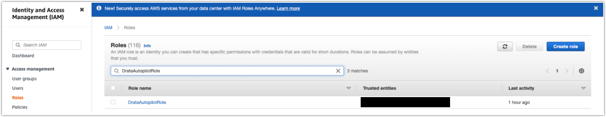
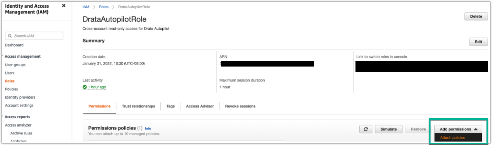
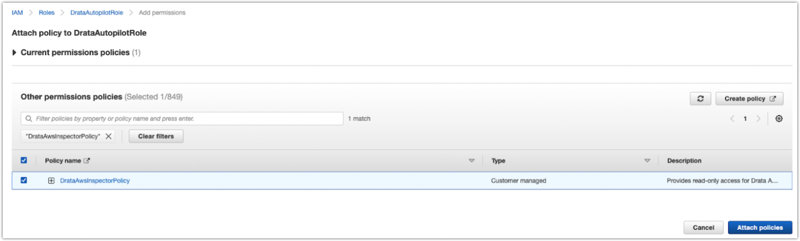

# AWS Inspector (Amazon Inspector) Integration Guide

Source: https://help.drata.com/en/articles/6619770-aws-inspector-amazon-inspector-integration-guide
Collection: Connection Support › Other Guidance
Updated: 2026-08-05
Fetched: 2026-11-22
Description: This article walks through the details of configuring AWS Inspector to connect to Drata.

## Article text

The AWS Inspector integration enables security and compliance teams to continuously monitor vulnerabilities in their AWS environment. It connects Drata to Amazon Inspector so your team can automate vulnerability evidence collection for compliance audits and security posture monitoring.

### Key Capabilities

- Vulnerability findings (via Amazon Inspector v2)
- Filtering by severity, region, and detection date
- Automated tests such as “Records of Vulnerability Scans” (mapping to DCF-18)

This integration is used to automate tests such as *Records of Vulnerability Scans* and *Timely Remediation of VLN- findings*, helping prove compliance with vulnerability-management and configuration-management policy areas.

## Prerequisites & Data Access

- Must have **Admin**, **Information Security Lead**, **DevOps Engineer**, or **Workspace Manager** roles in Drata.
- Must have an **Admin** role in your AWS account.
- Must have permissions to **create IAM policies** and **attach policies to roles**.
- Must use an existing **Drata Autopilot Role** (`DrataAutopilotRole`) in AWS.
- Drata syncs up to **1,000 new or updated vulnerabilities per day** for each connection, sorted by severity (Critical → Low).

### Permissions & Data Table

| **Permission / Scope** | **Why It’s Needed** | **Data Accessed (Read Only)** |
|---|---|---|
| `inspector2:ListFilters` | Lists configured filters for findings. | Metadata about filters |
| `inspector2:GetMember` | Retrieves AWS Organization member info (if applicable). | Member account data |
| `inspector2:ListUsageTotals` | Retrieves overall usage statistics. | Usage metrics |
| `inspector2:ListCoverageStatistics` | Lists coverage statistics across resources. | Coverage data |
| `inspector2:ListFindings` | Lists vulnerability findings. | Vulnerability details |
| `inspector2:ListFindingAggregations` | Retrieves grouped & aggregated findings. | Aggregated finding data |
| `inspector2:ListCoverage` | Lists resource coverage details. | Resource coverage info |
| `inspector2:GetFindingsReportStatus` | Checks status of generated finding reports. | Report metadata |
| `inspector2:ListTagsForResource` | Retrieves tags for Inspector resources. | Tag information |

## Step-by-Step Setup

### Step 1: Create a policy that allows access to AWS Inspector.

1. Sign in to the **[AWS Console](https://console.aws.amazon.com/)** with an account that has permission to create a new role.
2. Navigate to **[IAM](https://console.aws.amazon.com/iam) > Policies**, select **Create policy**.
3. In the **JSON** tab, paste the Drata policy (refer to the code-block below)
4. Choose **Next: Tags**, add tags if your org uses them.
5. Choose **Next: Review**, then enter:
   - **Name:** `DrataAwsInspectorPolicy`
   - **Description:** Provides read-only access for Drata AWS Inspector connection
6. Click **Create policy**.

**Drata Policy:**

```
{
  "Version": "2012-10-17",
  "Statement": [
    {
      "Effect": "Allow",
      "Action": [
        "inspector2:ListFilters",
        "inspector2:GetMember",
        "inspector2:ListUsageTotals",
        "inspector2:ListCoverageStatistics",
        "inspector2:ListFindings",
        "inspector2:ListFindingAggregations",
        "inspector2:ListCoverage",
        "inspector2:GetFindingsReportStatus",
        "inspector2:ListTagsForResource"
      ],
      "Resource": "*"
    }
  ]
}
```

### Step 2: Attach the Policy to Your Existing AWS Drata Role

1. In the **IAM console**, go to **Roles**.
2. Locate your current Drata Autopilot Role (`DrataAutopilotRole`).
3. 
4. Select **Add permissions → Attach policies**.
   
5. Search for and select **DrataAwsInspectorPolicy**.
   
6. Click **Attach policy**.

During the AWS Inspector connection process, you can choose which vulnerabilities to sync based on severity, AWS region, and detection date. These filters help tailor your sync to your compliance requirements.

### Step 3: Copy the Role ARN for Use in Drata

1. From the role summary page, copy the **Role ARN** (e.g., `arn:aws:iam::123456789012:role/DrataAutopilotRole`).
2. You’ll paste this value in Drata when completing the connection.

### Step 4: Connect AWS Inspector in Drata

1. In Drata, go to **Connections**.
2. Search for **AWS Inspector** and select it.
3. Paste the Role ARN you copied from AWS.
4. Configure the sync settings:
   - **Severity:** Choose which levels to include (Critical, High, Medium).
   - **AWS Regions:** Select the regions your role has access to.
   - **First Seen On:** Drata will sync findings detected on or after this date.
5. Click **Connect** to initiate the sync.

### Step 5: Verify That Vulnerability Findings Are Syncing

- Once connected, Drata automatically begins syncing findings based on your configuration.
- Navigate to **Vulnerabilities** in Drata’s sidebar or select **View Findings** on the connection page.
- Confirm that findings are visible and filtered by severity and region as configured.
- Drata shows *findings*, which are instances of *vulnerabilities* (an individual but higher-level CVE) against specific resources. This may reflect as higher finding counts in Drata vs. your AWS Inspector dashboard.

**Expected Outcome:**
You should now see Inspector findings populating in Drata under *Vulnerabilities*, with severity filters matching your selection.

## Important Notes

- **Supported Version:** Amazon Inspector v2 only (Inspector Classic is not supported).
- **Access Level:** Read-only permissions only; no write actions are requested.
- **Sync Limit:** Drata syncs up to 1,000 new or updated findings per day per connection.
- **Edge Cases:**
   - Removing the attached policy or role breaks the connection.
   - Ensure the role exists and is active in the regions you select.
   - For multi-account setups (AWS Organizations), the role must include cross-account access.

## Images

- [image 01] ../../images/integrations/aws/aws-inspector-amazon-inspector-integration-guide--01.png
- [image 02] ../../images/integrations/aws/aws-inspector-amazon-inspector-integration-guide--02.png
- [image 03] ../../images/integrations/aws/aws-inspector-amazon-inspector-integration-guide--03.png

## Related articles

- [AWS Integration Guide (Infrastructure, User Access Review)](aws-integration-guide-infrastructure-user-access-review.md)
- [AWS CodeCommit Integration Guide](aws-codecommit-integration-guide.md)
- [Snyk Integration Guide](snyk-integration-guide.md)
- [Semgrep Integration Guide](semgrep-integration-guide.md)
- [CrowdStrike Falcon Exposure Management Integration Guide](crowdstrike-falcon-exposure-management-integration-guide.md)
