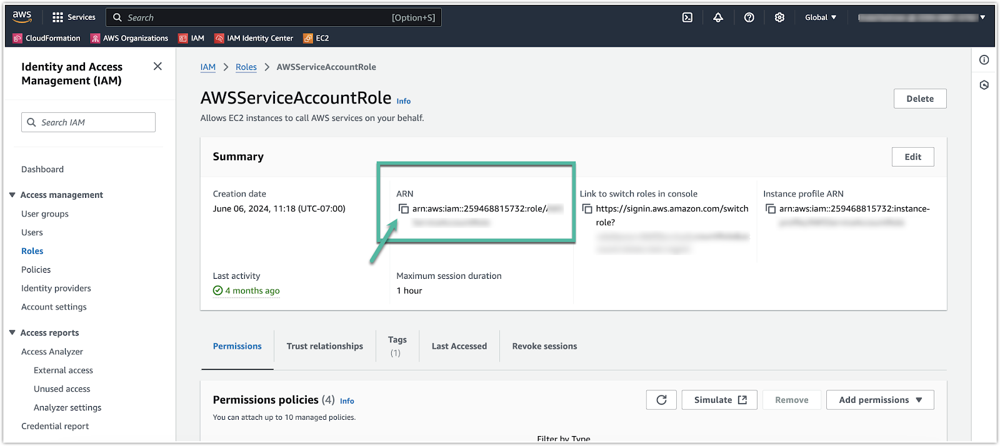
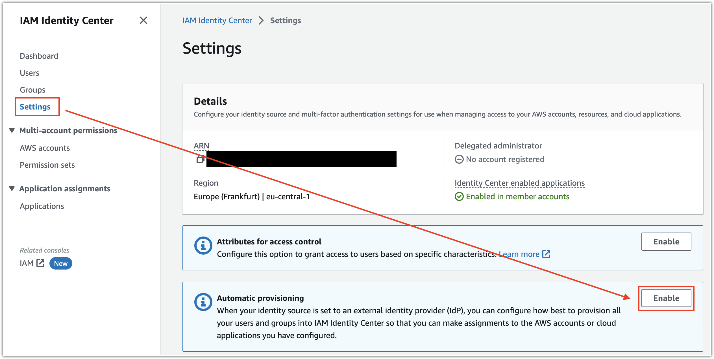
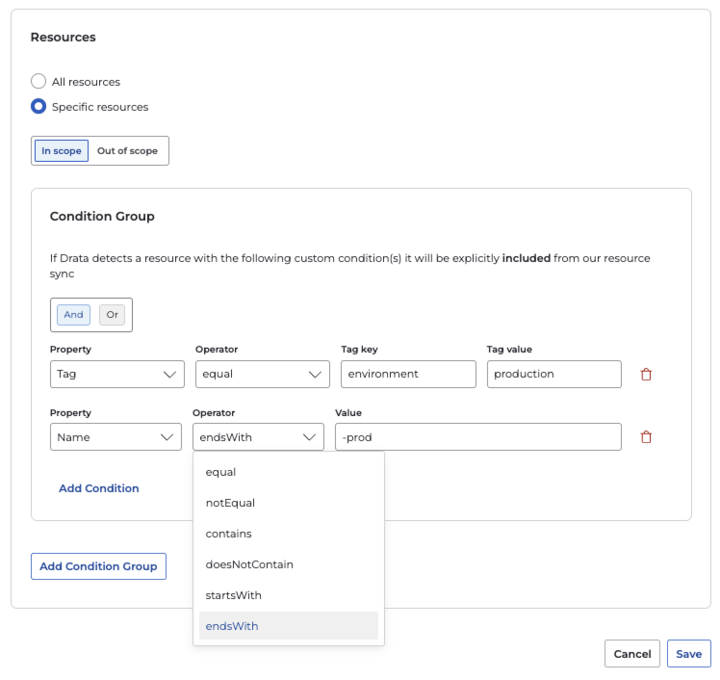

# AWS Integration Guide (Infrastructure, User Access Review)

Source: https://help.drata.com/en/articles/5048935-aws-integration-guide-infrastructure-user-access-review
Collection: Connection Support › Other Guidance
Updated: 2026-08-05
Fetched: 2026-11-22
Description: This article walks through the details of configuring AWS to connect to Drata.

## Article text

The AWS (Amazon Web Services) integration allows security and compliance teams to automate continuous infrastructure monitoring and evidence collection. It connects Drata to AWS so your team can perform read-only audits of your cloud environment and optionally sync identity data for user access reviews.

## Key Capabilities

- **Automated Monitoring & Evidence Collection:** Enable automated, continuous monitoring of infrastructure security controls and collection of audit evidence from AWS.
- **Read-Only Cross-Account Access:** Use an IAM role (e.g., `DrataAutopilotRole` with `SecurityAudit`) to allow Drata to perform read-only audits across your AWS resources.
- **Scoped & Modular Syncs:** Configure regional scoping (respecting SCP region restrictions), resource scoping rules (by tags or names), and optionally enable AWS IAM Identity Center (via SCIM) for Access Review data syncs.

This integration is used to automate tests such as **Test 105: AWS Guard Duty** and **Test 214: MFA for AWS Root Account**.

## Prerequisites & Data Access

- You must have one of the following Drata roles: **Admin**, **Information Security Lead**, **DevOps Engineer**, or **Workspace Manager**.
- **AWS Account Access:** You must have permissions to create new roles in your AWS account (typically admin or equivalent IAM privileges).
- **Service Control Policies (SCPs):** If your AWS account uses region restrictions, be prepared to configure allowed regions to avoid test errors.
- **Identity Center Support:** Organizations using **AWS Identity Center** (formerly AWS IAM Identity Center) must connect via **SCIM**; direct reads from the identity store are not supported.

**Note**: At this time, for organizations that manage identities through **AWS IAM Identity Center** (instead of AWS IAM) and select **Connect AWS Identity Center**, this functionality is only supported through SCIM linking, and does not read directly from the AWS IAM Identity Center identity store.

If you would like to enable AWS Organizational Units, refer to the [AWS Organizational Units Connection](aws-org-units-connection-instructions.md) help article.

## Step-by-Step Setup

You will be redirected to a 3 step connection process:

1. Configure Settings
2. Connect integration
3. Set Scope

## Configure Settings

In Drata, select the desired **workspaces** and **specifications** for your connection.

Options include:

- **Use AWS connection for infrastructure functions**: Enabled by default.
- **Use AWS for Access Review functions**: If you have access to the User Access Review module, you can enable syncs for that data.
- **Connect AWS Identity Center**: Organizations using AWS IAM Identity Center (instead of AWS IAM) can enable this option.
   - **Note:** This function currently supports only SCIM linking and does not yet read directly from the AWS IAM Identity Center identity store.
- **Configure AWS connection in Drata using Terraform scripts**: Set up the connection using **Terraform**.
   - For multiple sub-accounts, Terraform allows bulk IAM role creation.
   - Install **Terraform CLI (v1.2.0+)** and **AWS CLI**.
   - If using IAM credentials for authentication, refer to the [Build Infrastructure Guide]() on HashiCorp's site.
   - Download the Drata AWS Org Units script from Drata’s GitHub: [Drata AWS Terraform Script](https://github.com/drata/terraform-aws-drata-autopilot-role).

---

## Connect integration

The steps below may vary based on your previous specification selection. The setup process will adjust accordingly to match your chosen configuration.

### Step 1: Create and Link the AWS Role ARN

In the following steps, learn how to create a role and attach a policy to that role with defined permissions. This role will enable Drata to perform read-only audits of your AWS infrastructure for compliance purposes.

1. Log in to the[AWS Console](https://console.aws.amazon.com/) with an account that has access to create a new role.
2. Navigate to the[IAM service](https://console.aws.amazon.com/iam). Once there, select the **Roles** in the sidebar.
3. Select the **Create role** button, then select the **AWS account** box.
4. Click on the **Another AWS account** radio button.
5. Copy and paste the `Drata account ID: 269135526815` into the Account ID field.

### Step 2: Select trusted entity

1. Select the **Require external ID** checkbox.
2. Enter your Drata external ID into the External ID field (this is unique to your tenant, found in the AWS connection wizard in Drata).
3. Leave the Require MFA checkbox un-checked.

### Step 3: Add connection permission

1. Select the Next: Permissions button.
2. In the Attach permissions policies section, search for the **Read Only Access permission: SecurityAudit**
3. Scroll to the bottom of this list and select the **SecurityAudit** predefined role.

**Note**: Some additional permissions that are not covered by the SecurityAudit policy may be required in order to utilize additional tests that monitor AWS. Those tests and permissions are outlined in the Additional Permission Considerations section near the bottom of the article.

### Step 4: Create role

1. Copy and paste the fields below into the form, then click the **Next** button.
   Note: Ensure that the value for **Role Name** is copied exactly as listed below.
   - **Role Name**: DrataAutopilotRole
   - **Role Description**: Cross-account read-only access for Drata Autopilot

### Step 5: Link Amazon Resource Name

1. Search for and select the role you just created.
2. Copy the Role ARN from the role's summary page.
   - 
   - Paste this into Role ARN field on Drata connection wizard.
3. Scroll to the bottom of the connection form and click the ‘Next’ button to establish the link between AWS and Drata.

### Step 6: Set up Identity Center (Optional)

**Note**: Drata uses SCIM to read user data, such as usernames, emails, and roles with read-only access as configured in this setup. Although SCIM can enable write access under certain permissions, Drata only reads the data that is synced from the identity provider and does not modify or push changes to the source system. At this time, configurations using Identity Center Directory alone (without an external IdP) are not supported for SCIM provisioning.

Drata uses SCIM to connect to AWS IAM Identity Center. Enter a SCIM Endpoint and Token to enable an account data sync.

To have these fields available, you must have [provisioned an external identity provider into IAM Identity Center using SCIM](https://docs.aws.amazon.com/singlesignon/latest/userguide/provision-automatically.html). To generate a new access token you can follow the following steps:

1. In the [IAM Identity Center console](https://console.aws.amazon.com/singlesignon), choose **Settings** in the left navigation pane.
2. On the **Settings** page, enable **Automatic provisioning.**
   
3. Copy the **Access token**.

---

## Scope available regions for the connection

### Step 1: Select Scope regions

If the AWS account you are connecting to has a Service Control Policy (SCP) with region restrictions:

1. Within the Drata's AWS connection, select **Specific regions** in the **Scoping **set up section.
2. Then, choose the appropriate regions.

If it does not have restrictions, you can select the **All regions** option.

### Step 2: Verify SCP Region Restrictions for the Account

You can verify the appropriate regions through the AWS console:

1. Navigate to the[AWS Console](https://aws.amazon.com/console/).
2. In the services menu, search for and select Organizations.
3. In the Accounts section, find and select the account you are connecting to Drata.
4. Under the account details, go to the Policies tab and search for the Service Control Policies (SCPs) section to view all policies attached to the account.
5. Select each SCP to view its policy document and view the Condition element that specifies `aws:RequestedRegion`.
6. In the array, you will find a list of all the allowed regions. Select those regions in the AWS connection drawer in Drata.

Alternatively, you can use the AWS CLI to find these details:

1. List the policies attached to the account:
   - `aws organizations list-policies-for-target --target-id <account-id> --filter SERVICE_CONTROL_POLICY`
2. By using the PolicyId from the previous command, get the details of each policy.
   - `aws organizations describe-policy --policy-id <policy-id>`
3. In the output, inspect the `Condition` elements for `aws:RequestedRegion` to find a list of the allowed regions.

### Step 3: Add Resource Scoping Rules to Connection

You can also scope the resources that Drata pulls in from AWS by configuring Resource Condition Groups. When the **Specific resources **radio button is selected, you can configure condition groups with multiple conditions to determine what resources should be populated into Drata.

There are two important modifiers before you start writing conditions:** In scope **and **Out of scope**. Whichever option is selected will determine if Drata will explicitly **include** (In scope) or **exclude** (Out of scope) the resources caught by the conditionals set.

Drata only supports two property types for these conditionals:

- Tags
   - Operators available: **equal**
   - Tag values can be left blank to match any resource with a particular tag key
- Names
   - Operators include **equal**, **contains**, **doesNotContain**, **startWith**, and **endsWith**

These scoping rules will affect the next Drata sync for AWS after they are saved and determine information evaluated by Drata monitoring test utilizing AWS as well as ‘Virtual Assets’ added to the Asset page populated from AWS.



---

🎉 You have just successfully setup proper read-only access for Drata 🎉

---

## Additional Permission Considerations

The following tests require additional permissions not covered by the SecurityAudit Policy:

| **Test Name** | **Additional permission required** |
|---|---|
| Test 132: Daily Backup Job Status Monitored | `backup:ListRecoveryPointsbyResource` permission |
| Test 133: Failed Backup Alerts Being Sent | `backup:ListBackupJobs` permission |
| Test 134: Failed Backups Addressed in Timely Manner | `backup:ListBackupJobs` permission |
| Test 301: AWS DynamoDB Point-in-Time Recovery Enabled | `backup:ListRecoveryPointsbyResource` permission |

Running these tests before your connected AWS account has these proper permissions may result in an error. To add these permissions to the DrataAutopilotRole through a single inline policy:

1. Navigate to the DrataAutopilotRole in IAM Console.
2. Add an inline policy to the role.
3. In the policy editor, select the JSON tab to manually add these permissions by pasting the following JSON into the editor to include the require permissions for these tests.
   - The **Action** field specifies the permissions being added.
   - In the JSON below, the permissions being added are: `backup:ListBackupJobs` and `backup:ListRecoveryPointsbyResource` permissions. If you only need one of these permissions, you remove the unnecessary permission from the “Action” list.
      ```
{
  "Version": "2012-10-17", 
  "Statement": [
    {
      "Effect": "Allow", 
      "Action": [
        "backup:ListRecoveryPointsByResource",
        “backup:ListBackupJobs”
      ], 
      "Resource": "*"
    }
  ]
}
      ```
4. Give this inline policy a name and add it to the DrataAutopilotRole

## Images

- [image 01] ../../images/integrations/aws/aws-integration-guide-infrastructure-user-access-review--01.png
- [image 02] ../../images/integrations/aws/aws-integration-guide-infrastructure-user-access-review--02.png
- [image 03] ../../images/ux/connections/aws-integration-guide-infrastructure-user-access-review--03.png

## Related articles

- [AWS CodeCommit Integration Guide](aws-codecommit-integration-guide.md)
- [AWS Inspector (Amazon Inspector) Integration Guide](aws-inspector-amazon-inspector-integration-guide.md)
- [AWS GovCloud Integration Guide](aws-govcloud-integration-guide.md)
- [Understanding AWS Permissions and How Drata Integrates with AWS (Concept Guide)](understanding-aws-permissions-and-how-drata-integrates-with-aws-concept-guide.md)
- [Identify and Add Missing AWS Permissions for Drata](identify-and-add-missing-aws-permissions-for-drata.md)
