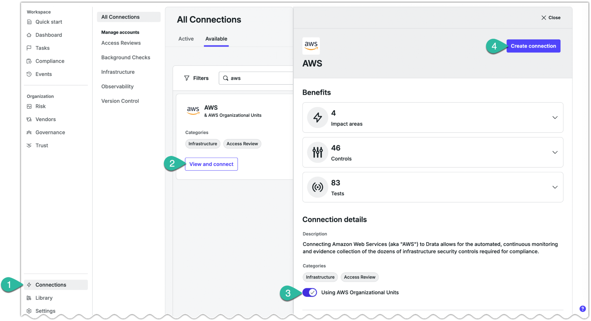
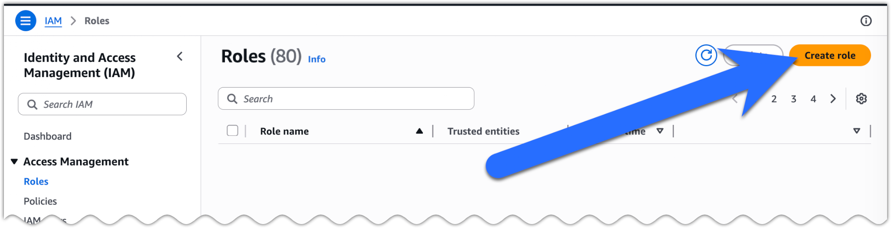
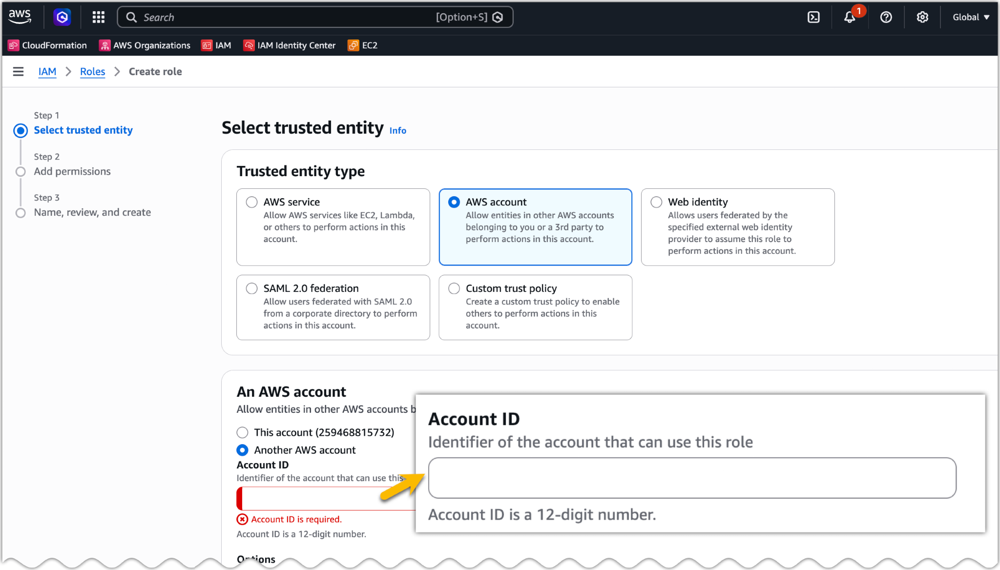
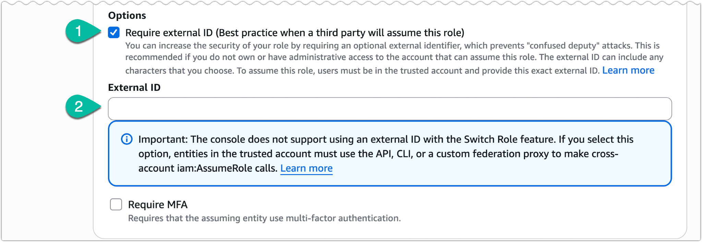
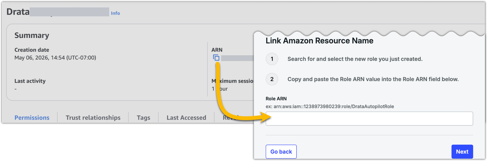

# AWS Org Units Connection Instructions

Source: https://help.drata.com/en/articles/8981943-aws-org-units-connection-instructions
Collection: Connection Support › Infrastructure Guidance
Updated: 2026-08-27
Fetched: 2026-11-22

## Article text

**Choose Your Connection Type**

| **If you have...** | **Choose...** | **Why?** | **Guide** |
|---|---|---|---|
| **One account**<br>(or a sandbox) | Do not toggle **Using AWS Organizational Units** | Quickest setup; one role per account. | [AWS Integration Guide (Single Account)](aws-integration-guide-infrastructure-user-access-review.md) |
| **Multiple accounts** (Enterprise) | Toggle **Using AWS Organizational Units** | **Recommended.** Covers all current and future accounts automatically (up to 350). | [AWS Organizational Units](aws-org-units-connection-instructions.md)<br>(This article) |

## Overview

The AWS Organizational Units (OU) integration enables Drata to automatically discover and monitor all AWS accounts within your organization for compliance. This eliminates the need to manually connect each AWS account and ensures centralized compliance monitoring across your entire AWS infrastructure.

## What This Integration Monitors

Once connected, Drata collects configuration and security data from your AWS accounts to enable 70+ automated compliance tests covering encryption, MFA, access controls, database monitoring, backup validation, and more.

## Understanding the DrataAutopilotRole

### The Core Requirement

**Drata requires an IAM role named DrataAutopilotRole to exist in every AWS account you want monitored.**

This includes:

- Your **management account** (also called root account)
- Every **member account** you want Drata to process

### Why This Role is Needed

When you connect your AWS Organization to Drata:

1. **Drata assumes the DrataAutopilotRole** in your management account to discover your organization structure and list all member accounts
2. **For each member account**, Drata assumes the DrataAutopilotRole in that account to read resource configurations and compliance data
3. **All access is read-only** — Drata cannot modify your AWS resources

### Role Configuration Requirements

Every DrataAutopilotRole must be configured with:

| **Requirement** | **Value** | **Purpose** |
|---|---|---|
| **Trusted Account** | 269135526815 | Drata's AWS account ID |
| **External ID** | Unique per customer (provided by Drata during the connection wizard process in Step 2: Connect.) | Prevents confused deputy attacks |
| **Permissions** | SecurityAudit managed policy | Read-only access to security configurations |

## Setup Instructions

### Before You Begin (All Methods)

1. Navigate to **Connections → Available Connections.**
2. Select View and Connect for the **AWS connection.**
3. Toggle on "**Using AWS Organizational Unit**"
   - If you do not enable **Using AWS Organizational Units**, refer to [AWS Integration Guide](aws-integration-guide-infrastructure-user-access-review.md) instead.
4. Start the connection!



This guide walks you through a **Connection Wizard.**

- In **Step 1**, you'll select your workspace and choose whether to enable **AWS IAM Identity Center**. (Drata uses this to pull user access data for User Access Reviews.)
- **Step 2** covers the bulk of the connection setup — your organization's **External ID** is displayed here, so keep it handy as you'll need it when creating the IAM role in AWS.
- **Step 3** covers permissions and scoping.
- **Step 4** finalizes the connection.

This guide focuses primarily on the connection setup configuration, as there are multiple ways to connect AWS to Drata depending on your organization's needs.

Identify which method fits your needs in the following section.

## Choosing Your Setup Method

There are **four ways** to create the DrataAutopilotRole across your accounts. Choose based on your team's expertise and the number of accounts you need to configure.

#### Decision Guide

| **Method** | **Best For** | **Prerequisites** | **Automation Level** |
|---|---|---|---|
| **[Option 1: Manual Creation](#h_d63c5baab4)** | Small organizations (1-10 accounts), teams unfamiliar with IaC | AWS Console access | None - fully manual |
| **[Option 2: Terraform Module (Per Account)](#h_3a8811d3a2)** | Teams already using Terraform, need granular control | Terraform expertise, existing Terraform workflow | Per-account automation |
| **[Option 3: Terraform + CloudFormation StackSets](#h_33388dbdb2)** | Large organizations (10+ accounts), existing Terraform users | Terraform expertise, StackSet permissions | High - auto-deploys to member accounts |
| **[Option 4: Manual CloudFormation StackSets](#h_b0b47674e9)** | Large organizations, teams comfortable with AWS Console but not Terraform | AWS Console access, StackSet permissions | High - auto-deploys to member accounts |

**Important:**

CloudFormation StackSet methods (options 3 and 4) do NOT automatically create the role in your management account. You must create it separately using option 1 or 2.

## Option 1: Manual Role Creation

**Best for:** Small organizations, teams unfamiliar with infrastructure-as-code tools

**▸ Instructions for Manual Role Creation**

### Prerequisites

- AWS Console access with IAM permissions in each account
- List of all AWS accounts you want to monitor

### Step 1: Create the Role in Your Management Account

Once you've created the role in your management account, copy the Role ARN and paste it into the Drata connection wizard. You'll need to create the same DrataAutopilotRole in each member account you want Drata to monitor, but the connection only uses the Management Account ARN

1. Sign in to your management account AWS Console
2. Navigate to **IAM → Roles → Create Role**
   
3. Under **Trusted entity type**, select **AWS account**, then select **Another AWS account** and enter the **Account ID** displayed in the Drata connection wizard (Step 2). It is critical that you use the Account ID shown in Drata — do not use your own AWS account ID.
   
4. Check **Require external ID** and enter the External ID displayed in the Drata connection wizard (Step 2)
   
5. Click **Next: Permissions**
6. Search for and attach the SecurityAudit managed policy
7. Click **Next: Tags**. Here, you can add optional tags for your organization.
8. Name the role DrataAutopilotRole. The role must be named **exactly** DrataAutopilotRole (case-sensitive, no extra characters).
9. Click **Create Role**
10. **Only for the Management Account: **Search for and open the new role. Then, copy the **Role ARN** and paste it into the **Role ARN** field back in the Drata AWS connection wizard.
   

### Step 2: Create the Role in Each Member Account

Ensure you repeat the section "[Step 1: Create the Role in Your Management Account](#h_6fce150cd0)" for every member account you want Drata to monitor.

Tip: You can use AWS Organizations' "Switch Role" feature to quickly move between accounts.

### Step 3: Find Amazon's Root ID

1. Navigate to the[AWS Organizations page](https://console.aws.amazon.com/organizations/v2/home/accounts) and copy the Root ID.
2. Copy and paste it into the Root ID field back in the Drata AWS connection wizard.

### Step 4: Complete Setup in Drata

1. Return to the Drata AWS connection page
2. Enter the **Role ARN** from your management account
3. Enter your **AWS Organization Root ID** (starts with r-)
4. Save the connection

---

## Option 2: Terraform Module (Per Account)

**Best for:** Teams already using Terraform who want version-controlled, repeatable infrastructure

**▸ Instructions for Terraform Module (Per Account)**

### Prerequisites

- Terraform CLI installed and configured
- Terraform state management set up
- AWS credentials configured for each account
- Familiarity with Terraform workflows

### Step 1: Add the Drata Terraform Module

- Add the following module to your Terraform configuration for **each account** you want Drata to monitor (including your management account and all member accounts).
- Replace the external_id value with the **External ID** displayed in the Drata connection wizard (Step 2).

```
module "drata_autopilot_role" {
 source = "drata/autopilot-role/aws"
 external_id = "REPLACE_THIS_WITH_YOUR_EXTERNAL_ID_FROM_DRATA"
}
```

### Step 2: Apply to Each Account

```
# For each account, configure AWS credentials and run:
terraform init
terraform plan
terraform apply
```

Note: By default, Terraform applies to one account at a time. For multi-account automation, consider using tools like Terragrunt, Terraform workspaces, or CI/CD pipelines.

### Step 3: Complete Setup in Drata

1. Return to the Drata AWS connection page
2. Enter the **Role ARN** from your management account
3. Enter your **AWS Organization Root ID** (starts with r-)
4. Save the connection

---

## Option 3: Terraform + CloudFormation StackSets

**Best for:** Large organizations already using Terraform who want automated deployment across all member accounts

**▸ Instructions for Terraform + CloudFormation StackSets**

### Prerequisites

- Terraform CLI installed and configured
- AWS credentials with StackSet permissions in management account
- StackSet trusted access enabled in AWS Organizations
- Familiarity with Terraform and CloudFormation concepts

### Important Limitation

- CloudFormation StackSets cannot deploy to the management account.
- You must create the DrataAutopilotRole in your management account separately using Option 1 or Option 2.
- Before deploying StackSets across your Organizational Units, confirm that no individual AWS accounts already have a DrataAutopilotRole manually configured.
   - If a role exists in a sub-account that falls within the OU scope, the StackSet deployment may fail or conflict with the existing role.
   - To prevent this, ensure **retries are enabled** in your CloudFormation StackSet settings before deploying.
   - **Example:** If DrataAutopilotRole was manually set up in a sub-account, and you later expand your OU scope to include that account, CloudFormation will attempt to deploy the role again — causing a conflict. Enabling retries helps handle this gracefully.

### Step 1: Create the Role in Your Management Account First

You must create the DrataAutopilotRole in your management account separately using Option 1 or Option 2.

### Step 2: Deploy StackSet via Terraform

Add the following to your Terraform configuration:

```
module "drata_stackset" {
 source = "drata/autopilot-stackset/aws"
 external_id = "YOUR_EXTERNAL_ID_FROM_DRATA"

 # Optional: Target specific OUs or accounts
 # organizational_unit_ids = ["ou-xxxx-xxxxxxxx"]
 # account_ids = ["123456789012", "234567890123"]
}

terraform init
terraform plan
terraform apply
```

This will create a CloudFormation StackSet that automatically deploys the DrataAutopilotRole to:

- All member accounts (default), OR
- Specific OUs or accounts (if configured)

### Step 3: Complete Setup in Drata

1. Return to the Drata AWS connection page
2. Enter the **Role ARN** from your management account
3. Enter your **AWS Organization Root ID** (starts with r-)
4. Save the connection

---

## Option 4: Manual CloudFormation StackSets

**Best for:** Large organizations comfortable with AWS Console who prefer not to use Terraform

**▸ Instructions for Manual CloudFormation StackSets**

### Prerequisites

- AWS Console access to management account
- IAM permissions to create StackSets
- StackSet trusted access enabled in AWS Organizations

**Important Limitation**

- CloudFormation StackSets cannot deploy to the management account.
- You must create the DrataAutopilotRole in your management account separately using **Option 1.**

### Step 1: Create the Role in Your Management Account First

Follow **Option 1** to manually create the DrataAutopilotRole in your management account.

### Step 2: Create the StackSet for Member Accounts

1. Sign in to your **management account** AWS Console
2. Navigate to **CloudFormation → StackSets → Create StackSet**
3. Select **Template is ready** and **Amazon S3 URL**
4. Enter the Drata-provided template URL:
   - **For single account**: Select **Amazon S3 URL** and enter: [https://drata-cloudformation-templates.s3.us-west-2.amazonaws.com/drata-autopilot-role.template.yaml](https://drata-cloudformation-templates.s3.us-west-2.amazonaws.com/drata-autopilot-role.template.yaml)
   - **For StackSets (Org Units)**: Optionally you may create the CloudFormation StackSet directly in the console, download the [json template](https://github.com/drata/aws-cloudformation-drata-setup/blob/main/drata_cloudformation_stackset_template.json) and upload it as a template resource.
5. Name the role DrataAutopilotRole. The role must be named **exactly** DrataAutopilotRole (case-sensitive, no extra characters).
6. Enter the **External ID** from Drata as a parameter
7. Add optional tags if desired.
8. Configure deployment options:
   - **Deployment targets:** Choose "Deploy to organization" or specific OUs
   - **Regions:** Select all regions where you have resources (or just us-east-1 if unsure)
9. Review and create the StackSet

### Step 3: Verify Deployment

1. Navigate to **CloudFormation → StackSets → [Your StackSet]**
2. Check the **Stack instances** tab to verify successful deployment to member accounts

### Step 4: Complete Setup in Drata

1. Return to the Drata AWS connection page
2. Enter the **Role ARN** from your management account
3. Enter your **AWS Organization Root ID** (starts with r-)
4. Save the connection

---

## Optional Configuration

### Including or Excluding Specific Accounts

By default, Drata will attempt to monitor all accounts in your organization. You can control which accounts are included:

**Method A: Configure in Drata**

- During the connection process, use **Step 3** of the Drata connection wizard to specify which AWS accounts to include or exclude.

**Method B: Use AWS Tags**

- Add a tag DrataExclude with value true to exclude an account
- Add a tag DrataInclude with value true to explicitly include an account

### Specifying Allowed Regions

If your organization uses Service Control Policies (SCPs) that restrict which AWS regions can be used:

1. In the Drata AWS connection settings, specify the allowed regions
2. Drata will only query resources in those regions

---

## General Prerequisites and Limits

- **Maximum accounts:** 350 accounts per AWS Organization connection
- **Cross-workspace sync:** AWS OU connections can synchronize across multiple Drata workspaces

---

## Troubleshooting

| **Issue** | **Cause** | **Solution** |
|---|---|---|
| Connection fails immediately | DrataAutopilotRole missing from management account | Create role in management account (Option 1, Step 1.1) |
| Expected account data not appearing in assets or test results | Role missing from those member accounts | Verify StackSet deployment or manually create role |
| "Access Denied" errors | Incorrect External ID or trust policy | Verify External ID matches Drata, check trusted account is 269135526815 |
| No resources found or Missing permissions errors on test results | Role missing SecurityAudit policy | Attach SecurityAudit managed policy to role |

---

## Summary: What You Need to Do

| **Your Situation** | **Recommended Path** |
|---|---|
| Small org (1-10 accounts), not using Terraform | Option 1: Manual creation in each account |
| Already using Terraform, want full control | Option 2: Terraform module per account |
| Large org, using Terraform, want automation | Option 3: Terraform + StackSets (+ manual for mgmt account) |
| Large org, comfortable with AWS Console | Option 4: Manual StackSets (+ manual for mgmt account) |

**Remember:** No matter which method you choose, the DrataAutopilotRole must exist in your management account AND every member account you want monitored.

## Images

- [image 01] ../../images/integrations/aws/aws-org-units-connection-instructions--01.png
- [image 02] ../../images/integrations/aws/aws-org-units-connection-instructions--02.png
- [image 03] ../../images/integrations/aws/aws-org-units-connection-instructions--03.png
- [image 04] ../../images/integrations/aws/aws-org-units-connection-instructions--04.png
- [image 05] ../../images/integrations/aws/aws-org-units-connection-instructions--05.png

## Related articles

- [AWS Integration Guide (Infrastructure, User Access Review)](aws-integration-guide-infrastructure-user-access-review.md)
- [AWS CodeCommit Integration Guide](aws-codecommit-integration-guide.md)
- [AWS GovCloud Integration Guide](aws-govcloud-integration-guide.md)
- [Identify and Add Missing AWS Permissions for Drata](identify-and-add-missing-aws-permissions-for-drata.md)
- [Connecting Private Git via AWS PrivateLink](connecting-private-git-via-aws-privatelink.md)
