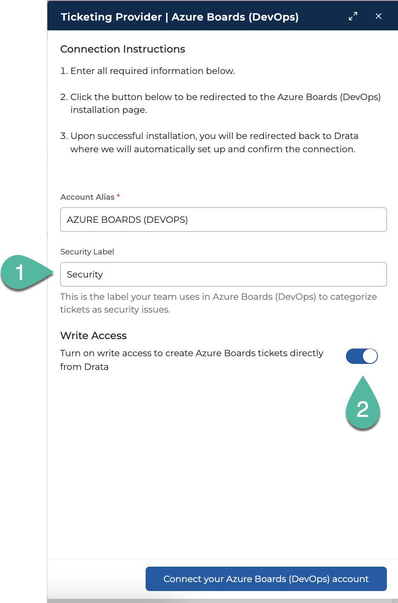
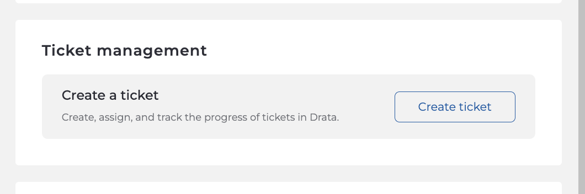
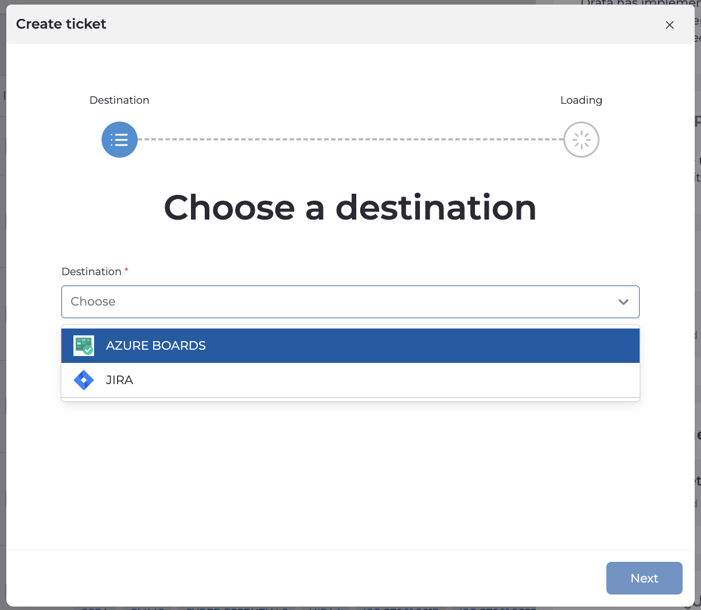
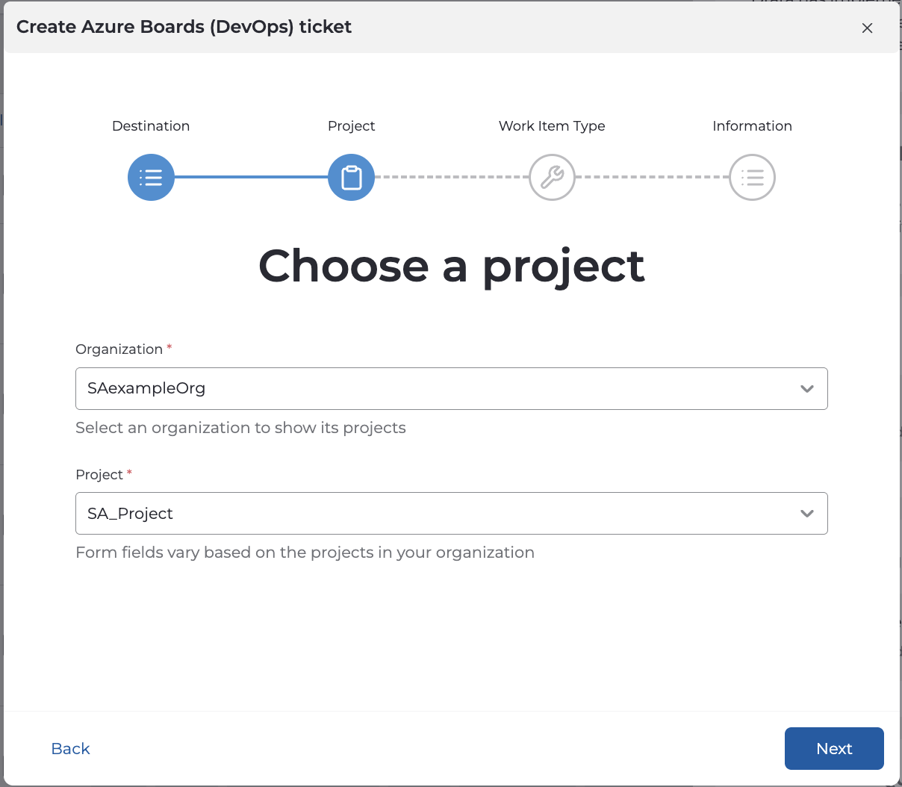
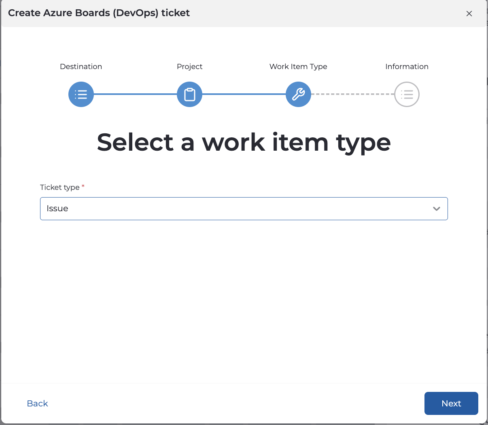
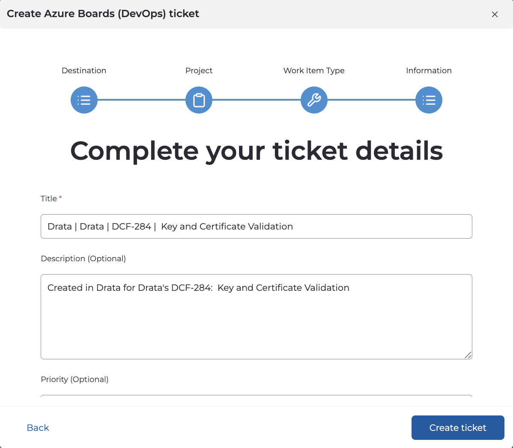

# Azure Boards (DevOps) Integration Guide

Source: https://help.drata.com/en/articles/5495282-azure-boards-devops-integration-guide
Collection: Connection Support › Ticketing Guidance
Updated: 2026-08-05
Fetched: 2026-11-22
Description: Making the initial connection to Azure Boards (DevOps)

## Article text

The **Azure Boards (DevOps)** integration enables your engineering and security teams to automate compliance checks and evidence collection. It connects Drata to Azure DevOps Boards, allowing your auditors to verify that vulnerability and security issues are tracked, prioritized, and resolved according to policy.

## Key Capabilities

- **Automated Ticket Synchronization:** Drata connects to Azure Boards projects to pull relevant ticket data.
- **Security Label Support:** Tickets labeled as *Security* can be automatically included in compliance scans.
- **Evidence Collection:** Supports tests that validate timely remediation of security issues.

## Prerequisites & Data Access

- You must be signed in to **Microsoft 365 / Azure Active Directory** with permission to connect Azure DevOps.
- You must have **Admin** access level in Azure DevOps Boards.
- Must have **Admin, Information Security Lead, DevOps Engineer, or Workspace Manager** roles in Drata.

## Step-by-Step Setup

### Step 1: Connect Azure Boards (DevOps) in Drata

1. In Drata, go to **Connections**.
2. Select the **Available Connections** tab.
3. Search for **Azure Boards (DevOps)** and select **Connect**.

- To use "Security" as the security label in Azure Boards (DevOps) to categorize tickets as security issues, enter **Security** in the **Security Label** field within the connection drawer.
- To create Azure Boards Work Items through Drata, enable **Write Access**.

When prompted, sign in with your **Microsoft 365 / Azure AD** credentials. Approve the requested permissions to complete authorization.

## Create a Ticket in Azure DevOps Boards

**Note:** In Azure DevOps Boards, tickets are called **Work Items**, while in Drata, they are referred to as **Tickets**.

You can create a ticket from the **Controls, Monitoring, or Risk Management** pages in Drata.

### Steps to Create a Ticket in Azure DevOps Boards from Drata:

1. Navigate to **Ticket Management** section in the **Controls**, **Monitor**, or **Risk Management** drawers.
   
2. If multiple ticketing providers are connected, select **Azure DevOps Boards**.
   
3. Choose an **organization** and a **project** within that organization.
   
4. Select a **ticket type**.
   
5. Fill in all required fields and select **Create**.
   

#### Important Notes

- Drata does **not** support custom fields when creating Azure DevOps Boards Work Items.
- If a Work Item requires custom fields, a **400 error** will occur.
- To prevent this error:
   - Use one of Azure DevOps' default project process flows (**Scrum, CMMI, Agile, Basic**).
   - If using a **custom process**, ensure custom fields remain **optional**.

## View and Manage Tickets in Drata

When a ticket is created for a **Control, Test, or Risk**, it appears in the corresponding drawer, with the most recent ticket displayed at the top.

### Viewing Tickets

- A **maximum of three** ‘In Progress’ tickets appear in the drawer.
- To view all the tickets, select **View all tasks** to open a modal.

### Ticket Categories

Tickets are categorized into two standardized statuses:

- **In Progress**: Tickets that are not marked as "complete" in your Azure Boards (DevOps) instance.
- **Done**: Tickets that are in a completed state in Azure Boards (such as Closed, Done).

Only tickets created in Drata for a specific Control, Test, or Risk will appear in Drata. Work Items created **directly** in Azure Boards (DevOps) will **not** be pulled into Drata for ticket management.

### Ticket Details

Each ticket includes the following details:

- Ticket Title and Description
- Creation and Updated dates
- Name of the person who created the item
- Name of the Azure DevOps Tickets assignee.
   - The assignee does not need to be an Information Security Lead or Admin in Drata.
- Tickets Status
   - This is reported by Azure Board (DevOps).
   - The status is determined by the "section" where the Tickets is located in Azure DevOps Boards.

### Update a Ticket

To update a ticket, select the **Manage ticket** and you'll be taken to Azure Boards (DevOps).

### Download Ticket Information

To download ticket details, select the **Download** icon. A **ZIP file** will be generated, containing:

- A **PDF** with ticket details.
- Any **attachments** linked to the Work Item.

### Unlink and Remove a Ticket

Note: Once you remove a ticket, it cannot be re-linked.

To unlink a ticket from a **Control, Test, or Risk**, select the **trash icon**. This removes the ticket from Drata but does **not** delete it in Azure DevOps.

## What the Connection Tests

Drata scans **all tickets** in a project **except** the following:

**Excluded Ticket Types:**

- Code Review Request
- Code Review Response
- Epic
- Feature
- Feedback Request
- Feedback Response
- Shared Step
- Test Case
- Test Plan
- Test Suite
- Shared Parameter

**Excluded Ticket States:**

- Closed
- Removed
- Resolved

This means that we will scan custom tickets you create.

For every ticket that is valid, we will check for the provided security tag.

- If there is no tag, we ignore the ticket.
- If there is a security tag and someone assigned as an owner, we ignore it.
- If there is no one assigned, the ticket will be added to the list of failed items for the [Security Issues are Prioritized](test-26-security-issues-are-prioritized.md) test.

## Images

- [image 01] ../../images/integrations/azure-boards/azure-boards-devops-integration-guide--01.png
- [image 02] ../../images/ux/tickets/azure-boards-devops-integration-guide--02.png
- [image 03] ../../images/ux/tickets/azure-boards-devops-integration-guide--03.png
- [image 04] ../../images/ux/tickets/azure-boards-devops-integration-guide--04.png
- [image 05] ../../images/ux/tickets/azure-boards-devops-integration-guide--05.png
- [image 06] ../../images/ux/tickets/azure-boards-devops-integration-guide--06.png

## Related articles

- [Asana Integration Guide](asana-integration-guide.md)
- [Linear Integration Guide](linear-integration-guide.md)
- [Target Process Integration Guide](target-process-integration-guide.md)
- [Azure Repos (DevOps) Integration Guide](azure-repos-devops-integration-guide.md)
- [Fibery Integration Guide](fibery-integration-guide.md)
