# Azure Integration Guide

Source: https://help.drata.com/en/articles/5032404-azure-integration-guide
Collection: Connection Support › Infrastructure Guidance
Updated: 2026-08-05
Fetched: 2026-11-22
Description: Connect Azure (Microsoft Entra) to perform streamlined access reviews and automate evidence collection for infrastructure security controls.

## Article text

The Azure integration enables security, compliance, and IT administrators to streamline access reviews and automate evidence collection. It connects Drata to Azure so your team can monitor user access and demonstrate infrastructure security compliance.

### Key Capabilities:

- **Access Reviews:** Automatically pull user access data from Microsoft Entra into Drata for streamlined access certification.
- **User and Group Data:** Syncs user and group information to support identity and access management controls.
- **Audit Evidence Automation:** Collects and maintains audit-ready evidence for compliance monitoring and reporting.

Azure is an infrastructure connection in Drata and is used to review access to Azure resources. Identity management and personnel synchronization for Microsoft environments are handled through the [Microsoft 365 / Microsoft 365 GCC High identity connection](microsoft-365-integration-guide.md).

## Prerequisites & Data Access

**Account / Role Needed:**

- [Microsoft Entra tenant](https://learn.microsoft.com/en-us/microsoft-365/education/deploy/intro-azure-active-directory#what-is-a-microsoft-entra-tenant) with the [Global Administrator](https://learn.microsoft.com/en-us/azure/role-based-access-control/rbac-and-directory-admin-roles#microsoft-entra-roles) role
   - To register the Drata app, create client secrets, and grant Graph API permissions.
- Access to Azure subscription(s) to assign the **Reader role** (and **Key Vault Reader role** for GCC High).
   - To assign the **Reader role** (and **Key Vault Reader role** in GCC High) to the Drata app.

**Additional Notes:**

- If you want to connect multiple Microsoft subscriptions, refer to [Azure Management Groups](azure-management-groups-integration-guide.md)connection.
- You can limit or customize who is synced into Drata by specifying group object IDs. To learn more, go to Microsoft's[Edit group settings](https://learn.microsoft.com/en-us/entra/fundamentals/how-to-manage-groups#edit-group-settings).
   - Each member within the top level of a group is synced.
   - Nested groups sync as one individual; members of nested groups are not pulled individually. For complex scenarios, use [Microsoft's dynamic group feature](https://learn.microsoft.com/en-us/entra/identity/users/groups-dynamic-membership).

### Permissions & Data Table

Drata requires the following **Microsoft Graph API application permissions** and **Azure RBAC role assignments**.

| **Permission / Scope** | **Why It’s Needed** | **Data Accessed (Read Only)** |
|---|---|---|
| **User.Read.All** | Used in **access reviews** to import personnel. | User directory data |
| **Reports.Read.All** | Used in **evidence collection** (e.g., MFA checks). | Audit & usage reports |
| **Directory.Read.All** | Used when **syncing groups** into Drata. | Group memberships, directory info |
| **Policy.Read.All** | Used in **monitoring** to confirm policy configurations. | Policy objects |
| **AuditLog.Read.All** | Used in **infrastructure monitoring** to detect changes (e.g., role or policy updates). | Audit log data |
| **Reader role** | Provides subscription-wide read-only visibility. | Infrastructure configuration data |
| **Key Vault Reader role (GCC High)** | Required only in Azure GCC High environments. Grants read-only access to Key Vault properties and metadata (not secrets/keys). | Key Vault metadata (properties only) |

## Step-by-Step Setup

### Step 1: Register a new Drata App in Microsoft

1. Log into the Microsoft [Entra portal](https://portal.azure.com/) with [Global Administrator](https://learn.microsoft.com/en-us/azure/role-based-access-control/rbac-and-directory-admin-roles#microsoft-entra-roles) role.
2. Within the Entra portal, navigate to **App Registration** > **New Registration**.
   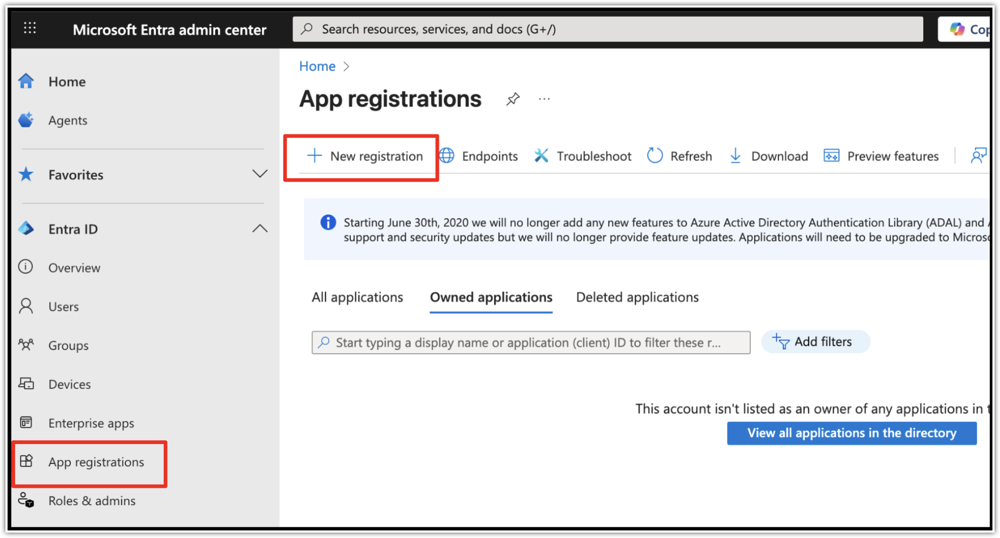
3. [Register a new application](https://learn.microsoft.com/en-us/entra/identity-platform/quickstart-register-app#register-an-application) with:
   - **Application name**: `Drata Entra App`
   - **Supported account types**: Accounts in this organizational directory only
   - **Redirect URL**: Leave blank.
   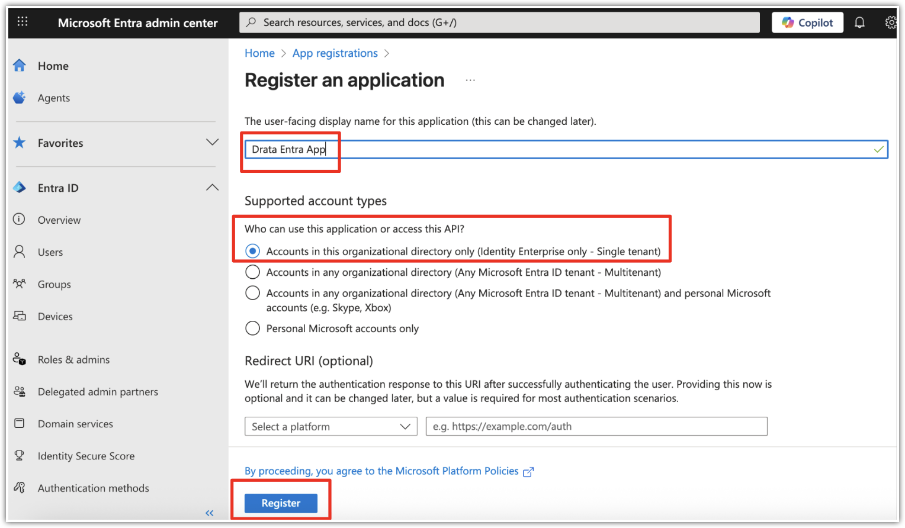
4. Copy the **Application (client) ID **and **Directory (tenant) ID**.
   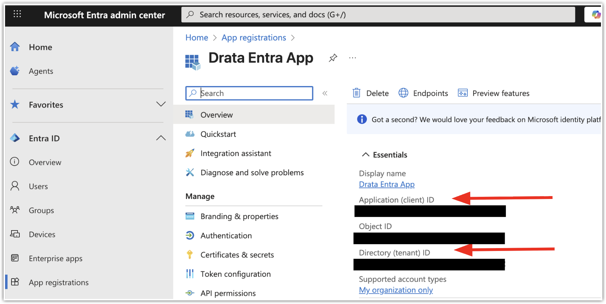
5. Enter these values in Drata:
   - **Tenant ID: **Entra’s Directory (tenant) ID.
   - **Application ID: ** Entra’s Application (client) ID.

---

### Step 2: Create a Client Secret

1. Follow Microsoft’s documentation on how to [add a client secret](https://learn.microsoft.com/en-us/entra/identity-platform/quickstart-register-app#add-a-client-secret).
2. Within the Drata Entra App created in Step 1, navigate to “**Certificates & secrets**” and select “**New client secret**”
   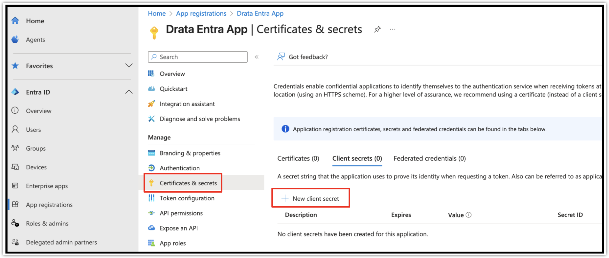
   - **Description:** Drata application secret
   - **Expiration:** 24 months
      - Note: The integration gets disconnected when the secret expires, so we recommend setting a reminder to ensure it stays active.
   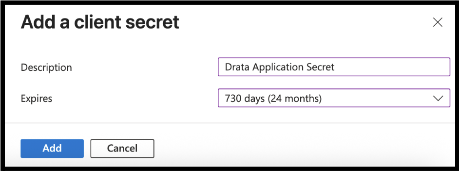
3. (**❗Important Step**) Copy the **secret value** (not the secret ID).
   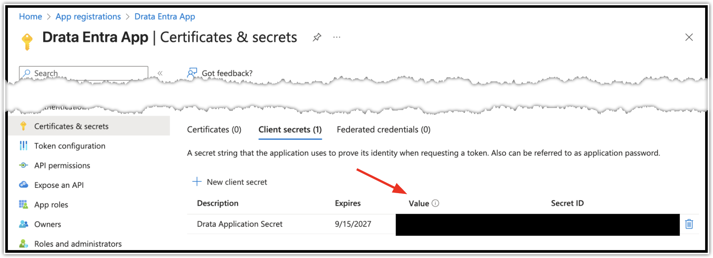
4. (**❗Important Step**) Refresh the **Certificates & Secrets** page to confirm activation.
   - **Note**: Microsoft holds the client secret in a pending state until the page is refreshed.
5. Paste the secret value into Drata’s **Application Secret** field.

---

### Step 3: Add Permissions

To learn more about Microsoft's read-only permissions, refer to Microsoft’s documentation: [Application permission to Microsoft Graph](https://learn.microsoft.com/en-us/entra/identity-platform/quickstart-configure-app-access-web-apis#application-permission-to-microsoft-graph).

1. On your newly registered app overview page, in the left sidebar, under **Manage **and select **API permissions**.
2. Select** + Add a permission**.
   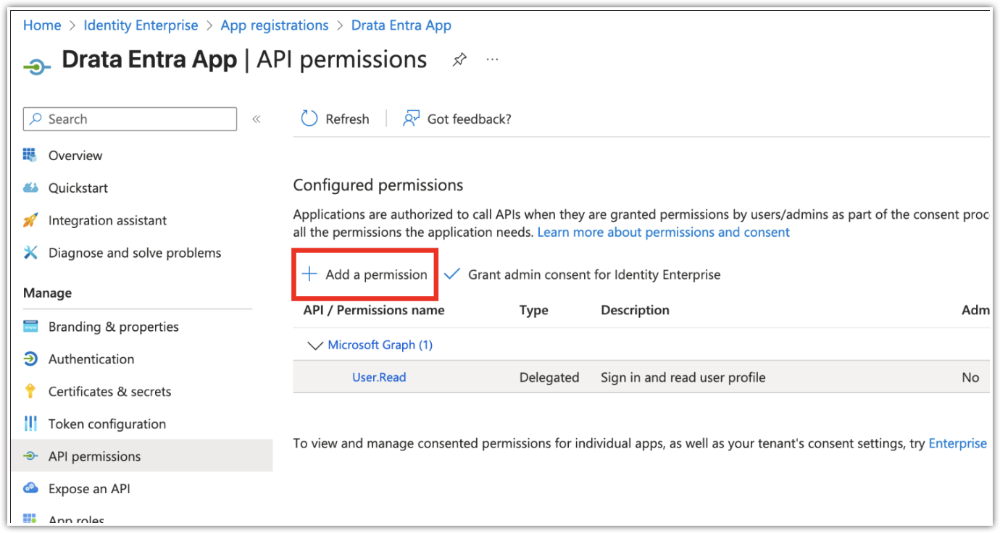
3. Select **Microsoft Graph API → Application permissions**.
   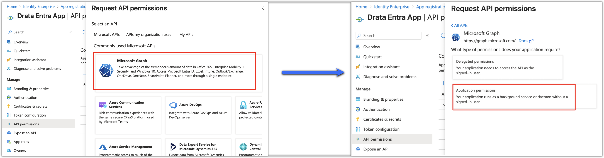
4. Add the following 5 permissions:
   - `User.Read.All`
   - `Reports.Read.All`
   - `Directory.Read.All`
   - `Policy.Read.All`
   - `AuditLog.Read.All`
5. Select **Add permissions**, then **Grant admin consent**.
   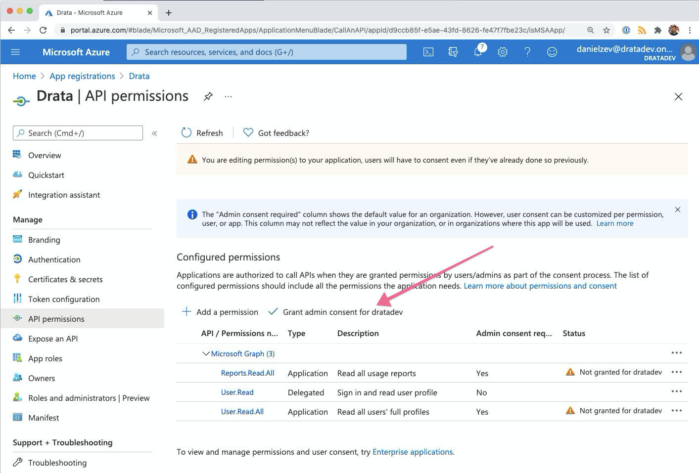

> **Note about `User.Read` permission:**
> When you register a new application in Microsoft Entra, Microsoft automatically assigns the **delegated permission `User.Read`**. This only allows a signed-in user to read their own profile. Drata does not use this permission. 
>
> Instead, Drata requires the **application permission `User.Read.All`**, which provides directory-wide read access needed for access reviews. You do not need to remove `User.Read`; it can remain in place but is unused by Drata.

---

## Step 4: Assign Azure Roles

**Find subscription ID:**

1. In Azure[Subscriptions](https://portal.azure.com/#blade/Microsoft_Azure_Billing/SubscriptionsBlade), copy your Subscription ID and enter it into Drata. Refer to Microsoft’s documentation to[find your Azure subscription ID](https://learn.microsoft.com/en-us/azure/azure-portal/get-subscription-tenant-id#find-your-azure-subscription).

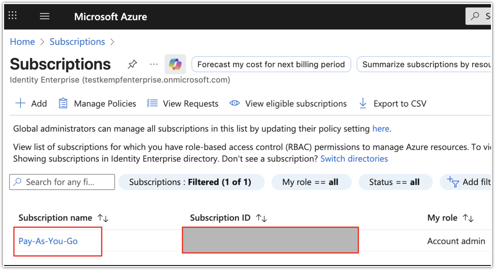

**Assign the Reader role to the Drata App:**

1. In the Azure portal, go to your subscription → **Access control (IAM)**.
2. Select **+ Add → Add role assignment**. For more information, refer to [Step 2: Open the Add role assignment page](https://learn.microsoft.com/en-us/azure/role-based-access-control/role-assignments-portal#step-2-open-the-add-role-assignment-page).
   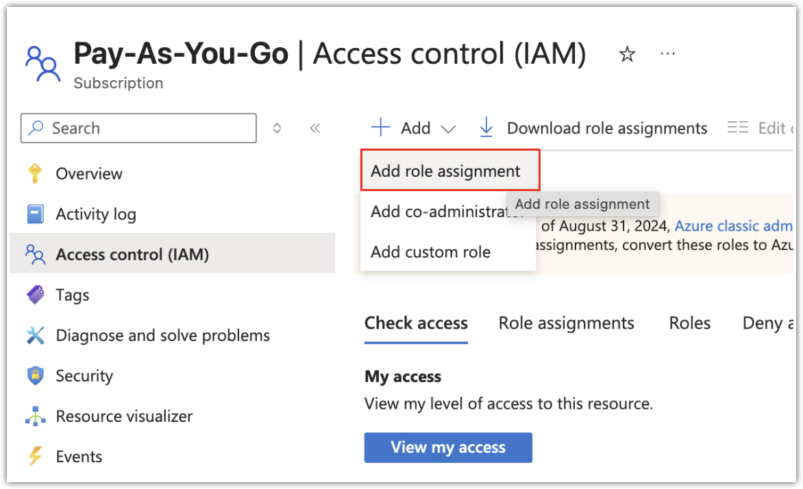
3. Choose the **Reader** role (built-in). For more information, refer to [Step 3: Select the appropriate role](https://learn.microsoft.com/en-us/azure/role-based-access-control/role-assignments-portal#step-3-select-the-appropriate-role).
   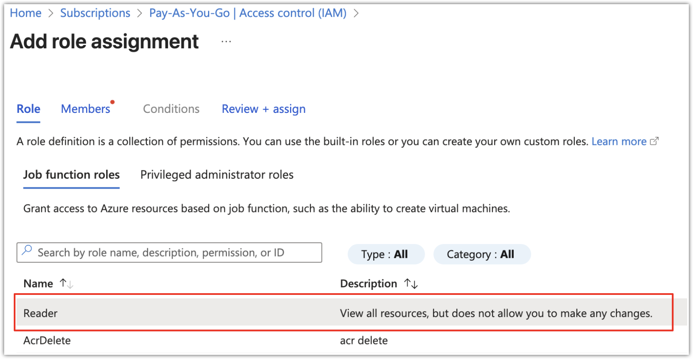
   - **Important (Azure GCC High only): **In addition to the Reader role, you must also assign the **Key Vault Reader** role to the Drata Entra App in your subscription.
4. Under *Assign access to*, select **User, group, or service principal**.
5. Select **+ Select Members** and choose your service principal **Drata Entra App**.
   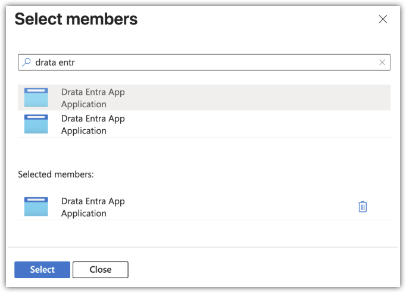
6. Select Review + assign to complete the role assignment. Refer to Microsoft’s documentation to learn how to[select who needs access](https://learn.microsoft.com/en-us/azure/role-based-access-control/role-assignments-portal#step-4-select-who-needs-access).
   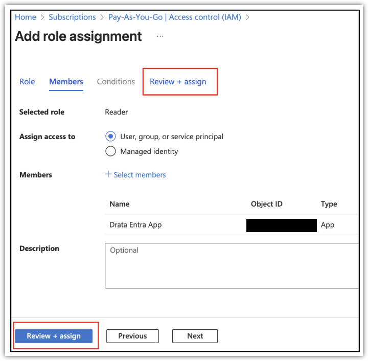
7. Save the assignment. Refer to Microsoft's documentation to learn how to select who needs access. Skip steps 5-9 since Drata does not manage identities.

---

## Choose Who to Sync into Drata

In Drata, you can select who you would like to sync from Azure. Choose who you want to bring into Drata from this infrastructure provider

- **Everyone** → Sync all members.
- **Specific Groups** → Enter group object IDs.
   - To learn more about Microsoft's group settings and group object ID, go to Microsoft's[Edit group settings](https://learn.microsoft.com/en-us/entra/fundamentals/how-to-manage-groups#edit-group-settings).
   - Nested groups sync as one entity.
   - For complex scenarios, use dynamic groups.
   - **Note**: Each member within the top level of a group is synced. Nested groups are synced as one individual. Individual members of any nested group are not synced. For more complex group membership, refer to [Microsoft's dynamic group feature](https://learn.microsoft.com/en-us/entra/identity/users/groups-dynamic-membership).

## Complete the Connection: Azure

When connecting, enter the following values from Azure:

| **Drata Field** | **Azure Value (Where to Find It)** |
|---|---|
| **Tenant ID** | Directory (tenant) ID from the app’s **Overview page** in Entra. |
| **Application ID** | Application (client) ID from the app’s **Overview page** in Entra. |
| **Client Secret Value** | Secret Value generated in **Certificates & Secrets** (not Secret ID). |
| **Subscription ID** | Subscription ID from the **Subscriptions page** in the Azure portal. |

For steps on accessing and using the Connections page in Drata, refer to [The Connections Page in Drata](https://help.drata.com/en/articles/12305645-the-connections-page-in-drata).

## Important Notes

- Expired secrets disconnect the integration — refresh regularly.
- Integration enforces the **principle of least privilege** (read-only).

**Edge Cases:**

- Nested groups sync as one entity only.
- Expired/missing secrets cause failures.

## Images

- [image 01] ../../images/integrations/azure/azure-integration-guide--01.png
- [image 02] ../../images/integrations/azure/azure-integration-guide--02.png
- [image 03] ../../images/integrations/azure/azure-integration-guide--03.png
- [image 04] ../../images/integrations/azure/azure-integration-guide--04.png
- [image 05] ../../images/integrations/azure/azure-integration-guide--05.png
- [image 06] ../../images/integrations/azure/azure-integration-guide--06.png
- [image 07] ../../images/integrations/azure/azure-integration-guide--07.png
- [image 08] ../../images/integrations/azure/azure-integration-guide--08.png
- [image 09] ../../images/integrations/azure/azure-integration-guide--09.png
- [image 10] ../../images/integrations/azure/azure-integration-guide--10.png
- [image 11] ../../images/integrations/azure/azure-integration-guide--11.png
- [image 12] ../../images/integrations/azure/azure-integration-guide--12.png
- [image 13] ../../images/integrations/azure/azure-integration-guide--13.png
- [image 14] ../../images/integrations/azure/azure-integration-guide--14.png

## Related articles

- [Microsoft 365 Integration Guide](microsoft-365-integration-guide.md)
- [Azure Repos (DevOps) Integration Guide](azure-repos-devops-integration-guide.md)
- [Azure Management Groups Integration Guide](azure-management-groups-integration-guide.md)
- [Identify and Add Missing Azure Permissions for Drata](identify-and-add-missing-azure-permissions-for-drata.md)
- [Understanding Azure Permissions and How Drata Integrates with Azure (Concept Guide)](understanding-azure-permissions-and-how-drata-integrates-with-azure-concept-guide.md)
