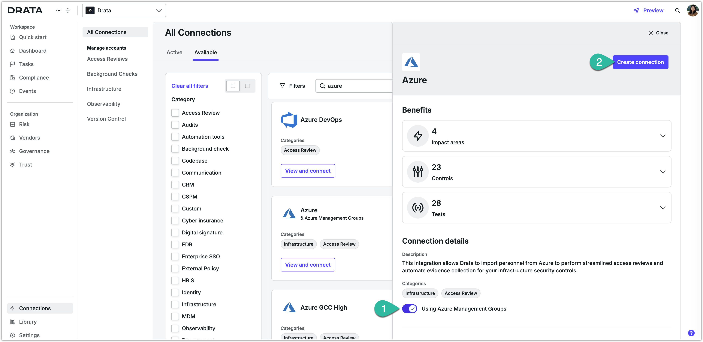
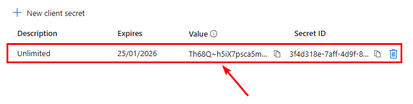
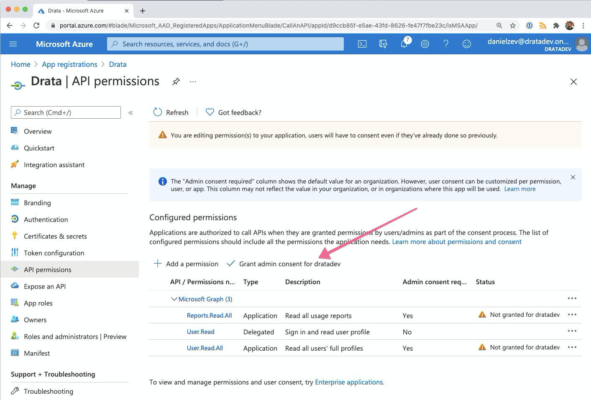
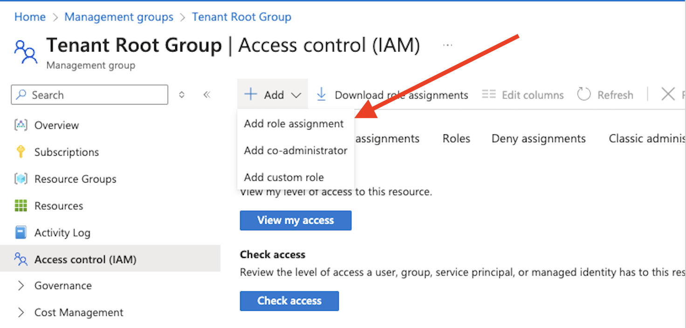
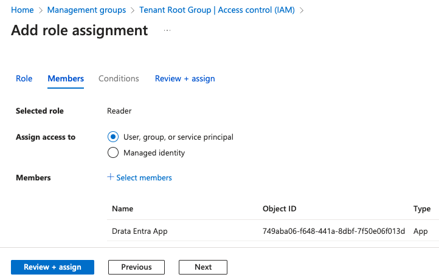
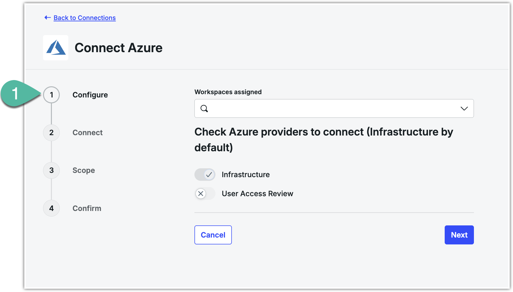
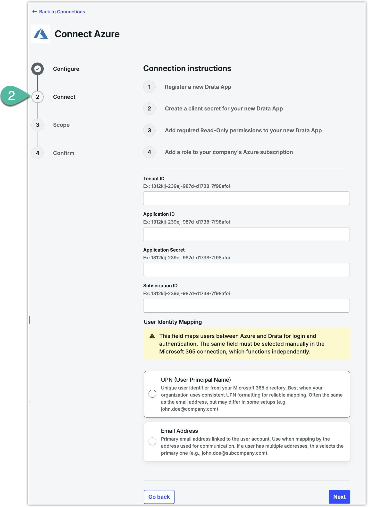
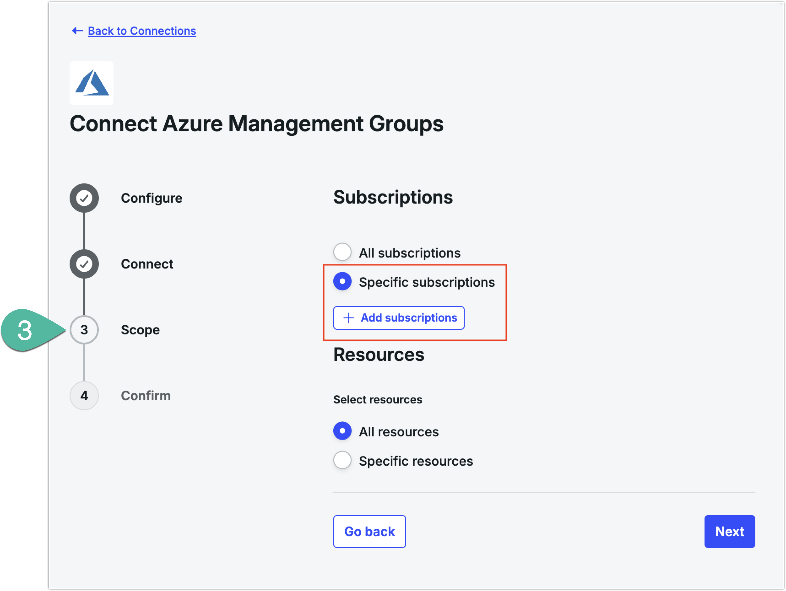
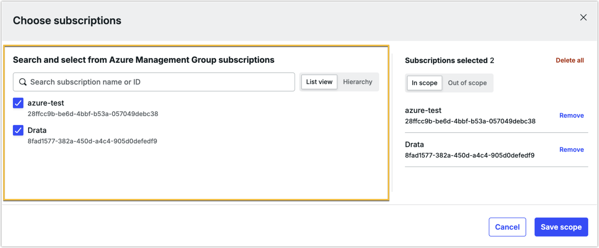

# Azure Management Groups Integration Guide

Source: https://help.drata.com/en/articles/9762686-azure-management-groups-integration-guide
Collection: Connection Support › Infrastructure Guidance
Updated: 2026-08-17
Fetched: 2026-11-22

## Article text

The **Azure Management Groups integration** enables **Cloud Infrastructure, Security, and Compliance teams** to connect multiple Azure subscriptions to Drata for centralized compliance automation. It allows Drata to read infrastructure data across subscriptions, providing continuous monitoring and evidence collection for cloud security and configuration controls.

## Key Capabilities

- **Multi-subscription visibility:** Connects multiple Azure subscriptions via Management Groups for streamlined evidence collection.
- **Automated compliance evidence:** Continuously monitors cloud infrastructure configurations and subscription-level permissions.
- **Scalable management:** Supports dynamic inclusion and exclusion of subscriptions using tagging policies.

## Prerequisites & Data Access

**Note**: Custom tests cannot be created for Azure Management Groups.

- Make sure you are logged into your company’s [Microsoft Entra tenant](https://learn.microsoft.com/en-us/microsoft-365/education/deploy/intro-azure-active-directory#what-is-a-microsoft-entra-tenant) with the [Global Administrator Microsoft Entra role](https://learn.microsoft.com/en-us/azure/role-based-access-control/rbac-and-directory-admin-roles#microsoft-entra-roles).
- To connect multiple Azure subscriptions through Azure Management Groups, ensure the Drata app has the required role assignments on the Management Groups that contain the subscriptions you want to monitor.
- You can limit or customize who is synced into Drata.
   - To learn more about Microsoft's group settings and group object ID, go to Microsoft's [Edit group settings](https://learn.microsoft.com/en-us/entra/fundamentals/how-to-manage-groups#edit-group-settings).
   - Each member within the top level of a group is synced. Nested groups are synced as one individual. Individual members of any nested group are not synced.
   - For more complex group membership, refer to Microsoft's [dynamic group feature](https://learn.microsoft.com/en-us/entra/identity/users/groups-dynamic-membership).

**Additional Notes:**

- To connect the Azure Management Groups integration, turn on **Using Azure Management Groups** during setup.
   
- If you want to connect a single Azure subscription instead, refer to the [Azure Integration Guide](azure-integration-guide.md).

### Permissions & Data Table

| **Permission/Scope** | **Why It’s Needed** | **Data Accessed (Read Only)** |
|---|---|---|
| Directory.Read.All | Reads Entra (Azure AD) directory structure and group membership | Tenant directory and user metadata |
| User.Read.All | Reads user information for access reviews | User accounts and role assignments |
| Policy.Read.All | Reads Azure security and compliance policies | Cloud policy configurations |
| Reports.Read.All | Provides activity and usage reporting visibility | Subscription activity and compliance reports |
| AuditLog.Read.All | Allows Drata to view audit and event logs | Audit logs related to infrastructure changes |
| Reader Role | Provides read-only access to Azure resources | Subscription-level configuration and metadata |

## Step-by-Step Setup

1. In Drata, go to the **Connections** page
2. Search for and select **Azure Management Groups** within your available connections.

During the connection process, you can:

- Enable Infrastructure or User Access Review.
- Enter the required fields: Tenant ID, Application ID, and Application Secret (Value). For more information about required fields, refer to the next sections.
- Configure who you would like to sync into Drata from Azure via Group Specification.

The following sections go in depth, aiding you in external resources and configuration requirements.

1. Register a new Drata App.
2. Create a client secret for your new Drata App.
3. Add the `ReadOnly` permissions to your new Drata App.
4. Add a role to your company’s Entra subscription(s).

---

## Step 1: Register a new Drata App

You must connect a registered application with the specific configurations to Drata.

### Register a new application in Microsoft

1. Go to Microsoft’s [Entra portal](https://entra.microsoft.com/) and log in.
   - Note: You must be logged into your company’s [Microsoft Entra tenant](https://learn.microsoft.com/en-us/microsoft-365/education/deploy/intro-azure-active-directory#what-is-a-microsoft-entra-tenant) with the [Global Administrator Microsoft Entra role](https://learn.microsoft.com/en-us/azure/role-based-access-control/rbac-and-directory-admin-roles#microsoft-entra-roles).
2. Refer to Microsoft’s documentation on [how to register an application](https://learn.microsoft.com/en-us/entra/identity-platform/quickstart-register-app#register-an-application). When registering the application, ensure that the fields have the following values.
   - **Application name**: Enter **`Drata Entra App`**.
   - **Supported account types**: Select **Accounts in this organizational directory only**.
   - **Redirect URL**: Leave blank.
3. Copy the Application (client) ID and Directory (tenant) ID.
4. After completing registration in Microsoft, enter the fields you copied into Drata.
   - **Tenant ID**: Enter the Entra’s Directory (tenant) ID.
   - **Application ID**: Enter the Entra’s Application (client) ID.

## Step 2: Create a client secret for your new Drata App

Next, you’ll need to create a client secret for your new app in Microsoft to identify your app:

1. Follow Microsoft’s documentation on how to [add a client secret](https://learn.microsoft.com/en-us/entra/identity-platform/quickstart-register-app#add-a-client-secret).
   - **Description**: Enter `Drata application secret`.
   - **Expiration**: Select 24 Months.
      - **Note**: Ensure to set a reminder for the expiration date. The integration gets disconnected when the secret expires.
2. After adding your client secret, copy the secret’s Value. Do not copy the secret ID.
3. Refresh Microsoft's Azure Certificates and Secrets page.
   - Note: Microsoft holds the client secret in a pending state until the page is refreshed.
4. After refreshing, enter the fields you copied into Drata.
   - **Application (Secret)**: Paste the secret value you copied

> **⚠️ Note**: When creating the client secret, ensure you copy the secret value and not the secret ID.
>
> 

## Step 3: Add five read-only permissions to your new Drata App

To learn more about Microsoft's read-only permissions, refer to Microsoft’s documentation: [Application permission to Microsoft Graph](https://learn.microsoft.com/en-us/entra/identity-platform/quickstart-configure-app-access-web-apis#application-permission-to-microsoft-graph).

1. Access the Microsoft’s API Permissions page. To access the API permission page:
   - On your newly registered app overview page, in the left sidebar, expand the **Manage **menu and select **API permissions**.
2. Select **+ Add a permission**.
3. Select **Microsoft graph** and then **Application permissions**.
4. Add the five permissions. In the search box, search for the following permissions:
   - `User.Read.All`
   - `Reports.Read.all`
   - `Directory.Read.All`
   - `Policy.Read.All`
   - `AuditLog.Read.All`
5. Select the **Add permissions **button.
6. Grant admin consent to the newly added permissions. To grant admin consent, select **Grant admin consent for <name>**.



**Note**: Microsoft includes the `User.Read` permission by default when you register an application in Azure Active Directory, but it is not required for Drata. To learn more about API permission refer to [Microsoft Graph permissions reference - Microsoft Graph](https://learn.microsoft.com/en-us/graph/permissions-reference).

## Step 4: Add a role to your company’s Entra subscriptions

This will allow you to auto-assign the **Reader** role for the Drata Entra App to all your subscriptions.

1. **Create a Management Group**: If you don't already have a management group, here's how to create one.
   - Navigate to the Azure portal.
   - At the top search bar, search for "Management groups" and select it.
   - Select** Add management group** and provide a name and ID for your new management group.
2. **Add Subscriptions to the Management Group**: Add the subscriptions you want to manage under the management group.
   - Select your management group.
   - Select** Details** and then **Add subscription**.
   - Select the subscriptions you want to add to the management group.
3. **Assign the Drata Application Reader Role to your Management Group**:
   - Go to the management group in the Azure portal.
   - Select the management group(s) containing the Subscriptions you wish to monitor in Drata
   - Select **Access control (IAM) **in the left side navigation,and expand the** +Add **menu to select **Add role assignment**.
      
   - Select the **Reader** role and then next.
      - If your connection is to **Azure Management Groups in GCC High**, you may need to assign the **Key Vault Reader** role in addition to the **Reader** role.
   - Under "Assign access to", select **User, group, or service principle**.
   - Under “Members”, select the **Drata Entra App**.
      
   - Select **Review + assign**.

In Drata, use the Scope step to choose which subscriptions to monitor. Ensure the subscriptions you want to monitor are in a Management Group where the Drata app has the Reader role assigned.

## Step 5: Dynamic and automatic inclusions or exclusions

You can also dynamically manage subscriptions through the **`DrataInclude` **or **`DrataExclude` **tag.

Creating an Azure Policy to auto-apply tags to all subscriptions within a management group involves several steps. Following the next couple of sections to create such a policy, assign it to a management group, and ensure compliance.

### Step 1: Create a Policy Definition

1. Open the Azure portal.
2. Go to **Azure Policy** in the left sidebar.
3. **Create a new policy definition**:
   - Select **Definitions** from the left sidebar.
   - Select **+ Policy definition**.
4. **Configure the policy definition**:
   - **Definition location**: Choose the management group where you want to apply the policy.
   - **Name**: Provide a name for the policy, for example "Enforce Tags on Subscriptions".
   - **Description**: Provide a description, for example "Automatically applies required tags to all subscriptions within the management group".
   - **Category**: Choose or create a category, e.g., "Tagging".
5. **Policy rule**: Define the policy rule.
   1. Role Definitions: Contributor
   2. Here's an example JSON for a policy that adds or updates a tag named `DrataInclude`:
      ```
{
  "mode": "All",
  "policyRule": {
    "if": {
      "field": "type",
      "equals": "Microsoft.Resources/subscriptions"
    },
    "then": {
      "effect": "modify",
      "details": {
        "roleDefinitionIds": [
          "/subscriptions//providers/Microsoft.Authorization/roleDefinitions/b24988ac-6180-42a0-ab88-20f7382dd24c"
        ],
        "operations": [
          {
            "operation": "addOrReplace",
            "field": "tags.DrataInclude",
            "value": "Production"
          }
        ]
      }
    }
  },
  "parameters": {}
}
      ```

### Step 2: Assign the Policy

1. In the Azure Policy service, select **Assignments** from the left sidebar.
2. **Assign the policy**:
   - Select **Assign Policy**.
   - **Scope**: Choose the management group and optionally select specific subscriptions
   - **Policy definition**: Select the policy definition you created earlier.
   - **Parameters**: If your policy has parameters, configure them accordingly.
   - Select **Review + create** and then **Create** to assign the policy.

### Step 3: Remediate Existing Resources

1. Navigate to the **Compliance** tab in Azure Policy.
2. Select the assignment that you just created.
3. Select **Create a remediation task** to apply the policy to existing subscriptions and resources.

## Step 6: Finalizing the Connection & Scoping Projects

After setting up Azure, return to Drata to upload your credentials and define exactly which Azure subscriptions are monitored.

**Initialize the Connection**

- Navigate to the **Connections** page in Drata.
- Search for and select **Azure**
- Toggle **Using Azure Management Groups** to On.
   - If you do not enable Using Azure Management Groups, refer to the Azure integration guide.
- A **four-step wizard** guides you through the entire connection process.


### Step 1: Configure

- Select your **Workspace** within Drata.
- Toggle **User Access Reviews (UAR)** on or off.



### Step 2: Connect

Enter the following IDs into the Drata connection wizard:

- **Tenant ID:** Your unique Azure Active Directory identifier.
- **Application (Client) ID:** The ID for the Drata App you just registered.
- **Application Secret:** The **Value** of the client secret you generated.

**User Identity Mapping**

This configuration determines how Drata matches Azure users to their Drata profiles for authentication and Access Reviews.

**Note:** If you also have a Microsoft 365 connection, ensure you select the same mapping field in both to maintain consistency.

Choose one of the following options:

- **UPN (User Principal Name):** This uses the unique identifier from your Microsoft 365 directory. Select this if your organization uses consistent UPN formatting (e.g., [`john.doe@company.onmicrosoft.com`](mailto:john.doe@company.onmicrosoft.com)).
- **Email Address:** This uses the primary email address linked to the user account. Select this if your team primarily identifies and communicates via their standard email (e.g., [`john.doe@company.com`](mailto:john.doe@company.com)).



### Step 3: Scope

The **Scope** stage determines which Azure subscriptions Drata will audit. You can choose to monitor your entire organization or pick and choose specific subscriptions.

### Selecting and Syncing Specific Subscriptions

If you prefer not to monitor your entire Azure tenant, you can manually refine your subscription scope. Within the **Scope** step of the Azure connection wizard, select **Specific Subscriptions > Add Subscriptions** to launch the selection modal.



The modal is divided into two primary sections to help you find and verify your subscriptions quickly.

1. **The Selection Pane (Left Side)** Choose between two views to locate your subscriptions:
   - **List View:** A flat, alphabetical list of all detected Azure subscriptions. Use the **search bar** to quickly find a subscription by its **Name** or **Subscription ID**.
   - **Hierarchy View:** Displays subscriptions according to your Azure Management Group (folder) structure.
      - **Expand/Collapse:** Use the arrows to navigate through different levels of your hierarchy.
      - **Bulk Selection:** Selecting a folder automatically includes **all current and future subscriptions** within that folder.
      - **Individual Selection:** You can select specific subscriptions within a folder without including the entire group.
   
2. **The Review Pane (Right Side)** This acts as your "summary" or "shopping cart" for final verification:
   - **Selection Summary:** View every subscription you have picked from the left side in one consolidated list.
   - **In or out of scope status**: You must assign a status to each. A subscription cannot be left unassigned:
      - **In Scope:** Drata will actively run automated tests and collect evidence for these subscriptions. These results impact your compliance scores.
      - **Out of Scope:** Drata recognizes these subscriptions exist but will **ignore** them for testing and evidence collection. They will appear in your connection settings but will not impact your compliance scores.

Review the right-hand list to ensure all production or sensitive environments are captured. Click **Save Scope** to apply these settings and proceed to the final confirmation step.

## Images

- [image 01] ../../images/integrations/azure/azure-management-groups-integration-guide--01.png
- [image 02] ../../images/integrations/azure/azure-management-groups-integration-guide--02.png
- [image 03] ../../images/integrations/azure/azure-integration-guide--09.png
- [image 04] ../../images/integrations/azure/azure-management-groups-integration-guide--04.png
- [image 05] ../../images/integrations/azure/azure-management-groups-integration-guide--05.png
- [image 06] ../../images/integrations/azure/azure-management-groups-integration-guide--01.png
- [image 07] ../../images/integrations/azure/azure-management-groups-integration-guide--07.png
- [image 08] ../../images/integrations/azure/azure-management-groups-integration-guide--08.png
- [image 09] ../../images/integrations/azure/azure-management-groups-integration-guide--09.png
- [image 10] ../../images/integrations/azure/azure-management-groups-integration-guide--10.png

## Related articles

- [Azure Integration Guide](azure-integration-guide.md)
- [Legacy: Microsoft Intune Integration Guide (Windows)](legacy-microsoft-intune-integration-guide-windows.md)
- [Legacy: Microsoft Intune Integration Guide (Mac Devices)](legacy-microsoft-intune-integration-guide-mac-devices.md)
- [Identify and Add Missing Azure Permissions for Drata](identify-and-add-missing-azure-permissions-for-drata.md)
- [Understanding Azure Permissions and How Drata Integrates with Azure (Concept Guide)](understanding-azure-permissions-and-how-drata-integrates-with-azure-concept-guide.md)
