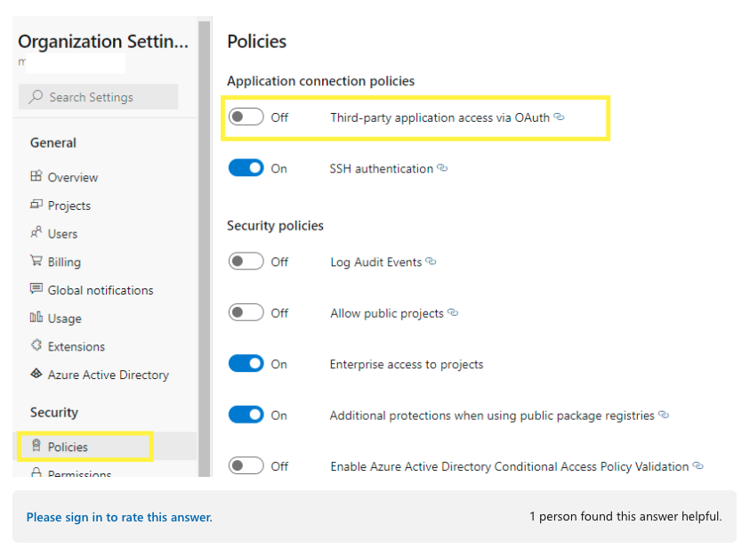

# Azure Repos (DevOps) Integration Guide

Source: https://help.drata.com/en/articles/5495253-azure-repos-devops-integration-guide
Collection: Connection Support › Version Control Guidance
Updated: 2026-08-05
Fetched: 2026-11-22
Description: Making the initial connection to Azure Repos (DevOps)

## Article text

The **Azure Repos (DevOps)** integration enables **engineering and compliance teams** to automate tests and evidence collection demonstrating that your organization follows its software development lifecycle (SDLC) procedures.

It connects Drata to your **Azure DevOps Repositories** to monitor repository configurations and user access, supporting version control compliance.

## Key Capabilities

- **User and Access Sync:** Pulls repository users to support managed account reviews and access verification.
- **SDLC Compliance Evidence:** Automates tests that demonstrate adherence to code review and version control procedures.
- **MFA Validation Support:** Enables automated verification for MFA enforcement on version control systems when paired with Microsoft 365 as your IdP.

## Prerequisites & Data Access

- Must have an **Azure DevOps Admin account** with **Read** access to your organization and projects.
- Must be **signed into Microsoft 365** (you’ll be prompted to sign in during connection if not already).

If Microsoft 365 is your Identity Provider, Azure-created Service Accounts may show up in Drata with this integration.

- There are a few service accounts that are generated by Microsoft Repos to support specific operations. These user accounts are added at the organization or collection level.
   - "Agent Pool Service", which is responsible for performing Azure DevOps read/write operations and updating work items when GitHub objects are updated.
   - "PipelinesSDK" which is similar to the build service identities but supports locking down permissions separately.This identity is granted read-only permissions to pipeline resources and the one-time ability to approve policy requests.
   - Read more here: [Permissions, security groups, and service accounts reference - Azure DevOps](https://docs.microsoft.com/en-us/azure/devops/organizations/security/permissions?view=azure-devops&tabs=preview-page#user-accounts)

### Permissions & Data Table

| **Permission/Scope** | **Why It’s Needed** | **Data Accessed (Read Only)** |
|---|---|---|
| **Read access to organization and projects** | Required to read user and repository data for compliance monitoring. | Repository metadata, users, and permissions |
| **Third-party application access via OAuth** | Enables Drata to connect securely through Microsoft’s OAuth API. | Authentication and token-based read access |

## Step-by-Step Setup

### Step 1: Open the Azure Repos (DevOps) Connection in Drata

1. In Drata, navigate to the available connections on the Connection page**.**
2. Search for **Azure Repos (DevOps)** and select **Connect**.

**Expected outcome:** You’ll begin the authentication process and be redirected to Microsoft for account authorization.

### Step 2: Authenticate with Microsoft

1. Ensure you’re **signed into Microsoft 365** with an Azure DevOps Admin account.
   - If you’re not signed in, Drata will prompt you to do so.
2. Approve the requested permissions to allow Drata to read Azure DevOps user and repository data.

**Expected outcome:** Drata successfully authenticates with Microsoft 365 and establishes a secure OAuth connection to Azure DevOps.

### Step 3: Enable OAuth Access in Azure DevOps

1. In **Azure DevOps**, navigate to **Organization Settings → Policies**.
2. Locate the setting for **Third-party application access via OAuth**.
3. Ensure this setting is **turned ON** to allow Drata to maintain the connection.

**Expected outcome:** Drata can securely pull repository user data for automated access and SDLC evidence collection.

### Step 4: Verify Managed Version Control Accounts

1. After connecting, Drata will automatically sync your **Azure DevOps Repos users** to the Managed Accounts page.
2. Wait several minutes for the initial sync to complete. delays may occur due to Microsoft’s API.
3. Once synced, verify that all expected users and service accounts appear.

**Note:** Service accounts such as **Agent Pool Service** and **PipelinesSDK** are system-generated and should not be removed.

**Expected outcome:** Azure DevOps users are now visible in Drata, allowing automated access review and MFA verification.

## Monitoring Test

In order for [Test 87: MFA on Version Control System](test-87-mfa-on-version-control-system.md) to pass, both of the following must be true:

1. Microsoft 365 must be your connected IdP
2. You must be enforcing MFA on Microsoft 365 via Conditional Access Policies or Security Defaults

## Images

- [image 01] ../../images/integrations/azure-repos/azure-repos-devops-integration-guide--01.png

## Related articles

- [GitHub Integration Guide](github-integration-guide.md)
- [Test 87: MFA on Version Control System](test-87-mfa-on-version-control-system.md)
- [Microsoft 365 Integration Guide](microsoft-365-integration-guide.md)
- [Azure Integration Guide](azure-integration-guide.md)
- [Azure Boards (DevOps) Integration Guide](azure-boards-devops-integration-guide.md)
