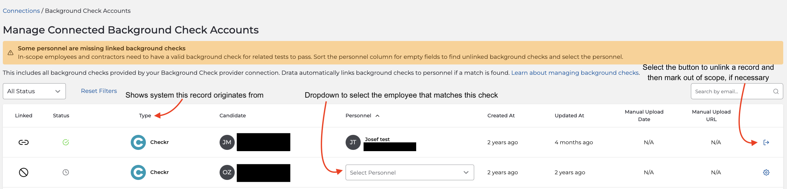

# Background Check Management

Source: https://help.drata.com/en/articles/5833999-background-check-management
Collection: Personnel Management › Employee Onboarding
Updated: 2026-11-09
Fetched: 2026-11-22
Description: How to use Drata's Background Check Management table to link users to their personal background checks performed before hiring

## Article text

## BEFORE DIVING IN

- Drata allows customers to link any background checks imported from supported providers and reaches out to these services to get an up-to-date list of records each night (PST time).
- The main identifier for a background check record is the email address associated with the background check, which is likely that employee’s personal email.
- Drata attempts to automatically link a background check record to a personnel by trying to match the main identifier (which is the email address associated with the background check) to your employee’s personal email, work email, or full name (in that order) from your HRIS connection.
- The following HRIS connections restrict the way Drata can match background checks to personnel because these connections do not share personal emails: Factorial, HR Partner, Insperity Premier, OysterHR, and TriNet. If you are using those HRIS connections, Drata uses work email and full name to match. If syncing issues arise due to mismatched emails, Drata provides manual linking options. Ensure the email in Checkr matches the employee’s personal or work email saved in your HRIS system. Manual linking can be done via the **Connections** page in Drata.

You can connect a [background check connection](https://app.drata.com/account-settings/connections?activeTab=browse&providerType=BACKGROUND_CHECK&page=1) or manually add background checks. If you are using one of these connections, Drata will populate a list at [https://app.drata.com/manage-accounts/background-check](https://app.drata.com/manage-accounts/background-check) with background checks. The following screenshot is an example of the view you'll find. Background check records from Checkr typically sync within 24 hours after completion. If a record is absent, check for mismatches or errors and consider manual linking or a forced sync. To view how background check records are mapped to personnel in Drata, navigate to **Connections → Background Checks** in the Drata app. This provides a user-friendly way to access the background check table without relying solely on the direct URL.

The columns represent the following information:

- Linked - Shows if the background check record has successfully been linked to a user record in Drata.
- Status - Shows if the background check record (not result) is valid and able to be used as evidence. Pending statuses represent ongoing processes in Checkr and will update automatically once completed.
- Type - Where did this record originate from (Manually Uploaded in Drata, Checkr, Karmacheck, or Certn)
- Candidate - The email address associated with the background check record.
- Personnel - The employee this record is linked to in Drata. If the record is not linked, this will show a dropdown selection so you can choose personnel from Drata.
- Created At - When this background check was created.
- Updated At - When Drata last updated this record.
- Manual Upload Date - If this is a manual record, when it was uploaded into Drata.
- Manual Upload URL - Links to the URL provided for manual evidence. For persistent syncing issues, troubleshooting steps include verifying email matches, checking the Checkr dashboard for completion, and using Drata’s "Resync Personnel" feature to update the records. If multiple checks are under one Checkr identity, they will be compiled into a single entry in Drata, displaying all related checks together.

## Partner Offers & Discounts

Drata has direct partnerships with leading background check providers such as Checkr and Amiqus for **first time and new customers**. Check out [more partner offers and discounts](https://drata.com/partner/find/tech-directory?collections=partner-discountoffers,partner-offers-discounts-pod).

- **Checkr**: Global background checks. Get $100 credit by using the code `DRATA100` when creating your account through Drata. Credit will be applied towards future invoices until exhausted.
- **Amiqus**: Focused on UK background checks. Visit [https://amiqus.co/partners/amiqus-x-drata](https://amiqus.co/partners/amiqus-x-drata) to get 10% off your first 3 months.
   - **Note:** Amiqus cannot be directly integrated with Drata.

## Images

- [image 01] ../../images/ux/personnel/background-check-management--01.png

## Related articles

- [Test 50: Contractor Background Checks](test-50-contractor-background-checks.md)
- [Certn Integration Guide (Background Check)](certn-integration-guide-background-check.md)
- [Manually map proof of a background check](manually-map-proof-of-a-background-check.md)
- [Bulk Import Personnel Background Checks (New Experience)](bulk-import-personnel-background-checks-new-experience.md)
- [Troubleshooting Identity Sync Issues in Drata](troubleshooting-identity-sync-issues-in-drata.md)
