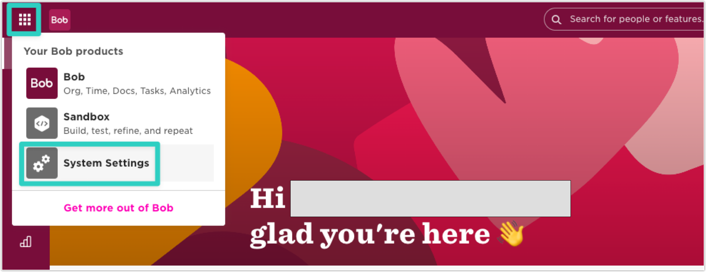
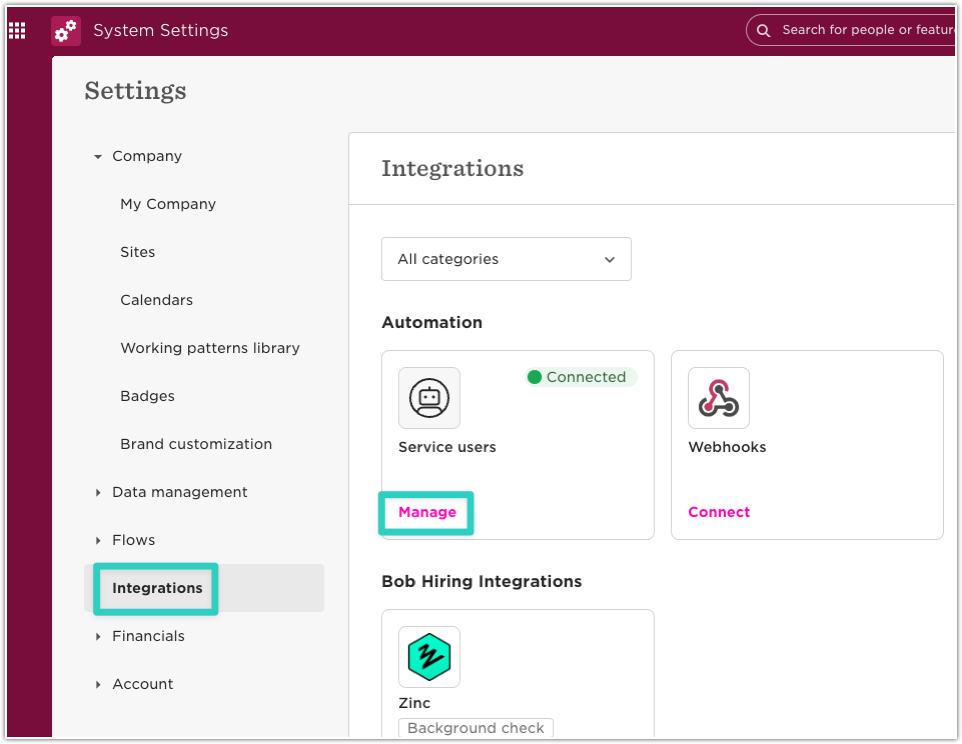
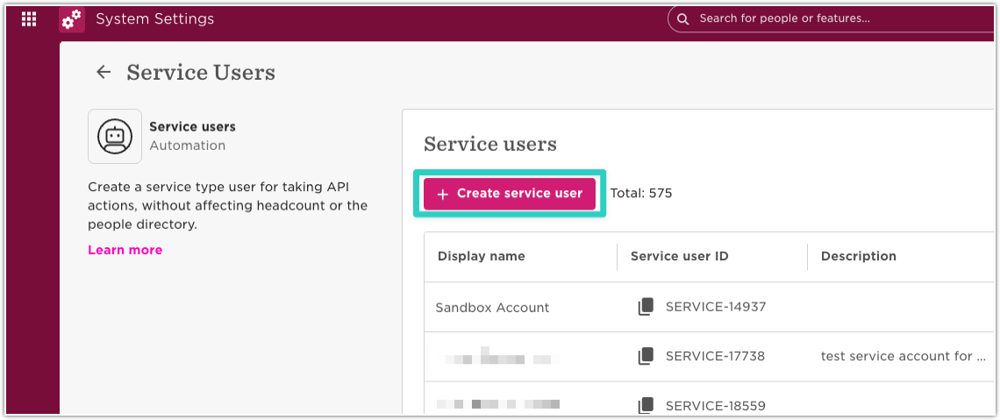
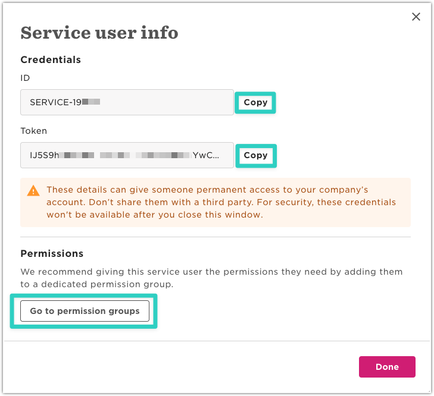
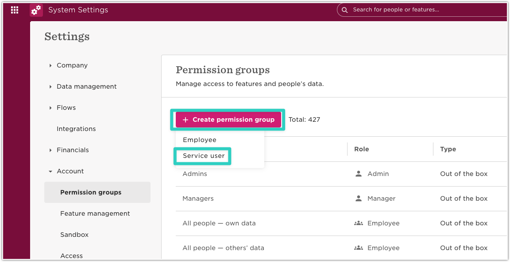
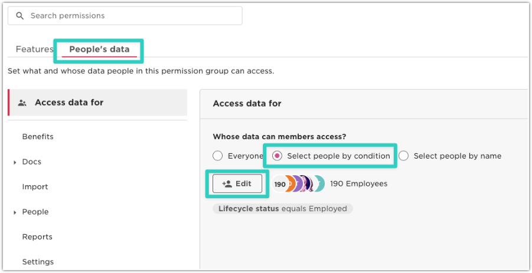
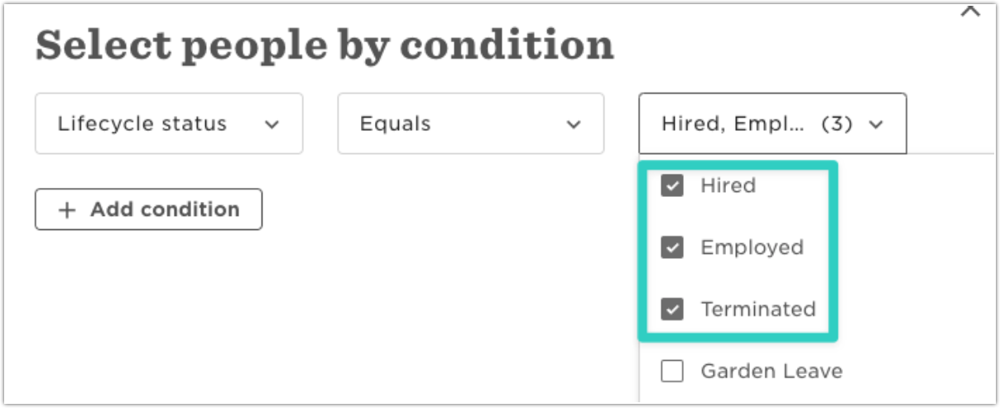
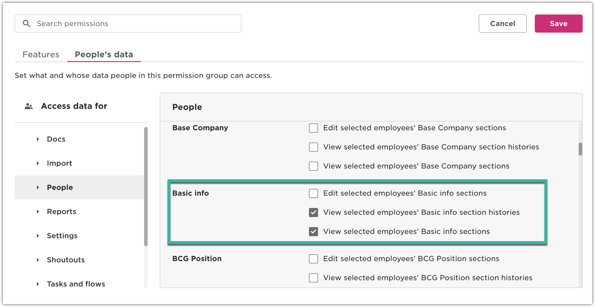

# Bob (HiBob) Integration Guide

Source: https://help.drata.com/en/articles/5457902-bob-hibob-integration-guide
Collection: Connection Support › Other Guidance
Updated: 2026-11-14
Fetched: 2026-11-22
Description: Making the initial connection to Bob

## Article text

Connecting Bob to Drata enables automated checks and evidence collection. This integration provides details about personnel hire and separation dates, as well as employment status.

## Prerequisites

- You must have **admin access** to your company’s Bob account.
- To authenticate HiBob, you will need to provide the following information:
   - Service Account User ID
   - Service Account Token

## Step-by-Step Setup

### Step 1: Create the Service User in your HiBob Account

1. Navigate to your HiBob **System Settings**
   
2. On the Settings screen, open **Integrations** and click **Manage** on the **Service users** tile
   
3. Click on **Create service user**
   
4. Enter any **Display name** and click **Create**
5. On the next screen, HiBob displays the credentials for your new service user. Make a note of both the **ID** and the **Token**, then click on **Go to permission groups** and proceed with the next step
   

### Step 2: Create a Permission Group

1. Click **Create permission group**, then **Service user**
   
2. Enter any **Group name**, select your new service user under **Select service users** and click **Create**
3. When asked to confirm the changes, click **Confirm**
4. Switch to the **People's data** tab of the new Permission Group and click **Access data for. **
   - Click **Edit permissions** on the top right corner.
   - Pick "Select people by condition" under **Whose data can members access?**, then click on **Edit** to select the people the integration can access
      
5. In the **Select people by condition** pop-up, select all relevant** Lifecycle Statuses.**
   - In most scenarios this will include **Hired**, **Employed**, and **Terminated**. Click Apply twice once done.
      
6. Return to **People’s Data** and add the following permissions based on the fields you need to share for the integration.
   - For each permission category you enable, also select the **View history** permissions as well.

### Required permission

| **HiBob Permission** | **Associated Fields** |
|---|---|
| **People > Basic Info ** | Name |
| **People > Employment** **People > Work** | Company Employee Number Manager Start Date Termination Date Work Email Work Location Department Job Title Employment Type FLSA Code |
| **People > Work contact details** | Work Email |
| **People > Personal contact details** | Mobile Phone Number Personal Email |
| **People > Lifecycle** | Employment Status |
| **People > About** | Avatar |

Once done adding the above permissions, finish creating the Permission Group by selecting **Save **and** Apply **the changes.

## Images

- [image 01] ../../images/integrations/hibob/bob-hibob-integration-guide--01.png
- [image 02] ../../images/integrations/hibob/bob-hibob-integration-guide--02.png
- [image 03] ../../images/integrations/hibob/bob-hibob-integration-guide--03.png
- [image 04] ../../images/integrations/hibob/bob-hibob-integration-guide--04.png
- [image 05] ../../images/integrations/hibob/bob-hibob-integration-guide--05.png
- [image 06] ../../images/integrations/hibob/bob-hibob-integration-guide--06.png
- [image 07] ../../images/integrations/hibob/bob-hibob-integration-guide--07.png
- [image 08] ../../images/integrations/hibob/bob-hibob-integration-guide--08.png

## Related articles

- [Freshteam Integration Guide](freshteam-integration-guide.md)
- [HR Cloud Integration Guide](hr-cloud-integration-guide.md)
- [Workday Integration Guide (HRIS)](workday-integration-guide-hris.md)
- [UKG Pro Integration Guide](ukg-pro-integration-guide.md)
- [Bob (HiBob) OAuth Integration Guide](bob-hibob-oauth-integration-guide.md)
