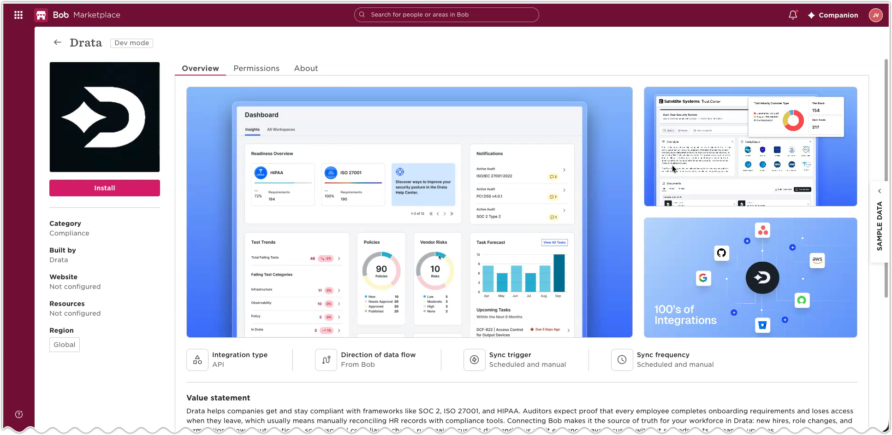
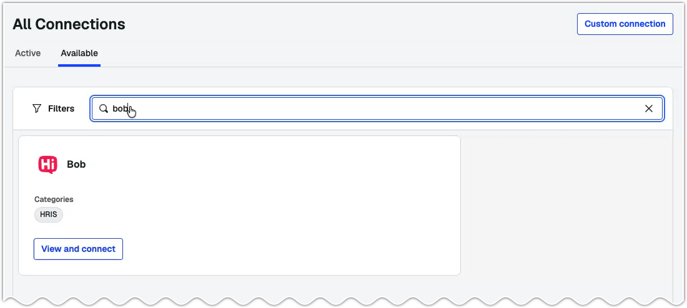
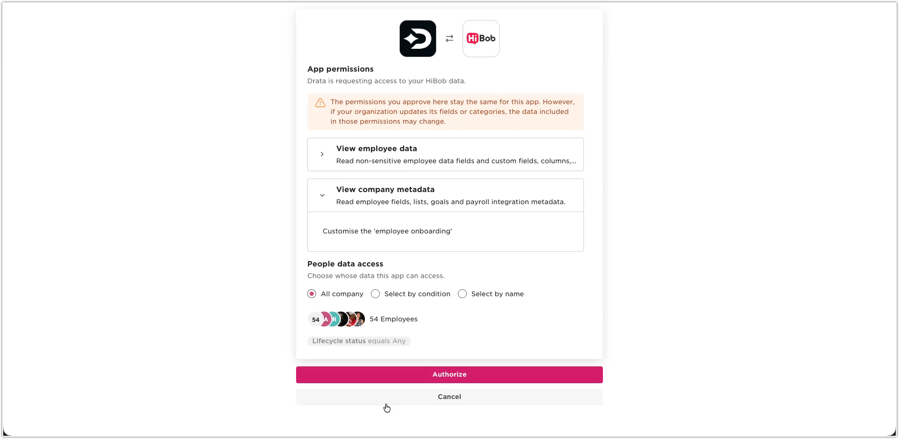
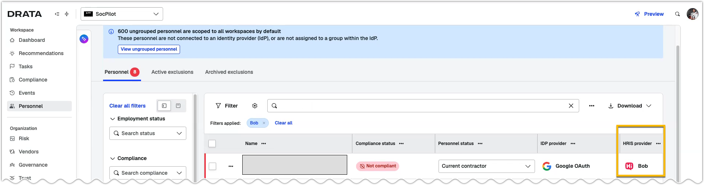
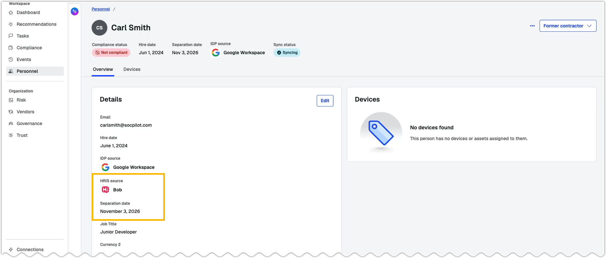
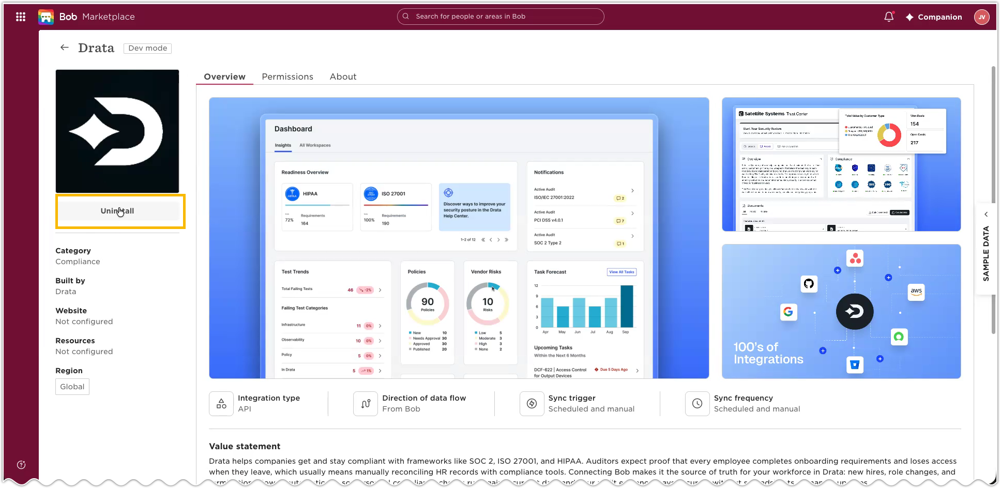

# Bob (HiBob) OAuth Integration Guide

Source: https://help.drata.com/en/articles/18250402-bob-hibob-oauth-integration-guide
Collection: Connection Support › Other Guidance
Updated: 2026-11-14
Fetched: 2026-11-22

## Article text

## Overview

Connecting Bob to Drata lets Drata keep your personnel records up to date automatically. Drata uses the data to run compliance checks such as onboarding and offboarding, and to collect evidence for frameworks like SOC 2, ISO 27001 and HIPAA.

The connection uses Bob's OAuth app authorization. You approve Drata from the Bob Marketplace; no service user or API token is needed.

The connection is **read-only**. Drata never writes to Bob. Drata requests two permissions:

- **`employee_data:read`** — employee records.
- **`company.metadata:read`** — company-level reference data (for example, lists used in employee fields).

Drata reads these fields: first and last name, work and personal email, job title, employment type (employee or contractor), start date, termination date, employment status, and manager.

Drata uses [Merge.dev](http://Merge.dev), its integration sub-processor, to connect to Bob.

## Prerequisites

- In Bob: a user who can install apps from the Bob Marketplace (usually a Bob admin).
- In Drata: an Admin role.
- Your employees' **work email** in Bob should match the email they use in your identity provider (for example, Okta, Microsoft Entra ID or Google Workspace). Drata uses it to match each person across systems.

## Connect Bob to Drata

You can start from the Bob Marketplace or from Drata. Both paths end on the same Bob consent screen.

### Option A — From the Bob Marketplace

1. In Bob, open the **Marketplace** and search for **Drata**.
2. Open the Drata app card and click **Install**.
   
3. Bob opens Drata. Sign in with your Drata account.
4. Continue with step 2 of Option B.

### Option B — From Drata

1. In Drata, go to **Connections** and open the **Available** tab.
2. Search for **Bob** and click **View and connect**.
   
3. In the window that opens, sign in to Bob if prompted.
4. Bob shows a consent screen that lists the two read-only permissions Drata requests. Review them and click **Authorize**.
5. Bob shows a consent screen that lists the two read-only permissions Drata requests. Review them and click **Authorize**.
   
6. You return to Drata, which shows **You're all set!** The Bob connection is now active.

## What happens after you connect

- **First sync.** Drata imports your employees from Bob. Depending on the size of your company, the first sync can take a while.
- **Daily sync.** After that, Drata syncs with Bob once a day.
- **Personnel.** Synced people appear in **Personnel**, with Bob as their HRIS source and their start date.

## How changes in Bob show up in Drata

| In Bob | In Drata, after the next sync |
|---|---|
| A new hire is added | The person appears in Personnel with their start date. |
| Job title or manager changes | The record is updated. |
| An employee is terminated | The person is marked as a **Former employee** with their separation date, which drives your offboarding checks. |
| Employment type is employee or contractor | Drata uses it to classify the person. |

*A person terminated in Bob, shown in Drata as a former contractor with their separation date.*

## Disconnect or uninstall

- **Uninstall from Bob (recommended way to revoke access).** In the Bob Marketplace, open the Drata app and click **Uninstall**. Bob revokes Drata's access immediately. On the next sync, the Bob connection in Drata shows an error.
   
- **Delete the connection in Drata.** This stops the sync in Drata, but **it does not uninstall the Drata app from Bob**. To fully remove access, also uninstall it from the Bob Marketplace.

## Already connected with a Bob service user?

If your Bob connection was set up with a Bob service user, re-authenticate it with OAuth. You update the connection you already have; Drata and Merge handle the switch, and your personnel history stays as it is.

1. In Drata, go to **Connections** and open your **Bob** connection.
2. Click **Update connection**.
3. Sign in to Bob if prompted, review the two read-only permissions, and click **Authorize**.
4. When you return to Drata, the connection is active again and keeps syncing as before.

> ⚠️ **Update the existing connection. Don't delete it and create a new one.** A new connection starts from scratch, and Drata does not import people who had already left your company before it was created. Your former employees would lose their Bob separation records in Drata. If you have already deleted the connection, contact Support before connecting Bob again.

### Troubleshooting

- **Some employees are missing in Drata.** Check that they have a work email and an employment status of Hired or Employed in Bob, then wait for the next daily sync.
- **A terminated employee still shows as current.** Check that the termination date is set in Bob. The change appears after the next sync.
- **The Bob connection shows an error.** The app may have been uninstalled in Bob, or the authorization was revoked. Reconnect Bob from Drata's Connections page.
- **"App is already installed" when connecting.** Uninstall Drata from the Bob Marketplace and connect again.

## Images

- [image 01] ../../images/integrations/hibob/bob-hibob-oauth-integration-guide--01.png
- [image 02] ../../images/ux/connections/bob-hibob-oauth-integration-guide--02.png
- [image 03] ../../images/integrations/hibob/bob-hibob-oauth-integration-guide--03.png
- [image 04] ../../images/ux/personnel/bob-hibob-oauth-integration-guide--04.png
- [image 05] ../../images/ux/personnel/bob-hibob-oauth-integration-guide--05.png
- [image 06] ../../images/integrations/hibob/bob-hibob-oauth-integration-guide--06.png

## Related articles

- [Bob (HiBob) Integration Guide](bob-hibob-integration-guide.md)
- [HR Cloud Integration Guide](hr-cloud-integration-guide.md)
- [ADP Workforce Now Integration Guide](adp-workforce-now-integration-guide.md)
- [How Drata Uses HRIS Data](how-drata-uses-hris-data.md)
- [UKG Ready Integration Guide](ukg-ready-integration-guide.md)
