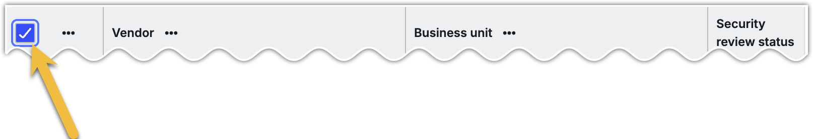
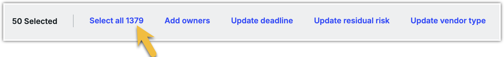

# Bulk actions for Current Vendors (New Experience)

Source: https://help.drata.com/en/articles/15032723-bulk-actions-for-current-vendors-new-experience
Collection: Understand the Drata Platform › Vendors
Updated: 2026-05-08
Fetched: 2026-11-22

## Article text

From Current Vendors, you can select multiple vendors at once and apply changes in bulk — saving time when managing large vendor directories. Bulk actions include updating owners, review deadlines, residual risk levels, vendor types, archiving vendors, and sending security questionnaires.

## Select vendors for a bulk action

1. Navigate to **Vendors → Current vendors**.
2. Select the checkbox next to each vendor you want to update.
   - To select all vendors on the page, check the box in the column header.
      
   - To include all vendors in your directory, select **Select all #** in the bulk action toolbar that appears at the bottom of the table.
      

The bulk action toolbar appears at the bottom of the screen once one or more vendors are selected.

### Available bulk actions

The following actions are available from the bulk action toolbar:

- **Add owners** – Assign a security owner to the selected vendors.
- **Update deadline** – Set a review deadline date and review schedule for the selected vendors.
- **Update residual risk** – Set the residual risk level for the selected vendors.
- **Update vendor type** – Update the vendor type classification for the selected vendors.
- **Send questionnaire** – Send a security questionnaire to contacts at the selected vendors.
- **Archive** – Archive the selected vendors.

## Add owners

1. Select the vendors you want to update.
2. In the bulk action toolbar, select **Add owners**.
3. In the modal, search for and select the team member(s) to assign as security owner.
4. Select **Assign owner** to save.

## Update review deadline

1. Select the vendors you want to update.
2. In the bulk action toolbar, select **Update deadline**.
3. In the **Update review deadline** modal, enter a **Review deadline** date.
4. Optionally, set a **Review schedule** to define how often these vendors should be reviewed after the deadline.
   - Options are: 1 month, 2 months, 3 months, 6 months, 1 year, Custom, or None.
5. Select **Update deadline** to save.

## Update residual risk

1. Select the vendors you want to update.
2. In the bulk action toolbar, select **Update residual risk**.
3. In the **Update overall risk** modal, select an **Overall risk** level.
   - Options are: None, Low, Moderate, or High.
4. Select **Update risk** to save.

## Update vendor type

1. Select the vendors you want to update.
2. In the bulk action toolbar, select **Update vendor type**.
3. In the **Update vendor type** modal, select the appropriate **Vendor type**.
   - Options are: Vendor, Contractor, Partner, Other, or Software.
4. Select **Update type** to save.

## Send questionnaire

Use the Send questionnaire bulk action to send a security review questionnaire to contacts at multiple vendors at once.

### Step 1: Select vendors and open the questionnaire form

1. Select the vendors you want to include.
2. In the bulk action toolbar, select **Send questionnaire**. This opens the **Send questionnaire** page.

### Step 2: Configure recipients

The Recipients section is divided into two groups:

- **Vendors with email address**: These vendors already have a contact email on file. You can choose to **Include** or **Exclude** each one from the send.
- **Vendors without email address**: These vendors are missing a contact email. You can either enter an email address for each one and click **Include**, or select **Exclude X vendors** to skip them entirely. You can add up to 5 email addresses per vendor, separated by commas.

| 💡 Vendors missing an email address won't receive the questionnaire unless you add one or exclude them. The form will not submit if there are vendors in the "without email address" group that are neither assigned an email nor excluded. |
|---|

### Step 3: Name the security review

In the **Security review name** field, enter a name for this review. This name is used across all selected vendors and will appear in their security review records. A default name is pre-populated based on today’s date.

### Step 4: Select the questionnaire

In the **Questionnaire(s) to send** dropdown, search for and select the questionnaire you want to send.

### Step 5: Customize the email (optional)

The **Subject line** and **Email content** fields are pre-populated with default text. You can edit both fields to customize the message before sending.

### Step 6: Send

Review all settings, then select **Send questionnaire** to send the questionnaire to all included recipients.

## Archive vendors in bulk

1. Select the vendors you want to archive.
2. In the bulk action toolbar, scroll to the right and select **Archive**.
3. Confirm the action when prompted.

| 💡 Archived vendors are retained for audit history. You can restore them at any time by filtering Current Vendors by Status → Archived, opening the vendor, and selecting Restore vendor from the ellipsis (⋯) menu. |
|---|

## Images

- [image 01] ../../images/ux/vendors/bulk-actions-for-current-vendors-new-experience--01.png
- [image 02] ../../images/ux/vendors/bulk-actions-for-current-vendors-new-experience--02.png

## Related articles

- [Import Risk in Bulk (New Experience)](import-risk-in-bulk-new-experience.md)
- [Vendors overview in Drata](vendors-overview-in-drata.md)
- [Start and manage security reviews for your vendors](start-and-manage-security-reviews-for-your-vendors.md)
- [Training Video: Conducting an End-to-End Vendor Review with the Drata TPRM Agent (New Experience)](training-video-conducting-an-end-to-end-vendor-review-with-the-drata-tprm-agent-new-experience.md)
- [Customize vendor risk levels](customize-vendor-risk-levels.md)
