# Bulk Import Assets

Source: https://help.drata.com/en/articles/15399981-bulk-import-assets
Collection: Understand the Drata Platform › Assets
Updated: 2026-09-17
Fetched: 2026-11-22
Description: Upload a CSV of custom assets using a guided, spreadsheet-style experience.

## Article text

## Overview

Drata's bulk asset import lets you create or update many assets at once using a guided, spreadsheet-style experience. Upload a CSV, paste data from an existing spreadsheet, or enter rows directly in the UI. Validation runs as you type, so errors are visible and fixable before you submit.

Import assets in bulk when you need to:

- Seed your asset inventory when migrating from another GRC platform
- Onboard a large batch of hardware, software, or other tracked assets in a single step
- Update existing manually-managed assets in bulk after an inventory review

## Key Capabilities

- **Create and update in the same file.** Rows whose **Asset Name** matches an existing asset are routed to update; rows with new names create new assets. The confirmation modal shows the create/update split before you submit.
- **Pre-filled dropdowns** for **Asset Type**, **Asset Class Types**, and **Owner Email** based on your workspace data.
- **Integration-managed asset protection.** Rows that match an asset synced from an integration (AWS, Jamf, Okta, etc.) are blocked from import so external data is never silently overwritten.
- **Real-time validation** with clear, inline error messages.

## Before You Begin

- The owner must already exist in your tenant and be active personnel at the time of import. Offboarded or inactive users are rejected. You can pick the owner from the dropdown or paste an email manually.
- **Asset Class Types** values must come from the supported list: `HARDWARE, DOCUMENT, PERSONNEL, SOFTWARE, CODE, CONTAINER, COMPUTE, NETWORKING, DATABASE, STORAGE`.
- **Asset Type** must be one of: `PHYSICAL, VIRTUAL`.

> 💡**Tip:** The bulk import entry point is only visible to users with the **Bulk Import Asset — Manage** permission. By default this is granted to **Admin**, **Workspace Administrator**, and **InfoSec Lead** roles. If you don't see the **Create/update assets in bulk** option, ask an Admin to verify your role and permissions.

## How to Bulk Import Assets

### Step 1: Open Bulk Import

Go to the **Assets** page. In the top-right corner, click the chevron (▾) next to the **Create asset** button, then select **Create/update assets in bulk**.

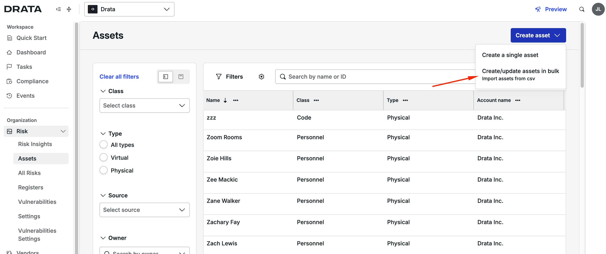

The **Import Assets** modal opens with two options to add your data: **Upload file** to import a CSV, or **Manually enter data** to type rows directly into the sheet.

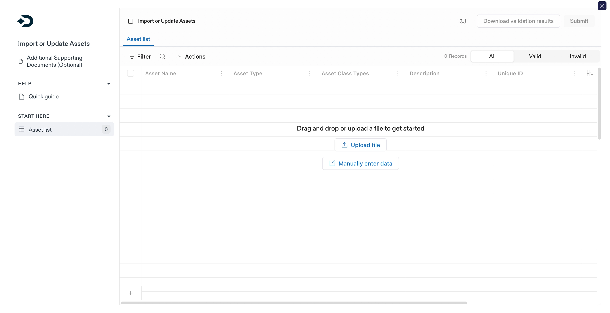

### Step 2: Add your data

You have two options:

1. **Upload a file.** Select the appropriate CSV from your machine.
2. **Type directly.** Click **Manually enter data** to enter rows one at a time using the built-in dropdowns and text fields.

### Step 3: Map your columns (file uploads only)

When you upload a file, Drata guides you through two quick mapping steps before your data loads into the sheet.

**Map fields**

Match your file's incoming fields to Drata's destination fields (**Asset Name**, **Asset Type**, **Asset Class Types**, **Description**, **Unique ID**, **Owner Email**, **Notes**). Drata auto-matches fields with the same name. Review each mapping and adjust any that are missing or incorrect. Use the **Data preview** panel on the right to confirm what will be imported for each field.

Click **Continue** when your mapping is complete.

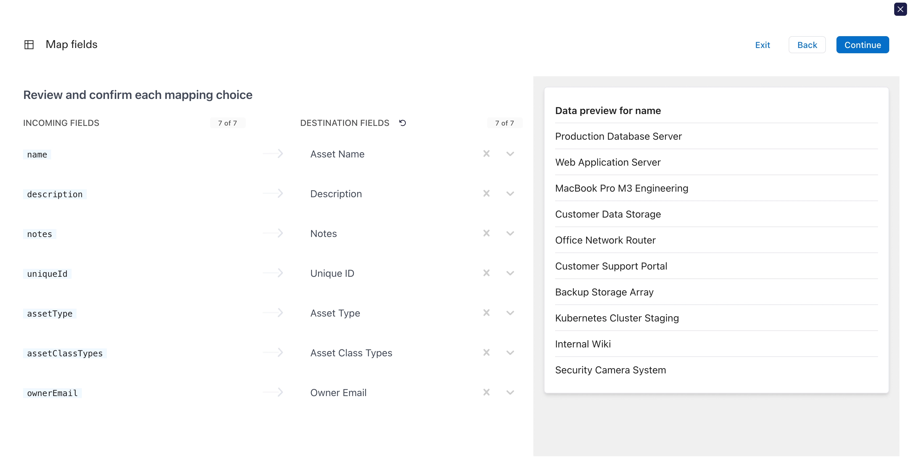

**Map field values**

For dropdown fields (**Asset Type**, **Asset Class Types**, **Owner Email**), Drata asks you to map each “Incoming Value” to a matching “Destination Value” from your workspace. Mapping values at this step is optional. If you skip it and click **Continue**, any unmapped values will show up as invalid cells in the sheet, and you can fix them there.

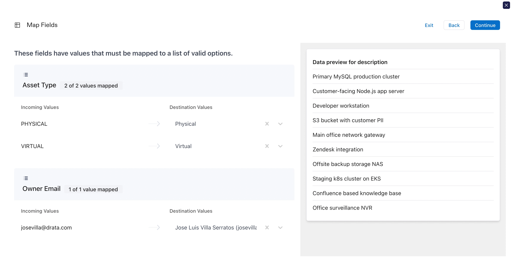

Once mapping is done, your data appears in the **Asset list** sheet, ready for validation.

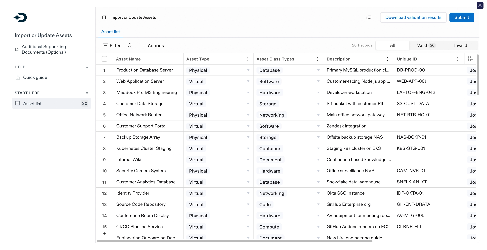

### Step 4: Review and resolve validation

Drata validates every row as you type. The **Submit** button stays disabled until all blocking errors are resolved.

- **Red cells are errors.** They must be fixed before you can submit.

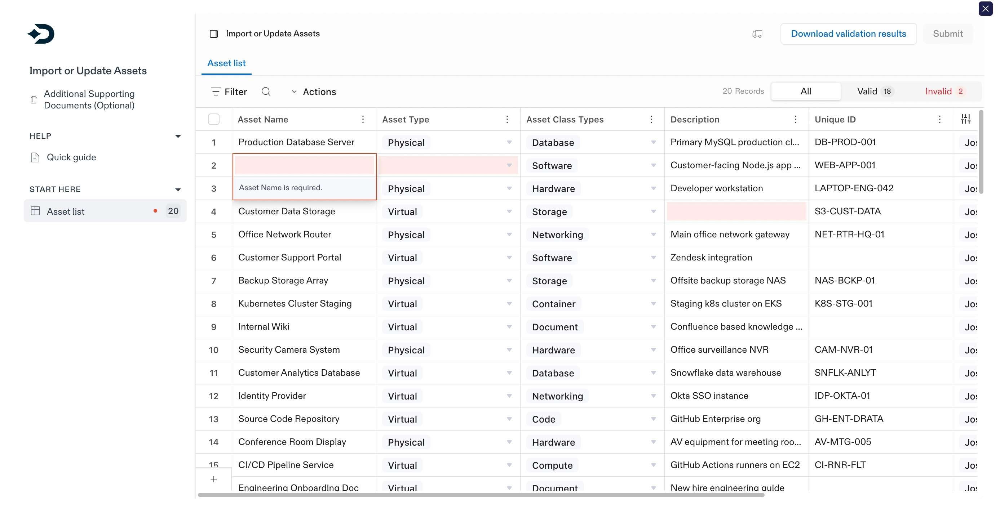

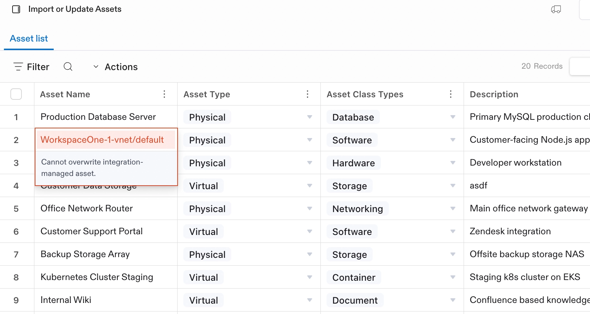

- **Yellow cells are warnings.** They are informational. You can still submit with warnings in place. The most common warning is the duplicate asset warning, which means importing this row will update an existing Drata-managed asset.

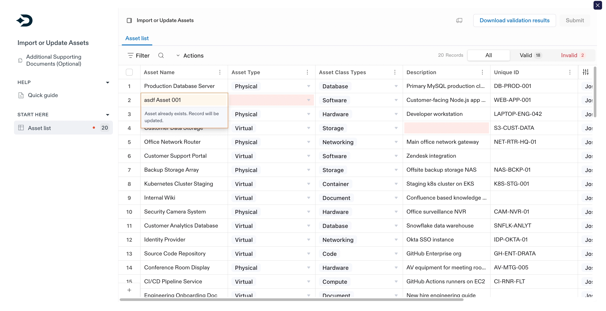

- The sheet shows the **number of invalid cells** so you know what's left to remediate.
- Use the **All / Valid / Invalid** tabs at the top to filter rows by validation status.

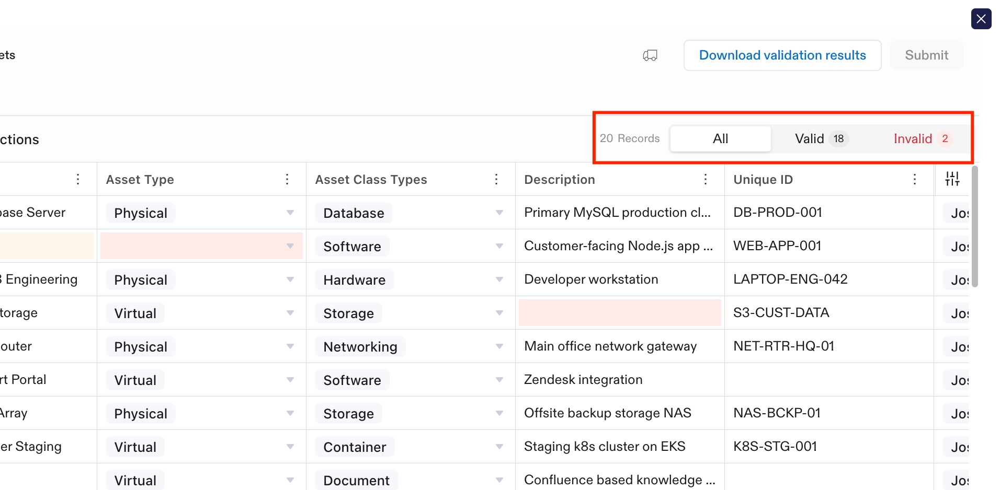

- Click **Download validation results** at the top right to export a CSV report of the current errors.

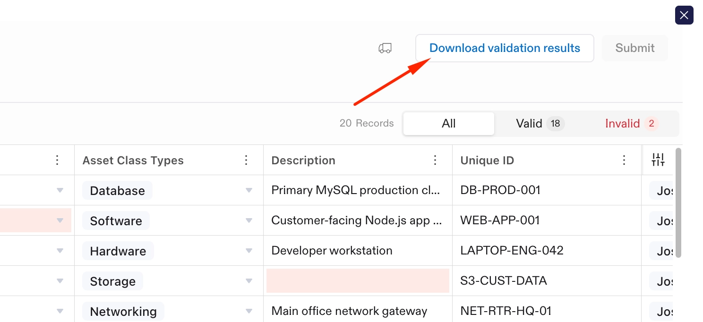

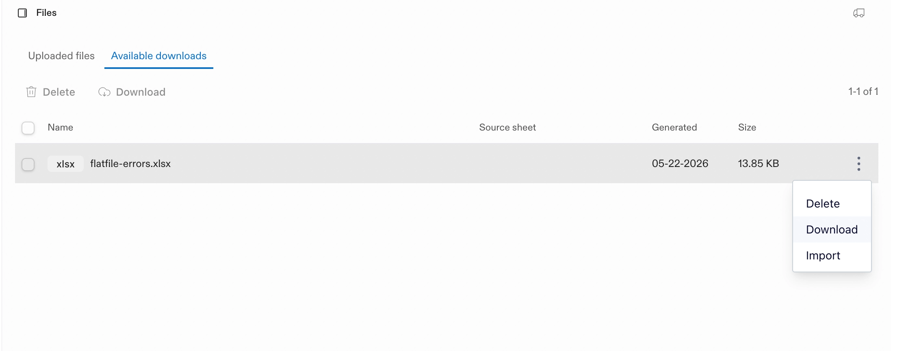

### Step 5: Submit

When you click **Submit**, a confirmation modal appears before the import runs. The modal shows how many rows will create new assets and how many will update existing assets, so you can confirm the split matches your intent.

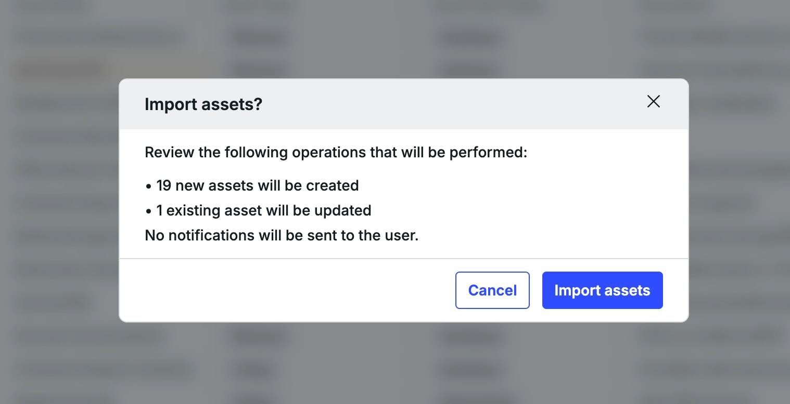

Click **Import assets**. Drata creates and updates the assets, and the Assets page refreshes automatically with the new items.

## Column Reference

The following columns appear in every Asset import session.

| **Field** | **Required** | **Format** | **Description** |
|---|---|---|---|
| **Asset Name** | Yes | Text, up to 191 characters | The name of the asset. Used to match against existing assets (case-insensitive). A match against a Drata-managed asset routes the row to **update**; a match against an integration-managed asset is rejected. |
| **Asset Type** | Yes | Dropdown: `PHYSICAL`, `VIRTUAL` | Whether the asset is physical hardware or a virtual resource. |
| **Asset Class Types** | Yes | Multi-select dropdown | One or more classifications: `HARDWARE, DOCUMENT, PERSONNEL, SOFTWARE, CODE, CONTAINER, COMPUTE, NETWORKING, DATABASE, STORAGE`. |
| **Description** | Yes | Text, up to 191 characters | Short description of the asset. |
| **Unique ID** | No | Text, up to 191 characters | Optional external identifier (asset tag, serial number, etc.). |
| **Owner Email** | Yes | Dropdown of eligible personnel emails (you may type an email to search) | The email of the user who owns the asset. Must match an active user in your tenant. |
| **Notes** | No | Text, up to 191 characters | Optional additional notes about the asset. |

## Validation Rules

### Asset Name

- **Required.** Between 1 and 191 characters.
- If a Drata-managed asset with the same name (case-insensitive) already exists, a yellow warning appears: *"Asset already exists. Record will be updated."* You can still submit; the existing asset will be updated.
- If the name matches an asset that came from an integration (AWS, Jamf, Okta, etc.), the row is blocked with: *"Cannot overwrite integration-managed asset."* Integration-managed assets can only be modified by their source integration.

### Asset Type

- **Required.** Must be one of `PHYSICAL` or `VIRTUAL` (case-insensitive).
- Any other value fails with: *"Asset Type must be one of: PHYSICAL, VIRTUAL."*

### Asset Class Types

- **Required.** At least one value.
- Empty cells fail with: *"At least one Asset Class Type is required."*
- Any value outside the supported list fails with: *"Invalid Asset Class Type(s): `<value>`” . Valid values are: HARDWARE, DOCUMENT, PERSONNEL, SOFTWARE, CODE, CONTAINER, COMPUTE, NETWORKING, DATABASE, STORAGE."*

### Description

- **Required.** Between 1 and 191 characters.

### Owner Email

- **Required.** Must be a valid email address.
- Must match a user in your tenant. Otherwise the row fails with: *"Owner user not found."*
- The user must be active personnel (current employee or contractor). Offboarded or inactive users fail with: *"Owner inactive."*

### Unique ID and Notes

- Optional. When provided, must be 1–191 characters. Blank cells are accepted and stored as empty.

## Duplicate Handling

Asset names are matched case-insensitively against existing assets in your tenant. The behavior depends on the existing asset's provider:

| **Existing asset's source** | **Row outcome** | **Notes** |
|---|---|---|
| None (new name) | Creates a new asset with `Drata` as the provider. | Counted under **assets to create** in the confirmation modal. |
| Drata-managed (manual) | **Updates** the existing asset in place. | Yellow warning on **Asset Name**. Counted under **assets to update**. **Asset Class Types** replace the existing classification wholesale. |
| Integration-managed (AWS, Jamf, Okta, etc.) | **Blocked** with a red error on **Asset Name**. | Cannot be overridden. Manage the asset from its source integration instead. |

## Troubleshooting

**▸ "Cannot overwrite integration-managed asset."**

The asset name in your sheet matches an asset that was synced from an integration (e.g., AWS, Jamf, Okta). Integration-managed assets are owned by the source integration and cannot be edited through bulk import. Either rename the row to a new asset name or remove the row and update the asset through its source integration.

**▸ Yellow warning: "Asset already exists. Record will be updated."**

This is informational, not blocking. A Drata-managed asset with the same name (case-insensitive) already exists, and submitting this row will update it. Remove the row if you don't intend to update the existing asset.

**▸ "Owner user not found."**

The email in **Owner Email** doesn't match any user in your tenant. Verify the spelling and confirm the user exists in **Personnel**. If the user is new, add them to your tenant first via an IdP sync and then re-import the assets they should own.

**▸ "Owner inactive."**

The email matches a user in your tenant, but that user's personnel status is not a current employee or contractor (for example, offboarded). Either pick a different active owner, or restore the user's personnel status before re-importing.

**▸ The “Create Asset” button, and/or “Create/update assets in bulk” option, doesn't show in the Assets page**

The **Create/update assets in bulk** option only appears for users with the **Bulk Import Asset — Manage** permission, granted by default to **Admin**, **Workspace Administrator and InfoSec leads**. Ask an Admin to verify your role and permissions.

## Images

- [image 01] ../../images/ux/assets/bulk-import-assets--01.png
- [image 02] ../../images/ux/assets/bulk-import-assets--02.png
- [image 03] ../../images/ux/assets/bulk-import-assets--03.png
- [image 04] ../../images/ux/assets/bulk-import-assets--04.png
- [image 05] ../../images/ux/assets/bulk-import-assets--05.png
- [image 06] ../../images/ux/assets/bulk-import-assets--06.png
- [image 07] ../../images/ux/assets/bulk-import-assets--07.png
- [image 08] ../../images/ux/assets/bulk-import-assets--08.png
- [image 09] ../../images/ux/assets/bulk-import-assets--09.png
- [image 10] ../../images/ux/assets/bulk-import-assets--10.png
- [image 11] ../../images/ux/assets/bulk-import-assets--11.png
- [image 12] ../../images/ux/assets/bulk-import-assets--12.png

## Related articles

- [Manual Import (CSV) Identity Provider Integration Guide](manual-import-csv-identity-provider-integration-guide.md)
- [Bulk Import Personnel Training Records (New Experience)](bulk-import-personnel-training-records-new-experience.md)
- [Bulk Import Personnel Background Checks (New Experience)](bulk-import-personnel-background-checks-new-experience.md)
- [Bulk Import Policy Acknowledgments](bulk-import-policy-acknowledgments.md)
- [Bulk Import Evidence](bulk-import-evidence.md)
