# Bulk Import Custom Tasks

Source: https://help.drata.com/en/articles/14744132-bulk-import-custom-tasks
Collection: Enhancing your workflow › Tasks
Updated: 2026-07-29
Fetched: 2026-11-22
Description: In this article, you learn how to create many custom tasks at once using bulk import.

## Article text

## Overview

Drata's bulk tasks import lets you create many custom tasks at once using a guided, spreadsheet-style experience. You can upload a CSV, paste data from an existing spreadsheet, or enter rows directly in the UI. Validation runs as you type, so errors are visible and fixable before you submit.

Use bulk tasks import when you need to:

- Bring an existing task list into Drata in a single step.
- Set up recurring reviews, checkpoints, or annual tasks in batches.
- Assign many tasks across your team without opening the Create Task form for each one.

## Key Capabilities

- **One-time and recurring tasks in the same file.** Mix both freely.
- **Weekly, Monthly, and Yearly schedules** with an optional end date.
- **Link to Controls or Risks** from within your workspace.
- **Pre-filled dropdowns** for Assignee Email, Control ID, and Risk ID based on your workspace data.
- **Opt-in email notifications.** At submit time, you can choose to send an assignment email to each one-time task assignee. Recurring tasks are not notified at import time. Drata's upcoming-task reminder system covers them automatically seven days before each instance's due date.
- **Real-time validation** with clear, inline error messages.
- **Flexible data entry:** upload a file, paste from a spreadsheet, or type directly.

## Before You Begin

- You can only assign tasks to current personnel in your tenant.
- Control IDs and Risk IDs you reference must exist in your workspace.
- Accepted date format: `YYYY-MM-DD`.
- Accepted year range for **Due Date** and **End Date**: `2000` through `2100`.

> 💡**Tip:** The Create tasks in bulk option is only available to users who can create tasks in your workspace: Admins, Control Managers, Information Security Leads, Risk Managers, and Workspace Managers. If you don't see the dropdown chevron (▾) next to Create task, ask an Admin to verify your role and permissions.

## How to Bulk Import Custom Tasks

### Step 1: Open Bulk Import

Go to the **Tasks** page. In the top-right corner, click the chevron (▾) next to the Create task button, then select Create tasks in bulk.

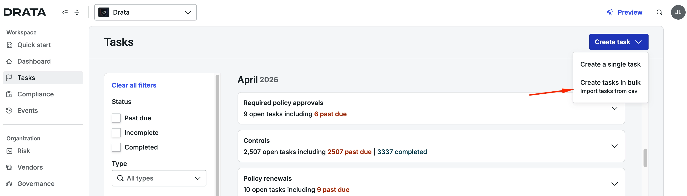

The Import or Update Custom Tasks modal opens with two options to add your data: “Upload file” to import a CSV, or “Manually enter data” to type rows directly into the sheet.

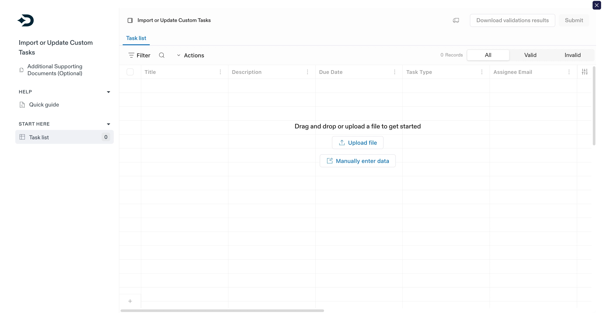

### Step 2: Add your data

You have two options:

1. **Upload a file.** Select the appropriate CSV from your machine.
2. Type directly. Click Manually enter data to enter rows one at a time using the built-in dropdowns and text fields.

### Step 3: Map your columns (file uploads only)

When you upload a file, Drata guides you through two quick mapping steps before your data loads into the sheet.

**Map fields**

Match your file's incoming fields to Drata's destination fields. Drata auto-matches fields with the same name. Review each mapping and adjust any that are missing or incorrect. Use the Data preview panel on the right to confirm what will be imported for each field. Click **Continue** when your mapping is complete.

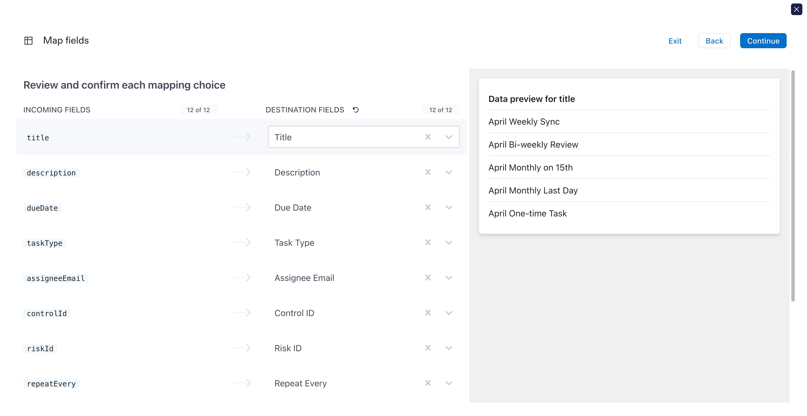

**Map field values**

For fields with a fixed set of valid options (like “Task Type,” “Assignee Email,” “Control ID,” and “Risk ID”), Drata asks you to map each "Incoming Value" to a matching "Destination Value" from your workspace. Mapping values at this step is optional. If you skip it and click Continue, any unmapped values will show up as invalid cells in the sheet, and you can fix them there.

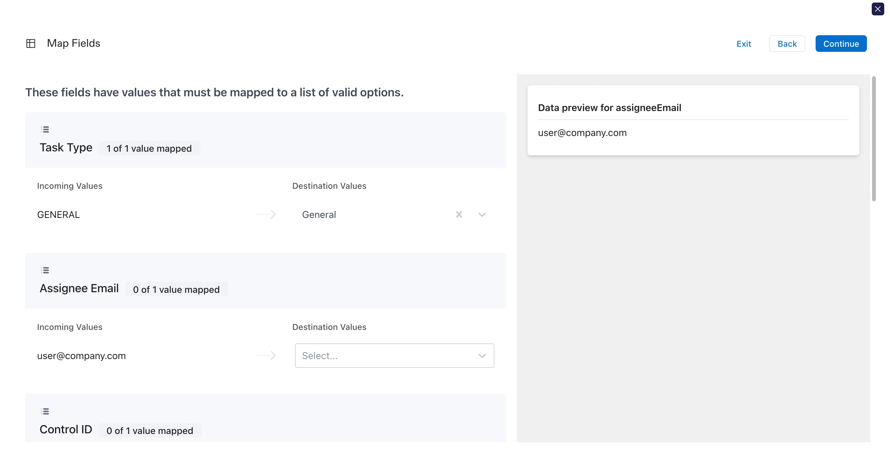

Once the mapping is done, your data appears in the “Task list” sheet, ready for validation.

### Step 4: Review and resolve validation

Drata validates every row as you type. The Submit button stays disabled until all errors are resolved.

- Red cells are errors. They must be fixed before you can submit.

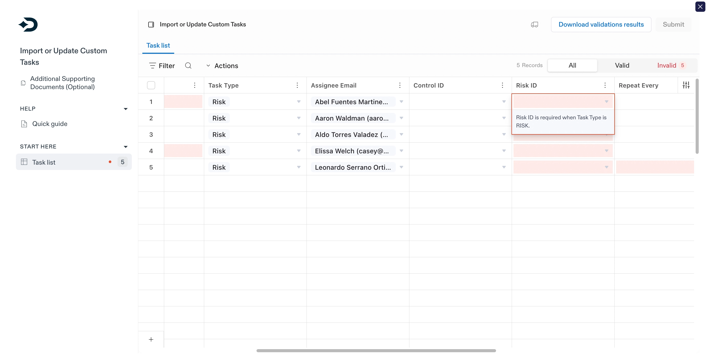

- Yellow cells are warnings or informational messages. You can still submit with warnings in place.

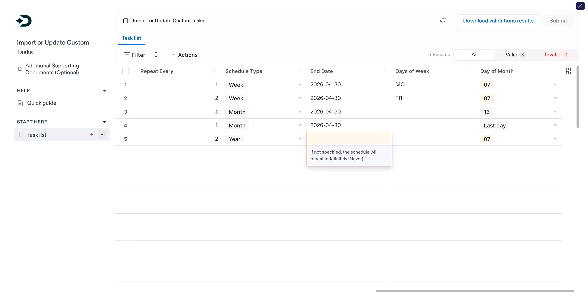

- Hover any column header to see that field's validation rules.

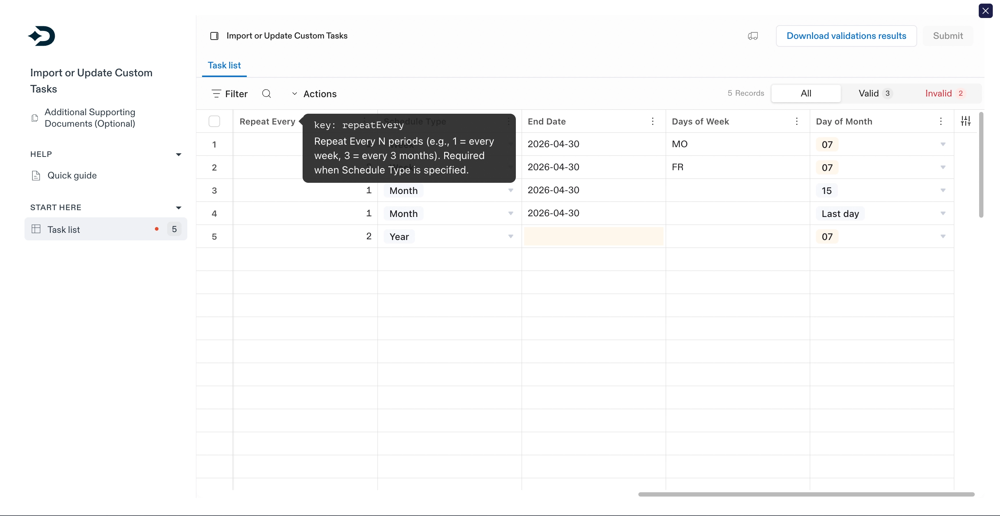

- The sheet shows the number of invalid cells so you know what's left.

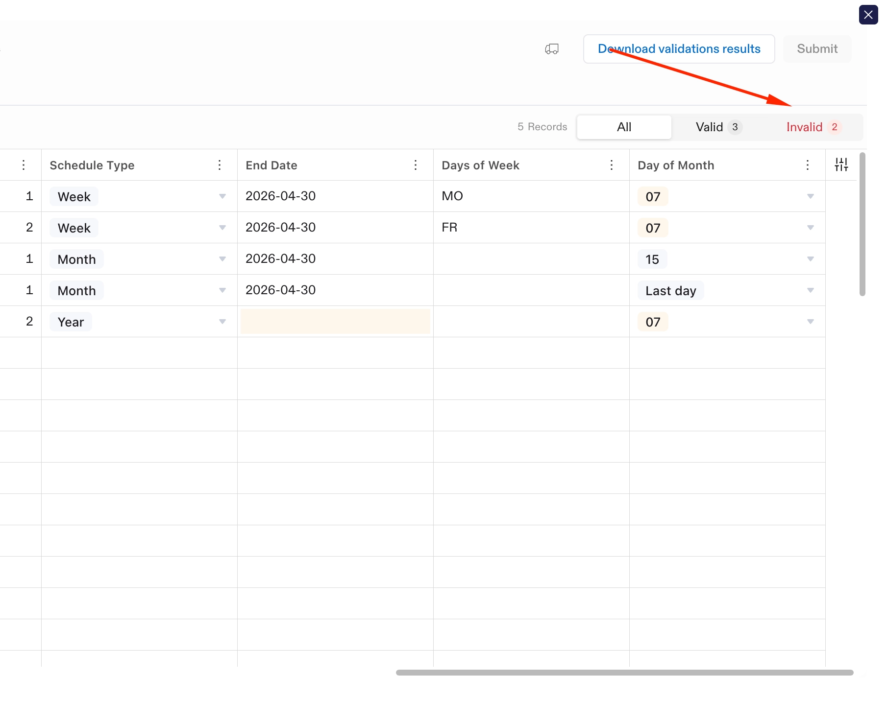

- Use the “All / Valid / Invalid” tabs at the top to filter rows by validation status.

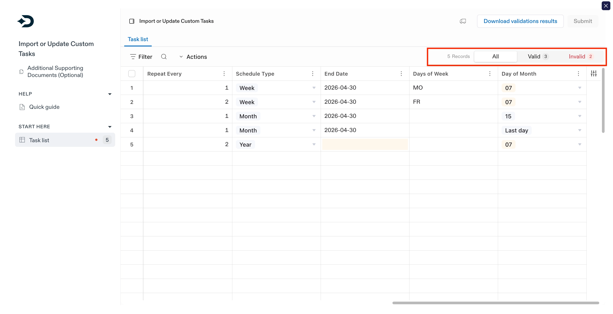

- Click “Download validations results” at the top right to export a report of the current errors.

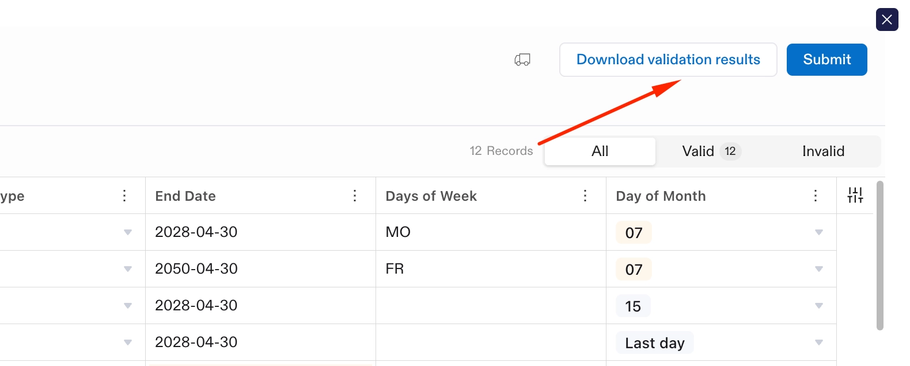

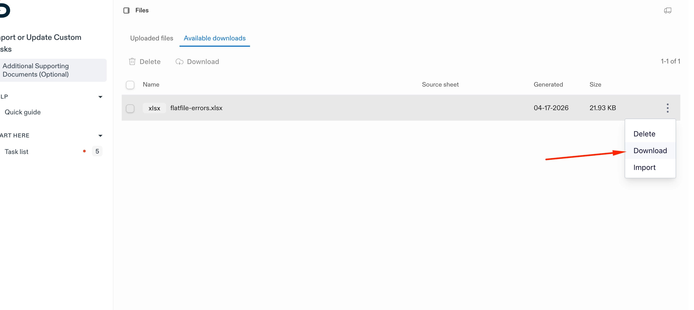

### Step 5: Submit

Once every error is cleared, click **Submit**. A confirmation modal appears before the import runs.

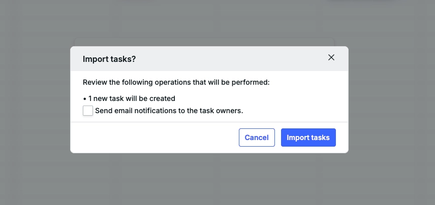

The modal includes a **Send email notifications to the task owners** checkbox, unchecked by default.

- **Leave unchecked** to create all tasks silently. No assignment emails are sent. Recurring task assignees will still receive their scheduled upcoming-task reminders automatically, regardless of this setting.
- **Check the box** to send an assignment email to each one-time task assignee after the import completes.

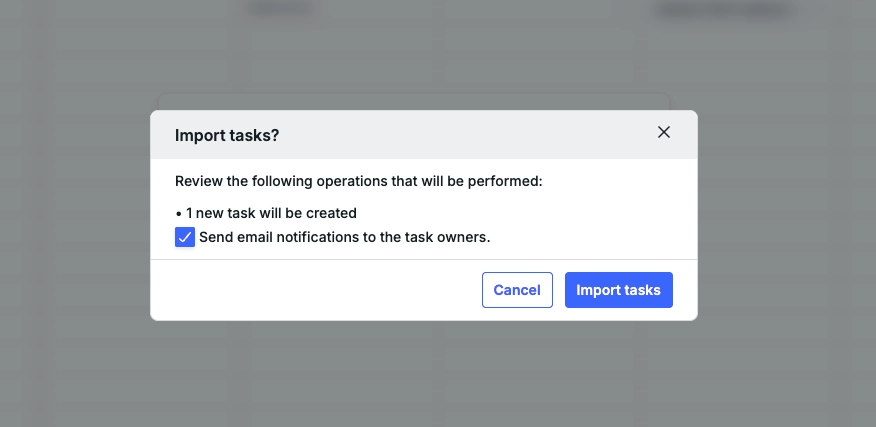

> 💡**Tip:** Regardless of the checkbox setting, recurring task assignees will still receive Drata's scheduled upcoming-task reminders automatically, seven days before each instance's due date. The checkbox only controls whether one-time task assignees get an assignment email at import time.

One additional thing to know:

- If a task is assigned to the same user running the import, that row is skipped (no self-notification).

Click **Import tasks**. Drata creates the tasks and the Tasks page refreshes automatically with the new items.

## Column Reference

The following columns appear in every Custom Task import session.

| **Field** | **Required** | **Format** | **Description** |
|---|---|---|---|
| **Title** | Yes | Text, up to 191 characters | The name of the task. Must be unique across your existing tasks and within the import file. |
| **Description** | No | Text, up to 30,000 characters | Optional description. Supports long-form text. |
| **Due Date** | Yes | `YYYY-MM-DD` | When the task is due. For recurring tasks, this is also the schedule start date. Must be today or a future date, between the years 2000 and 2100 (inclusive). |
| **Task Type** | No | Dropdown: General, Control, Risk | Defaults to **General** when left blank. |
| **Assignee Email** | Yes | Dropdown of current personnel emails | The email of the user the task is assigned to. Must match an active user with access to your workspace. |
| **Control ID** | Conditional | Dropdown of your controls | Required when Task Type is Control. Must be an in-scope control in your workspace. A task can link to a Control OR a Risk, not both. |
| **Risk ID** | Conditional | Dropdown of your risks | Required when **Task Type** is **Risk**. Must match a risk in your workspace. A task can link to a Control OR a Risk, not both. |
| **Schedule Type** | No | Dropdown: Week, Month, Year | Leave blank for a one-time task. Choose a value to create a recurring task. |
| **Repeat Every** | Conditional | Whole number, 1–100 | Required when **Schedule Type** is set. For example, `1` = every week/month/year, `2` = every other week/month/year. |
| **Days of Week** | Conditional | Comma-separated day codes | Required when **Schedule Type** is **Week**. Allowed values: `MO, TU, WE, TH, FR, SA, SU`. Example: `MO,WE,FR`. Duplicates are not allowed. |
| **Day of Month** | Conditional | Dropdown: 01–31 or Last day | Required when **Schedule Type** is **Month**. Use **Last day** for schedules that should always fall on the final day of the month. |
| **End Date** | No | `YYYY-MM-DD` | Optional. When omitted, the schedule repeats indefinitely. Must be on or after **Due Date**, and within the years 2000–2100 (inclusive). |

## Recurring Tasks

A task is treated as **recurring** when you fill in **Schedule Type**. When **Schedule Type** is blank, the task is a **one-time** task and the schedule fields are ignored.

### Schedule types

- **Week** — repeats on specific days of the week. Requires **Days of Week**.
- **Month** — repeats on a specific day of the month. Requires **Day of Month**.
- **Year** — repeats once per year, on the same month and day as the **Due Date**.

### How schedule fields work together

| **Schedule Type** | **Required schedule fields** | **Optional** |
|---|---|---|
| *(blank — one-time task)* | None | All schedule fields are ignored. |
| **Week** | Repeat Every, Days of Week | End Date |
| **Month** | Repeat Every, Day of Month | End Date |
| **Year** | Repeat Every | End Date. Month and day are taken from **Due Date**. |

### Examples

### Weekly schedule

Run a task every Monday and Friday, starting April 1, 2026, ending December 31, 2026:

| **Title** | **Due Date** | **Assignee Email** | **Schedule Type** | **Repeat Every** | **Days of Week** | **End Date** |
|---|---|---|---|---|---|---|
| Weekly security review | 2026-04-01 | [jane@company.com](mailto:jane@company.com) | Week | 1 | MO,FR | 2026-12-31 |

### Monthly schedule on the last day

Run a task on the last day of every month, starting April 30, 2026, with no end date:

| **Title** | **Due Date** | **Assignee Email** | **Schedule Type** | **Repeat Every** | **Day of Month** | **End Date** |
|---|---|---|---|---|---|---|
| Month-end access review | 2026-04-30 | [sally@company.com](mailto:john@company.com) | Month | 1 | Last day | *(blank)* |

### Yearly schedule

Run an annual policy review, starting April 15, 2026, repeating every year:

| **Title** | **Due Date** | **Assignee Email** | **Task Type** | **Schedule Type** | **Repeat Every** |
|---|---|---|---|---|---|
| Annual policy review | 2026-04-15 | [alice@company.com](mailto:alice@company.com) | General | Year | 1 |

> 💡**Tip:** Leaving **End Date** blank on a recurring task makes it repeat indefinitely. Drata will show a yellow warning to confirm this behavior.

### Cross-field rules

- **Control ID requires Task Type = Control.** Entering a Control ID with a different Task Type is a blocking error.
- **Risk ID requires Task Type = Risk.** Entering a Risk ID with a different Task Type is a blocking error.
- **Control ID and Risk ID are mutually exclusive.** A task can link to one, the other, or neither.
- **Schedule Type and Repeat Every are paired.** If one is set, the other is required.

## Troubleshooting

- **"A task with this title already exists"**
   Task titles must be unique across your workspace. Either choose a different title for this row or delete the existing task in Drata before re-importing.
- **"This title appears more than once in the sheet"**
   Two or more rows in your import share the same title. Edit one of them to make the title unique.
   Because validation only re-runs on cells you edit, a duplicate warning on a related row may remain visible after you fix the first row. Re-edit (or re-type) the value in the other row to clear the message, or click **Submit** — validation runs again on submit.
- **"Control ID can only be used when Task Type is Control"**
   You entered a Control ID on a row where Task Type is blank or set to something other than Control. Either:
   - Clear the Control ID, or
   - Change Task Type to **Control**.
- **"Risk ID can only be used when Task Type is Risk"**
   You entered a Risk ID on a row where Task Type is blank or set to something other than Risk. Either:
   - Clear the Risk ID, or
   - Change Task Type to **Risk**.
- **"A task cannot have both a Control ID and a Risk ID"**
   A task can be linked to a Control OR a Risk, not both. Remove one of the two IDs from that row.
- **"Repeat Every is required when Schedule Type is specified"**
   Every recurring task needs a **Repeat Every** value. Use `1` for every period (every week, every month, every year), `2` for every other, and so on.
- **"End Date must be on or after Due Date"**
   Your **End Date** is earlier than your **Due Date**. Pick an **End Date** equal to or later than the Due Date. To let the schedule run indefinitely, leave **End Date** blank.

## Images

- [image 01] ../../images/ux/tasks/bulk-import-custom-tasks--01.png
- [image 02] ../../images/ux/tasks/bulk-import-custom-tasks--02.png
- [image 03] ../../images/ux/tasks/bulk-import-custom-tasks--03.png
- [image 04] ../../images/ux/tasks/bulk-import-custom-tasks--04.png
- [image 05] ../../images/ux/tasks/bulk-import-custom-tasks--04.png
- [image 06] ../../images/ux/tasks/bulk-import-custom-tasks--06.png
- [image 07] ../../images/ux/tasks/bulk-import-custom-tasks--07.png
- [image 08] ../../images/ux/tasks/bulk-import-custom-tasks--08.png
- [image 09] ../../images/ux/tasks/bulk-import-custom-tasks--09.png
- [image 10] ../../images/ux/tasks/bulk-import-custom-tasks--10.png
- [image 11] ../../images/ux/tasks/bulk-import-custom-tasks--11.png
- [image 12] ../../images/ux/tasks/bulk-import-custom-tasks--12.png
- [image 13] ../../images/ux/tasks/bulk-import-custom-tasks--13.png
- [image 14] ../../images/ux/tasks/bulk-import-custom-tasks--14.png

## Related articles

- [ClickUp Integration Guide](clickup-integration-guide.md)
- [Task notifications](task-notifications.md)
- [Import Risk in Bulk (New Experience)](import-risk-in-bulk-new-experience.md)
- [Manage tasks in Drata](manage-tasks-in-drata.md)
- [Bulk Import Evidence](bulk-import-evidence.md)
