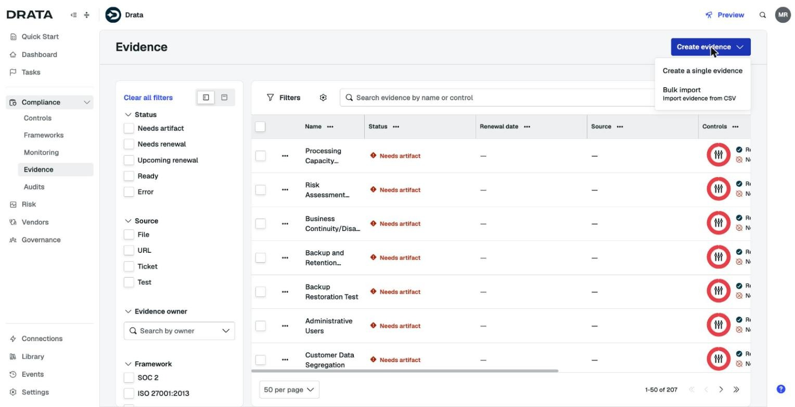
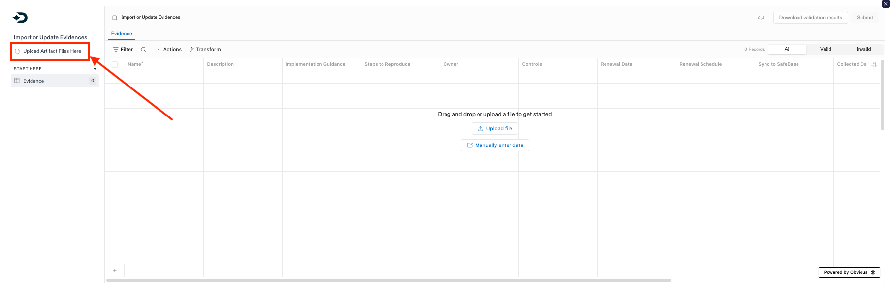
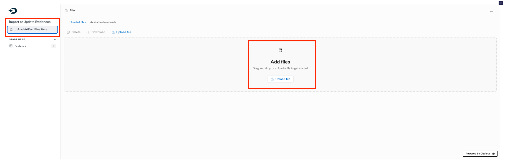
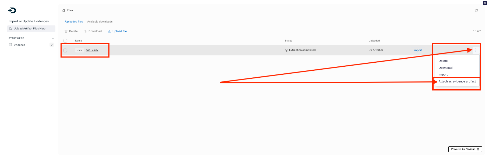
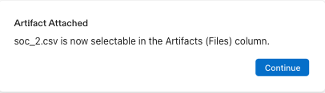
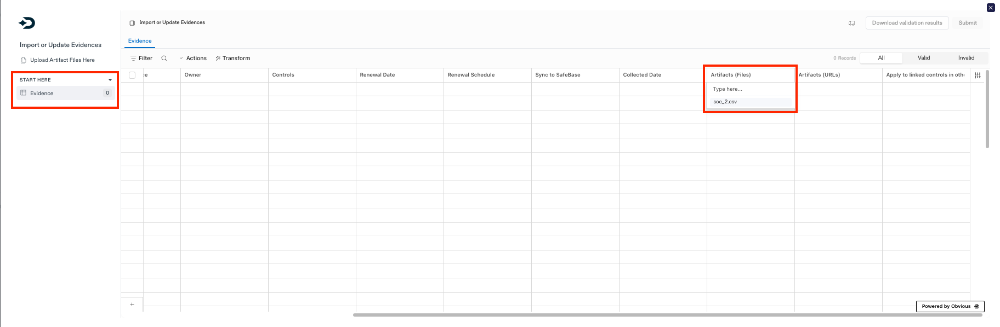
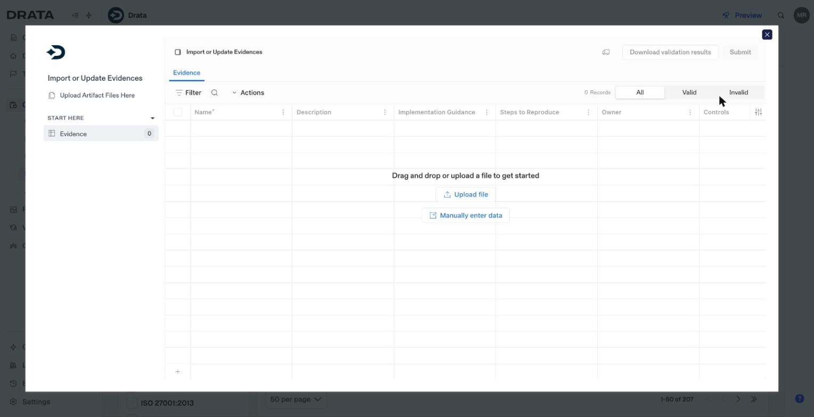
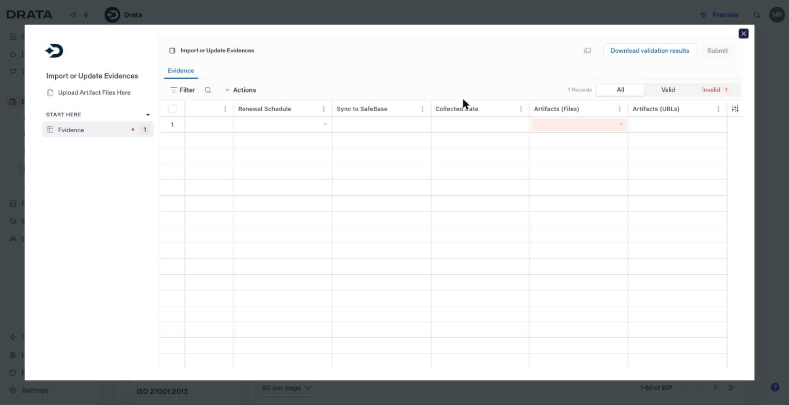
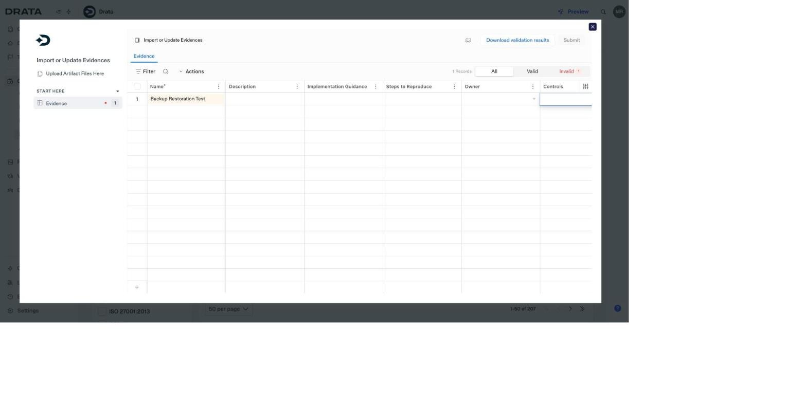

# Bulk Import Evidence

Source: https://help.drata.com/en/articles/16989042-bulk-import-evidence
Collection: Understand the Drata Platform › Evidence
Updated: 2026-11-20
Fetched: 2026-11-22
Description: Upload a CSV of evidence items and artifacts using a guided, spreadsheet-style experience.

## Article text

## Overview

Drata's bulk evidence import lets you create or update many Evidence Library items at once, together with their file and URL artifacts, using a guided, spreadsheet-style experience. Upload a CSV and attach the supporting files, paste data from an existing spreadsheet, or enter rows directly in the UI. Validation runs as you type, so errors are visible and fixable before you submit.

Use bulk evidence import when you need to:

- Migrate an existing evidence library into Drata in a single step.
- Attach a large batch of collected artifacts (PDFs, ZIPs, and/or links) to their evidence items at once.
- Update metadata or add artifacts to existing evidence in bulk.

## Key Capabilities

- **Create and update in the same file.** Rows whose **Name** matches existing evidence in the workspace are routed to update; new names create new evidence.
- **Multiple artifacts per item — files and URLs.** Attach uploaded PDF files and/or URL links to each evidence item. Upload a **ZIP** and Drata expands its files.
   - Uploading in bulk follows the same fields and validations as the [individual Evidence Creation with Multi-Artifact support](evidence-library-multiple-artifacts-multi-file-upload-new-experience.md).
- **Link files to rows by filename.** Reference an uploaded file by its filename in the **Artifacts (Files)** column.
- **Field parity with the [individual Create Evidence form](create-evidence.md):** description, implementation guidance, steps to reproduce, control mappings, owner, renewal schedule, [SafeBase sync](drata-evidence-library-sync.md), and artifacts (files and/or URLs).
- **Pre-filled dropdowns** for **Owner** and **Controls**, based on your workspace data.
- **Apply evidence across linked workspaces** when a control on the row is linked to other workspaces (available to Admins / Information Security Leads).
- **Real-time validation** with clear, inline error messages.
- **Flexible data entry:** upload a file, paste from a spreadsheet, or type directly.

## Before You Begin

- Every evidence item needs **at least one artifact** — an uploaded file **or** a URL. Both can be provided.
- The **owner** must be active personnel in your tenant and hold an eligible role: **Administrator, Security Lead, Workspace Manager, or Control Manager**. You can pick the owner from the dropdown or type/paste the email.
- **Controls** you reference must exist in the current workspace (matched by control code or name).
- Accepted date format: `YYYY-MM-DD` (for **Renewal Date** and **Collected Date**).
- A **Renewal Date** can only be set when **Renewal Schedule** is **Custom - One Time**. Fixed intervals calculate the next date automatically; **None** has no renewal.

> 💡 Tip: The **Bulk import** option is only available to users with the **Bulk Import Evidence - Manage** permission, granted by default to **Admin, Information Security Lead**, **Workspace Administrator**, and **Service User (Guest Admin)** roles. If you don't see the **Bulk import** option under **Create evidence**, ask an Admin to verify your role and permissions.

## How to Bulk Import Evidence

### Step 1: Open Bulk Import

Go to the **Evidence Library**. In the top-right corner, click the chevron (▾) next to the **Create evidence** button, then select **Bulk import**.

### Step 2: Upload Artifact Files

Attach the artifact files in the “**Upload Artifact Files Here**” area — e.g. individual PDFs, or a **ZIP archive** which Drata expands into its contents. The files extracted from within the ZIP will be available for mapping. The ZIP itself will not.

> 💡 **Note:** The following file formats are supported for bulk import: CSV, DOCX, GIF, HTML, JPEG, JPG, JSON, LOG, MP4, MSG, ODP, ODS, ODT, PDF, PNG, PPTX, TXT, XLSX, ZIP
>
> File formats that are not supported, or corrupt files, will show an error message and will not be selectable for import.

> 💡 Uploading a CSV as an artifact file requires an extra step. Once the CSV is upload in the artifacts area, click on the 3 dots on the file's row, then click on “**Attach as evidence artifact**" action. After the file is processed and validated, click "**Continue**," and this file name will be selectable in the **Artifacts (Files)** column.
>
> Other file formats do not require this extra step.

### Step 3: Add your data

The bulk import modal opens with two options to add your data:

1. **Upload a file.** Select the evidence CSV from your machine.
2. **Type directly.** Click **Manually enter data** to enter rows one at a time using the built-in dropdowns and text fields.

### Step 4: Map your columns (file uploads only)

When you upload a file, Drata guides you through two quick mapping steps before your data loads into the sheet.

**Map fields**

Match your file's incoming fields to Drata's destination fields:

- Name
- Description
- Implementation Guidance
- Steps to Reproduce
- Owner
- Controls
- Renewal Date
- Renewal Schedule
- [Sync to SafeBase](drata-evidence-library-sync.md)
- Collected Date
- Artifacts (Files)
- Artifacts (URLs)

Drata auto-matches fields with the same name. Review each mapping and adjust any that are missing or incorrect, then click **Continue**.

**Map field values**

For dropdown fields (**Owner**, **Controls**, **Renewal Schedule**), Drata asks you to map each incoming value to a matching destination value from your workspace. Mapping at this step is optional; anything left unmapped shows as an invalid cell in the sheet, where you can fix it.

Once mapping is done, your data appears in the **Evidence** sheet, ready for validation.

### Step 5: Review and resolve validation

Drata validates every row as you type. The **Submit** button stays disabled until all errors are resolved. Hover over the highlighted cell to see more information about the issue.

- **Red cells are errors.** They must be fixed before you can submit.

- **Yellow cells are warnings**, which are informational; you can still submit. The most common warning is that an evidence item with the same name has been detected, meaning the row will **update** existing evidence.

- Hover any column header to see that field's validation rules.
- The sheet shows the **number of invalid cells** so you know what's left, and the **All / Valid / Invalid** tabs filter rows by status.
- Click **Download validation results** (top right) to export a report of the current errors.

### Step 6: Submit

When you click **Submit**, a confirmation modal appears before the import runs, summarizing what will be imported.

Click **Import evidence**. Drata creates and updates the evidence items and attaches their artifacts; the Evidence Library refreshes with the new items.

## Column Reference

The following columns appear in every Evidence import session. Only **Name** is required, and every row must include **at least one artifact** (a file or a URL).

| **Field** | **Required** | **Format** | **Description** |
|---|---|---|---|
| **Name** | Yes | Text | The name of the evidence. Matched case-insensitively against existing evidence in the workspace. A match updates that item (see [Duplicate Handling](#h_0e057d755f)). |
| **Description** | No | Text | Optional description of the evidence. |
| **Implementation Guidance** | No | Text | Optional guidance on how the evidence is implemented. |
| **Steps to Reproduce** | No | Text | Optional steps to reproduce or collect the evidence. |
| **Owner** | No | Dropdown of eligible personnel emails (type to search) | Email of the evidence owner. Must be an active user with an eligible role (Administrator, Information Security Lead, Workspace Manager, or Control Manager). One owner per item. |
| **Controls** | No | Multi-value dropdown of your controls | Control code(s) or name(s) to map to this evidence. Separate multiple values with commas. Each must exist in the current workspace. |
| **Renewal Date** | Conditional | `YYYY-MM-DD` | The next renewal date. Only allowed when **Renewal Schedule** is **Custom - One Time**. |
| **Renewal Schedule** | No | Dropdown | How often the evidence renews: **1 Month, 2 Months, 3 Months, 6 Months, 1 Year, Custom - One Time, None**. |
| **Sync to SafeBase** | No | `true` / `false` | Whether to sync this evidence to SafeBase. |
| **Collected Date** | No | `YYYY-MM-DD` | Date the artifacts were collected. Applied to all artifacts in the row; defaults to the import date when blank. |
| **Artifacts (Files)** | Conditional | Filename(s) of uploaded files | Uploaded file(s) to attach, matched by filename to the **Files** area. A row needs at least one artifact (file or URL). |
| **Artifacts (URLs)** | Conditional | URL(s), including protocol | URL link artifact(s). Each URL must include its protocol (e.g. `https://`), one URL per value. |
| **Replace Matching Artifacts** | No | `true` / `false` | When checked, an uploaded file whose name exactly matches one existing artifact on this evidence replaces it with a new version instead of being added alongside it. Only applies to evidence that already exists. |
| **Apply to linked controls in other workspaces** | No | `true` / `false` | When checked, this evidence will be mapped to the same control(s) in every workspace where the control(s) is/are linked. Requires at least one control that is linked across workspaces. Only appears when available (see below). |

## Artifacts: Files and URLs

- **Artifacts (Files)** references files you uploaded in the **Files** area, matched by **filename** (they must match exactly). Upload a **ZIP** to include many files at once; Drata expands it into its contents.
   - **Note:** the files extracted from within the ZIP will be available for mapping. The ZIP itself will not.
- **Artifacts (URLs)** holds link artifacts. Each URL must include its protocol (e.g. `https://`), and you enter **one URL per value**.
- Every evidence item must have **at least one** artifact, a file or a URL. A row with neither fails validation.
- **Collected Date** applies to all artifacts in the row and defaults to the import date when left blank.

## Renewal Schedule and Renewal Date

- **Renewal Schedule** options:
   - **1 Month**
   - **2 Months**
   - **3 Months**
   - **6 Months**
   - **1 Year**
   - **Custom - One Time**
   - **None**
- For fixed intervals (1 Month through 1 Year), Drata calculates the next renewal date automatically. Leave **Renewal Date** blank.
- For **Custom - One Time**, you must provide a **Renewal Date**.
- For **None**, the evidence does not renew.

> 💡 Setting a **Renewal Date** with any non-Custom schedule is a blocking error, and choosing **Custom - One Time** without a date is also a blocking error. Match the two fields according to the validation described above.

## Applying Evidence Across Linked Workspaces

When your workspace has controls that are **linked across workspaces** (through a control group), an **Apply to linked controls in other workspaces** column appears for **Admins and Information Security Leads**. Check it on a row to also apply that evidence to the **same control in every workspace where those control(s) is/are linked**.

- The row must have **at least one control**, and at least one of those controls must be **linked** to another workspace.
- If neither condition is met, the row fails validation with a message explaining why. To clear the error, you must do one of the following:
   - Specify a linked control
   - Link the control across workspaces first (outside of the upload modal)
   - Clear the column

This column only appears when your tenant has multiple workspaces and a qualifying linked control.

## Duplicate Handling (Create vs. Update)

Evidence names are matched **case-insensitively** against existing evidence **in the same workspace**:

| **Existing evidence with this name?** | **Existing artifact file with the same name?** | **"Replace Matching Artifacts" checked?** | **Row outcome** | **Notes** |
|---|---|---|---|---|
| No (new name) | N/A | N/A | Creates a new evidence item. | Artifacts on the row are attached to the new item. |
| Yes (same workspace) | No | N/A | **Updates** the existing **evidence** item in place. New artifacts are created. | Shown as a yellow warning on **Name**: "Evidence with this name already exists in this workspace and will be updated." |
| Yes (same workspace) | Yes | No | **Updates** the existing **evidence** item in place. **New artifacts** are created. Existing artifacts are unaffected. | Shown as a yellow warning on **Name**: "Evidence with this name already exists in this workspace and will be updated." |
| Yes (same workspace) | Yes | Yes | Updates the **existing evidence item** in place. The **existing artifact with the exact same file name** (case-sensitive) is **replaced** with a new version. | Shown as a yellow warning on **Name**: "Evidence with this name already exists in this workspace and will be updated." |

## Troubleshooting

**▸ "Control "…" was not found in this workspace."**

The control code or name doesn't match a control in the current workspace. Check the value, map it during **Map field values**, or add/enable that control in this workspace before re-importing. Separate multiple controls with commas.

**▸ "Evidence requires at least one uploaded file or artifact URL."**

The row has no artifact. Add a filename in **Artifacts (Files)** (and upload that file in the Files area) or a link in **Artifacts (URLs)**.

**▸ "Uploaded file "…" was not found in the Files area."**

The filename in **Artifacts (Files)** doesn't match any uploaded file. Upload the file in the **Files** area, or correct the filename so it matches exactly (including the extension).

**▸ "Owner … must be an administrator, security lead, workspace manager, or control manager to own evidence."**

The owner email is valid but the user doesn't hold an eligible role. Choose a user who is an Administrator, Information Security Lead, Workspace Manager, or Control Manager, or update the user's role.

**▸ "A renewal date is required when the renewal schedule is Custom."**

You chose **Custom - One Time** but left **Renewal Date** blank. Enter a renewal date, or choose a fixed interval (which calculates the date automatically) or **None**.

**▸ "A renewal date can only be set when the renewal schedule is Custom."**

You set a **Renewal Date** on a row whose schedule is a fixed interval or **None**. Clear the Renewal Date, or change the schedule to **Custom - One Time**.

**▸ Yellow warning: "Evidence with this name already exists in this workspace and will be updated."**

This is informational, not blocking. Submitting the row will update the existing evidence with the same name. Rename the row if you intended to create a new item instead.

**▸ The "Bulk import" option doesn't appear under Create evidence**

The option only appears for users with the **Bulk Import Evidence - Manage** permission, granted by default to **Admin, Information Security Lead**, **Workspace Administrator**, and **Service User (Guest Admin)** roles. Ask an Admin to verify your role and permissions.

## Images

- [image 01] ../../images/ux/evidence/bulk-import-evidence--01.jpg
- [image 02] ../../images/ux/evidence/bulk-import-evidence--02.png
- [image 03] ../../images/ux/evidence/bulk-import-evidence--03.png
- [image 04] ../../images/ux/evidence/bulk-import-evidence--04.png
- [image 05] ../../images/ux/evidence/bulk-import-evidence--05.png
- [image 06] ../../images/ux/evidence/bulk-import-evidence--06.png
- [image 07] ../../images/ux/evidence/bulk-import-evidence--07.jpg
- [image 08] ../../images/ux/evidence/bulk-import-evidence--08.jpg
- [image 09] ../../images/ux/evidence/bulk-import-evidence--09.jpg

## Related articles

- [Evidence Overview](evidence-overview.md)
- [Add Jira Tickets as Evidence](add-jira-tickets-as-evidence.md)
- [Section 5: Evidence Owners](section-5-evidence-owners.md)
- [Bulk Import Policy Acknowledgments](bulk-import-policy-acknowledgments.md)
- [Bulk Import Assets](bulk-import-assets.md)
