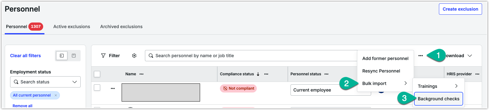
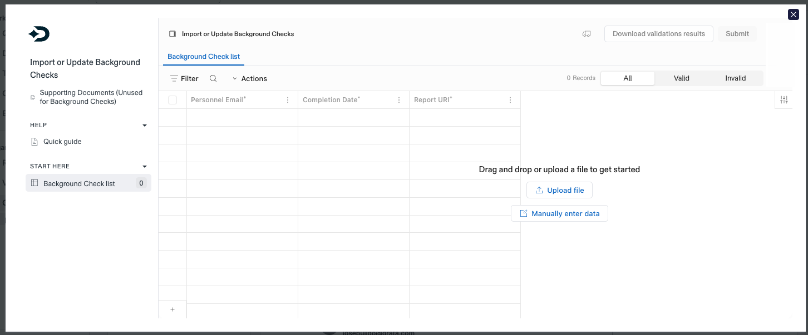

# Bulk Import Personnel Background Checks (New Experience)

Source: https://help.drata.com/en/articles/14142232-bulk-import-personnel-background-checks-new-experience
Collection: Understand the Drata Platform › Personnel
Updated: 2026-03-24
Fetched: 2026-11-22
Description: Upload completed background checks for multiple personnel at once using a CSV file, instead of updating each record individually.

## Article text

Background check bulk import allows you to **add manual background check evidence for multiple personnel at once** using a CSV file or in-app sheet.

Use this feature when you already have completed background check reports stored in your own system and want to **associate them with personnel records in Drata**.

## How bulk import works

Background check bulk import is **not just a file upload**. Each row is matched to a specific person in Drata.

- Each row must include a **personnel email address**
- Drata uses this email to match the row to an existing personnel record
- If no matching record is found, the row is **rejected**
- Background check evidence is then **attached to that individual’s record**

During a background check bulk import, you:

- Upload a file or create a data sheet
- Map your file’s columns to Drata background check fields
- (Optional) Map values and resolve any validation errors shown in the sheet
- Submit once all rows pass validation

Drata validates each row and blocks submission until invalid cells are resolved.

---

## Prerequisites

- Personnel must already exist in Drata as:
   - Current employees
   - Former employees
   - Contractors
- Out-of-scope and future-hire records are **not supported and are rejected**

---

## Access the background check bulk import

From the **Personnel** page in the New Drata Experience:

1. Go to **Governance → Personnel**
2. In the Personnel table, select the **More actions (three dots)** menu
3. Choose **Bulk import**
4. Select **Background checks**

---

## Prepare your file

Bulk import for background checks supports:

- CSV files (for example, `.csv`)

For background checks:

- Evidence files are **not uploaded** through the bulk import file section
- Instead, you provide a **URL** pointing to the completed background check document (for example, a file stored in Google Drive, SharePoint, or Dropbox)

---

## Required fields

| Field (Drata) | Type | Required | Validation rules |
|---|---|---|---|
| Personnel email address | Email | Yes | Must match a current or former employee or contractor in Drata. Out-of-scope and future-hire personnel are rejected. If no matching record is found, the row fails. Personnel with a Background checks exclusion can be imported, but compliance status will not change. |
| Background check completion date | Date | Yes | Must be today or earlier. Future dates are rejected. Empty or invalid formats fail validation. Supported formats are normalized before saving. |
| Background check location | URL | Yes | Must be a valid URL (for example, `[https://](https://)...`). Empty or malformed values fail validation. Drata validates the URL format only and does not verify that the file exists or is accessible. |

**Important**

- Drata stores a **link to the background check report**, not the file itself
- The report must be hosted in your organization’s storage system (for example, internal storage or a document management system)

---

## Step-by-step

### Step 1: Upload your file or start from the in-app sheet

Inside the Background checks bulk import:

- Upload a CSV file, or
- Work directly in the sheet by pasting or typing your data

Your data is parsed into rows and displayed in a spreadsheet-style grid.

---

### Step 2: Map your fields

- Map each column in your file to a destination field in Drata
- Required fields must be mapped before you can proceed

---

### Step 3 (optional): Map field values

- If your file contains values that differ from Drata’s internal values (for example, status labels), use value mapping to align them

For background checks, focus on ensuring:

- Date formats are valid
- URLs are properly formatted

---

### Step 4: Validate the data

Drata validates each row and cell:

- Cells with errors appear in **red** with error messages
- Warning or informational cells appear in **yellow**
- Hover over column headers to view validation rules

You must correct or remove invalid rows before submitting.

---

### Step 5: Review the summary and submit

When all rows are valid:

- A confirmation modal appears summarizing the import
- Confirm to submit

On submission:

- Drata processes the validated records together in a single transaction
- If any issues occur at submission, the import does not complete and must be corrected before retrying

---

## How background check status is updated

### Personnel with no existing background check evidence

- A successful import adds manual background check evidence for the person
- The background check is marked as **compliant/passing**
- The evidence is visible in the Background Checks UI

### Personnel with an active “Background checks” exclusion

- The import adds the evidence record
- The background check status remains **excluded**

### Personnel who already have manual background check evidence

- Only one manual background check record per person is supported
- Additional rows are blocked during validation and cannot be submitted

---

## Limitations and best practices

- Only **one manual background check record per person** is supported via bulk import
- Additional rows for the same person are rejected
- This feature supports **manual evidence** with a completion date and URL
- Automated background check integrations (for example, Checkr) operate separately
- Imports are processed as a single batch:
   - Resolve all errors before submitting

## Images

- [image 01] ../../images/ux/personnel/bulk-import-personnel-background-checks-new-experience--01.png
- [image 02] ../../images/ux/personnel/bulk-import-personnel-background-checks-new-experience--02.png

## Related articles

- [Background Check Management](background-check-management.md)
- [Bulk Import Personnel Training Records (New Experience)](bulk-import-personnel-training-records-new-experience.md)
- [Bulk Import Policy Acknowledgments](bulk-import-policy-acknowledgments.md)
- [Bulk Import Assets](bulk-import-assets.md)
- [Bulk Import Evidence](bulk-import-evidence.md)
