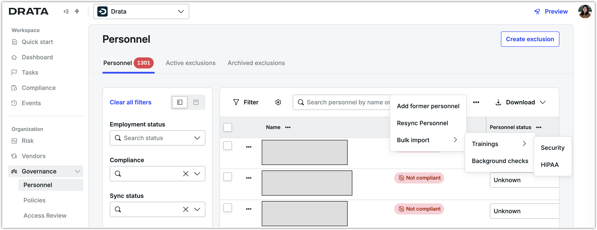
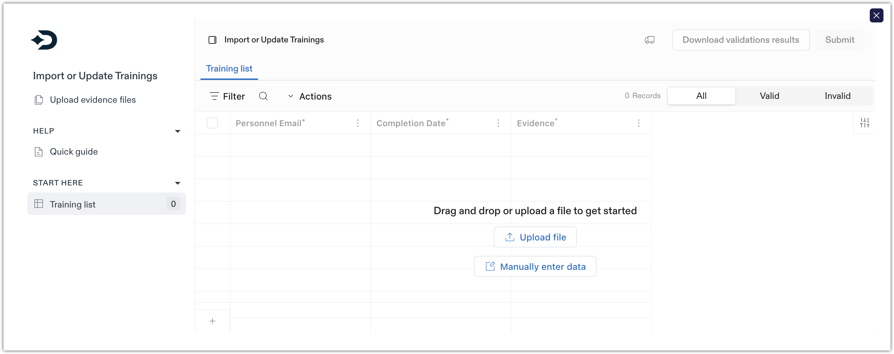

# Bulk Import Personnel Training Records (New Experience)

Source: https://help.drata.com/en/articles/12634309-bulk-import-personnel-training-records-new-experience
Collection: Understand the Drata Platform › Personnel
Updated: 2026-11-12
Fetched: 2026-11-22
Description: Upload training completion records for multiple personnel at once using a CSV or Excel file.

## Article text

Drata supports bulk import of evidence for Security, HIPAA, and AI Awareness personnel training. Bulk import allows you to upload training completion records for multiple personnel at once using a file. Each record is matched to a user by email address and recorded on that individual’s Personnel profile.

## How bulk import works

During import, you:

1. Upload a file.
2. Map your file’s fields to Drata fields.
3. Resolve any validation errors.
4. Submit the import.

Drata validates each row before allowing submission. If validation fails, the row must be corrected before you can complete the import.

## Prerequisites

- The applicable framework must be enabled:
   - HIPAA training requires the HIPAA framework.
   - AI Awareness training requires the applicable AI framework, one of ISO 42001:2023 or NIST AI RMF.
- If your account uses multiple workspaces, at least one workspace must have the framework enabled in **Settings**.
- Personnel must already exist in Drata as current or former employees or contractors.
- **Required Drata roles:** Admin, Workspace Manager

Future hire or out-of-scope email addresses are not supported.

## Access bulk import

1. Go to **Governance** → **Personnel**.
2. In the Personnel table, select the **More options menu (⋯)**.
3. Select **Bulk import**.
4. Select **Trainings**.
   
5. Select the training type:
   - **Security**
   - **HIPAA** (visible only if the HIPAA framework is enabled)
   - **AI Awareness** (visible only if the applicable AI framework is enabled)

After selecting a training type, continue with the upload workflow to import your training assignments.

## Import training evidence data

You can import training evidence by uploading a file or by manually mapping fields during the workflow.

If you upload a file, prepare your file in advance and ensure it meets the field requirements listed in the next section. Files that do not meet these requirements will fail validation and must be corrected before submission.

### Field requirements and validation rules

The following fields must be included and mapped correctly in your import file.

| **Field name** | **Required** | **Validation rules** |
|---|---|---|
| Personnel Email | Yes | Must be a valid email address belonging to a current or former employee or contractor in Drata. Out-of-scope and future hire email addresses are not supported. |
| Completion Date | Yes | Must be today’s date or earlier. Future dates are not allowed. |
| Evidence | Yes | Evidence files must be uploaded in the **Upload evidence files** section. Supported formats: `.pdf`, `.docx`, `.odt`, `.xlsx`, `.ods`, `.pptx`, `.odp`, `.gif`, `.jpeg`, `.jpg`, `.png`. |

### Step 1: Upload your file and map your fields

1. In the Training list section, select **Upload a file**.
2. Choose one of the following:
   - **Upload a file** or
   - **Manually map** to enter and map data directly in the interface.

If you upload a file:

1. Upload your file.
2. Match your **Incoming fields** to Drata’s **Destination fields**.
   - Fields marked with an asterisk (*) in the Destination fields column are required and must be mapped to avoid validation errors.
3. Use the preview to review your mapped data.
4. Select **Continue**.

### Step 2: (Optional) Map field values

If your file contains enumerated values (for example, predefined dropdown values), review and map them before continuing.

1. Under **Incoming Values** → **Destination Values**, review any mismatched values.
2. Update mappings as needed to align with Drata’s accepted values.
3. When all values are correctly mapped, select **Submit**.

You can map destination values to empty cells if needed. This may help prevent validation errors for required fields in the next step.

### Step 3: Validate and submit the data

After mapping fields and values, Drata validates each row against the required field rules.

- The number of invalid cells appears in the spreadsheet.
- Cells that fail validation appear in red.
- Warning or informational cells appear in yellow.
- Hover over a column header to view its validation rules.
- The **Submit** button becomes available only after all invalid (red) cells are resolved.

When all validation errors are resolved, select **Submit** to complete the import.

## Images

- [image 01] ../../images/ux/personnel/bulk-import-personnel-training-records-new-experience--01.png
- [image 02] ../../images/ux/personnel/bulk-import-personnel-training-records-new-experience--02.png

## Related articles

- [Import Risk in Bulk (New Experience)](import-risk-in-bulk-new-experience.md)
- [Import Controls in Bulk (New Experience)](import-controls-in-bulk-new-experience.md)
- [Personnel Overview](personnel-overview.md)
- [Bulk Import Personnel Background Checks (New Experience)](bulk-import-personnel-background-checks-new-experience.md)
- [Bulk Import Policy Acknowledgments](bulk-import-policy-acknowledgments.md)
