# Bulk Import Policy Acknowledgments

Source: https://help.drata.com/en/articles/15195769-bulk-import-policy-acknowledgments
Collection: Personnel Management › Personnel Compliance
Updated: 2026-05-26
Fetched: 2026-11-22
Description: Upload a CSV of policy acknowledgments using a guided, spreadsheet-style experience.

## Article text

## Overview

Drata's policy acknowledgments bulk import lets you record many policy acknowledgments at once using a guided, spreadsheet-style experience. Upload a CSV, paste data from an existing spreadsheet, or enter rows directly in the UI. Validation runs as you type, so errors are visible and fixable before you submit.

Use policy acknowledgments bulk import when you need to:

- Record acknowledgments captured during onboarding or annual policy review in a single step
- Update acknowledgments for many personnel after a policy version is republished, without opening each user's profile

## Key Capabilities

- **Scope-aware validation.** Drata checks the policy's scope (All personnel, Group, or None) and the user's group memberships, so rows for users outside a policy's scope are flagged before submit.
- **Duplicate detection.** If a user already has a valid acknowledgment for the current published version of a policy, the row is flagged with a yellow warning. You can still submit; the existing acknowledgment will be overwritten.
- **Real-time validation** with clear, inline error messages.
- **Flexible data entry:** upload a file, paste from a spreadsheet, or type directly.
- **Automated downstream work.** After a successful import, Drata recomputes the *Policies Accepted* compliance check for every imported user, and reruns Monitoring Test 38 (Accepted Policies — Employees) and Test 190 (Accepted Policies — Contractors) if any new acknowledgments were created.

## Before You Begin

- Users must already exist in your tenant. The dropdown only lists users who have Personnel records.
- The policy must be **active**, with a **published current version** that has **"Requires acknowledgment"** enabled. Draft, replaced, archived, or non-acknowledgment policies are not eligible.
- The user must be in scope for the policy:
   - Scope **All personnel**: any user passes.
   - Scope **Group**: the user must belong to at least one of the policy's assigned groups.
   - Scope **None**: no user passes; all rows for these policies will fail validation.
- Accepted date format: `YYYY-MM-DD`.
- Accepted **Acknowledgment Date** range: on or after `1900-01-01`, and on or before today (no future dates).

> 💡**Tip:** The bulk import entry points are only visible to users with the **Bulk Import Policy Acknowledgments — Manage** permission. By default this is granted to Admin, Workspace Administrator, Policy Manager, InfoSec Lead, and Personnel Manager roles. If you don't see the entry points described below, ask an Admin to verify your role and permissions.

## How to Bulk Import Policy Acknowledgments

### Step 1: Open Bulk Import

There are two entry points. Use whichever fits your workflow:

**Option 1 - From the Policy Center**

Go to **Policies**. In the top-right corner, click the **Import policy acknowledgments** button (next to **Create policy**).

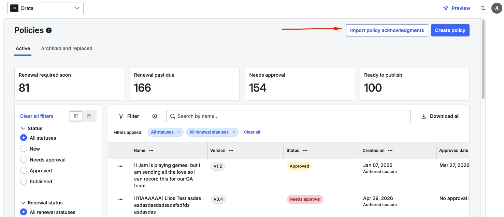

**Option 2 - From the Personnel page**

Go to **Personnel**. In the toolbar above the personnel table, click the **⋯** (More actions) button, hover over **Bulk import**, then select **Policy acknowledgments**.

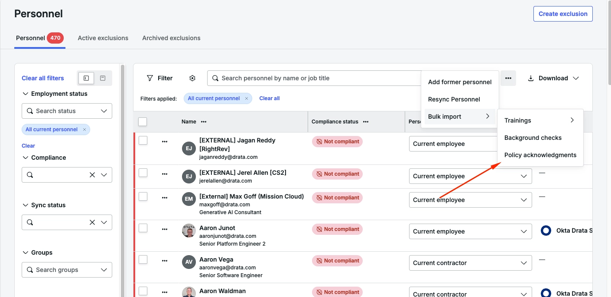

The **Import Policy Acknowledgments** modal opens with two options to add your data: **Upload file** to import a CSV, or **Manually enter data** to type rows directly into the sheet.

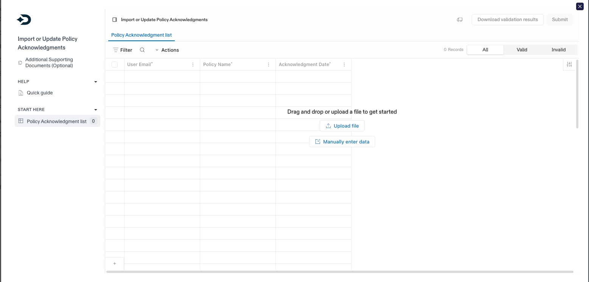

### Step 2: Add your data

You have two options:

1. **Upload a file.** Select the appropriate CSV from your machine.
2. **Type directly.** Click **Manually enter data** to enter rows one at a time using the built-in dropdowns and date picker.

### Step 3: Map your columns (file uploads only)

When you upload a file, Drata guides you through two quick mapping steps before your data loads into the sheet.

**Map fields**

Match your file's incoming fields to Drata's destination fields (**User Email**, **Policy Name**, **Acknowledgment Date**). Drata auto-matches fields with the same name. Review each mapping and adjust any that are missing or incorrect. Use the **Data preview** panel on the right to confirm what will be imported for each field. Click **Continue** when your mapping is complete.

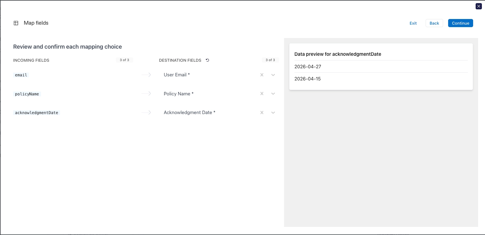

**Map field values**

For dropdown fields (**User Email** and **Policy Name**), Drata asks you to map each "Incoming Value" to a matching "Destination Value" from your workspace. Mapping values at this step is optional. If you skip it and click **Continue**, any unmapped values will show up as invalid cells in the sheet, and you can fix them there.

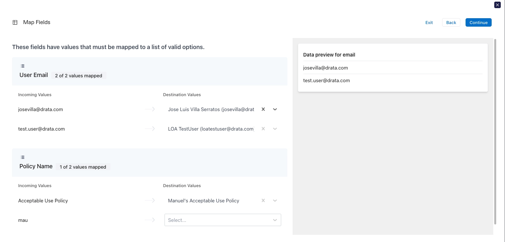

Once mapping is done, your data appears in the **Policy Acknowledgment list** sheet, ready for validation.

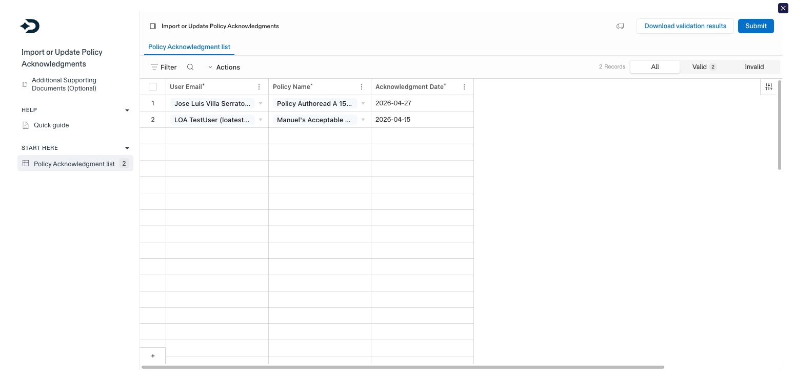

### Step 4: Review and resolve validation

Drata validates every row as you type. The **Submit** button stays disabled until all blocking errors are resolved.

- **Red cells are errors.** They must be fixed before you can submit.

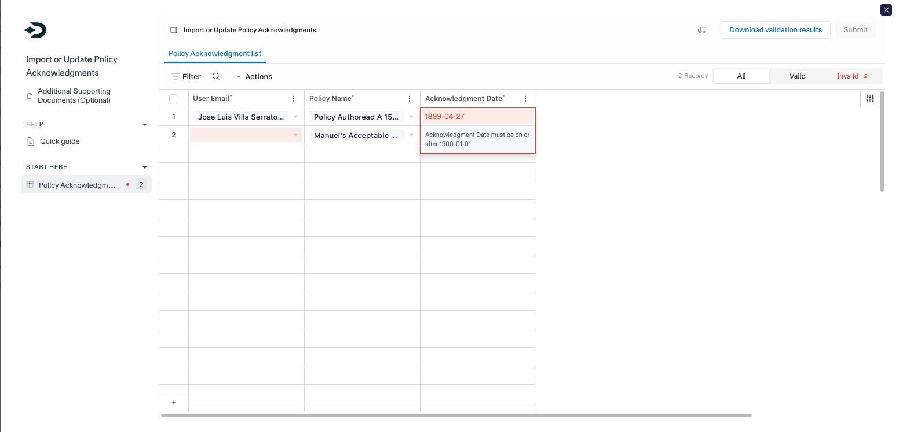

- **Yellow cells are warnings.** They are informational. You can still submit with warnings in place. The most common warning is the duplicate acknowledgment warning, which means importing this row will overwrite an existing acknowledgment.

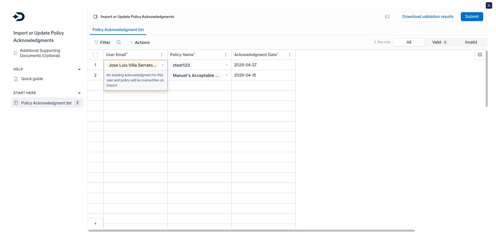

- The sheet shows the **number of invalid cells** so you know what's left to remediate.

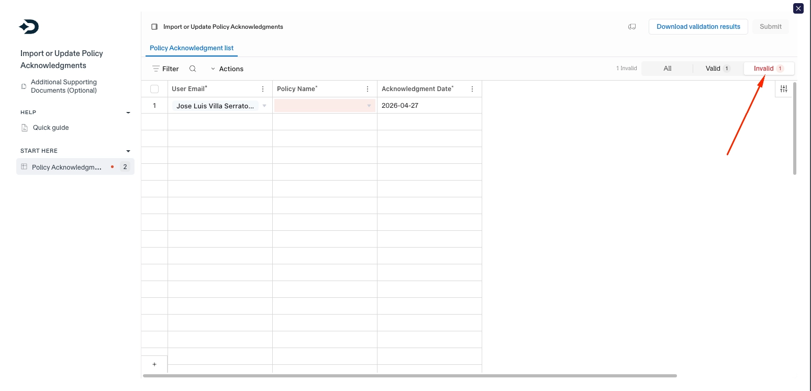

- Use the **All / Valid / Invalid** tabs at the top to filter rows by validation status.

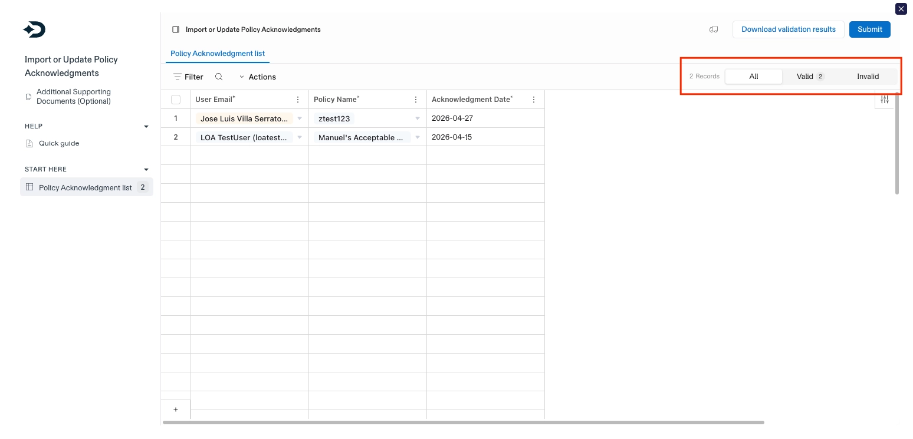

- Click **Download validation results** at the top right to export a CSV report of the current errors.

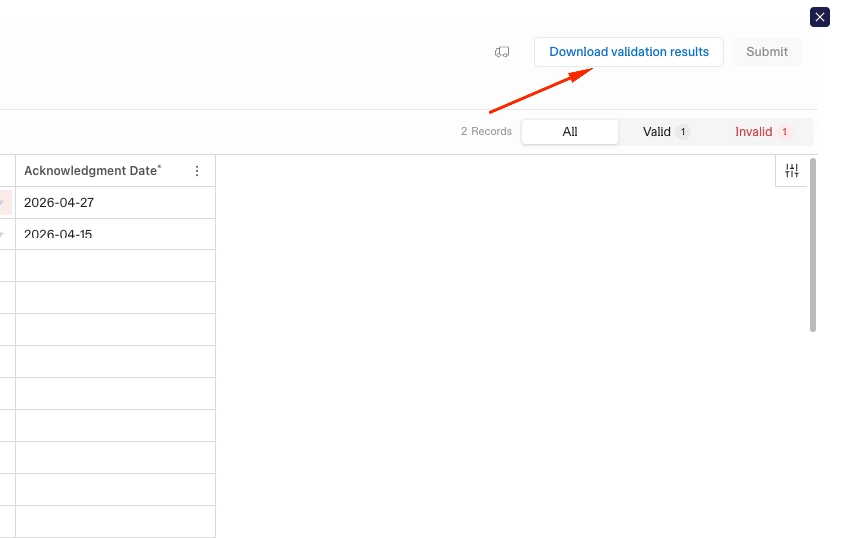

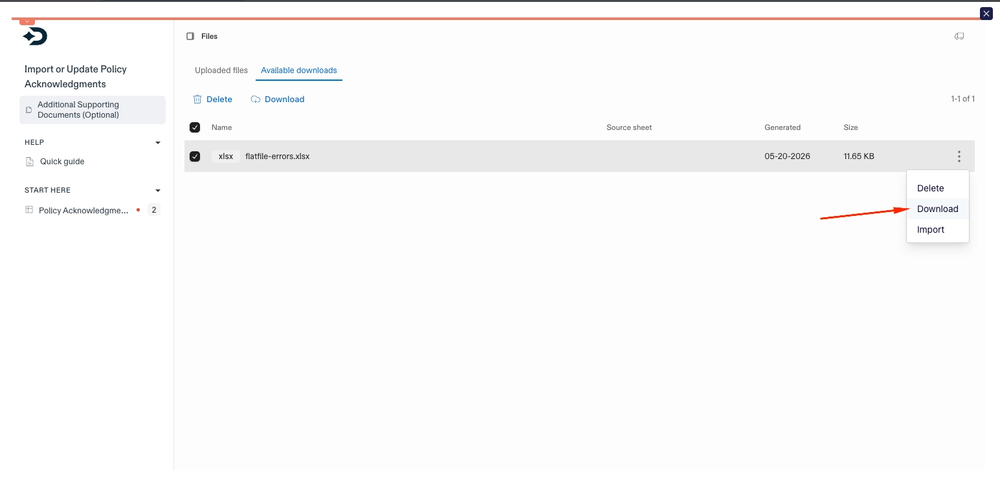

### Step 5: Submit

When you click **Submit**, a confirmation modal appears before the import runs.

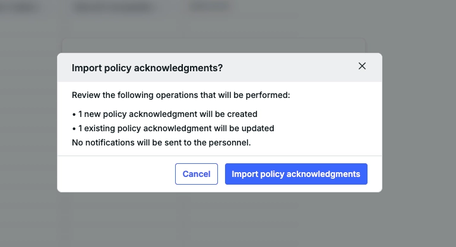

Click **Import policy acknowledgments**. Drata creates the acknowledgments and the page refreshes automatically.

After a successful import, Drata automatically:

- Recomputes the **Policies Accepted** compliance check for every imported user.
- Reruns **Test 38 (Accepted Policies — Employees)** and **Test 190 (Accepted Policies — Contractors)** when at least one row created a new acknowledgment. Update-only imports (where every row overwrites an existing acknowledgment) skip the rerun, since the test outcome cannot change.

> 💡Overwrites are idempotent. If a row matches an existing acknowledgment (same user + same current policy version), the existing record's accepted date is updated to your imported value. No duplicate acknowledgment rows are created.

## Column Reference

The sheet has exactly three columns. All three are required.

| **Field** | **Required** | **Format** | **Description** |
|---|---|---|---|
| **User Email** | Yes | Dropdown of personnel emails (you may type an email to search) | The email of the user who acknowledged the policy. Must match an existing user in your tenant; the user must have a Personnel record. |
| **Policy Name** | Yes | Dropdown of acknowledgment-eligible policies (you may type a policy name to search) | The exact name of the policy. The policy must be active, have a current published version, and have **Requires acknowledgment** enabled. |
| **Acknowledgment Date** | Yes | `YYYY-MM-DD` | The date the user signed the policy. Must be on or after `1900-01-01` and on or before today. |

## Validation Rules

### User Email

- **Required.**
- Must be a valid email address.
- Must match a user in your tenant.

### Policy Name

- **Required.**
- Must match an active policy in your tenant. Match is case-insensitive and ignores leading/trailing whitespace.
- The policy's current version must be **Published** and must have **Requires acknowledgment** enabled. Otherwise the row fails with *"Policy does not require acknowledgment."*
- The user must be in scope for the policy:
   - **All personnel** scope: any user passes.
   - **Group** scope: the user must belong to at least one of the policy's assigned groups.
   - **None** scope: row fails with *"User is not in scope for this policy."*

### Acknowledgment Date

- **Required.**
- Must follow `YYYY-MM-DD` format.
- Must be on or after `1900-01-01`. Earlier dates are rejected.
- Must be today or earlier. Future dates are rejected.

### Existing acknowledgment overwrites

If a row matches an existing acknowledgment in your tenant (same user, same current policy version), Drata flags the **User Email** cell with a yellow warning: *"An existing acknowledgment for this user and policy will be overwritten on import."* This is **not blocking** — you can still submit, and the existing record's accepted date will be updated.

## Troubleshooting

**▸ Email warning about personnel status**

The email matches an existing user, but their personnel status is something other than current employee/contractor (for example, offboarded). Confirm you intended to record an acknowledgment for this user, or remove the row.

**▸ "Policy not found or not currently active."**

The policy doesn't exist in your tenant, is archived, or has no current version. Verify the spelling (matching is case-insensitive) and confirm in the Policy Center that the policy is **Active**.

**▸ "Policy does not require acknowledgment."**

The policy exists but its current published version has **Requires acknowledgment** turned off. Edit the policy in the Policy Center to enable acknowledgment on its current version, then re-import. If the policy is intentionally non-acknowledgment, remove the row.

**▸ "User is not in scope for this policy."**

The policy is scoped to specific groups (or **None**), and the user does not belong to any of the policy's assigned groups. Either update the user's group memberships, change the policy's scope, or remove the row.

**▸ Yellow warning: "An existing acknowledgment for this user and policy will be overwritten on import."**

This is informational, not blocking. The user already has an accepted acknowledgment for the current published version of the policy. Submitting will overwrite the existing record's accepted date with the value from your sheet. Remove the row if you didn't intend to overwrite.

## Images

- [image 01] ../../images/ux/policies/bulk-import-policy-acknowledgments--01.png
- [image 02] ../../images/ux/personnel/bulk-import-policy-acknowledgments--02.png
- [image 03] ../../images/ux/personnel/bulk-import-policy-acknowledgments--03.png
- [image 04] ../../images/ux/personnel/bulk-import-policy-acknowledgments--04.png
- [image 05] ../../images/ux/personnel/bulk-import-policy-acknowledgments--05.png
- [image 06] ../../images/ux/personnel/bulk-import-policy-acknowledgments--06.png
- [image 07] ../../images/ux/personnel/bulk-import-policy-acknowledgments--07.png
- [image 08] ../../images/ux/personnel/bulk-import-policy-acknowledgments--08.png
- [image 09] ../../images/ux/personnel/bulk-import-policy-acknowledgments--09.png
- [image 10] ../../images/ux/personnel/bulk-import-policy-acknowledgments--10.png
- [image 11] ../../images/ux/personnel/bulk-import-policy-acknowledgments--11.png
- [image 12] ../../images/ux/personnel/bulk-import-policy-acknowledgments--12.png
- [image 13] ../../images/ux/personnel/bulk-import-policy-acknowledgments--13.png

## Related articles

- [Review and Acknowledge Company Policies](review-and-acknowledge-company-policies.md)
- [Bulk Import Personnel Training Records (New Experience)](bulk-import-personnel-training-records-new-experience.md)
- [External Policy: Use BambooHR to manage your policies](external-policy-use-bamboohr-to-manage-your-policies.md)
- [Bulk Import Assets](bulk-import-assets.md)
- [Bulk Import Evidence](bulk-import-evidence.md)
