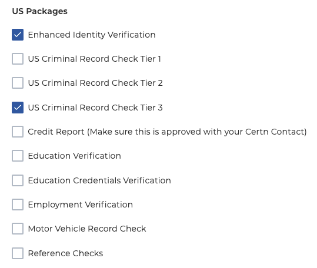
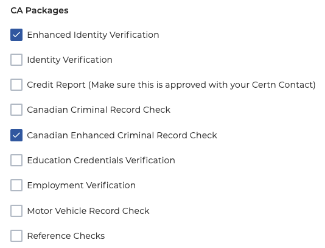
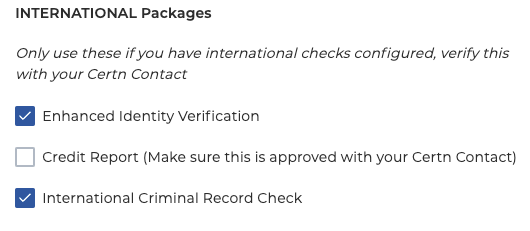

# Certn Background Check Packages

Source: https://help.drata.com/en/articles/5695892-certn-background-check-packages
Collection: Personnel Management › Employee Onboarding
Updated: 2026-08-05
Fetched: 2026-11-22
Description: Additional information to help choose the right background check package for your employees

## Article text

Certn offers an ever-expanding list of checks for building custom-tailored background checks. Checks can be run a la carte or in combination on a per-applicant basis.

Drata suggests the following as default options if you're unsure of which background checks you should have run on employees:

For US based checks:

- OneID (formerly Enhanced Identity Verification)
- US Criminal Check Tier 3

For Canadian checks:

- OneID (formerly Enhanced Identity Verification)
- Canadian Enhanced Criminal Record Check

For international checks:

- OneID (formerly Enhanced Identity Verification)
- International Criminal Record Check

The following lists more information about what checks can be selected in Drata:

- Credit Report
   - Equifax Credit Score
   - Equifax Credit Data
- Identity Verification
   - Verified with Equifax Credit Data
- OneID (formerly Enhanced Identity Verification)
   - AI and Computer Vision supported review of Identity Documents
- Canadian Criminal Record Check
   - Standard
      - Canadian Police Information Centre (CPIC)
   - Enhanced
      - Canadian Police Information Centre (CPIC)
      - Police Information Portal (PIP)
      - Firearms Interest Police (FIP)
      - Niche RMS
- US Criminal Record Check
   - Tier 1
      - SSN validation
      - Address history trace
      - Sex offenses
      - National Criminal Database convictions
   - Tier 2
      - SSN validation
      - Address history trace
      - Sex offenses
      - National Criminal Database convictions
      - Local court records in most recent address (county or state)
   - Tier 3
      - SSN validation
      - Address history trace
      - Sex offenses
      - National Criminal Database convictions
      - Local court records in most recent address (county or state)
      - Local court records in all addresses (counties and states)
- International Criminal Record Check
   - Criminal Check in previous countries of residence
   - Subject to limited availability based on a country’s laws and regulations
- Education Verification
- Employment Verification
- Motor Vehicle Record Check
- Reference Checks
   - Email: An email and/or SMS with a supplied questionnaire will be sent to the references provided.
   - Phone: Certn will manually call the references provided and fill out the supplied questionnaire.

## Images

- [image 01] ../../images/integrations/certn/certn-background-check-packages--01.png
- [image 02] ../../images/integrations/certn/certn-background-check-packages--02.png
- [image 03] ../../images/integrations/certn/certn-background-check-packages--03.png

## Related articles

- [Test 47: Employee Background Checks](test-47-employee-background-checks.md)
- [Test 50: Contractor Background Checks](test-50-contractor-background-checks.md)
- [Certn Integration Guide (Background Check)](certn-integration-guide-background-check.md)
- [Background Check Management](background-check-management.md)
