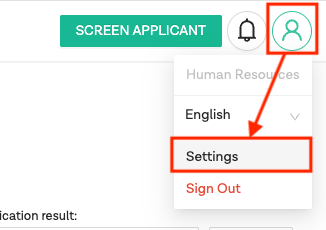
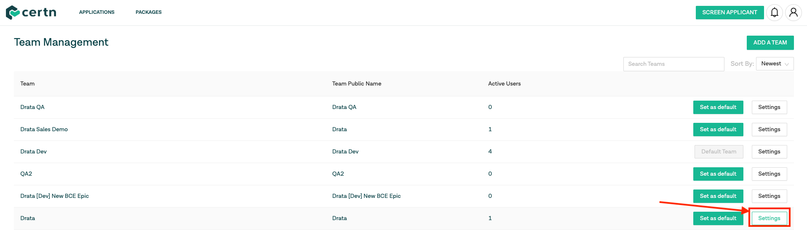
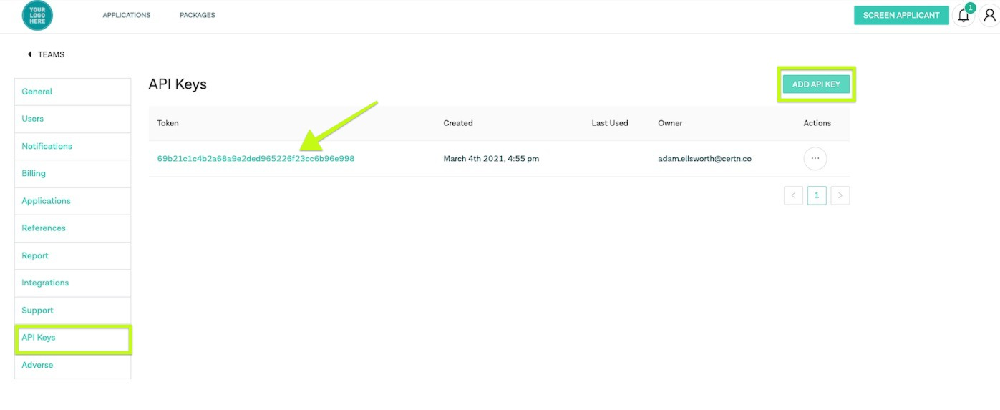
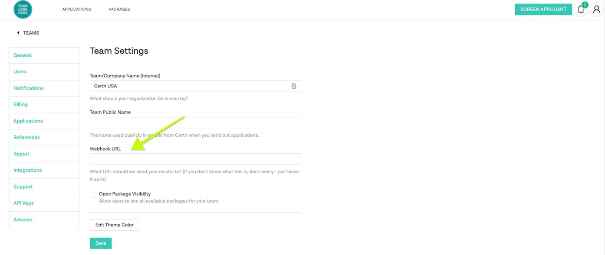

# Certn Integration Guide (Background Check)

Source: https://help.drata.com/en/articles/4972294-certn-integration-guide-background-check
Collection: Connection Support › Other Guidance
Updated: 2026-08-05
Fetched: 2026-11-22
Description: Learn how to connect Certn to Drata to background checks and store screening summaries for compliance workflows.

## Article text

The **Certn integration** enables organizations to perform **background checks for new hires directly through Drata**. By connecting Certn, companies can streamline employee onboarding while automatically storing background check summaries in Drata for compliance and audit readiness.

**Note:**
The Certn integration is **not available for EU-based customers**. EU customers can instead use supported background check providers such as **Checkr** or **KarmaCheck**.

---

## Key Capabilities

- **Background Check Automation:** Initiate background checks for personnel directly from Drata
- **Centralized Records:** Store background check summaries within Drata for compliance tracking
- **Streamlined Onboarding:** Simplify the employee screening process during onboarding

---

## Prerequisites & Data Access

### Certn Access Requirements

- You must have a **Certn account** for your organization.
- You must create the following credentials in Certn:
   - **API Key**
   - **Webhook Secret Key**

### Drata Role Requirements

To create or modify connections, you must have one of the following **Drata roles with write access**:

- Admin
- Workspace Manager
- DevOps Engineer

Access Reviewers can view the connection page but cannot modify connection settings.

---

## Step-by-Step Setup

### Step 1: Create a Certn API Key

1. Log in to your **Certn account**.
2. Navigate to your avatar in the upper right and click **Settings**.
   
3. Select the appropriate **Team**.
4. Open **Team Settings**.
   
5. Select **API Keys** from the left menu.
6. Select **Add API Key**.
   
7. Copy the generated **API Key**.

Store this key securely, as it will be required to connect Certn to Drata.

**Expected outcome:**
You have generated the **Certn API Key** required for the integration.

---

### Step 2: Register the Certn Webhook

Drata uses a webhook to receive background check status updates from Certn.

1. In Certn, navigate back to **Settings → Team → Team Settings**. Alternatively, if you are already in Team Settings from the previous API key step, select the **General **tab in the left menu.
2. Locate the **Webhook configuration** section.
   
3. Enter the following webhook URL:

```
https://api.drata.com/certn/webhook
```

4. Save the configuration.

5. Copy the generated **Webhook Secret Key**.

**Expected outcome:**
 The webhook is registered and Certn will send background check updates to Drata.

---

### Step 3: Connect Certn in Drata

1. Log in to **Drata** → go to the **Connections** page.
2. Navigate to your **Available Connections**.
3. Search for and start the **Certn connection process**.
4. Enter the following information when prompted:
   - **API Key**
   - **Webhook Secret Key**
5. Select **Continue**.
6. Next, select the **background check packages** configured in your Certn account.
   - **Note: OneID (Enhanced Identity Verification)** is required for **Canadian and International background checks**, and is also recommended for **U.S. background checks**.
7. Select **Save & Test Connection**.

**Expected outcome:**
 Certn is successfully connected to Drata.

---

## Enable Certn for Background Checks

After the connection is established, enable Certn as your background check provider.

1. Navigate to **Settings → Personnel Compliance →Human Resources** tab in Drata.
2. Locate the **Background Checks** section.
3. Select **Use Drata's partner Certn for background checks**.

**Expected outcome:**
 Certn is now configured as the background check provider for your organization.

---

## How Personnel Complete Background Checks

When a background check is required:

1. The employee logs in to **My Drata**.
2. Navigate to the **Background Check** section.
3. Select **Certn**.
4. Choose the appropriate screening type:
   - **U.S.**
   - **Canada**
   - **International**
5. Start the background check process.

**Expected outcome:**
 Background check results are sent to Drata and stored for compliance and audit purposes.

---

## Important Notes

- **Regional limitation:** Certn is not supported for **EU-based customers**.
- **Webhook requirement:** The webhook must be configured for background check updates to sync properly.
- **Background check packages:** Only packages configured in Certn can be selected during the connection process.

## Images

- [image 01] ../../images/integrations/certn/certn-integration-guide-background-check--01.png
- [image 02] ../../images/integrations/certn/certn-integration-guide-background-check--02.png
- [image 03] ../../images/integrations/certn/certn-integration-guide-background-check--03.jpg
- [image 04] ../../images/integrations/certn/certn-integration-guide-background-check--04.jpg

## Related articles

- [Background Check Management](background-check-management.md)
- [Hexnode UEM (Windows) Integration Guide](hexnode-uem-windows-integration-guide.md)
- [Vetty Integration Guide](vetty-integration-guide.md)
- [Qualys Integration Guide](qualys-integration-guide.md)
- [Zinc Integration Guide (Background Check)](zinc-integration-guide-background-check.md)
