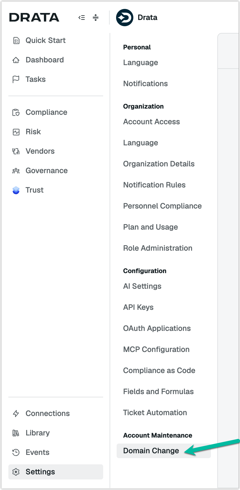
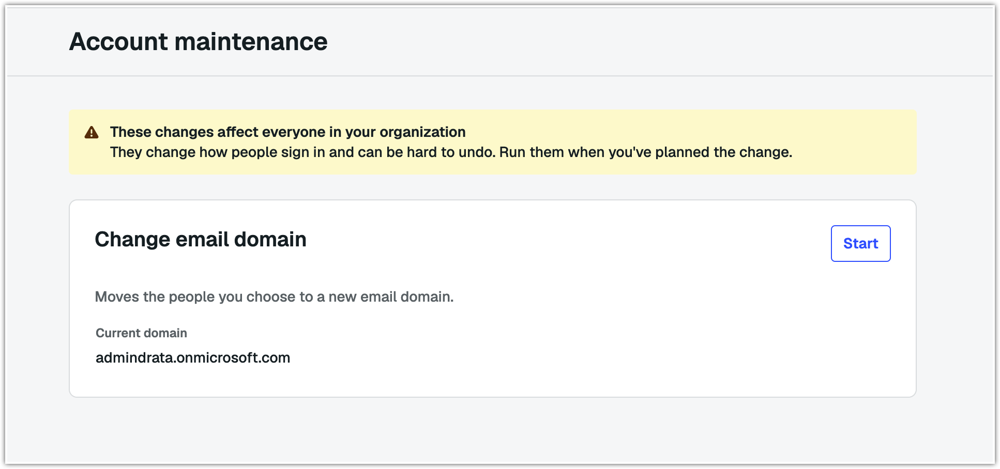
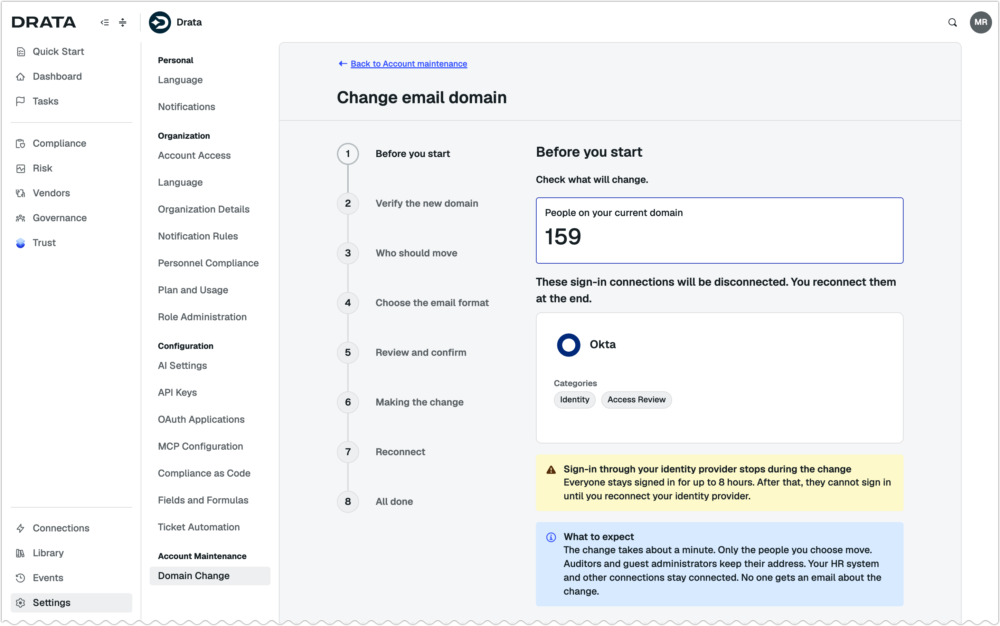
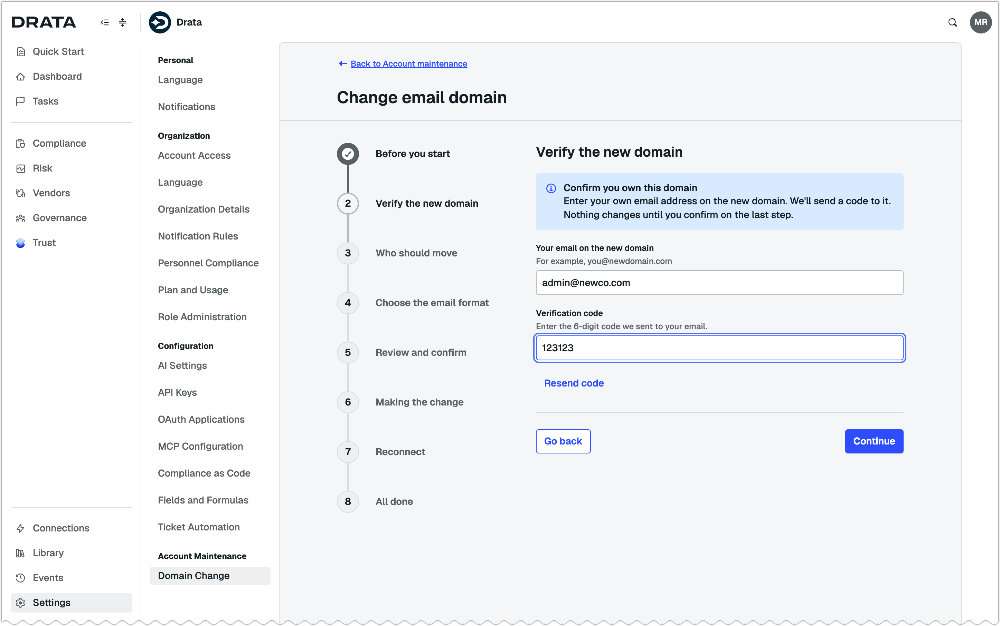
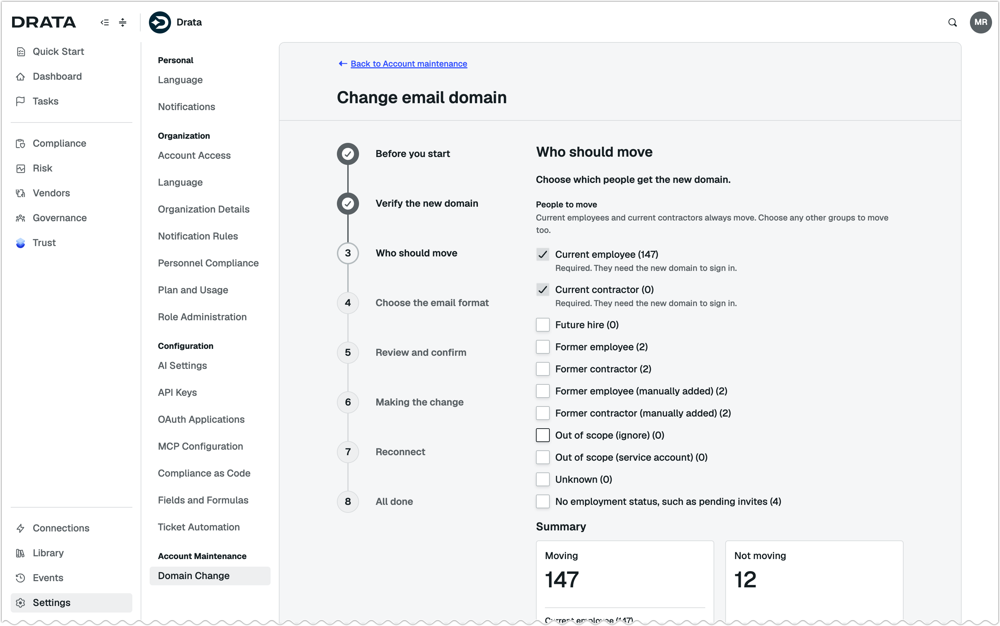
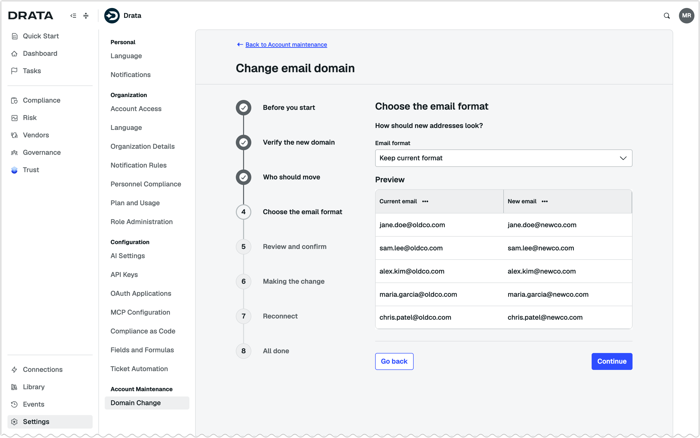
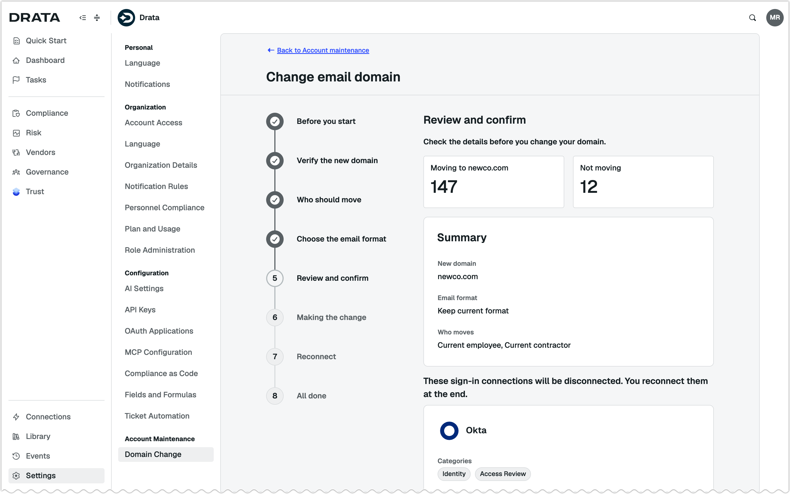
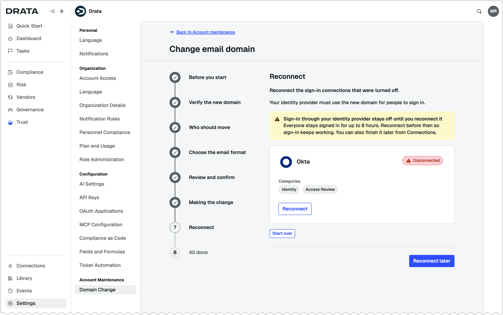
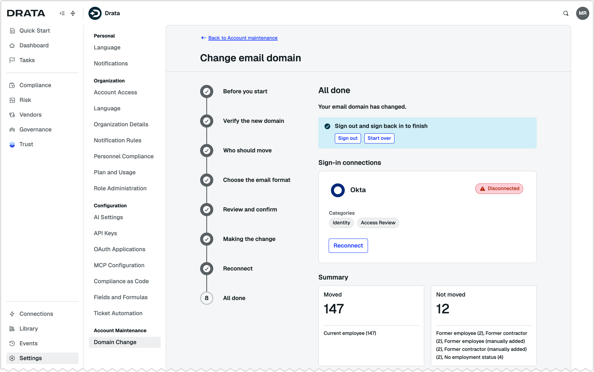

# Change your company's email domain

Source: https://help.drata.com/en/articles/18416864-change-your-company-s-email-domain
Collection: Settings
Updated: 2026-11-16
Fetched: 2026-11-22

## Article text

If your company changes its email domain, for example after a rebrand or an acquisition, an Administrator can move your people to the new domain in Drata. You don't need to contact Support.

The change takes about a minute. Nobody on your team gets an email about it.

## Before you begin

- **You need the Administrator role.** Guest administrators, auditors and Workspace Managers can't change the domain.
- **You need a mailbox on the new domain.** Drata sends a verification code to your own address on the new domain.
- **Your identity provider must use the new domain.** Once the change finishes, people sign in with their new address, so your identity provider has to recognize it.
- **Plan for a short sign-in gap.** Drata turns off sign-in through your identity provider during the change. People who are already signed in stay signed in for up to 8 hours. After that, they can't sign in until you reconnect your identity provider.

You can't use a public email domain, such as gmail.com, or your current domain.

## Change your domain

Go to **Settings**, then **Account Maintenance**, then **Domain Change**.

Then, select **Start **for the Change email domain

1. **Before you start**: review who is on your current domain and which connections will be affected.
   
2. **Verify the new domain**: enter your email address on the new domain and select **Send code**. Enter the 6-digit code from the email. The code works for 10 minutes.
   
3. **Who should move**: current employees and current contractors always move. You can choose to move other groups too, such as former employees, former contractors and people with no employment status (for example, pending invites).
   
4. **Choose the email format**: keep each person's current format and change only the domain, or build new addresses from their names (for example jane.doe or jdoe).
   
5. **Review and confirm**: check the summary, then select **Change domain**.
   
6. **Reconnect**: reconnect your identity provider and SSO connections as soon as the domain change finishes. The wizard prompts you for this.
   - You can also select **Reconnect later** and finish from **Connections** instead. **This option adds risk**: sessions end after up to 8 hours, and until you reconnect, no one can sign in through your identity provider. Drata also pauses employment status updates until you reconnect it.
   
7. **All done**: select **Sign out**, then sign back in with your new email address.
   

The change is all or nothing. If anything fails, Drata puts everything back the way it was.

## What changes and what doesn't

### People who keep their address

These people always keep their current address:

- Guest administrators
- Auditors
- Anyone who also belongs to another Drata account. The wizard marks them "Also in another Drata account".
- Anyone whose address on the new domain is already in use. Everyone else still moves.

### People who keep their address format

If you pick a name-based format, some people may not be able to get a new address. For example, their name may be missing, or two people's names may produce the same address. These people keep the part before the @, and only their domain changes. The wizard lists each person with the reason, and you can still continue.

### Connections

- **Identity provider and single sign-on**: turned off during the change. Reconnect them so people can sign in with their new address.
- **HR systems**: stay connected. No action needed.
- **Other connections**, such as version control or cloud accounts: stay connected and linked to the same people. Each one picks up the new address on its next sync.

## After the change

The **All done** screen shows:

- Who moved to the new domain
- Which groups didn't move
- Who kept their current address format
- Who kept their current address because the new one was already in use

**Sign out and sign back in with your new address.** If your browser is still signed in to your identity provider with your old address, you may be asked to sign in once more. A private browser window also works.

## Troubleshooting

| Message | What to do |
|---|---|
| That code does not match. Check it and try again. | Check the code and try again. |
| That code no longer works. Send a new code. | Codes expire after 10 minutes or 5 wrong tries. Send a new code. |
| Wait a minute before you send another code. | You can send one code a minute, and up to 10 an hour. |
| Your verification expired. | More than 10 minutes passed between verifying and confirming. Verify the new domain again. |
| Too many wrong codes. Contact support to change your domain. | After 10 wrong codes in 24 hours, verification is locked for you. Another Administrator can make the change, or contact Support. |
| Only an Administrator can change your domain. | Ask an Administrator on your account. |
| This domain cannot be used. Contact support. | Contact Support. |
| Your domain is already being changed. | A change is already running, often in another tab. Wait a minute and reload. |
| We could not change your domain. Nothing was changed. | Try again. If it happens again, contact Support. |

If the wizard asks you to contact Support, select **Contact support**. Your message includes a **Reference ID** that helps Support find your change quickly.

## FAQ

### Will my employees get an email?

No. Only the Administrator making the change gets the verification code.

### Will anyone be offboarded?

No. The domain change alone never offboards anyone — status still comes from your identity provider and HR system.

Update your identity provider to use people's new addresses before you reconnect it. Anyone not reported under the new domain may be marked as a former employee or contractor after the next sync.

Check Personnel after you reconnect, and contact Support if anyone looks wrong.

### Can I move only some people?

Yes. Current employees and current contractors always move. Every other group is your choice.

### Can Support make the change for me?

Yes. Contact Support if you'd like help.

### We have more than one domain. What moves?

Only your primary domain moves. For changes to secondary domains or subdomains, contact Support.

## Images

- [image 01] ../../images/ux/settings/change-your-company-s-email-domain--01.png
- [image 02] ../../images/ux/settings/change-your-company-s-email-domain--02.png
- [image 03] ../../images/ux/settings/change-your-company-s-email-domain--03.png
- [image 04] ../../images/ux/settings/change-your-company-s-email-domain--04.png
- [image 05] ../../images/ux/settings/change-your-company-s-email-domain--05.png
- [image 06] ../../images/ux/settings/change-your-company-s-email-domain--06.png
- [image 07] ../../images/ux/settings/change-your-company-s-email-domain--07.png
- [image 08] ../../images/ux/settings/change-your-company-s-email-domain--08.png
- [image 09] ../../images/ux/settings/change-your-company-s-email-domain--09.png

## Related articles

- [Google Workspace Integration Guide](google-workspace-integration-guide.md)
- [Okta Integration Guide (Identity Management Provider)](okta-integration-guide-identity-management-provider.md)
- [Your Drata Domain](your-drata-domain.md)
- [Signing In to Drata (New Experience)](signing-in-to-drata-new-experience.md)
- [Multi-Domain Support](multi-domain-support.md)
