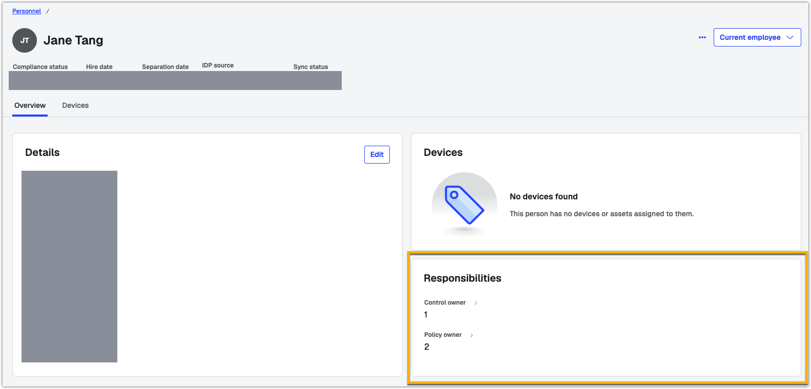

# Checklist: Before the Admin Leaves (New Experience)

Source: https://help.drata.com/en/articles/14142997-checklist-before-the-admin-leaves-new-experience
Collection: Settings › Role Administration
Updated: 2026-11-03
Fetched: 2026-11-22

## Article text

### 1. Promote a new Admin

- Go to **Settings → Role administration** and ensure at least one other user has an Admin (or equivalent) role
- If your org uses IdP group → role mapping, confirm the new admin is in the correct IdP group. Run an **Ad-Hoc Identity Resync** so the new admin appears immediately rather than waiting for the nightly sync.

### 2. Reconnect integrations owned by the departing admin

- Integration connections are authenticated via the connecting user's credentials — if that person leaves, **connections can break or fail to re-authenticate**.
- Go to **Connections**, identify any connections set up by the departing admin, and have a current admin **reconnect/re-authenticate** each one.
   - Pro tip: The new admin should be a **Super Admin** in the connected tool (e.g., Google Workspace, M365, Okta) *before* attempting to reconnect.

### 3. Reassign control ownership

- When a user is marked as **Former Employee**, Drata automatically removes them from all control ownership. If they were the *sole* owner, the control is left with no owner and a **red banner** will appear prompting reassignment.

### 4. Reassign policy ownership

- If the departing admin owned policies, proactively go to **Policies **and reassign policy ownership to the right stakeholder

### 5. Reassign evidence ownership

- If the departing admin had evidence ownership, review the Evidences and reassign the ownership

### 6. Check asset ownership

- For assets (e.g., Azure Virtual Assets), ownership follows a fallback chain: **Engineering Lead → CEO → Security Officer → Privacy Officer → Business Lead → first active Drata Admin**.
- Verify critical assets have the right owner after the transition.

### 7. Avoid accidentally having no admins

- Always confirm at least one active admin remains *before* processing the departing user

## Reassign the departing admin's responsibilities

When a user is marked as Former Employee, their responsibilities — controls, policies, vendors, evidence, and risks — stay with them. Drata no longer automatically moves these to another admin. Go to the departing admin's profile on the Personnel page and use **Responsibilities** section to move everything to someone with the right permissions in one step.

You'll also get an email linking directly to their profile when this happens.

## Images

- [image 01] ../../images/ux/personnel/personnel-overview--03.png

## Related articles

- [Populating and Managing Personnel Data in Drata (Concept Guide)](populating-and-managing-personnel-data-in-drata-concept-guide.md)
- [Your Drata Domain](your-drata-domain.md)
- [Personnel Overview](personnel-overview.md)
- [Personal settings: Notifications (New Experience)](personal-settings-notifications-new-experience.md)
- [Signing In to Drata (New Experience)](signing-in-to-drata-new-experience.md)
