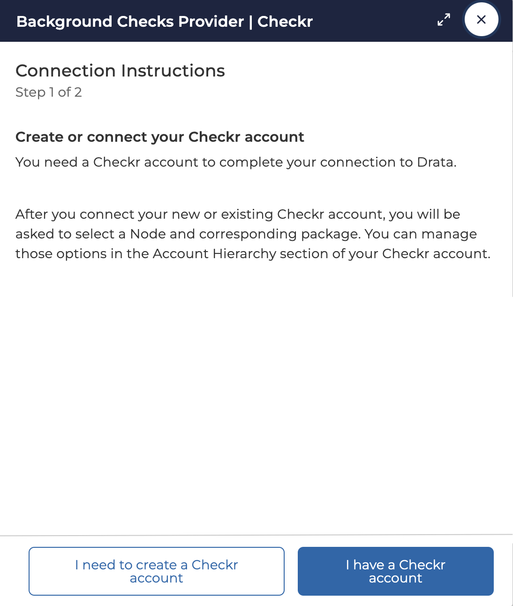
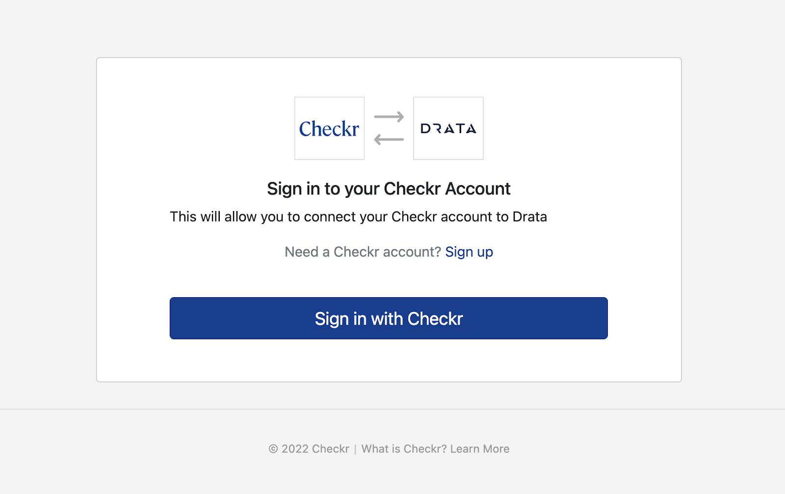
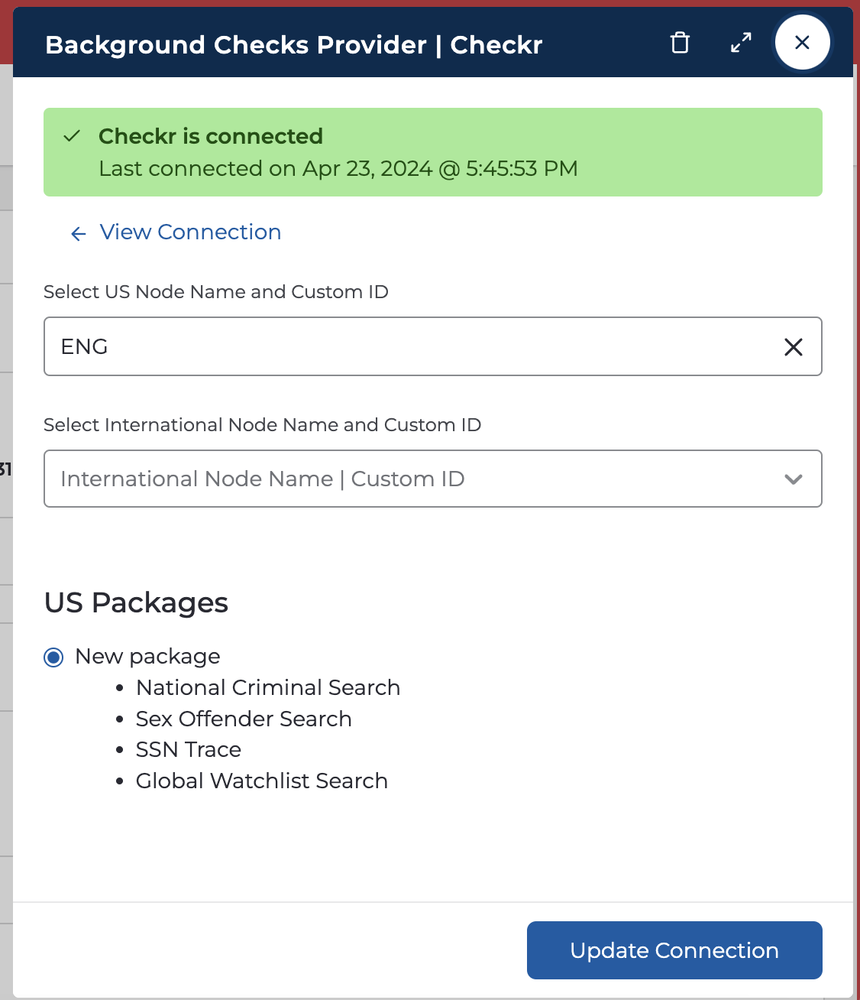
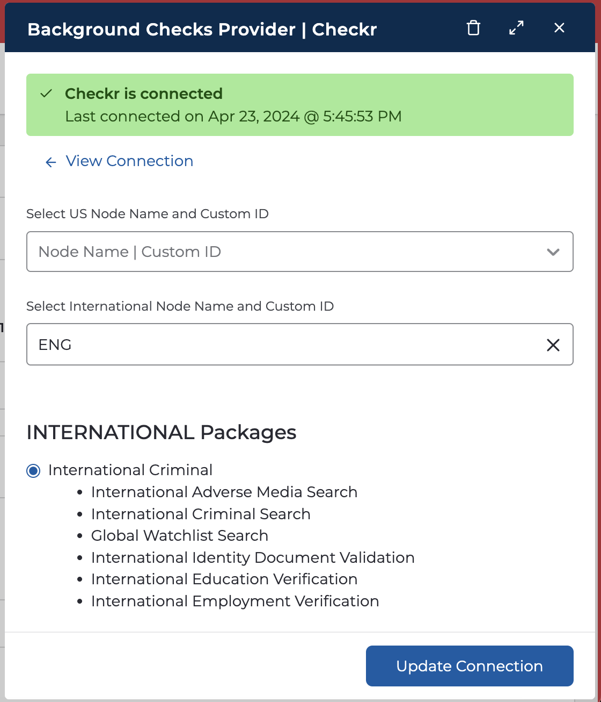
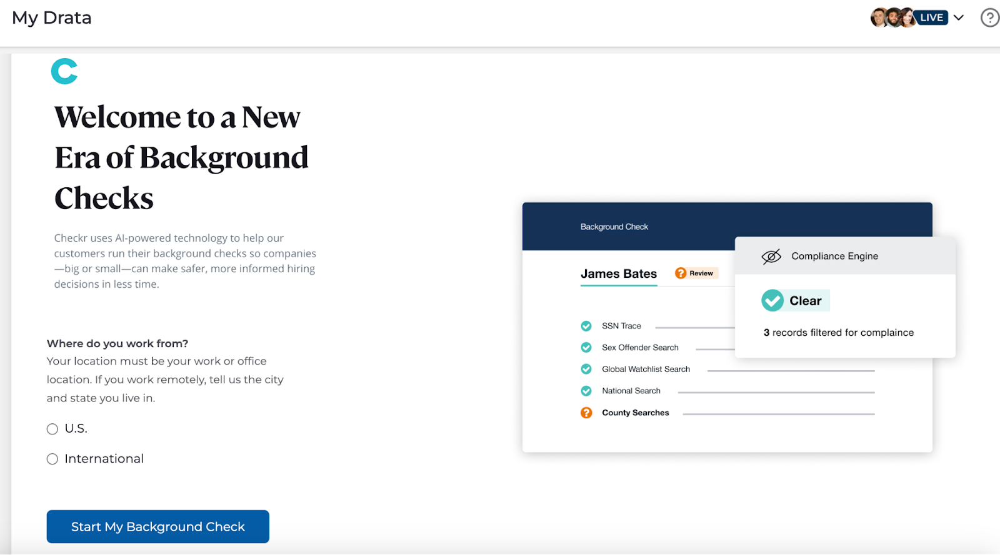

# Checkr Integration Guide

Source: https://help.drata.com/en/articles/5409416-checkr-integration-guide
Collection: Connection Support › Other Guidance
Updated: 2026-08-05
Fetched: 2026-11-22
Description: Making the initial connection to Checkr (BG Checks)

## Article text

By connecting Checkr to Drata, background checks are automatically synced to Drata. These background checks can be linked to the employee and used as evidence that a background check was conducted. You can also choose to give each employee the ability to order a new background check from Checkr during onboarding through **My Drata**. This will appear in the background check section of **My Drata **for your employees.

This integration streamlines compliance tracking by automating the synchronization of background check statuses directly with Drata.

## Prerequisites & Data Access

- Must have **Admin privileges** in your company’s **Checkr account**.
- If you do not yet have a Checkr account, register for one via [Checkr Registration](https://checkr.com).
   - When a new Checkr account is created, background checks cannot be run until the account is credentialed and the integration cannot proceed until that step is completed internally by the Checkr team.
- Your Checkr account must be **credentialed and approved** by Checkr before background checks can be processed.
- If **Account Hierarchy** is not enabled in Checkr, node selection fields will not appear during setup.

### Permissions & Data Table

| **Permission/Scope** | **Why It’s Needed** | **Data Accessed (Read Only)** |  |
|---|---|---|---|
| Background check API access | Enables Drata to retrieve report data from Checkr | Background check reports status and completion events |  |
| Webhook event subscription | Allows Drata to update status in real time | invitation.completed, report.completed events |  |
| OAuth authorization | Authenticates Drata’s access to Checkr | Secure connection between Drata and Checkr dashboard |  |

## Step-by-Step Setup

### Step 1: Enable Checkr in Drata

1. In Drata, go to **Connections** from the left-side navigation menu.
2. Select the **Available Connections** tab.
3. Search for **Checkr** and click **Connect.**
4. In the connection drawer, follow the prompts to begin the **OAuth connection**.
   - If not logged in, you’ll be redirected to the **Checkr Dashboard** login page.
   
5. If you are not already signed in, you will be prompted to log in to your Checkr Dashboard.
   
6. Select the Node that has been set up in your Checkr account for each region (US and International).
   - If you do not want your employees to be able to order a particular regional BG check during onboarding, do not select a node for that region.
   - If Account Hierarchy is not enabled (within Checkr), the node fields is hidden and we only display the packages. Skip and select your packages.
   - Selecting a node and packages only influences your personnel's **My Drata** page for background checks. Drata syncs both US and International BG checks that are found once connection is made.
7. Select the package. If the node selected for a region does not contain any packages, the packages are not populated.
   - An employee initiating a US background check receives the US package selected
   - An employee initiating an International background check receives the International package selected.

### Step 2: Enable International Background Checks

The connection supports international background checks, allowing compliance management for global employees.

### Step 3: Configure Background Check Settings in Drata

> Note: In order for your account to be eligible for "Live" (non-testing) API requests, you might have to contact [clients@checkr.com](mailto:clients@checkr.com) to activate your account.

If you want to allow personnel to initiate new background checks in Drata, select your company's logo in the lower left, and in the fly-out menu, select** Human Resources**.

Under the **Background Checks** section, select the radio button for **Use Checkr for background checks.** View [human resources](https://help.drata.com/en/articles/4779292-human-resources) for more details.

If you do not want personnel to have any view in their My Drata onboarding related to background checks, select the option "We use a different background check solution" and upload background check documents manually for each employee on the Personnel page. This method hides the "Background Check" section for employees and removes the option to initiate new background checks.

### Step 4: Employee Experience in My Drata

When enabled, employees will see a **Background Check** section in their **My Drata** onboarding flow.

1. The employee selects the appropriate background check type (U.S. or International).
2. The employee clicks **Start my Background Check.**
3. An email is automatically sent from Checkr prompting them to complete their background check form.
4. Drata updates employee status in real time using Checkr webhook events:
   - **invitation.completed:** Employee submitted their background check form.
   - **report.completed:** Background check process completed and results received.

### Background check not enabled

If a background check type has not been setup to be enabled, your employees will not be able to order that background check and will be notified that the background check type being initiated is not available.

### Step 5: Verify Synchronization and Display

Drata consolidates multiple background checks for the same individual into a single candidate profile, listing all checks under their profile. This approach ensures organized, non-duplicative data presentation.

### Troubleshooting Non-Compliant Statuses

In rare cases, Drata may not automatically re-evaluate a background check once an initial pass has been recorded. If a background check appears as non-compliant even though it’s clear in Checkr, manually upload the background check evidence to ensure compliance continuity. Our team is refining the synchronization logic to better handle these cases moving forward.

## Partner Offers & Discounts

Drata has direct partnerships with background check providers such as Checkr for **first time and new customers**. Check out [more partner offers and discounts](https://drata.com/partner/find/tech-directory?collections=partner-discountoffers,partner-offers-discounts-pod).

- **Checkr**: Global background checks. Get $100 credit by using the code `DRATA100` when creating your account through Drata. Credit will be applied towards future invoices until exhausted.

## Images

- [image 01] ../../images/integrations/checkr/checkr-integration-guide--01.png
- [image 02] ../../images/integrations/checkr/checkr-integration-guide--02.png
- [image 03] ../../images/integrations/checkr/checkr-integration-guide--03.png
- [image 04] ../../images/integrations/checkr/checkr-integration-guide--04.png
- [image 05] ../../images/ux/personnel/checkr-integration-guide--05.png

## Related articles

- [KarmaCheck Integration Guide](karmacheck-integration-guide.md)
- [Certn Integration Guide (Background Check)](certn-integration-guide-background-check.md)
- [Rippling Integration Guide (HRIS, MDM, UAR)](rippling-integration-guide-hris-mdm-uar.md)
- [BambooHR Integration Guide](bamboohr-integration-guide.md)
- [Background Check Management](background-check-management.md)
