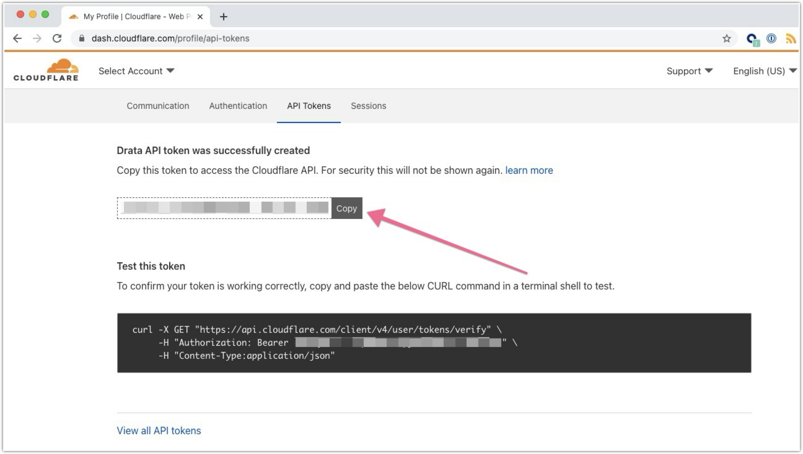

# Cloudflare Integration Guide (Infrastructure and UAR)

Source: https://help.drata.com/en/articles/5455086-cloudflare-integration-guide-infrastructure-and-uar
Collection: Connection Support › Infrastructure Guidance
Updated: 2026-08-05
Fetched: 2026-11-22
Description: Making the initial connection to Cloudflare

## Article text

Connecting Cloudflare to Drata allows Drata to retrieve Cloudflare configuration metadata for Infrastructure and, if enabled, Cloudflare user access information for User Access Reviews.

## Key Capabilities

### Infrastructure

- **Configuration ingestion**: Imports cloud infrastructure metadata
- **Compliance mapping**: Supports infrastructure-related compliance tests
- **Read-only access**: Provides environment visibility without making configuration changes

### User Access Review (optional)

- **Access retrieval**: Retrieves users and assigned roles from connected systems.
- **Review enablement**: Makes this access data available for review in Drata’s Access Reviews feature.
- **Account mapping support**: Allows external accounts to be mapped to Drata personnel for accurate review and tracking.

## Prerequisites & Data Access

- Administrator or Super Administrator access in Cloudflare. Specifically, you'll need the ability to create new roles.
   - If necessary, register for a Cloudflare account at [https://dash.cloudflare.com/sign-up](https://dash.cloudflare.com/sign-up)
- Ability to create a **Custom API Token** with read-only scopes.
- A dedicated service account is recommended.
- Must be assigned one of the following Drata roles: **Admin, Workspace Managers, DevOps Engineer**.
- If you have the **Access Reviewer** Drata role, you can only view the Connections page.

## Permissions & Data Table

| Permission Type | Why It’s Needed | What Drata Reads (Read-Only) |
|---|---|---|
| Custom API Token | Authenticates the Cloudflare integration | Infrastructure configuration, user list, roles (if UAR enabled) |
| Accounts, Zones, Users | Defines which Cloudflare resources Drata can pull data from | Zone configuration, security settings |

## Step-by-Step Setup

### Step 1: Create a Custom API Token

To keep your Cloudflare integration stable and secure, create the API token using a **dedicated service account**, such as `svc-cloudflare@yourcompany.com`, rather than a personal user account.

1. Sign in to the [Cloudflare Dashboard](https://dash.cloudflare.com/login) using the dedicated service account.
2. In the upper-right corner, select your **profile icon**, then select **[My Profile](https://dash.cloudflare.com/profile)** and go to the **[API Tokens](https://dash.cloudflare.com/profile/api-tokens)**.
3. Select **Create Token**, then scroll to the **Custom token** section and select **Get started**.
4. In the **Token name** field, enter a name like `Drata`

Now that you’ve started creating your token, you’ll need to assign the required permissions listed in the next section.

### Step 2: Set the Read Permissions

Drata only needs **read-only** access to verify your Cloudflare configuration. You’ll need to add the permission scopes.

1. In the permissions configuration screen, select **+ Add more** seven times.
2. Use the table below to add the correct **type**, **scope**, and **access level**

| **Type** | **Scope** | **Access** |
|---|---|---|
| Account | Access: Organizations, Identity Providers, and Groups | Read |
| Account | Account Firewall Access Rules | Read |
| Account | Account Settings | Read |
| Zone | Zone Settings | Read |
| Zone | Zone | Read |
| Zone | Firewall Services | Read |
| Zone | Access: Apps and Policies | Read |
| Zone | Zone WAF | Read |
| Users | Memberships | Read |
| Users | User Details | Read |

After setting permissions, you'll choose which Cloudflare accounts and zones the token can access.

### Step 3: Select Accounts and Zones

In this step, define the scope of access for the token. We recommend limiting access to only the accounts and zones you use in production.

In the **Account Resources** section:

- Select **All accounts**, or
- Choose **specific accounts** (recommended).
   - To add more than one account, select the first, then choose + Add more.

In the **Zone Resources** section:

1. In the **Zone Resources** section, select **All zones**, or select **Specific zones** (It is recommended to select specific zones if you use one domain for production).
   - To include multiple specific zones, select the first one, then select **+ Add more**.
2. Leave the **Client IP Address Filtering** and **TTL** settings unchanged.
3. Select **Continue to summary**, then select **Create token**.

### Step 4: Connect inside Drata

1. In Drata, go to the **Connections** page
2. Search for and select **Cloudflare** within your available connections.
3. Start the connections process.
4. Enable **User Access Review** if you desire.
5. During the connection process, paste your **API Token**.

**Expected outcome:**
Drata establishes a connection and begins retrieving Cloudflare data.

## Images

- [image 01] ../../images/integrations/cloudflare/cloudflare-integration-guide-infrastructure-and-uar--01.png

## Related articles

- [GitHub Integration Guide](github-integration-guide.md)
- [Shortcut Integration Guide](shortcut-integration-guide.md)
- [Microsoft 365 Integration Guide](microsoft-365-integration-guide.md)
- [DigitalOcean Integration Guide](digitalocean-integration-guide.md)
- [MongoDB Atlas Integration Guide](mongodb-atlas-integration-guide.md)
