# Compare Policy Versions with AI

Source: https://help.drata.com/en/articles/15436872-compare-policy-versions-with-ai
Collection: Understand the Drata Platform › Policies
Updated: 2026-06-09
Fetched: 2026-11-22

## Article text

When a policy goes through the approval process, understanding exactly what changed from the last published version can be time-consuming and error-prone — especially for teams managing dozens of policies across multiple frameworks. The Policy Version Comparison Summary feature solves this by generating a structured change summary in one click, comparing two versions of the same policy.

The three most common reasons Drata customers use this feature:

1. **Faster approvals**: Approvers can quickly understand the scope of changes without reading the full policy, reducing back-and-forth between policy owners and compliance managers.
   
2. **Audit-ready publishing**: Before publishing an updated policy, compliance managers can generate and insert a change summary so employees know exactly what changed when they're asked to re-acknowledge.
   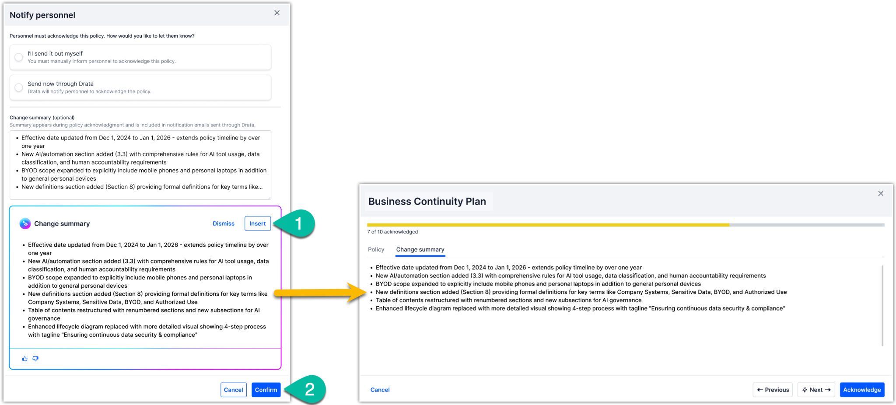
3. **Version history audits**: Compliance teams can pull a structured summary between any two published versions at any time.
   

**Note:**

- This feature is available in the new Drata experience only.
- Your organization must also have the AI settings toggle enabled.

---

## Prerequisites

Make sure the following are in place before using this feature:

- Required Data Roles: Admin, Information Security Lead, Policy Manager or Personnel Compliance Manager.
- AI settings toggle is enabled (navigate to Settings → AI)

Where it is applicable:

| **Scenario** | **Benefit** |
|---|---|
| **Approval workflow** — policy is in Needs Approval or Approved status | Compare the version under review against the currently published version to make an informed approval decision without reading both documents in full. |
| **Version history panel** — viewing any previously published version | Generate a structured change summary between an older published version and the latest published version, useful for audits and periodic policy reviews. |
| **Publish/Notify personnel modal** — publishing an approved policy | Review the AI-generated change summary and decide whether to include it for employees to see when they acknowledge the updated policy in My Drata. |
| **My Drata policy acknowledgement modal** — employee-facing | If a change summary was enabled during publishing, employees see exactly what changed before confirming their acknowledgment. |

---

## Generate a change summary

When you **generate a Change Summary**, in general you get a three-part structured summary:

| **Summary Component:** | **What it shows:** |
|---|---|
| **Executive Summary** | A high-level overview of what changed |
| **Detailed Change Log** | Specific additions, removals, and modifications |
| **Risk/Compliance Notes** | Any compliance implications of the changes |

Learn how to create the policy summary changes in the next few sections.

### Generate from the approval workflow

1. Go to **Governance → Policies**.
2. Select a policy in **Needs Approval** or **Approved** status.
3. **First time only:** In the **Policy** tab, select **Get Started** under the **Speed up your review** section.
   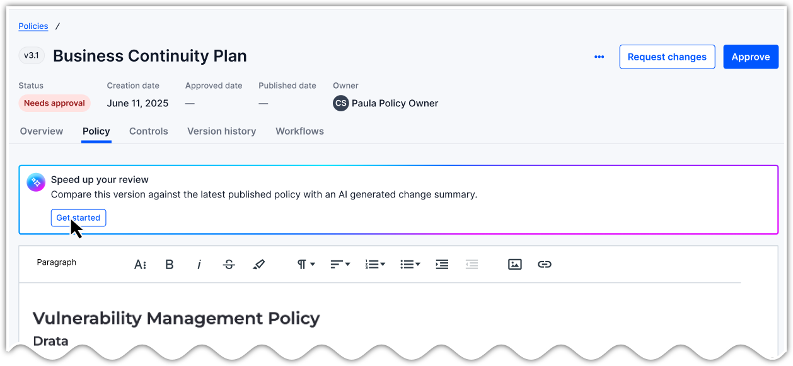
4. **Approve AI use in your Settings page** if you have not done so already.
5. If it is not your first time, Navigate to the **Overview** tab or **Policy** tab and locate the AI card.
   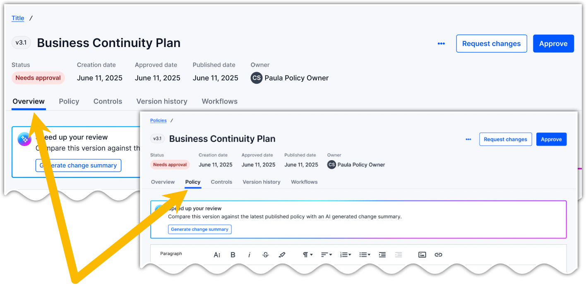
6. Select **Generate Change Summary**.
7. Wait for the summary to load. The page remains usable while the AI generates the result.
8. Review the **Executive Summary**, **Detailed Change Log**, and **Risk/Compliance Notes**.
9. Use the **thumbs up / thumbs down** buttons on the AI card to rate the quality of the summary.

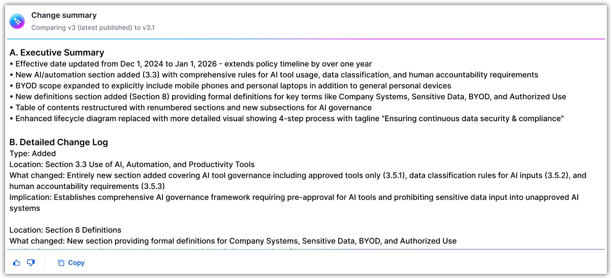

Approving the policies at this point does not send anything to employees or trigger the My Drata acknowledgment flow. This summary is for your review only. It helps you approve, deny, or request changes faster. The My Drata change summary is a separate step that happens during the **Publish flow**.

### Generate from the version history panel

You can compare any previously published version against the latest published version directly from the version history.

1. Go to **Governance → Policies**.
2. Select a policy with existing versions.
3. Open the **Version History** tab.
4. Locate the version you want to compare. You have two ways to trigger the comparison:
   - **From the table row**:
      - Select **Compare to Latest** on the version row.
      - A modal will appear where you confirm which version you want to compare against the most recent published version.
   - **From the ellipsis menu**:
      - Select the **⋯** (ellipsis) next to the version.
      - Then, select **Compare to Latest**.
      - This skips the modal and generates the summary directly.
   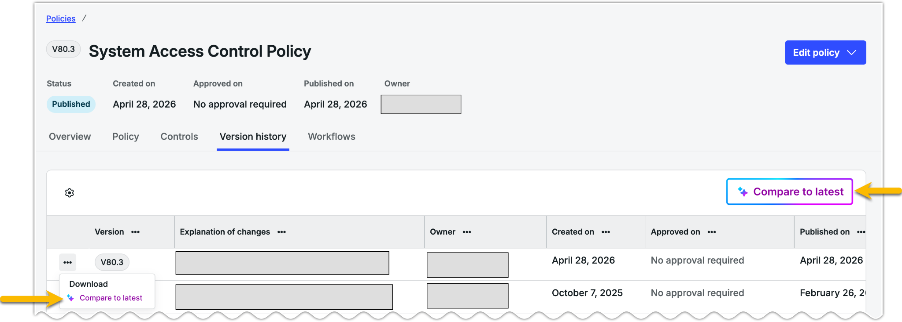
5. A notification will appear confirming the summary is being generated.
   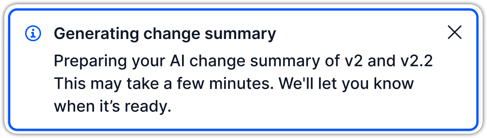
6. Once complete, a second notification will confirm it's ready.
   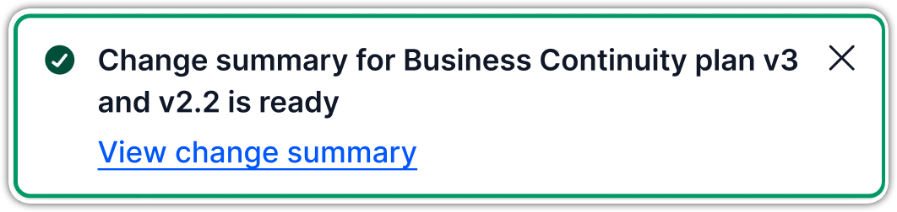
7. Review the **Executive Summary**, **Detailed Change Log**, and **Risk/Compliance Notes** in the AI card.

**Tip:** You can also open the policy version's detail panel and select **Compare to Latest** from there.

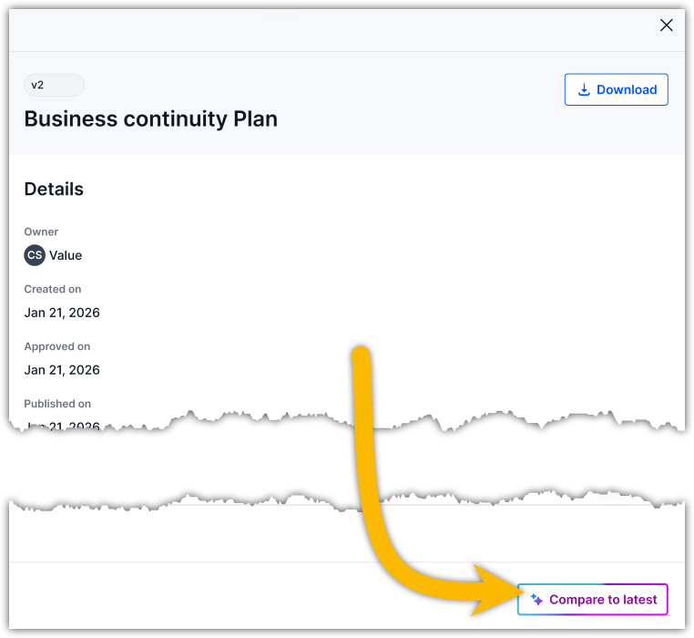

### Generate from the publish flow

1. Go to **Governance → Policies**.
2. Select a policy in **Approved** status.
3. Select **Publish**.
   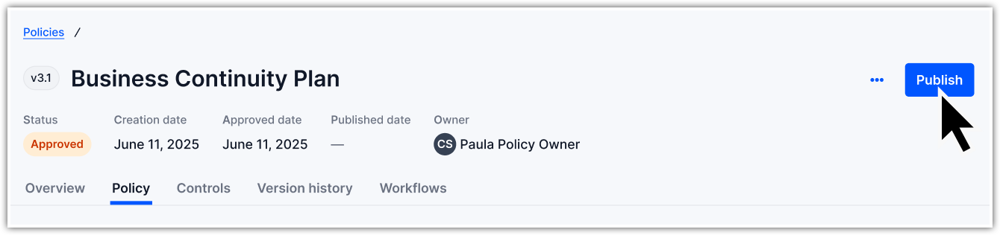
4. From the **Publish/Notify personnel** modal, select **Generate Change Summary**.
   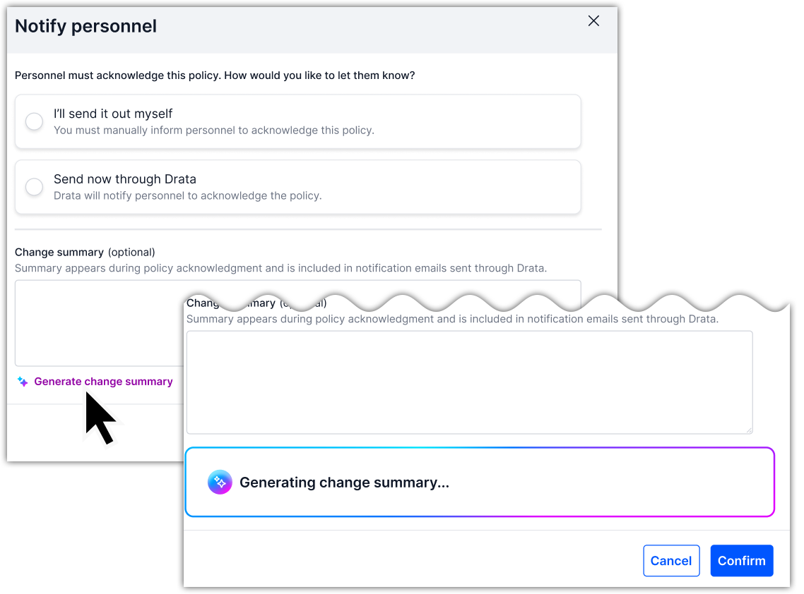
5. Review and optionally insert the summary as the change summary for personnel to see when acknowledging the policy in MyDrata.
   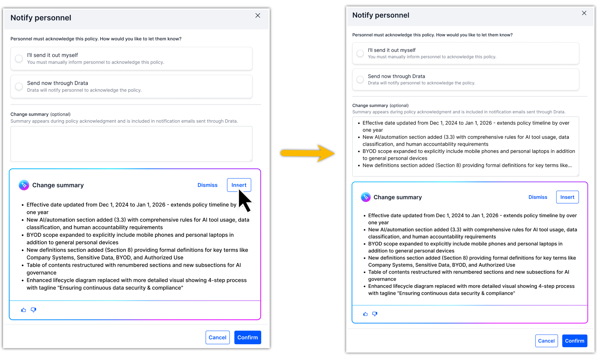
6. When a policy owner inserts a change summary during the publish flow, employees see it in their **My Drata** page when they are prompted to acknowledge the updated policy.
   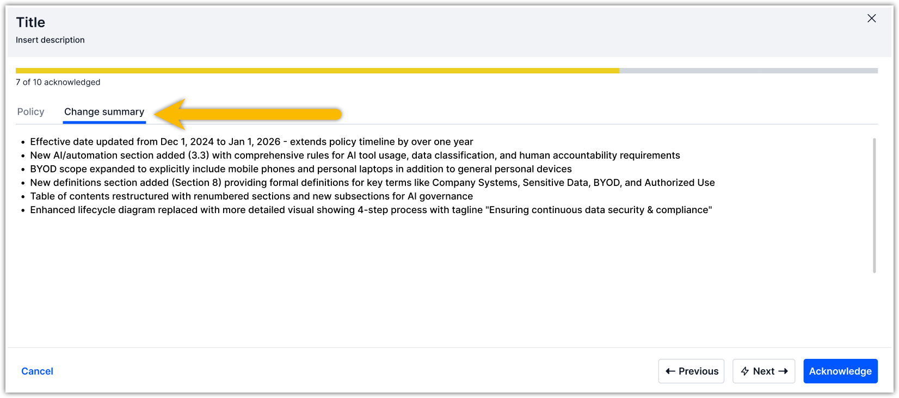

Employees do not trigger the summary themselves — it is surfaced automatically if one was added during publishing.

---

## How stale summaries are handled

If an **Approved** policy is edited after a change summary has been generated, the existing summary is automatically **invalidated**. You will need to generate a new summary after re-finalizing and re-approving the policy.

---

## Roles and permissions

| **Action** | **Who can perform it** |
|---|---|
| Generate a change summary | Admin, Information Security Lead, Policy Manager or Personnel Compliance Manager. |
| View a change summary | Anyone with access to the policy |

## Images

- [image 01] ../../images/ux/policies/compare-policy-versions-with-ai--01.png
- [image 02] ../../images/ux/policies/compare-policy-versions-with-ai--02.png
- [image 03] ../../images/ux/policies/compare-policy-versions-with-ai--03.png
- [image 04] ../../images/ux/policies/compare-policy-versions-with-ai--04.png
- [image 05] ../../images/ux/policies/compare-policy-versions-with-ai--05.png
- [image 06] ../../images/ux/policies/compare-policy-versions-with-ai--06.png
- [image 07] ../../images/ux/policies/compare-policy-versions-with-ai--07.png
- [image 08] ../../images/ux/policies/compare-policy-versions-with-ai--08.png
- [image 09] ../../images/ux/policies/compare-policy-versions-with-ai--09.png
- [image 10] ../../images/ux/policies/compare-policy-versions-with-ai--10.png
- [image 11] ../../images/ux/policies/compare-policy-versions-with-ai--11.png
- [image 12] ../../images/ux/policies/compare-policy-versions-with-ai--12.png
- [image 13] ../../images/ux/policies/compare-policy-versions-with-ai--13.png
- [image 14] ../../images/ux/personnel/compare-policy-versions-with-ai--14.png

## Related articles

- [Annual Compliance Review](annual-compliance-review.md)
- [Policy Center Overview](policy-center-overview.md)
- [View and edit a policy](view-and-edit-a-policy.md)
- [Manage policy renewals](manage-policy-renewals.md)
- [General AI Policy](general-ai-policy.md)
