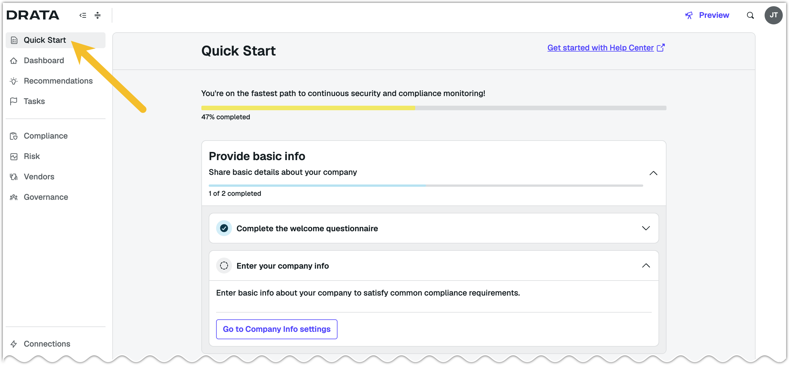
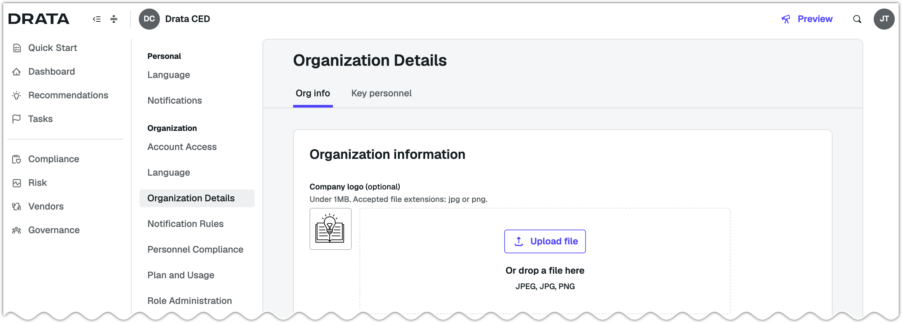

# Complete the Provide Basic Info task in Quick Start

Source: https://help.drata.com/en/articles/16915146-complete-the-provide-basic-info-task-in-quick-start
Collection: Understand the Drata Platform › Quick Start
Updated: 2026-09-15
Fetched: 2026-11-22
Description: Learn which fields and documents complete the Provide Basic Info task.

## Article text

The Provide Basic Info task is marked complete after you finish entering your organization details.

## Before you begin

You must be a Drata Admin to access Quick Start.

### Complete every field in Organization Details page

Fill out every field in the **Org info tab** within the **Organization Details** page, including fields labeled **optional** to complete the **Enter your company info ** task.

Some fields, such as **Account ID**, **SafeBase Organization ID**, and **Data residency location**, may be system-generated or prefilled. Complete these fields only if Drata allows you to edit them.

**Important:** Although some fields are labeled **optional**, complete every editable field on the page so the **Enter your company info** task can be completed.

## Images

- [image 01] ../../images/ux/home/complete-the-provide-basic-info-task-in-quick-start--01.png
- [image 02] ../../images/ux/settings/complete-the-provide-basic-info-task-in-quick-start--02.png

## Related articles

- [ClickUp Integration Guide](clickup-integration-guide.md)
- [Quick Start Guide](quick-start-guide.md)
- [Manage tasks in Drata](manage-tasks-in-drata.md)
- [Bulk Import Custom Tasks](bulk-import-custom-tasks.md)
- [TPRM Agent: Trust Center Document Collection](tprm-agent-trust-center-document-collection.md)
