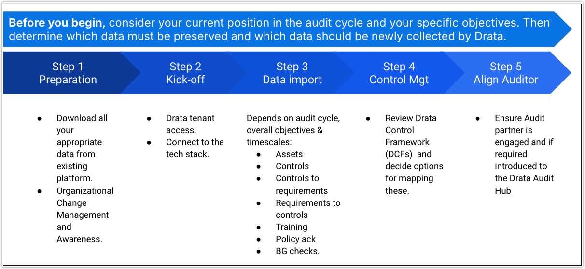

# Compliance Program Migration Best Practices

Source: https://help.drata.com/en/articles/10371583-compliance-program-migration-best-practices
Collection: Getting Started › Helpful Resources
Updated: 2026-08-27
Fetched: 2026-11-22
Description: Structured steps for migrating to Drata.

## Article text

No two businesses are exactly alike, and neither are your GRC programs. While there’s no universal method for migrating your compliance program, these best practices aim to make the process smoother.

## Step 1: Prepare to Migrate

### Download all your compliance data

If your current access will expire before you begin with Drata, export all data and evidence. You own this information and may need it later for reference or upload.

### Organizational Change Management and Awareness

Your GRC program involves stakeholders across your organization. For example, your CEO approves policies while employees and contractors acknowledge them. Make sure key stakeholders understand how migration changes where and how the program is managed. Not everyone manages the day-to-day, but key stakeholders should know how Drata improves operations.

## Step 2: Begin with Drata

### Access your Drata tenant

When you access your Drata tenant for the first time, the in-app welcome experience guides you through the onboarding steps. Your first task is to connect your in-scope systems to Drata.

### Connect Tech Stack

These connections are required before you configure controls or evidence. They also power Drata’s automated monitoring tests. Once connected, Drata runs tests the same day to detect any configuration gaps so you can begin remediating failed tests and take action in your environment. Automated monitoring runs daily to support continuous compliance, not just during audits.

For a current list of integrations, visit [drata.com/integrations](http://drata.com/integrations).

## Step 3: Import Data and Configure Controls

You can import data into Drata through direct uploads, CSV import templates, or self imports.

1. **Direct Upload:** Best for small, frequent updates.
2. **CSV Import Templates:** Ideal for large-scale migrations.
3. **Self-service imports:** Recommended for fast, independent data handling.

### CSV Import Templates

To request templates, contact Technical Support via in-app chat.

Each template includes the required fields in the exact format needed to import your data into Drata. Templates contain a header row, followed by a second row with instructions and examples indicating which fields are required or optional. You can delete or replace the second row with your data, but the header row must remain unchanged. Header values must match exactly, as Drata validates them during the import process.

After you complete and submit the template, our team reviews them for accuracy. Once approved, the template is processed and uploaded. This process typically takes five to ten business days.

#### Supported Data Types

The following list outlines the types of data you can import into Drata using the template, along with key requirements for each.

- **Assets**
   - The owner of the asset can be any current employee listed in Drata. This use case is specific to populating the **Assets page** with data Drata does not automatically import, such as virtual assets from GCP, globally deployed software, or other IT inventory.
   - You can also use this template to request a bulk change of existing asset ownership.
- **Controls**
   - Drata includes pre-mapped controls for supported frameworks.
   - Use this template to create new controls in Drata.
- **Controls-to-Requirements**
   - Use this template to map controls to requirements that already exist in Drata.
- **Requirements-to-Controls**
   - Use this template to map requirements that already exist in Drata to controls that already exist in Drata.
- **Controls-to-Owners**
   - We strongly recommend using the platform’s built-in bulk control ownership management. If you choose to use this import template, it must map controls that already exist in Drata to users that already exist in Drata. To learn more about control owners, refer to [control ownership](https://help.drata.com/en/articles/5633393-control-owners).
- **Security, HIPAA, and/or NIST Training**
   - Proof of completion files must be submitted as standalone documents. If submitting multiple files, compile them into a single ZIP file.
- **Policy Acknowledgement**
   - Policies must be active, approved, and assigned to relevant employees or groups before uploading acknowledgements.
- **Background Checks**
   - Drata does not accept or host raw background check files. Provide links to background check records hosted in your system of record or a secure document repository.

**Note**: If you have elements of your compliance data or evidence that you plan to migrate into Drata and do not see them listed above, this is generally because Drata provides a built-in platform feature for managing them once you have access to your tenant. If you have questions about the options for migrating or managing your data, contact Technical Support via in-app chat or reach out to your Drata Account Team.

### Self-service bulk import (New Drata Experience)

Use **Bulk import** in the New Drata Experience to upload data for **Controls, Risks, Personnel Trainings, and Background Checks**.

1. **Open the relevant page in the New Drata Experience**
   - For example, go to **Governance → Personnel** for people-related imports, or to your **Controls** or **Risks** table for those data types.
2. **Open the Bulk import menu**
   - In the table toolbar, select the **More actions** (three dots) menu.
   - Choose **Bulk import**, then select the specific data type you want to import (for example, **Controls**, **Risks**, **Trainings**, or **Background checks**).
3. **Upload or start from the in-app sheet**
   - Upload a **CSV or Excel** file, or start with the in-app spreadsheet and paste/type your data directly.
   - Drata parses the file and displays your rows in a spreadsheet-like grid.
4. **Map your columns to Drata fields**
   - For each column, map the **incoming field** in your file to a **destination field** in Drata.
   - All **required** destination fields must be mapped before you can continue.
5. **(Optional) Map field values**
   - If your file uses custom labels (for example, custom status names) that differ from Drata’s internal values, map those values so they import correctly.
6. **Review and fix validation errors**
   - Drata validates each row and cell against field rules (for example, required fields, valid dates, valid URLs).
   - Cells with errors are highlighted; you must correct or remove invalid rows before you can submit.
7. **Submit the import**
   - When all rows are valid, review the summary and confirm the import.
   - Drata writes the validated records in a single transaction—either the **entire batch succeeds or none of it is applied**, so you don’t end up with partial imports.

**Note:** Some bulk imports have additional prerequisites (for example, New Drata Experience enabled, specific roles, or existing personnel records). Check the data-type specific documentation:

- [Background Check Bulk Import](bulk-import-personnel-background-checks-new-experience.md)
- [Training Record Bulk Import](bulk-import-personnel-training-records-new-experience.md)
- [Control Bulk Import](import-controls-in-bulk-new-experience.md)
- [Risk Bulk Import](import-risk-in-bulk-new-experience.md)

## Step 4: Control Management

Drata has its own control framework, referred to as the DCF (Drata Control Framework). This framework was developed with auditors and compliance experts and is based on best practices. Within the Drata UI, these controls can be adjusted to meet your specific compliance and business requirements.

### Have your own controls?

If you have your own controls, you have several options:

- Opt to move to the DCF by adopting all Drata controls.
- Compare your current controls to the DCF and determine the overlap or edits needed in the UI.
   - After identifying gaps, manually add the remaining controls in the Drata UI.
   - Alternatively, use the Drata import templates to format and upload additional controls.
- Request to disable the DCF and import only your custom controls using the Drata template. This option is available, though not recommended, as it limits the value of compliance automation. Contact your Account Team to enable this option.

### Important Considerations

1. A major advantage of using DCF controls is that they are already pre-mapped to the appropriate policies and control tests. If you upload custom controls, you must manually map policies and control tests.
2. When uploading custom controls, identify the DCF controls they replace and mark those out of scope to avoid duplication.
3. All DCF control fields are customizable except the control code (e.g., you cannot change DCF-46 to ABC-xx). If you need to preserve your existing control codes, import them as custom controls.

## Step 5: Policy Management

The **Policies page** allows you to manage policy authoring, revisions, annual reviews, control mapping, and employee acknowledgement. Drata provides a comprehensive set of policy templates based on industry best practices developed by compliance experts and auditors. You can customize these policy templates to meet your specific needs.

### Policy Migration Options

To use the policies you already have, you can:

- **Author Policy in Drata (Recommended)**: Start with a blank template and copy in your existing content. This option allows you to edit and update the policy directly in the platform without needing to re-upload it each time.
- **Upload Policy**: Import your policy as a PDF. This is the best option if you want to retain your branding or logos. However, PDFs cannot be edited within Drata, so you must re-upload a new file for each revision.

**Note**: If your policy matches the title or general content of a Drata template, use the **Replace Policy** feature. This archives the original template and applies its control and control test mappings to your uploaded version.

## Step 6: Auditor Alignment

Drata is auditor agnostic. If you are already working with an auditor, the Drata Auditor Alliances team will work with both you and your auditor to train them on how to use Drata’s Auditor Hub and support them during the audit, especially if they are new to the platform.

If you do not yet have an auditor, the Audit Alliance teams at Drata can provide guidance and make introductions. Drata also offers an Auditor Directory that customers can use to locate an auditor.

## Images

- [image 01] ../../images/documentation/compliance-program-migration-best-practices--01.png

## Related articles

- [Custom Framework](custom-framework.md)
- [NIST SP 800-53 (Rev. 5) Control & Policy Mapping Updates](nist-sp-800-53-rev-5-control-policy-mapping-updates.md)
- [SOC 2 Checklist](soc-2-checklist.md)
- [Organization settings: Organization Details (New Experience)](organization-settings-organization-details-new-experience.md)
- [Map audit requests to DCF controls with AI](map-audit-requests-to-dcf-controls-with-ai.md)
