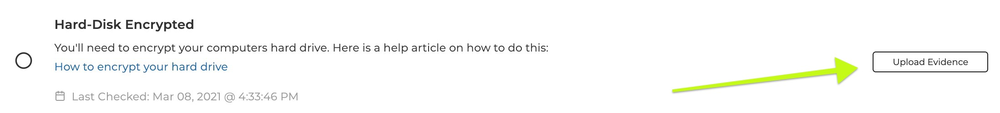
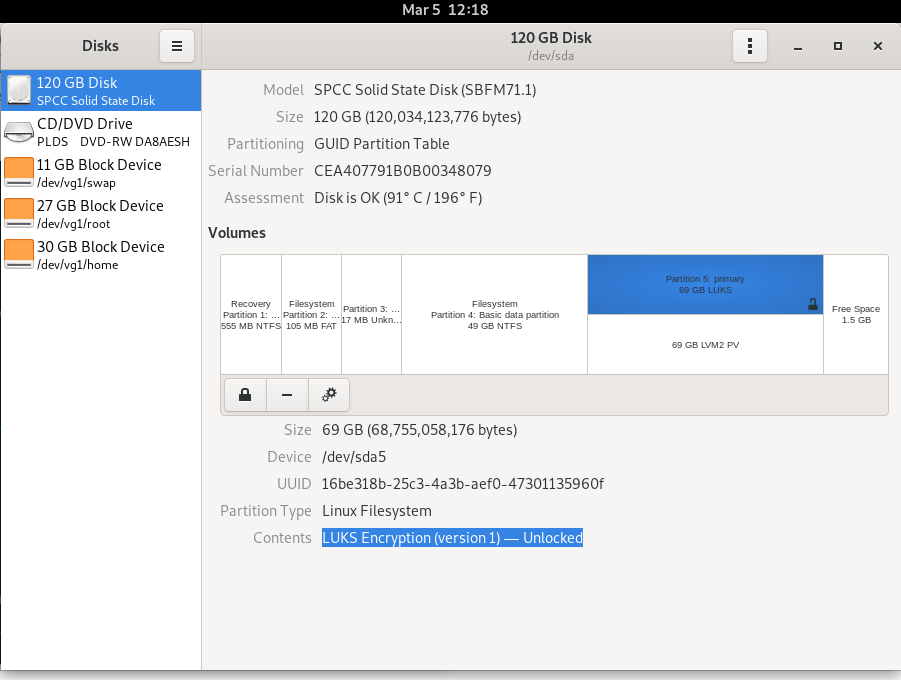
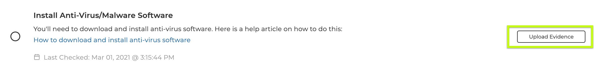
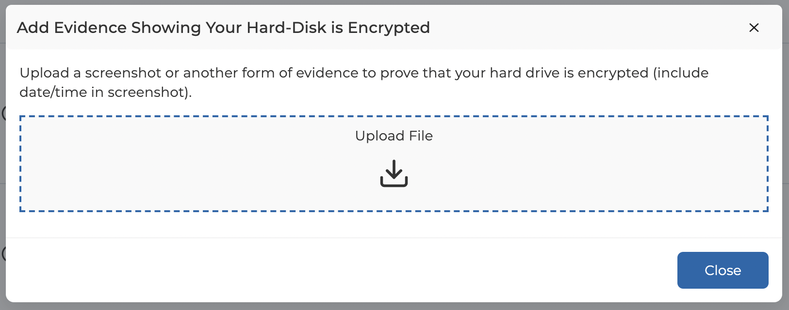
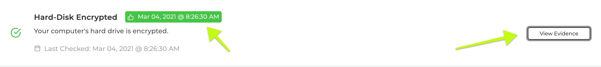

# Computer Configuration via Ubuntu Linux

Source: https://help.drata.com/en/articles/5014509-computer-configuration-via-ubuntu-linux
Collection: Personnel Management › Drata Agent
Updated: 2026-08-05
Fetched: 2026-11-22

## Article text

**HERE'S WHY**

The Drata agent is a lightweight application that lives in your computer's toolbar. This application is granted **READ ONLY** access to your system preferences to help ensure proper security configurations are set - such as screensaver locking, password manager, antivirus software and automatic updates are enabled. These security configurations are required for SOC 2 compliance. The agent runs every day.

For those using Ubuntu Linux, you will need to manually upload evidence of your hard drive encryption. Admin users can manually upload evidence for employees on the Personnel page or employees can manually upload evidence themselves in myDrata. You can [configure your Internal Security settings](https://help.drata.com/en/articles/4779821-internal-security) to give this ability to your employees.

NOTE: Drata agent auto updates are supported for Linux devices as of v3.5 and earlier. If you installed the Drata Agent on an Ubuntu system, Ubuntu operating systems will automatically update the agent to the latest version, starting with version 3.6. All the updates are required. An update notification informs you that an update is available and requests your permission to proceed with the update.

**HERE'S HOW**

Once you [install the Drata agent](https://help.drata.com/en/articles/5002305-installing-the-drata-agent-via-windows-os), you will see a list of items you need to show proof of under 'Configure your computer'. **The agent will pick up your password manager, automatic updates, antivirus software and screen saver lock**. If you do not see a green check mark next to one of these steps saying it is complete, you will see a blue link under the step which will guide you to make the update.

**NOTE: The Drata agent runs every day so you will not see the items automatically turn green after making the update.**

On Ubuntu Linux, you will need to **upload evidence to show that your hard drive is encrypted**. Be sure to include a time and date stamp in the screen shot. See example screen shot below:

You will then click 'Upload Evidence' next to the appropriate configuration step.

A modal will open up prompting you to upload a file. This is where you load your screenshot.

You will upload the file and click 'Close'. You will then see the step is completed and you have the ability to view the evidence.

## Images

- [image 01] ../../images/ux/personnel/computer-configuration-via-ubuntu-linux--01.jpg
- [image 02] ../../images/documentation/computer-configuration-via-ubuntu-linux--02.png
- [image 03] ../../images/ux/personnel/computer-configuration-via-ubuntu-linux--03.png
- [image 04] ../../images/ux/personnel/computer-configuration-via-ubuntu-linux--04.png
- [image 05] ../../images/ux/personnel/computer-configuration-via-ubuntu-linux--05.jpg

## Related articles

- [Encrypting your Computer's Hard Drive](encrypting-your-computer-s-hard-drive.md)
- [Configure your computer for installing  Anti-Virus Software](configure-your-computer-for-installing-anti-virus-software.md)
- [Computer Configuration via Windows OS](computer-configuration-via-windows-os.md)
- [1Password Device Trust (Kolide) Integration Guide](1password-device-trust-kolide-integration-guide.md)
- [Install the Drata Agent](install-the-drata-agent.md)
